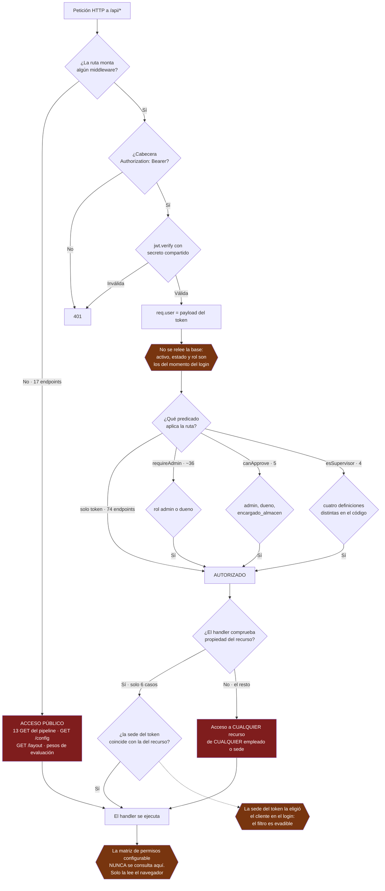
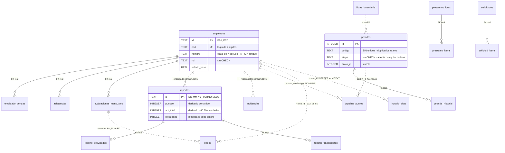
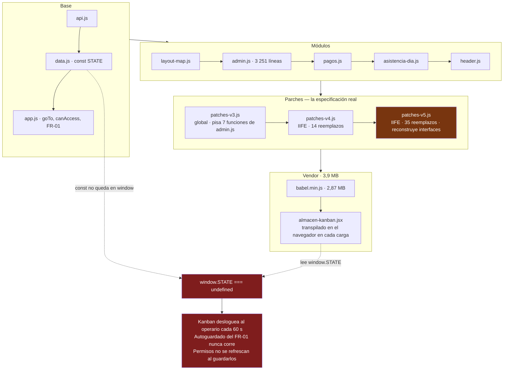
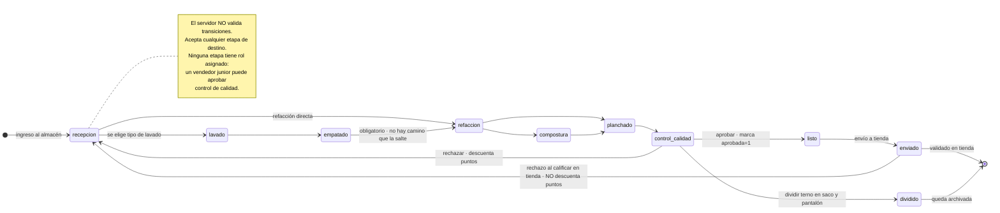
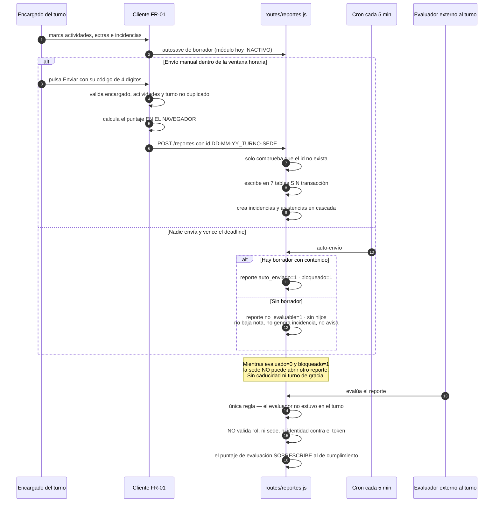
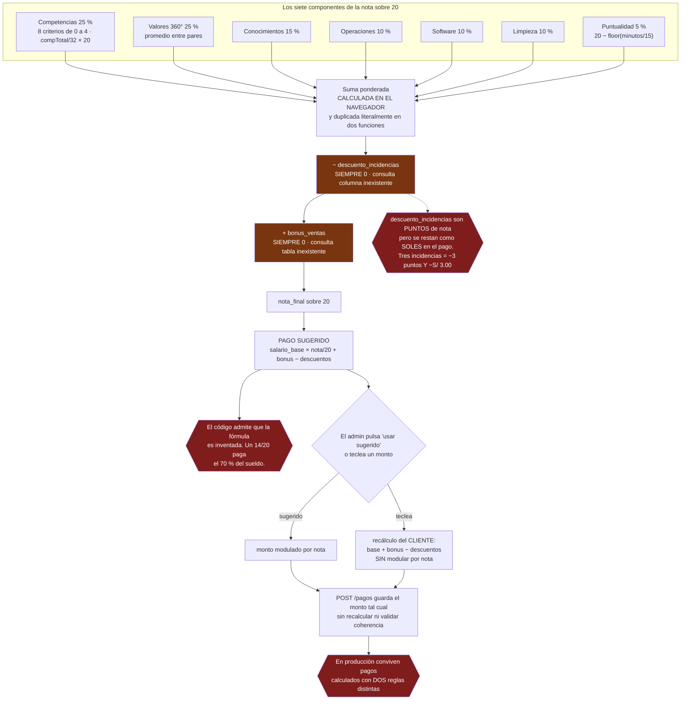
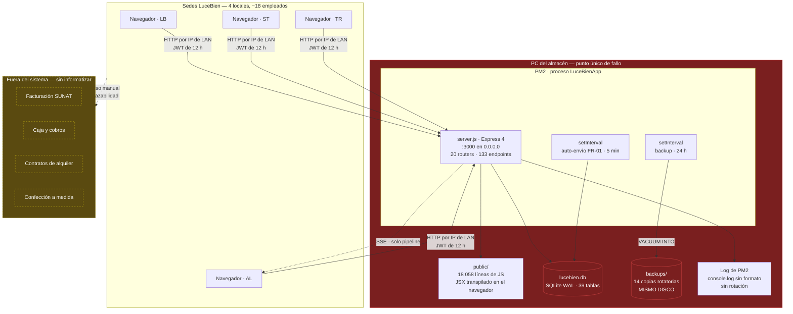

# Informe de inspección del sistema viejo — SCI-LB (LuceBien)

**Fecha:** 13 de agosto de 2026
**Alcance:** el ERP interno legacy de Confecciones Aliaga E.I.R.L. — `server.js`, `middleware/`,
`routes/` (20 archivos), `public/` (frontend completo) y `database/`. Quedan fuera `apps/erp-web`,
`packages/` y los worktrees de trabajo, que pertenecen al sistema nuevo.
**Propósito:** describir cómo funciona realmente el sistema actual, con sus reglas, sus flujos y sus
defectos, para que el sistema nuevo lo reemplace con conocimiento de causa en lugar de reinventarlo.

Este documento es la síntesis. El detalle completo, con inventario de endpoints, catálogo de tablas
y hallazgos numerados, está en los cinco anexos de esta misma carpeta:

| Anexo | Contenido | Extensión |
|---|---|---|
| [01 — Backend y autorización](01-backend-y-autorizacion.md) | 133 endpoints inventariados, modelo de auth, crons, 33 hallazgos | 1 156 líneas |
| [02 — Modelo de datos](02-modelo-de-datos.md) | 39 tablas, diagrama entidad-relación, claves de `config`, 42 hallazgos, mapeo a Postgres | 1 380 líneas |
| [03 — Frontend](03-frontend.md) | 23 vistas, arquitectura real, los tres `patches`, 32 hallazgos | 579 líneas |
| [04 — Reglas de negocio y flujos](04-reglas-de-negocio-y-flujos.md) | 9 procesos documentados, 12 diagramas, 44 reglas ambiguas | 1 847 líneas |
| [05 — Operación y brechas](05-operacion-y-brechas.md) | Despliegue, pruebas, observabilidad, tabla priorizada de 25 brechas | 1 075 líneas |

---

## 1. Resumen ejecutivo

El sistema viejo hace bien aquello para lo que fue construido: llevar la operación interna de cuatro
sedes y dieciocho personas. Registra el reporte diario por turno, mueve las prendas por el pipeline
de lavandería, acumula puntos de productividad, calcula evaluaciones mensuales y liquida pagos al
personal. Lleva más de un año en producción, recibe escrituras todos los días y es el sistema de
registro real de la empresa.

Dicho eso, la inspección arroja tres conclusiones que conviene no suavizar.

**La primera es que el sistema no tiene control de acceso real.** El modelo de permisos —veintidós
módulos por siete roles— vive íntegramente en el navegador. El servidor solo distingue dos niveles:
token válido y administrador. Once de los veinte routers no verifican absolutamente nada, y de los
133 endpoints solo seis comprueban que el recurso solicitado pertenezca a quien lo pide. En la
práctica, cualquier persona con una sesión abierta puede leer el sueldo, el DNI y la nota de
cualquier compañero, imputar una falta a quien quiera con los puntos que decida, reescribir los pesos
de puntos del pipeline y marcar como devuelto el depósito de garantía de cualquier cliente.

**La segunda es que el dinero y las notas se calculan en el navegador.** El puntaje del reporte
diario, la nota mensual sobre 20 y los importes en soles de los trabajos extra se computan en
JavaScript de cliente y el servidor los persiste tal como llegan, sin revalidar. La fórmula del pago
—salario base multiplicado por la nota sobre 20— está declarada como provisional en un comentario del
propio código, nunca fue confirmada por el dueño, y además el frontend aplica una fórmula distinta
que no modula por nota. En producción conviven pagos calculados con dos reglas diferentes.

**La tercera es que el sistema falla en silencio por diseño.** Hay 173 bloques `catch` vacíos; en
`routes/` eso es cerca de cuatro de cada diez. La decisión es deliberada y consiguió su objetivo —el
servidor casi nunca se cae—, pero el precio se puede medir: el descuento por incidencias consulta una
columna que no existe y el bonus de ventas una tabla que tampoco, ambos dentro de `catch` vacíos, de
modo que llevan meses devolviendo cero sin que nadie lo notara. Nadie ha sido penalizado por
incidencias ni bonificado por ventas, nunca, aunque las pantallas digan lo contrario.

A eso se suma una cuarta observación de otra naturaleza: el sistema informatiza cómo trabaja la
gente, no cómo la empresa gana dinero. No conoce clientes, ni pedidos, ni caja, ni comprobantes. Las
palabras `alquiler`, `confeccion` y `SUNAT` no aparecen ni una vez en el código legacy. La mitad de
la empresa que factura no está informatizada aquí.

---

## 2. El sistema en números

| Dimensión | Medida |
|---|---|
| Backend | `server.js` + 20 routers · 4 891 líneas · **133 endpoints** |
| Frontend | 17 archivos JS + 1 JSX + `index.html` · **18 058 líneas** · ~1,1 MB |
| Vendor auto-alojado | 3,9 MB, de los cuales `babel.min.js` son 2,87 MB |
| Base de datos | SQLite en modo WAL · **39 tablas** · 880 KB + 4,1 MB de journal |
| Endpoints sin autenticación | **17** |
| Endpoints con "cualquier token válido" | **74** |
| Endpoints que verifican propiedad del recurso | **6** |
| Bloques `catch` vacíos | **173** (99 en `routes/`) |
| Pruebas automatizadas | **0** · sin linter, sin CI que cubra el legacy |
| Relaciones pseudo-FK por nombre TEXT | **7 documentadas**, más de 10 columnas adicionales sin cascada |
| Último cambio en `routes/` o `public/js/` | 10 de mayo de 2026 (código congelado) |

El código está congelado desde mayo, pero sigue siendo el sistema de registro vivo. Esa combinación
—congelado y en producción— es lo que hace que la falta de pruebas sea un riesgo latente en vez de
un problema diario: no hace daño mientras nadie lo toque, y se vuelve grave el día que haya que
arreglar algo con urgencia.

---

## 3. Los cinco hallazgos estructurales

Estos cinco no son defectos puntuales sino patrones que atraviesan todo el sistema. Cada uno de
ellos es una decisión de arquitectura que el sistema nuevo debe invertir explícitamente.

### 3.1 La seguridad es cosmética

El árbol real de decisión de una petición autenticada es este:

Tres detalles agravan el cuadro. El secreto que firma los tokens está escrito en el código
versionado, repetido en catorce archivos, y el valor del `.env` de producción resultó ser idéntico a
ese literal: cualquiera con acceso al repositorio puede firmarse un token de administrador. El login
por código de cuatro dígitos no tiene límite de intentos y compara el código contra su propio hash,
lo que reduce el espacio a diez mil combinaciones — y ni siquiera hace falta probarlas, porque el
endpoint que lista empleados devuelve esos códigos a cualquier cliente. Y la sede que va dentro del
token la elige el cliente en el formulario de login, sin cotejarla contra las sedes asignadas al
empleado, aunque el código las consulte dos líneas antes.

### 3.2 La lógica de negocio vive en el cliente

El servidor es, en la mayor parte del sistema, una capa de persistencia sin criterio. Escribe lo que
le mandan.

| Qué se calcula en el navegador | Qué hace el servidor |
|---|---|
| Puntaje del reporte diario FR-01 | Lo inserta tal cual |
| Puntaje de la evaluación del reporte | Lo inserta tal cual, y sobrescribe con él el puntaje original |
| Nota mensual sobre 20, con los siete componentes ponderados | La inserta tal cual |
| `monto_total` de los trabajos extra remunerados | Lo inserta sin contrastar con el catálogo |
| Ventanas horarias del FR-01 (8:00 / 15:00 / 23:00) | No las revalida |
| Transiciones válidas del pipeline | Acepta cualquier etapa de destino |
| Identidad del evaluador | La toma del cuerpo de la petición, no del token |

La consecuencia práctica es que todas las reglas del sistema son eludibles con una petición
construida a mano, y que la especificación real del negocio está repartida entre archivos de
JavaScript de navegador — en varios casos duplicada literalmente, como la fórmula de la evaluación
mensual, que aparece dos veces en `public/js/admin.js` con el mismo cálculo copiado.

### 3.3 El silencio como política de errores

El principio declarado del proyecto es que la estabilidad del servidor es prioridad absoluta y que
toda ruta nueva va en `try/catch`. Funcionó: el servidor casi nunca se cae. Pero la implementación
dejó 173 `catch` completamente vacíos, y varios de ellos no protegen un `ALTER TABLE` idempotente
sino un cálculo de negocio.

Los casos verificados con consecuencias reales:

- El descuento por incidencias de la evaluación mensual consulta `incidencias.emp_id`, columna que no
  existe. Devuelve siempre 0.
- El bonus de ventas consulta la tabla `ventas`; la tabla real se llama `ventas_metas`. Devuelve
  siempre 0.
- El cálculo de puntos del pipeline en el módulo de ventas responde 200 con `puntos: 0` si la
  consulta falla: el empleado ve su bonificación en cero sin ninguna señal de error.
- El router de asistencias se monta dentro de un `catch` vacío sin log. Si no carga, todo el módulo
  devuelve 404 y nada en el arranque lo menciona.

Hay además un error conocido en los logs de producción —`[Pipeline] no such column: AL`— cuyo origen
nadie ha podido localizar, precisamente porque el log no registra ni endpoint, ni usuario, ni
petición.

### 3.4 El modelo de datos no protege nada

SQLite está en modo WAL con `foreign_keys = ON`, pero las restricciones que importan no están
declaradas. `prendas.codigo`, que es la clave de negocio y el vínculo con el objeto físico, no tiene
`UNIQUE`: ya hay duplicados reales en la base (`SIN CODIGO` tres veces, `SL-360`, `LB-105` y
`ALB-800` dos veces cada uno). Las etapas del pipeline, los turnos y los estados no tienen `CHECK`:
son texto libre. Los valores derivados se persisten en vez de calcularse, y ya divergieron: cuarenta
de los 934 reportes tienen un `act_total` distinto del conteo real de sus actividades.

Las relaciones se hacen por nombre de texto en siete tablas, con un renombrado en cascada que cubre
solo parte de las columnas afectadas — quedan al menos diez más sin cubrir, entre ellas
`pagos.registrado_por` y `solicitudes.solicitante`. Y `empleados.nombre` tampoco es único, mientras
el login acepta coincidencia por prefijo de nombre.

Un caso merece mención aparte porque es una bomba de relojería: `horarios`, `horario_slots` y
`ventas_metas` declaran `emp_id INTEGER` mientras `empleados.id` es TEXT (`E01`, `E02`…). Las 46
filas existentes guardan texto en una columna entera; `parseInt('E01')` devuelve `NaN` y el cálculo
de horas mensuales devuelve cero para todos. SQLite lo tolera. Postgres no: en la migración esto es
un error duro que hay que resolver antes del ETL.

### 3.5 El frontend es tres sistemas superpuestos

No hay bundler, ni router, ni store. Las 23 vistas viven en un único `index.html` de 2 106 líneas y
la navegación es una función con veintiocho `if` encadenados. El estado real está en el DOM: 1 161
llamadas a `getElementById` y 583 manejadores `onclick` en línea. La reactividad se simula con un
temporizador que compara una firma del usuario cada 800 milisegundos, y hay ocho temporizadores
globales corriendo en paralelo.

Sobre esa base están los tres archivos `patches-v3/v4/v5`. No son parches: contienen comportamiento
de producción que no existe en ningún otro lugar. `patches-v5.js` reescribe en caliente el DOM del
formulario de login —dejando muerta la función `doLogin` original—, reemplaza por completo la
pantalla de Configurar Accesos y aporta la importación de horarios desde Excel y el catálogo de
tipificaciones de incidencias. `patches-v3.js` contiene el editor de layout completo y toda la regla
de frecuencia de actividades. `patches-v4.js` aporta la interfaz de evaluación por emoji.

**Cualquier reescritura que no lea estos tres archivos perderá funciones en silencio**, porque las
versiones "originales" que quedan en `app.js` y `admin.js` son anteriores y en varios casos ya ni
siquiera funcionan contra el DOM actual.

Hay además un defecto de una línea con consecuencias desproporcionadas: `data.js` declara
`const STATE`, y una constante de nivel superior no queda como propiedad de `window`. Por eso
`window.STATE` nunca existe. Eso desactiva por completo el módulo de autoguardado y auto-envío de
borradores del FR-01 —código muerto que nadie sabía que estaba muerto— y hace que el tablero de
almacén **desloguee al operario cada sesenta segundos**.

---

## 4. Riesgos que exigen acción sobre el sistema viejo

La mayor parte de lo encontrado desaparece por sustitución cuando el sistema nuevo entre en
producción. Estos seis no pueden esperar, porque protegen lo que hoy sostiene la operación y su
valor no depende de la fecha de cutover. En conjunto son poco más de una semana de trabajo.

| # | Riesgo | Qué puede pasar | Esfuerzo |
|---|---|---|---|
| 1 | `DROP TABLE IF EXISTS prendas_baja` dentro del `catch` de un `PUT` HTTP (`routes/prestamos.js:60-61`) | Un fallo de inserción durante el uso normal borra el histórico completo de prendas vendidas y perdidas, y la API responde `{ok:true}` | 0,5 día |
| 2 | Los backups se escriben en el mismo disco que protegen (`_backup-bd.js:29-30`) | Un fallo de disco, un robo o un ransomware se llevan el original y las catorce copias a la vez | 0,5 día |
| 3 | Devolución de garantías sin control de rol ni sede (`routes/garantias.js:35`) | Cualquier usuario autenticado declara que se entregó dinero de cualquier cliente, en cualquier tienda | 1 día |
| 4 | El manual de migración recomienda copiar solo el `.db` (`migracion_produccion.js:15`) | Con WAL activo se pierden los datos del journal. Hoy son **cinco días de operación** | 0,5 día |
| 5 | `database/repair.js` se autoejecuta al importarlo | Borra `empleado_tiendas` y la repuebla con la lista de trece empleados de abril. Hoy son dieciocho: cinco quedarían sin sede | 0,5 día |
| 6 | `JWT_SECRET` hardcodeado en catorce archivos, idéntico al de producción | Cualquiera con acceso al repositorio firma un token de administrador | 0,5 día rotar / 2 unificar |

Los puntos 4 y 5 no requieren cambiar código, solo dejar de hacer lo que la documentación indica.
El punto 2 tampoco: basta con copiar `database/backups/` a un destino externo de forma automática.

Hay además dos defectos de negocio que llevan meses corriendo mal y conviene decidir qué hacer con
ellos antes de migrar los datos: el descuento por incidencias y el bonus de ventas devuelven siempre
cero, de modo que **todas las notas mensuales calculadas hasta hoy están infladas** respecto de lo
que la regla pretendía, y los pagos derivados de ellas también.

---

## 5. Los flujos, tal como funcionan hoy

### 5.1 Pipeline de lavandería

La documentación del proyecto describe nueve pasos, con "Vacío" entre Empatado y Refacción. **El
código implementa ocho**: la palabra `vacio` no aparece en ningún archivo del repositorio. Hay que
decidir si es un paso real que nunca se implementó o un paso eliminado que quedó en los documentos.

Sobre los puntos, cuatro cosas que el sistema nuevo debería corregir o al menos decidir de forma
consciente. Los puntos se calculan sobre la **etapa de la que sale** la prenda, no sobre la que
entra, de modo que `pts_listo` nunca llega a cobrarse y `pts_recepcion` —que ni siquiera está
sembrada— cae a un valor por defecto de 1. Una prenda suelta vale la mitad que un terno completo,
pero la detección es por búsqueda de texto y deja fuera camisas y corbatas, que puntúan como terno
completo. Los puntos se pueden duplicar indefinidamente moviendo la prenda en círculos, porque no
hay validación de transición ni restricción de unicidad. Y el ranking y el avance personal filtran
`puntos > 0`, de modo que las penalizaciones por rechazo son invisibles para el operario.

No existe ningún mecanismo de detección de prendas atascadas: ni SLA, ni fecha límite, ni alerta por
antigüedad, ni cron que revise el pipeline. Una prenda puede quedarse seis meses en Refacción y el
sistema no dirá nada.

### 5.2 Reporte diario FR-01

Las ventanas horarias no coinciden entre cliente y servidor: el turno completo se cierra a las 15:00
en el navegador y a las 23:00 en el cron. Ninguna de las dos está en la tabla de configuración, pese
a que existen claves sembradas para ello que el backend de reportes no lee. Y el cron de auto-envío
solo procesa el día en curso, de modo que un fin de semana con el servidor apagado deja huecos
permanentes que nadie detecta.

La regla de bloqueo merece atención especial porque es la que más fricción produce en la operación
diaria: una sede no puede abrir un reporte nuevo mientras el anterior siga sin evaluar. No hay
excepciones, ni caducidad, ni auto-evaluación. Un reporte auto-enviado con contenido queda con
`evaluado=0` y `bloqueado=1`, es decir, **bloqueando indefinidamente a su sede** hasta que alguien lo
evalúe a mano.

### 5.3 Evaluación mensual y pago

Este es el flujo con más dinero en juego y el que más problemas acumula.

A esto hay que añadir que conviven **tres tablas de pesos de evaluación** distintas en el código —una
vigente y dos muertas—, que una evaluación se puede sobrescribir indefinidamente sin dejar historial,
que no hay restricción que impida registrar dos pagos del mismo mes al mismo colaborador, y que
cualquier empleado autenticado puede leer el sueldo, la nota y el DNI de cualquier compañero.

No existen adelantos ni préstamos de dinero: la única forma de reflejar un adelanto es teclearlo a
mano en el campo de descuentos, sin trazabilidad ni saldo pendiente.

### 5.4 Asistencias

La tardanza se mide contra una hora global de referencia —08:00 para mañana, 14:00 para tarde— e
**ignora por completo el horario real del empleado**, aunque el sistema sí lo almacena. Un
colaborador programado de 10:00 a 16:00 acumula 120 minutos de tardanza cada día. No existe
tolerancia: se cuenta desde el primer minuto. No existen faltas persistidas —la ausencia se infiere
al leer y no se guarda—, ni justificaciones, ni permisos, ni vacaciones, ni descansos médicos.

Y hay una contradicción de esquema que conviene resolver antes del ETL: la tabla `asistencias` está
definida dos veces con definiciones distintas, una con columna `turno` y otra sin ella, con claves de
unicidad diferentes. En una base creada desde cero, el turno tarde sobrescribiría al de mañana,
borrando las tardanzas de la mañana.

### 5.5 Arquitectura de despliegue actual

Un solo equipo físico ejecuta el proceso, aloja la única base de datos y guarda las únicas copias de
seguridad. No hay réplica, ni conmutación, ni segunda instancia, ni dominio interno: los operarios
acceden por IP de LAN, y si esa IP cambia todos los clientes dejan de funcionar hasta que alguien
reparta la nueva. Los dos crons son temporizadores en memoria: si el proceso está caído a las 15:00,
los reportes de ese turno no se cierran y nadie se entera.

---

## 6. Lo que el negocio necesita y el sistema viejo no cubre

El sistema viejo informatiza la operación interna. La actividad comercial —que es de donde sale el
dinero— está fuera por completo.

| Necesidad del negocio | Estado en el sistema viejo | ¿Lo resuelve el sistema nuevo? |
|---|---|---|
| Clientes / CRM | **No existe.** Solo cuatro campos de texto libre en garantías | Sí — módulo de clientes con segmentación |
| Pedidos de cliente | **No existe.** `solicitudes` son pedidos internos entre sedes | Sí — pedidos multi-línea |
| Caja y arqueo | **No existe.** El sistema tipifica "faltante de caja" como falta grave pero no tiene datos para detectarla | Sí — módulo de caja |
| Alquiler: contratos, devoluciones, vencimientos | **No existe.** Se lleva en cuaderno | Sí — con ciclo de devolución y garantías |
| Inventario comercial | **A medias.** Hay inventario de *proceso* (etapa, trazabilidad) pero no de *negocio*: sin precio, sin estado comercial, sin stock consultable | Sí — pendiente de aplicar migraciones |
| Reportes gerenciales financieros | **No existe.** Todos los indicadores son operativos y de RR. HH. | Sí, una vez existan caja y pedidos |
| Facturación y comprobantes SUNAT | **No existe** | **No.** Cero cobertura también en el sistema nuevo |
| Confección a medida | **No existe.** El pipeline de nueve pasos es de lavandería, no de fabricación | **No.** Tampoco está modelado |
| Acceso móvil | **No existe.** Sin PWA, sin service worker, y la hoja de estilos principal no tiene ni una media query | **No** |
| Web pública / e-commerce | Fuera de este repositorio | Repositorio `LuceBienWeb`, ya desplegado |

Las tres brechas que **ningún sistema resuelve todavía** —facturación SUNAT, confección a medida y
movilidad— son las que deberían entrar en la planificación de lo que viene. De las tres, la
facturación electrónica es la que tiene consecuencias legales y la que conviene decidir primero.

Antes de comprometer esfuerzo en el bloque comercial conviene resolver una contradicción documental:
`docs/entrevista-dueno.md:204` afirma que el inventario, la caja y las ventas los llevará **otro
programador en un sistema aparte**, lo que contradice el alcance que el sistema nuevo ya construyó.
Si eso es cierto, hay trabajo duplicado corriendo y la pregunta pasa a ser de integración, no de
desarrollo.

---

## 7. Qué debe heredar el sistema nuevo

De todo lo anterior se derivan requisitos concretos para el reemplazo. No son opiniones de estilo:
cada uno corrige un defecto verificado.

**Autorización.** El servidor decide, siempre. La matriz de permisos configurable debe aplicarse en
el servidor, no en la interfaz, y cada consulta debe filtrar por la sede e identidad del solicitante
—con RLS o equivalente, no con `if` dispersos—. La sede del usuario no puede venir del cliente. Los
datos salariales y personales necesitan una política explícita de quién los ve.

**Cálculo.** Ningún importe ni nota puede llegar calculado desde el navegador. La fórmula de la
evaluación y la del pago deben existir una sola vez, en código compartido y con pruebas, y el
servidor debe recalcularlas al recibir. Las unidades deben ser explícitas: hoy el mismo número se
usa como puntos de nota y como soles.

**Errores.** Nada de `catch` vacíos en caminos de negocio. Un fallo debe ser visible: registrado,
observable y, cuando afecta a un cálculo que alguien va a cobrar, alertado. El caso del descuento por
incidencias devolviendo cero durante meses es el argumento entero.

**Integridad.** Claves foráneas reales en las siete relaciones que hoy se hacen por nombre. `UNIQUE`
en el código de prenda. `CHECK` o enumerados en etapas, turnos y estados. Los valores derivados se
calculan, no se guardan; si se guardan por rendimiento, con mecanismo de recálculo.

**Configuración.** Todos los parámetros de negocio del anexo 04 —horarios de corte, umbrales de
recomendación, pesos del pipeline, tolerancia de tardanza, catálogos de colores, tipos y tallas—
deben vivir en base de datos y ser editables desde la interfaz. Hoy están repartidos entre el código
del cliente y del servidor, y varias claves ya sembradas en `config` no las lee nadie.

**Trazabilidad.** La auditoría debe registrar también las lecturas de datos sensibles y los intentos
rechazados, que es justo lo que hoy no queda. Las evaluaciones necesitan historial de versiones en
lugar de sobrescritura silenciosa.

**Lo que sí conviene conservar.** Tres decisiones del sistema viejo son buenas y deberían
mantenerse: derivar la fecha del reporte de su identificador en lugar del reloj, para que evaluar al
día siguiente no contamine la fecha del turno; guardar un snapshot de los pesos usados en cada
evaluación, de modo que cambiar los pesos no recalcule lo ya cerrado; y el resumen de negocio
selectivo del registro de auditoría, que extrae los campos con significado en vez de volcar el JSON
entero.

**Lo que hay que extraer antes de borrar.** Los tres archivos `patches-v3/v4/v5` contienen el editor
de layout, la regla de frecuencia de actividades, la matriz de accesos con puestos personalizados,
la importación de horarios desde Excel y el catálogo de tipificaciones de incidencias. Son unas 2 460
líneas de especificación real que no está en ningún otro sitio.

---

## 8. Preguntas abiertas para el dueño

El anexo 04 cierra con cuarenta y cuatro reglas ambiguas o contradictorias, ordenadas por impacto.
Estas son las diez que bloquean el diseño del sistema nuevo y no se pueden resolver leyendo código:

1. **¿La nota mensual determina el sueldo?** Hoy el sistema multiplica el salario base por la nota
   sobre 20: un 14/20 paga el 70 % del sueldo. La fórmula está declarada como provisional en el
   código y nunca fue confirmada. Es la regla más delicada del sistema.
2. **¿Cuánto vale cada paso del pipeline?** Los pesos actuales son heredados del sistema anterior y
   nadie los validó. Faltan dos claves y una etapa nunca llega a cobrarse.
3. **¿Existe el paso "Vacío"?** La documentación dice nueve pasos, el código implementa ocho.
4. **¿Quién puede ejecutar cada paso del pipeline?** Hoy nadie está restringido.
5. **¿Cuál es el tiempo máximo aceptable por etapa, y qué debe pasar al superarlo?** Hoy no hay
   ninguna detección de prendas atascadas.
6. **¿Qué pasa si nadie envía o nadie evalúa un reporte?** Hoy: en el primer caso nada, en el segundo
   la sede queda bloqueada indefinidamente.
7. **¿Cuántos minutos de tolerancia de tardanza hay, y contra qué horario se mide?** Hoy: cero
   tolerancia y contra una hora global que ignora el horario real del empleado.
8. **¿Qué pasa con faltas justificadas, permisos, vacaciones y descansos médicos?** Hoy no existen.
9. **¿Se dan adelantos de sueldo, y cómo se descuentan?** Hoy no existen en el sistema.
10. **¿Quién debe poder ver sueldos, notas y asistencias ajenas?** Hoy: cualquiera con una sesión
    abierta.

A esto se suma la contradicción de alcance de la sección 6: si el inventario, la caja y las ventas
los va a llevar otro programador, hay que definir el contrato de integración antes de seguir
construyendo.

---

## 9. Nota metodológica

La inspección se hizo leyendo el código, no ejecutándolo. No se modificó ningún archivo del proyecto
y la base de datos viva solo se abrió en modo lectura. Las afirmaciones cuantitativas —número de
endpoints, de `catch` vacíos, de duplicados en la base— se verificaron directamente; las que
dependen de datos de producción están marcadas como tales en los anexos.

Dos limitaciones conviene declarar. La primera es que esta inspección describe el código de este
repositorio, y la instalación de producción vive en otra máquina: si allí hay parches locales que no
están en `main`, no están cubiertos. La segunda es que sin una copia reciente de la base de
producción no se puede medir el uso real —qué módulos están vivos, qué tablas están muertas, cuántos
datos huérfanos hay—, de modo que las conclusiones sobre volumen y calidad de dato se apoyan en la
copia local disponible.
