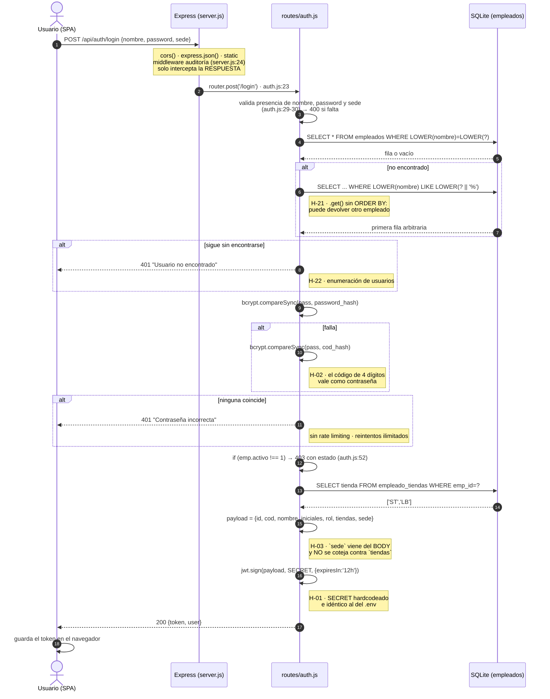
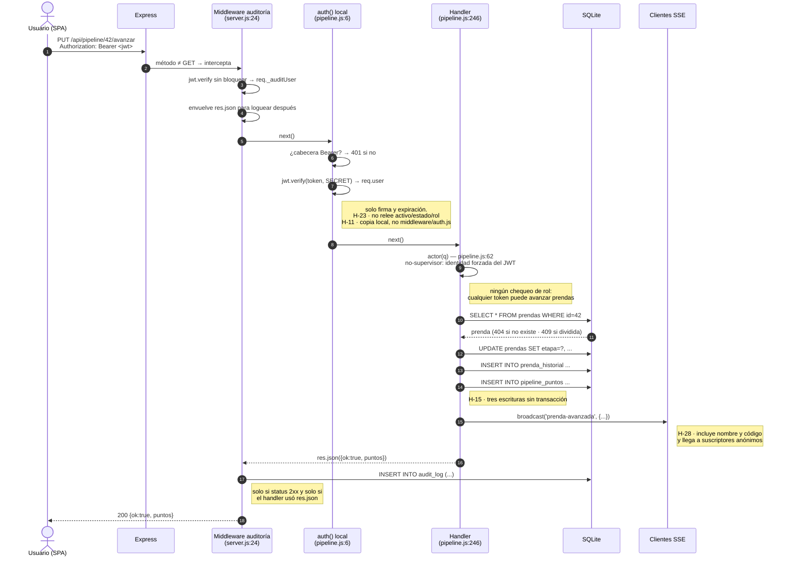
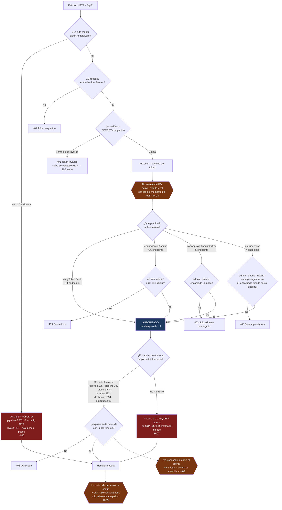

# Auditoría del backend HTTP — SCI-LB (sistema legacy)

**Repositorio:** `D:\Sistemas\Lucebien\SCI-LB`
**Alcance:** `server.js`, `middleware/auth.js` y los 20 archivos de `routes/`. Se leyeron además
`database/db.js`, `database/seed-config.js`, `_backup-bd.js`, `_env-loader.js`, `.env`,
`package.json` y `ecosystem.config.js` como material de apoyo, porque el modelo de autenticación,
las migraciones y los crons no se entienden sin ellos.
**Fecha:** 2026-08-13
**Stack:** Node.js + Express 4.18 + better-sqlite3 9.4 + jsonwebtoken 9 + bcryptjs 2.4 + cors 2.8.
No hay Helmet, ni rate limiting, ni validador de esquemas (Zod/Joi), ni logger estructurado,
ni suite de tests.

**Escala del sistema auditado:** 5.101 líneas de código de rutas y servidor, 133 endpoints HTTP
registrados, 12 copias independientes del middleware de autenticación y 12 copias del secreto JWT.

---

## 1. Inventario completo de endpoints

Se listan los 133 handlers registrados. La columna "Valida entrada" distingue tres casos:
**No** (no valida nada, escribe el body tal cual), **Parcial** (verifica presencia de uno o dos
campos obligatorios pero no tipos ni rangos ni pertenencia) y **Sí** (normaliza, acota o
sanea los valores antes de persistirlos). Ningún endpoint del sistema usa un validador de esquema.

### 1.1 Núcleo (`server.js`)

| Método | Ruta | Archivo:línea | Rol / permiso | Qué hace | Valida entrada |
|---|---|---|---|---|---|
| GET | `/api/audit` | server.js:104 | `admin` o `dueno` (JWT inline) | Lista el `audit_log` con filtros de fecha, sede, usuario y módulo. | Parcial (`limit` con `parseInt`, resto libre) |
| GET | `/api/audit/stats` | server.js:127 | `admin` o `dueno` (JWT inline) | Agrega conteos del día por módulo, usuario y sede. | No |
| GET | `/api/test` | server.js:146 | **Ninguno** | Devuelve `{ok:true}` como health check. | N/A |
| ALL | `/api/*` | server.js:147 | **Ninguno** | Fallback 404 JSON para rutas de API inexistentes. | N/A |
| GET | `*` | server.js:148 | **Ninguno** | Sirve `public/index.html` (SPA fallback). | N/A |

### 1.2 Autenticación (`routes/auth.js`)

| Método | Ruta | Archivo:línea | Rol / permiso | Qué hace | Valida entrada |
|---|---|---|---|---|---|
| POST | `/api/auth/login` | auth.js:23 | **Público** | Autentica por nombre + contraseña + sede y emite un JWT de 12 h. | Parcial (presencia de nombre, pass y sede; la sede no se coteja contra las tiendas del empleado) |
| POST | `/api/auth/login-code` | auth.js:65 | **Público** | Autentica solo con el código de 4 dígitos (usado por almacén-kanban). | Parcial (presencia de `cod`) |
| GET | `/api/auth/me` | auth.js:85 | Token válido | Devuelve el payload del token sin releerlo de la base. | N/A |

### 1.3 Empleados (`routes/empleados.js`)

| Método | Ruta | Archivo:línea | Rol / permiso | Qué hace | Valida entrada |
|---|---|---|---|---|---|
| GET | `/api/empleados` | empleados.js:48 | Token válido | Lista todos los empleados con sus tiendas, saneando campos sensibles para no-admin. | N/A |
| GET | `/api/empleados/by-sede/:sede` | empleados.js:59 | Token válido | Separa empleados activos en "propios" y "otros" según la sede pedida. | No |
| GET | `/api/empleados/:id/desempeno` | empleados.js:72 | Token válido | Devuelve reportes, evaluaciones, incidencias y puntos de pipeline de un empleado. | No |
| POST | `/api/empleados` | empleados.js:102 | `admin` / `dueno` | Crea un empleado, hashea el código y la contraseña y asigna tiendas. | Parcial (solo unicidad del `cod`) |
| PUT | `/api/empleados/:id` | empleados.js:148 | `admin` / `dueno` | Actualiza el empleado y propaga el cambio de nombre a 7 tablas pseudo-FK. | Parcial |
| PUT | `/api/empleados/:id/estado` | empleados.js:191 | `admin` / `dueno` | Cambia estado (activo/suspendido/deshabilitado) y el flag `activo`. | No (acepta cualquier string como estado) |
| DELETE | `/api/empleados/:id` | empleados.js:200 | `admin` / `dueno` | Baja lógica del empleado. **Roto:** usa comillas dobles en SQL (ver H-04). | No |
| GET | `/api/empleados/:id/checklists` | empleados.js:208 | Token válido | Reportes del empleado en un rango con sus actividades. | No |
| GET | `/api/empleados/:id/checklists2` | empleados.js:233 | Token válido | Agrega notas por categoría (operaciones/software/limpieza) para evaluación mensual. | No |

### 1.4 Reportes FR-01 (`routes/reportes.js`)

| Método | Ruta | Archivo:línea | Rol / permiso | Qué hace | Valida entrada |
|---|---|---|---|---|---|
| GET | `/api/reportes` | reportes.js:105 | Token válido | Lista reportes filtrando por sede, fecha o trabajador. | No |
| GET | `/api/reportes/alertas/:sede` | reportes.js:119 | Token válido | Indica qué turnos de hoy tienen reporte y cuál está pendiente de evaluar. | No |
| POST | `/api/reportes` | reportes.js:141 | Token válido | Crea el reporte del turno con trabajadores, actividades, extras e incidencias. | Parcial (solo unicidad del id) |
| GET | `/api/reportes/:id/detalle` | reportes.js:179 | Token válido + misma sede | Detalle completo del reporte; único endpoint con chequeo cross-sede real. | No |
| PUT | `/api/reportes/:id/evaluar` | reportes.js:197 | Token válido | Registra calificaciones del turno anterior y desbloquea el reporte. | Parcial (solo que el evaluador no sea del turno) |
| DELETE | `/api/reportes/:id/anular` | reportes.js:213 | `admin` / `dueno` (inline) | Borra el reporte y todas sus filas asociadas, incluidas las incidencias. | No |
| DELETE | `/api/reportes/:id/anular-eval` | reportes.js:230 | `admin` / `dueno` (inline) | Revierte solo la evaluación y deja el reporte pendiente. | No |
| GET | `/api/reportes/drafts/:sede/:fecha/:turno` | reportes.js:248 | Token válido | Lee el borrador vivo de FR-01. | No |
| POST | `/api/reportes/drafts` | reportes.js:261 | Token válido | Upsert del borrador (autosave). | Parcial (sede/fecha/turno obligatorios) |
| DELETE | `/api/reportes/drafts/:sede/:fecha/:turno` | reportes.js:286 | Token válido | Elimina el borrador. | No |
| POST | `/api/reportes/permitir-reenvio` | reportes.js:296 | `admin` / `dueno` (inline) | Borra los reportes `no_evaluable` de un turno para permitir reenvío manual. | Parcial |
| POST | `/api/reportes/auto-envio/run` | reportes.js:402 | `admin` / `dueno` (inline) | Fuerza una corrida del auto-envío sin esperar al cron. | N/A |

### 1.5 Pipeline de lavandería (`routes/pipeline.js`)

| Método | Ruta | Archivo:línea | Rol / permiso | Qué hace | Valida entrada |
|---|---|---|---|---|---|
| GET | `/api/pipeline/stream` | pipeline.js:36 | **Ninguno** (token opcional) | Canal SSE que emite todos los eventos del pipeline en vivo. | N/A |
| GET | `/api/pipeline` | pipeline.js:163 | **Ninguno** | Lista prendas con filtros de sede y etapa. | Parcial (`limit`) |
| GET | `/api/pipeline/kanban` | pipeline.js:165 | **Ninguno** | Devuelve el kanban completo, accesorios pendientes y estadísticas. | N/A |
| GET | `/api/pipeline/stats` | pipeline.js:180 | **Ninguno** | Conteo de prendas por etapa. | N/A |
| GET | `/api/pipeline/:id/historial` | pipeline.js:182 | **Ninguno** | Historial de movimientos de una prenda. | No |
| GET | `/api/pipeline/envios` | pipeline.js:190 | **Ninguno** | Últimos 50 envíos con sus prendas. | No |
| GET | `/api/pipeline/accesorios` | pipeline.js:192 | **Ninguno** | Últimos 200 registros del log de accesorios. | N/A |
| GET | `/api/pipeline/ranking` | pipeline.js:194 | **Ninguno** | Ranking semanal de productividad por operario. | N/A |
| GET | `/api/pipeline/bitacora` | pipeline.js:200 | **Ninguno** | Últimos movimientos de puntos con nombre y código de empleado. | Parcial (`limit`) |
| GET | `/api/pipeline/config-puntos` | pipeline.js:203 | **Ninguno** | Devuelve los pesos de puntos por etapa. | N/A |
| PUT | `/api/pipeline/config-puntos` | pipeline.js:210 | **Cualquier token** | Reescribe los pesos `pts_*` y `precio_*` en `config`. | Parcial (prefijo de clave; valor libre) |
| POST | `/api/pipeline` | pipeline.js:220 | Cualquier token | Crea una prenda y su primer registro de historial. | Parcial (código y sede) |
| POST | `/api/pipeline/batch` | pipeline.js:229 | Cualquier token | Alta masiva de prendas desde una lista. | Parcial |
| PUT | `/api/pipeline/:id/avanzar` | pipeline.js:246 | Cualquier token | Avanza la prenda de etapa y asigna puntos al operario. | Parcial (`etapa_destino` presente; no se valida contra el catálogo de etapas) |
| PUT | `/api/pipeline/:id/deshacer` | pipeline.js:276 | Cualquier token | Revierte la última etapa y borra el último registro de puntos. | Parcial |
| PUT | `/api/pipeline/:id/rechazar` | pipeline.js:289 | Cualquier token | Devuelve la prenda a una etapa previa y descuenta puntos al responsable. | No |
| POST | `/api/pipeline/enviar` | pipeline.js:312 | Cualquier token | Crea un envío a tienda con las prendas en estado `listo`. | Parcial |
| PUT | `/api/pipeline/envios/:id/calificar` | pipeline.js:342 | Token + sede destino (o supervisor) | La tienda acepta o rechaza prendas recibidas. | No |
| POST | `/api/pipeline/accesorios` | pipeline.js:373 | Cualquier token | Registra accesorios procesados y otorga puntos o incentivo monetario. | Parcial (cantidad > 0) |
| POST | `/api/pipeline/:id/dividir` | pipeline.js:403 | Cualquier token | Divide un terno en saco + pantalón marcando la matriz como dividida. | Parcial (409 si ya dividida) |
| GET | `/api/pipeline/diario` | pipeline.js:429 | **Ninguno** | Movimientos del día agrupados por operario. | No |
| POST | `/api/pipeline/registrar-local` | pipeline.js:437 | Cualquier token | Alta de prendas directamente en almacén. | Parcial |
| POST | `/api/pipeline/accesorios-extra` | pipeline.js:449 | Cualquier token | Registra accesorios extra con sustento. | Parcial |
| GET | `/api/pipeline/mi-avance` | pipeline.js:459 | **Ninguno** | Puntos y acciones del día para el código que se pase por query. | No |
| GET | `/api/pipeline/historial` | pipeline.js:473 | Supervisor (`admin`/`dueno`/`encargado_almacen`) | Historial unificado multi-fuente con filtros. | Parcial (`limit` acotado a 2000) |
| GET | `/api/pipeline/lista/:id/trazabilidad` | pipeline.js:605 | Cualquier token | Traza una lista de lavandería hasta las prendas y su historial. | No |
| POST | `/api/pipeline/envios-accesorios` | pipeline.js:620 | Cualquier token | Crea un envío de accesorios y marca el stock como enviado. | Parcial |
| GET | `/api/pipeline/envios-accesorios` | pipeline.js:653 | Cualquier token | Lista envíos de accesorios con sus ítems. | No |
| PUT | `/api/pipeline/envios-accesorios/:id/validar` | pipeline.js:669 | Token + sede destino (o supervisor) | La tienda confirma la recepción de accesorios. | No |

### 1.6 Lavandería (`routes/lavanderia.js`)

| Método | Ruta | Archivo:línea | Rol / permiso | Qué hace | Valida entrada |
|---|---|---|---|---|---|
| GET | `/api/lavanderia` | lavanderia.js:27 | Cualquier token | Lista listas de lavandería con sus ítems y generales. | No |
| POST | `/api/lavanderia` | lavanderia.js:47 | Cualquier token | Crea la lista y auto-inserta cada prenda en el pipeline del almacén. | **No** (ni sede ni tipo ni ítems) |
| PUT | `/api/lavanderia/:id/estado` | lavanderia.js:90 | Cualquier token | Cambia el estado de la lista. | No |
| PUT | `/api/lavanderia/:id/validar` | lavanderia.js:98 | Cualquier token | Valida el retorno marcando el estado de cada ítem. | No |

### 1.7 Evaluaciones mensuales (`routes/evaluaciones.js`)

| Método | Ruta | Archivo:línea | Rol / permiso | Qué hace | Valida entrada |
|---|---|---|---|---|---|
| GET | `/api/evaluaciones/mensual` | evaluaciones.js:138 | Cualquier token | Lista evaluaciones mensuales filtradas por empleado, mes o ciclo. | No |
| POST | `/api/evaluaciones/mensual` | evaluaciones.js:155 | `admin` / `dueno` | Guarda o reemplaza la evaluación mensual con los pesos usados. | Parcial (`emp_id`) |
| GET | `/api/evaluaciones/pesos` | evaluaciones.js:193 | **Ninguno** | Devuelve los pesos vigentes de la evaluación. | N/A |
| PUT | `/api/evaluaciones/pesos` | evaluaciones.js:198 | `admin` / `dueno` | Actualiza los pesos en `config`. | Parcial (`parseFloat`, sin tope) |
| GET | `/api/evaluaciones/ciclo-actual` | evaluaciones.js:216 | Cualquier token | Calcula el ciclo personal según la fecha de ingreso. | Parcial |
| GET | `/api/evaluaciones/calcular` | evaluaciones.js:251 | Cualquier token | Autopuebla notas, cumplimiento, tardanzas, incidencias y bonus del periodo. | Parcial (emp_id/desde/hasta) |

### 1.8 Incidencias (`routes/incidencias.js`)

| Método | Ruta | Archivo:línea | Rol / permiso | Qué hace | Valida entrada |
|---|---|---|---|---|---|
| GET | `/api/incidencias` | incidencias.js:68 | Cualquier token | Lista incidencias con filtros de sede, nivel, responsable y rango. | Parcial (normaliza `nivel`) |
| POST | `/api/incidencias` | incidencias.js:85 | Cualquier token | Registra una incidencia resolviendo puntos desde el catálogo. | Parcial (normaliza nivel y puntos; no valida sede, fecha ni responsable) |
| DELETE | `/api/incidencias/:id` | incidencias.js:112 | `admin` / `dueno` | Borra la incidencia definitivamente. | No |
| GET | `/api/incidencias/tipos/list` | incidencias.js:122 | Cualquier token | Catálogo de tipificaciones. | Parcial |
| PUT | `/api/incidencias/tipos/list` | incidencias.js:134 | `admin` / `dueno` | Reemplaza el catálogo completo (DELETE + INSERT). | Sí (recorta strings, acota puntos 0–20) |

### 1.9 Valores 360 (`routes/valores.js`)

| Método | Ruta | Archivo:línea | Rol / permiso | Qué hace | Valida entrada |
|---|---|---|---|---|---|
| GET | `/api/valores/config` | valores.js:38 | Cualquier token | Configuración del módulo y si está activo hoy. | N/A |
| PUT | `/api/valores/config` | valores.js:52 | `admin` / `dueno` | Cambia habilitación, modo y días de la ventana. | Sí (acota días 1–31) |
| GET | `/api/valores/pendientes/:mes` | valores.js:65 | Cualquier token | Compañeros que el usuario aún no evaluó. | No |
| GET | `/api/valores/resumen/:emp_id/:mes` | valores.js:77 | `admin` / `dueno` | Promedios de valores recibidos por un empleado. | No |
| POST | `/api/valores` | valores.js:103 | Cualquier token | Guarda la evaluación de valores de un compañero. | Parcial (solo impide auto-evaluarse) |
| GET | `/api/valores/mis-pendientes/:mes` | valores.js:116 | Cualquier token | Listado de compañeros con flag de evaluado. | No |
| GET | `/api/valores/seguimiento/:mes` | valores.js:137 | `admin` / `dueno` | Panel de participación y cumplimiento global del mes. | No |
| GET | `/api/valores/mi-resumen/:mes` | valores.js:201 | Cualquier token | Resumen propio del colaborador. | No |

### 1.10 Actividades configurables (`routes/actividades.js`)

| Método | Ruta | Archivo:línea | Rol / permiso | Qué hace | Valida entrada |
|---|---|---|---|---|---|
| GET | `/api/actividades` | actividades.js:33 | Cualquier token | Actividades aplicables a una sede, fecha y turno, más pendientes acumuladas. | Parcial (`sede` obligatoria) |
| GET | `/api/actividades/admin` | actividades.js:56 | `admin` / `dueno` | Catálogo completo por sede. | No |
| POST | `/api/actividades` | actividades.js:62 | `admin` / `dueno` | Crea una actividad configurable. | Parcial (`nombre`) |
| PUT | `/api/actividades/:id` | actividades.js:71 | `admin` / `dueno` | Actualiza la actividad sin tocar la sede. | **No** (sobrescribe con `undefined` los campos ausentes) |
| DELETE | `/api/actividades/:id` | actividades.js:79 | `admin` / `dueno` | Elimina la actividad y limpia pendientes huérfanos. | No |
| POST | `/api/actividades/duplicar` | actividades.js:91 | `admin` / `dueno` | Copia las actividades de una sede a otra. | Parcial |
| POST | `/api/actividades/sync-sedes` | actividades.js:99 | `admin` / `dueno` | Sincroniza una actividad en el conjunto de sedes indicado. | Parcial |
| POST | `/api/actividades/pendiente` | actividades.js:116 | Cualquier token | Marca actividades no realizadas como pendientes de la sede. | Parcial |
| POST | `/api/actividades/resolver` | actividades.js:117 | Cualquier token | Marca pendientes como resueltas. | Parcial |
| GET | `/api/actividades/pendientes` | actividades.js:118 | Cualquier token | Lista pendientes abiertos de una sede. | No |

### 1.11 Préstamos y bajas (`routes/prestamos.js`)

| Método | Ruta | Archivo:línea | Rol / permiso | Qué hace | Valida entrada |
|---|---|---|---|---|---|
| GET | `/api/prestamos/bajas/list` | prestamos.js:12 | Cualquier token | Lista prendas dadas de baja, migrando la tabla si es antigua. | N/A |
| PUT | `/api/prestamos/bajas/:id/procesar` | prestamos.js:28 | `admin`, `dueno` o `encargado_almacen` | Marca la baja como procesada. | No |
| PUT | `/api/prestamos/item/:itemId/estado` | prestamos.js:38 | Cualquier token | Cambia el estado de una prenda prestada y genera baja si corresponde. | Sí (lista blanca de estados) |
| GET | `/api/prestamos` | prestamos.js:75 | Cualquier token | Lotes de préstamo con sus ítems y pendientes. | No |
| POST | `/api/prestamos` | prestamos.js:92 | Cualquier token | Crea un lote de préstamo entre sedes. | Parcial |
| GET | `/api/prestamos/:id` | prestamos.js:111 | Cualquier token | Detalle de un lote. | No |

### 1.12 Garantías (`routes/garantias.js`)

| Método | Ruta | Archivo:línea | Rol / permiso | Qué hace | Valida entrada |
|---|---|---|---|---|---|
| GET | `/api/garantias` | garantias.js:8 | Cualquier token | Últimas 100 devoluciones de garantía. | No |
| GET | `/api/garantias/resumen` | garantias.js:16 | Cualquier token | Totales de garantías pendientes y devueltas. | No |
| POST | `/api/garantias` | garantias.js:25 | Cualquier token | Registra una garantía con datos del cliente y monto. | Parcial (presencia de nombre, celular y monto; el monto no se valida numérico) |
| PUT | `/api/garantias/:id` | garantias.js:35 | Cualquier token | Marca la garantía como devuelta y fija responsable. | No |

### 1.13 Solicitudes (`routes/solicitudes.js`)

| Método | Ruta | Archivo:línea | Rol / permiso | Qué hace | Valida entrada |
|---|---|---|---|---|---|
| GET | `/api/solicitudes` | solicitudes.js:27 | Cualquier token (filtra por `sede` del token si no es supervisor) | Lista solicitudes ordenadas por urgencia. | No |
| POST | `/api/solicitudes` | solicitudes.js:40 | Cualquier token | Crea la solicitud con sus ítems. | Parcial (al menos un ítem) |
| PUT | `/api/solicitudes/:id/aprobar` | solicitudes.js:50 | `admin`, `dueno` o `encargado_almacen` | Aprueba y fija cantidades enviadas por ítem. | No |
| PUT | `/api/solicitudes/:id/entregar` | solicitudes.js:63 | `admin`, `dueno` o `encargado_almacen` | Marca la entrega y guarda los códigos de prenda. | No |
| PUT | `/api/solicitudes/:id/confirmar` | solicitudes.js:73 | Cualquier token | La tienda confirma recepción y corrige cantidades. | No |
| PUT | `/api/solicitudes/:id/rechazar` | solicitudes.js:85 | `admin`, `dueno` o `encargado_almacen` | Rechaza con motivo obligatorio. | Parcial (`motivo`) |
| PUT | `/api/solicitudes/:id/deshacer` | solicitudes.js:96 | Cualquier token | Revierte la solicitud a un estado anterior. | Parcial (`estado_destino`) |
| PUT | `/api/solicitudes/:id/marcar-impreso` | solicitudes.js:112 | Cualquier token | Marca el pedido o la confirmación como impresos. | No |

### 1.14 Pagos (`routes/pagos.js`)

| Método | Ruta | Archivo:línea | Rol / permiso | Qué hace | Valida entrada |
|---|---|---|---|---|---|
| GET | `/api/pagos` | pagos.js:84 | Cualquier token | Lista pagos con nombre, rol y sedes del empleado. | No |
| GET | `/api/pagos/sugerir` | pagos.js:107 | Cualquier token | Sugiere el monto a pagar a partir de la evaluación y el salario base. | Parcial (`emp_id`) |
| GET | `/api/pagos/:id` | pagos.js:158 | Cualquier token | Detalle del pago con DNI del empleado y la evaluación asociada. | No |
| POST | `/api/pagos` | pagos.js:174 | `admin` / `dueno` | Registra un pago. | Parcial (`emp_id`, monto ≥ 0) |
| PUT | `/api/pagos/:id` | pagos.js:203 | `admin` / `dueno` | Edita campos del pago desde una lista blanca de columnas. | Parcial (lista blanca de campos; valores sin tipar) |
| DELETE | `/api/pagos/:id` | pagos.js:224 | `admin` / `dueno` | Anulación lógica con motivo obligatorio. | Parcial (`motivo`) |
| GET | `/api/pagos/:id/comprobante` | pagos.js:236 | Cualquier token | Devuelve el comprobante de pago en HTML imprimible. | No |

### 1.15 Asistencias (`routes/asistencias.js`)

| Método | Ruta | Archivo:línea | Rol / permiso | Qué hace | Valida entrada |
|---|---|---|---|---|---|
| GET | `/api/asistencias/del-dia` | asistencias.js:29 | Cualquier token | Consolida asistencia del día cruzando horario y registros. | Parcial (`fecha`) |
| GET | `/api/asistencias` | asistencias.js:110 | Cualquier token | Lista asistencias de cualquier empleado y rango. | No |
| GET | `/api/asistencias/resumen` | asistencias.js:124 | Cualquier token | Totales de tardanza y nota de puntualidad de un empleado. | Parcial (`emp_id`) |
| POST | `/api/asistencias` | asistencias.js:146 | `admin` / `dueno` | Alta o reemplazo de un registro de asistencia. | Parcial (`emp_id`, `fecha`) |
| POST | `/api/asistencias/bulk` | asistencias.js:160 | `admin` / `dueno` | Guarda la grilla completa del día. | Parcial |
| DELETE | `/api/asistencias/:id` | asistencias.js:179 | `admin` / `dueno` | Borra un registro. | No |
| GET | `/api/asistencias/horarios/:emp_id` | asistencias.js:185 | Cualquier token | Horario legacy de un empleado. | No |
| PUT | `/api/asistencias/horarios/:emp_id` | asistencias.js:194 | `admin` / `dueno` | Reemplaza el horario completo (DELETE + INSERT). | No |
| POST | `/api/asistencias/horarios/bulk` | asistencias.js:212 | `admin` / `dueno` | Importa horarios de varios empleados. | Parcial |

### 1.16 Horarios v2 (`routes/horarios.js`)

| Método | Ruta | Archivo:línea | Rol / permiso | Qué hace | Valida entrada |
|---|---|---|---|---|---|
| GET | `/api/horarios/periodos` | horarios.js:162 | Cualquier token | Lista los periodos con su total de slots. | N/A |
| POST | `/api/horarios/periodos` | horarios.js:174 | `admin` / `dueno` | Crea un periodo de horario. | Parcial (`nombre`, `fecha_desde`) |
| PUT | `/api/horarios/periodos/:id/activar` | horarios.js:187 | `admin` / `dueno` | Marca un periodo como vigente y desactiva los solapados. | No |
| PUT | `/api/horarios/periodos/:id` | horarios.js:208 | `admin` / `dueno` | Edita la metadata del periodo. | No |
| DELETE | `/api/horarios/periodos/:id` | horarios.js:219 | `admin` / `dueno` | Borra el periodo y todos sus slots. | No |
| GET | `/api/horarios/periodos/:id` | horarios.js:231 | Cualquier token | Detalle del periodo con slots y datos de empleado. | No |
| POST | `/api/horarios/periodos/:id/slots/bulk` | horarios.js:247 | `admin` / `dueno` | Reemplaza todos los slots del periodo (import de Excel). | Parcial (descarta slots incompletos) |
| GET | `/api/horarios/vigente` | horarios.js:273 | Cualquier token | Slots del periodo vigente, opcionalmente por sede. | No |
| GET | `/api/horarios/mi-horario` | horarios.js:287 | Cualquier token | Horario propio del usuario del token. | N/A |
| GET | `/api/horarios/empleado/:id` | horarios.js:307 | `admin`/`dueno` o el propio empleado | Horario de un empleado concreto. | No |
| GET | `/api/horarios/del-dia` | horarios.js:330 | Cualquier token | Quiénes deben trabajar en una sede, fecha y turno. | No |
| GET | `/api/horarios/encargado` | horarios.js:338 | Cualquier token | Resuelve el encargado del turno. | No |
| GET | `/api/horarios/horas-mes` | horarios.js:345 | Cualquier token | Horas programadas de un empleado en el mes. | Parcial (`parseInt`) |
| POST | `/api/horarios/periodos/:id/slots` | horarios.js:360 | `admin` / `dueno` | Agrega un slot individual. | Parcial |
| PUT | `/api/horarios/slots/:id` | horarios.js:383 | `admin` / `dueno` | Edita un slot preservando los campos no enviados. | Parcial |
| DELETE | `/api/horarios/slots/:id` | horarios.js:413 | `admin` / `dueno` | Borra un slot. | No |
| POST | `/api/horarios/periodos/:id/duplicar` | horarios.js:423 | `admin` / `dueno` | Clona un periodo con todos sus slots. | Parcial |

### 1.17 Dashboard y notificaciones

| Método | Ruta | Archivo:línea | Rol / permiso | Qué hace | Valida entrada |
|---|---|---|---|---|---|
| GET | `/api/dashboard/admin` | dashboard.js:59 | Supervisor (admin, dueño, encargado de tienda o almacén) | KPIs, alertas críticas, estado del pipeline, tendencias y salud del sistema. | Parcial (fuerza la sede a las permitidas) |
| GET | `/api/dashboard/empleado` | dashboard.js:325 | Supervisor + solape de sede | Dashboard personal del colaborador (matriz Christie, heatmap, evolución). | Parcial |
| GET | `/api/notificaciones/pendientes` | notificaciones.js:31 | Cualquier token | Conteos accionables del usuario y del sistema para la campana del header. | N/A |

### 1.18 Configuración, layout y ventas

| Método | Ruta | Archivo:línea | Rol / permiso | Qué hace | Valida entrada |
|---|---|---|---|---|---|
| GET | `/api/config` | config.js:8 | **Ninguno** | Vuelca la tabla `config` completa como objeto clave/valor. | N/A |
| PUT | `/api/config` | config.js:9 | `admin` / `dueno` (chequeo dentro del handler) | Escribe cualquier par clave/valor en `config`. | **No** (cualquier clave, cualquier valor) |
| GET | `/api/config/permisos` | config.js:11 | Cualquier token | Devuelve la matriz de permisos almacenada en `config`. | N/A |
| PUT | `/api/config/permisos` | config.js:12 | `admin` / `dueno` | Guarda la matriz de permisos como JSON. | **No** (guarda el body tal cual) |
| GET | `/api/config/puestos` | config.js:18 | Cualquier token | Puestos personalizados. | N/A |
| PUT | `/api/config/puestos` | config.js:23 | `admin` / `dueno` | Reemplaza los puestos personalizados. | Sí (normaliza cod, recorta longitudes, deduplica) |
| GET | `/api/config/grupos-rangos` | config.js:43 | Cualquier token | Grupos de rangos para permisos en lote. | N/A |
| PUT | `/api/config/grupos-rangos` | config.js:48 | `admin` / `dueno` | Reemplaza los grupos de rangos. | Sí |
| GET | `/api/config/layout-tooltips` | config.js:73 | **Ninguno** | Tooltips personalizados del mapa de layout. | N/A |
| PUT | `/api/config/layout-tooltips` | config.js:78 | `admin` / `dueno` | Guarda tooltips saneados por tipo y prefijo. | Sí |
| GET | `/api/config/eval-pesos` | config.js:113 | **Ninguno** | Pesos de la evaluación mensual con defaults. | N/A |
| PUT | `/api/config/eval-pesos` | config.js:124 | `admin` / `dueno` | Actualiza los pesos acotados a 0–100. | Sí |
| GET | `/api/layout` | layout.js:19 | **Ninguno** (explícito: "workers need this") | Zonas del layout de una sede. | No |
| PUT | `/api/layout/bulk` | layout.js:29 | `admin` / `dueno` | Reemplaza todas las zonas de la sede. | Parcial (`sede`) |
| POST | `/api/layout/zona` | layout.js:51 | `admin` / `dueno` | Crea una zona. | No |
| DELETE | `/api/layout/zona/:id` | layout.js:63 | `admin` / `dueno` | Borra una zona. | No |
| GET | `/api/ventas` | ventas.js:8 | Cualquier token | Metas de venta por mes y empleado. | No |
| POST | `/api/ventas` | ventas.js:20 | `admin` / `dueno` | Registra meta y venta del mes, calculando el bonus. | Parcial (`emp_id`, `mes`) |
| GET | `/api/ventas/bonus/:emp_id/:mes` | ventas.js:40 | Cualquier token | Bonus de ventas de un empleado. | No |
| GET | `/api/ventas/pipeline-bonus/:emp_id/:mes` | ventas.js:50 | Cualquier token | Bonificación monetaria por puntos de pipeline sobre la meta. | No |

**Resumen del inventario:** de 133 endpoints, **17 no exigen ningún token** (13 de ellos son
lecturas del pipeline y de configuración con datos operativos reales), **74 se contentan con
"cualquier token válido"** sin verificar rol ni pertenencia al recurso, y solo **42** aplican
un chequeo de rol. Únicamente **6 endpoints** verifican que el recurso pedido pertenezca al
usuario o a su sede (`reportes.js:185`, `pipeline.js:347`, `pipeline.js:674`, `horarios.js:312`,
`dashboard.js:354`, `solicitudes.js:30`).

---

## 2. Modelo de autenticación y autorización

### 2.1 Emisión del token

El único emisor de tokens es `routes/auth.js`. Hay dos caminos de login:

- **`POST /api/auth/login`** (`auth.js:23`) busca al empleado por nombre exacto y, si no lo
  encuentra, por prefijo con `LIKE` (`auth.js:34-35`). Compara la contraseña contra
  `password_hash` con bcrypt y, si eso falla, vuelve a intentar contra `cod_hash`
  (`auth.js:44-46`), es decir, contra el hash del código de 4 dígitos. Recién después de
  validar la credencial comprueba `activo` (`auth.js:52`), lo cual es correcto para no filtrar
  el estado de cuentas ajenas.
- **`POST /api/auth/login-code`** (`auth.js:65`) busca al empleado por `cod` y luego compara
  ese mismo `cod` contra su `cod_hash`. Como la fila ya se localizó por el código en claro, la
  comparación bcrypt es una tautología: el único secreto real son 4 dígitos.

En ambos casos el payload firmado es
`{ id, cod, nombre, iniciales, rol, tiendas, sede }` (`auth.js:58` y `auth.js:79`) con
`expiresIn: '12h'`. El campo `sede` **proviene del cuerpo de la petición**, no de la base de
datos, y no se coteja contra `empleado_tiendas` pese a que las tiendas del empleado sí se
consultan dos líneas antes (`auth.js:55-56`). El campo `rol`, en cambio, sí viene de la tabla
`empleados`.

No existe refresh token, ni lista de revocación, ni versión de credencial en el payload. Una vez
emitido, el token es válido 12 horas aunque el empleado sea suspendido, deshabilitado o cambie
de rol: `GET /api/auth/me` (`auth.js:85`) devuelve el payload del token sin releer la base.

### 2.2 Validación del token y ubicación del secreto

El secreto se define en `middleware/auth.js:2` como
`process.env.JWT_SECRET || 'lucebien-secret-2026-xK9mP3qR'`, y esa misma línea está **duplicada
literalmente en 12 archivos**: `server.js:13`, `middleware/auth.js:2`, `routes/actividades.js:4`,
`routes/asistencias.js:3`, `routes/config.js:4`, `routes/empleados.js:5`, `routes/garantias.js:4`,
`routes/lavanderia.js:8`, `routes/layout.js:4`, `routes/pipeline.js:4`, `routes/prestamos.js:4`,
`routes/reportes.js:4`, `routes/solicitudes.js:4` y `routes/ventas.js:4`.

El `.env` del repositorio define `JWT_SECRET` con **exactamente el mismo valor hardcodeado**
(29 caracteres, verificado). Es decir, el fallback no es un fallback: es el secreto en uso.

`jwt.verify` se invoca sin restringir algoritmos en ninguna de las 12 implementaciones. La
implementación canónica es `middleware/auth.js:4-16` (`verifyToken`) y `18-23` (`requireAdmin`),
pero solo 8 de los 20 archivos de rutas la importan; los otros 12 reimplementan `auth` y `admin`
en una sola línea comprimida, con variaciones semánticas (ver H-11).

### 2.3 Resolución de roles y permisos

Los roles reconocidos por el código son `admin`, `dueno`, `encargado_tienda`,
`encargado_almacen` y el resto (operarios). Hay **cuatro predicados distintos** de autorización,
inconsistentes entre sí:

| Predicado | Dónde | Roles que acepta |
|---|---|---|
| `requireAdmin` | middleware/auth.js:18 | `admin`, `dueno` |
| `admin` inline | empleados.js:8, actividades.js:6, config.js:6, ventas.js:6, layout.js:5, server.js:109 | `admin`, `dueno` |
| `esSupervisor` | dashboard.js:21, notificaciones.js:15, evaluaciones.js:79 | `admin`, `dueno`, `dueño`, `encargado_almacen`, `encargado_tienda` |
| `esSupervisor` | pipeline.js:154 | `admin`, `dueno`, `dueño`, `encargado_almacen` (**sin** `encargado_tienda`) |
| `adminOrEnc` / `canApprove` | prestamos.js:7, solicitudes.js:6 | `admin`, `dueno`, `encargado_almacen` |

Los predicados de `dashboard`, `notificaciones`, `evaluaciones`, `pagos` y `pipeline` normalizan
a minúsculas y aceptan `dueño` con tilde; los `admin` inline comparan con `!==` estricto contra
`'dueno'` sin tilde y sin normalizar mayúsculas. Si el rol se guarda en la base como `dueño` o
`Admin`, el dueño perdería acceso a empleados, actividades, configuración, ventas y layout
mientras conservaría el dashboard.

### 2.4 La matriz de permisos no se aplica en el servidor

Existe una matriz de permisos configurable, guardada en `config` bajo la clave `permisos`, con
endpoints de lectura y escritura (`config.js:11-12`), más los conceptos accesorios de "puestos
personalizados" (`config.js:18-38`) y "grupos de rangos" (`config.js:43-67`). Una búsqueda de la
palabra `permisos` en todo el backend devuelve **únicamente** esas líneas de `config.js`: ningún
handler la consulta para decidir. Los únicos consumidores son
`public/js/admin.js`, `public/js/app.js` y `public/js/patches-v5.js`, es decir, el navegador.

En consecuencia, la matriz de permisos que el administrador configura desde la UI es
**decorativa desde el punto de vista de la seguridad**: oculta botones, no protege endpoints.
Cualquier usuario con un token puede llamar directamente a la API y hacer lo que el permiso le
niega en pantalla.

### 2.5 Endpoints sin protección alguna

Diecisiete endpoints responden sin token:

- `server.js:146` `/api/test` (health check, inocuo).
- `server.js:148` `GET *` (SPA).
- `pipeline.js:36, 163, 165, 180, 182, 190, 192, 194, 200, 203, 429, 459` — trece rutas del
  pipeline que exponen el inventario completo de prendas, el ranking de productividad con
  nombres y códigos de empleado, la bitácora de puntos, el historial por prenda y el detalle
  diario por operario.
- `layout.js:19` `GET /api/layout` (decisión deliberada documentada en el comentario).
- `config.js:8` `GET /api/config` — vuelca **toda** la tabla `config`.
- `config.js:73` `GET /api/config/layout-tooltips` y `config.js:113` `GET /api/config/eval-pesos`.
- `evaluaciones.js:193` `GET /api/evaluaciones/pesos`.

Además, `server.js:104` y `server.js:127` devuelven `200` con cuerpo vacío cuando el token es
inválido, porque el `jwt.verify` está dentro del mismo `try` que atrapa todo y responde
`res.json([])` (`server.js:124`); el `401` solo se emite si falta por completo la cabecera.

---

## 3. Crons, tareas programadas y timers

Hay exactamente tres temporizadores en el proceso. No se usa `node-cron` ni ninguna librería de
scheduling: todo es `setInterval`/`setTimeout` sobre el reloj del proceso.

### 3.1 Auto-envío de reportes FR-01

- **Registro:** `server.js:156-168`. Intervalo fijo de **5 minutos** (`server.js:165`).
- **Implementación:** `reportes.js:324-399` (`autoEnviarPendientes`), exportada en
  `reportes.js:409`.
- **Disparador manual:** `POST /api/reportes/auto-envio/run` (`reportes.js:402`), solo admin.
- **Condición:** `deadlinePasado(turno)` (`reportes.js:97-102`) — turno M a partir de las 15:00,
  turnos T y C a partir de las 23:00, según la hora local del servidor.
- **Qué muta:** para cada combinación de las 4 sedes (`ST`, `LB`, `AL`, `TR`) por los 3 turnos
  (`M`, `T`, `C`) sin reporte del día, inserta una fila en `reportes` y, si había borrador con
  contenido, también en `reporte_trabajadores`, `reporte_actividades`, `reporte_extras` e
  `incidencias`; borra el borrador de `reporte_drafts` y genera filas en `asistencias`
  (`reportes.js:356-390`). Si no había borrador, crea un reporte marcado `no_evaluable=1`.
- **Si el proceso está caído:** el auto-envío solo procesa `hoyLocal()` (`reportes.js:326`).
  Si el servidor está apagado a las 15:00 y a las 23:00 y arranca al día siguiente, los turnos
  de ayer **nunca** se cierran: no hay recuperación retroactiva. El hueco queda permanente y la
  auditoría del día se pierde. Con PM2 en modo fork (`ecosystem.config.js:28-33`) hay una sola
  instancia, así que no hay duplicación por cluster; si alguien pasara a modo cluster, las
  N instancias correrían el cron en paralelo y competirían por el mismo `INSERT`.
- **Efecto colateral:** después de las 23:00 el cron sigue corriendo cada 5 minutos; en la
  práctica genera hasta 12 reportes placeholder por día (4 sedes × 3 turnos), incluidos turnos
  y sedes que no operan, lo que infla los KPIs de "reportes sin evaluar" del dashboard.

### 3.2 Backup automático de la base de datos

- **Registro:** `server.js:171-176`; implementación en `_backup-bd.js:91-100`.
- **Periodicidad:** primer backup 30 segundos después del arranque (`_backup-bd.js:98`) y luego
  cada `BACKUP_INTERVAL_HOURS` horas, por defecto 24 (`_backup-bd.js:92`).
- **Qué muta:** escribe `database/backups/lucebien_auto_<timestamp>.db` mediante
  `VACUUM INTO` (`_backup-bd.js:45`) con fallback a copia de archivo, y rota conservando los
  últimos `BACKUP_MAX_KEEP` (por defecto 14, `_backup-bd.js:72-85`).
- **Si el proceso está caído:** no hay backups. Como el intervalo se reinicia con el proceso, un
  servidor que se reinicia varias veces al día genera un backup por arranque y rota los antiguos
  antes de tiempo; un servidor que se reinicia cada más de 24 h nunca alcanza el segundo tick.

### 3.3 Heartbeat SSE del pipeline

- **Registro:** `pipeline.js:23`, `setInterval(ssePing, 25000)`.
- **Qué hace:** envía `:ping` a todos los clientes SSE conectados (`pipeline.js:18-22`) y purga
  los que fallan. No muta la base.
- **Si el proceso está caído:** los clientes pierden la conexión y `EventSource` reintenta cada
  5 s por la directiva `retry` de `pipeline.js:50`.

### 3.4 Ausencias notables

- **No existe cron de auto-evaluación en este backend.** El commit `2300c57`
  ("auto-evaluación cuando nadie evalúa a tiempo") vive fuera de `routes/`; en el sistema legacy
  auditado, un reporte sin evaluar permanece indefinidamente con `evaluado=0` y `bloqueado=1`, y
  solo alimenta la alerta del dashboard (`dashboard.js:139`).
- **No hay tarea de limpieza** de `reporte_drafts` huérfanos, `audit_log` (crece sin límite ni
  rotación), ni `pipeline_puntos`.

---

## 4. Middlewares globales, errores, CORS, límites y ficheros

### 4.1 Cadena global

`server.js:18-20` monta, en este orden: `cors()`, `express.json()` y `express.static` sobre
`public/` con cabeceras `no-store`. Después, `server.js:24-79` monta un middleware de auditoría
sobre `/api`.

- **CORS:** `cors()` sin opciones equivale a `Access-Control-Allow-Origin: *` para todos los
  métodos y orígenes. Como el token viaja en la cabecera `Authorization` y no en cookies, no hay
  CSRF clásico, pero cualquier página web puede consumir los 17 endpoints públicos del apartado
  2.5 desde el navegador de un empleado, y cualquier XSS en la SPA puede exfiltrar y reutilizar
  el token contra la API desde cualquier origen.
- **Límite de body:** `express.json()` sin parámetros aplica el default de 100 kB. Eso es
  incompatible con endpoints de importación masiva como
  `POST /api/horarios/periodos/:id/slots/bulk`, `POST /api/asistencias/horarios/bulk` o
  `PUT /api/layout/bulk`, que fallarán con `PayloadTooLargeError` en importaciones grandes; y
  como no hay manejador de errores, ese fallo se devuelve como HTML de Express, no como JSON.
- **Subida de archivos:** no existe. No hay `multer`, ni `express.urlencoded`, ni ningún endpoint
  `multipart`. Toda la importación de Excel se hace parseando en el cliente y enviando JSON.
- **Cabeceras de seguridad:** no hay Helmet ni cabeceras equivalentes: sin `X-Content-Type-Options`,
  sin `X-Frame-Options`, sin CSP. `GET /api/pagos/:id/comprobante` (`pagos.js:236`) devuelve HTML
  construido por interpolación de plantilla con datos de la base (`pagos.js:296-324`), sin
  escapado; el sistema depende de que nadie guarde `<script>` en `observaciones` o en el nombre
  del empleado.
- **Rate limiting:** inexistente. `POST /api/auth/login-code` acepta intentos ilimitados contra
  un espacio de 10.000 códigos.

### 4.2 Middleware de auditoría

`server.js:24-79` intercepta todo `POST`/`PUT`/`DELETE` bajo `/api`, decodifica el token sin
bloquear, envuelve `res.json` y registra en `audit_log` un resumen del body cuando el status es
2xx. Tiene tres defectos operativos: ejecuta `CREATE TABLE IF NOT EXISTS` **en cada petición**
(`server.js:11`); solo captura respuestas emitidas con `res.json`, de modo que el comprobante de
pago (`res.send`) y cualquier respuesta de error de Express quedan fuera; y toma la IP
exclusivamente de `x-forwarded-for` (`server.js:11`), que en una LAN sin proxy llega vacía,
de manera que el campo `ip` del log queda siempre en blanco.

### 4.3 Manejo de errores

**No hay manejador de errores de Express** (`app.use((err, req, res, next) => ...)`). El patrón
dominante es un `try/catch` por handler que responde `res.status(500).json({error: e.message})`,
lo que devuelve al cliente mensajes crudos de SQLite ("no such column: X", "UNIQUE constraint
failed: empleados.cod"). Hay tres consecuencias:

1. Se filtra la estructura interna de la base a cualquier usuario autenticado.
2. Errores de validación se reportan como 500 en vez de 4xx.
3. Los handlers **sin** `try/catch` (`incidencias.js:68`, `incidencias.js:85`,
   `incidencias.js:112`, `valores.js:65`, `valores.js:77`, `valores.js:103`, `valores.js:116`,
   `auth.js:23`, `auth.js:65`) propagan la excepción al manejador por defecto de Express, que
   responde HTML con stack trace si `NODE_ENV` no es `production` — y el `.env` no define
   `NODE_ENV`.

---

## 5. Hallazgos

Severidades: **Crítico** (compromiso total o pérdida de datos), **Alto** (acceso o modificación
indebida de datos sensibles del negocio), **Medio** (corrupción de datos, decisiones erróneas,
degradación), **Bajo** (higiene, mantenibilidad).

### H-01 · Crítico · Secreto JWT hardcodeado en el repositorio y en uso real

**Archivos:** `middleware/auth.js:2`, `server.js:13`, y las once copias listadas en 2.2. `.env`.

El secreto de firma `lucebien-secret-2026-xK9mP3qR` está escrito en el código fuente versionado y
el `.env` de producción lo repite idéntico. Cualquiera con acceso al repositorio —incluido
cualquier colaborador pasado, cualquier copia del código en otra máquina, o cualquier fork—
puede firmarse un token arbitrario.

**Escenario concreto:** un empleado con acceso al repositorio ejecuta
`jwt.sign({id:'E01',cod:'0000',nombre:'X',rol:'admin',tiendas:['LB','ST','TR','AL'],sede:'AL'}, 'lucebien-secret-2026-xK9mP3qR')`
y obtiene un token de administrador válido 12 horas sin haber pasado nunca por el login. Con él
puede editar salarios (`empleados.js:148`), registrar pagos (`pagos.js:174`), borrar reportes
(`reportes.js:213`) y consultar el `audit_log` para verificar que su propia actividad quedó
registrada bajo un nombre inventado.

### H-02 · Crítico · La contraseña puede ser el código de 4 dígitos y no hay límite de intentos

**Archivos:** `auth.js:44-46`, `auth.js:65-74`.

`POST /api/auth/login` acepta como contraseña válida el hash del código (`cod_hash`) cuando la
comparación contra `password_hash` falla. `POST /api/auth/login-code` autentica con el código a
secas. No hay rate limiting, ni bloqueo por intentos, ni captcha, ni registro de intentos
fallidos (el middleware de auditoría solo registra respuestas 2xx, `server.js:40`).

**Escenario concreto:** un atacante en la red local itera los 10.000 códigos de 4 dígitos contra
`/api/auth/login-code`. Con bcrypt como único freno (≈100 ms por intento) recorre el espacio
completo en menos de veinte minutos y obtiene tokens de todos los empleados, incluido el que
tenga rol `admin`. Ninguna alerta se dispara y el `audit_log` solo mostrará el login exitoso.

### H-03 · Crítico · La sede del token la elige el cliente, y de ella depende toda la autorización por sede

**Archivos:** `auth.js:30`, `auth.js:58`, `auth.js:67`, `auth.js:79`.

El campo `sede` del payload JWT se copia tal cual del cuerpo del login sin cotejarlo contra
`empleado_tiendas`, aunque esa consulta ya se hace en `auth.js:55`. Los chequeos de aislamiento
por sede que existen en el sistema —`reportes.js:185`, `pipeline.js:347`, `pipeline.js:674`,
`solicitudes.js:30`, `dashboard.js:36-38`— confían en ese valor.

**Escenario concreto:** una vendedora junior de la tienda ST hace login enviando
`{"nombre":"...","password":"...","sede":"AL"}`. Su token dice `sede: 'AL'`. A partir de ese
momento: ve todas las solicitudes de todas las sedes que estén dirigidas a AL
(`solicitudes.js:30`), puede leer el detalle de reportes de cualquier sede que declare AL
(`reportes.js:185`), y puede validar y calificar envíos destinados a AL
(`pipeline.js:347`). Además, en `dashboard.js:69-70`, un encargado con `tiendas` vacío en la base
pero `sede` elegida a mano obtiene el filtro que quiera.

### H-04 · Alto · `DELETE /api/empleados/:id` está roto por comillas dobles en SQL

**Archivo:** `empleados.js:201`.

```js
getDB().prepare('UPDATE empleados SET activo=0,estado="deshabilitado" WHERE id=?')
```

`better-sqlite3` se compila con `SQLITE_DQS=0`, de modo que `"deshabilitado"` se interpreta como
un identificador de columna. Se verificó empíricamente en este entorno: la sentencia lanza
`no such column: deshabilitado`.

**Escenario concreto:** el administrador da de baja a un empleado que se fue de la empresa. La UI
recibe un 500 con el mensaje de SQLite. El empleado sigue con `activo=1`, sigue apareciendo en
selectores, sigue contando en los KPIs de "empleados activos" (`dashboard.js:107`) y, sobre todo,
**sigue pudiendo hacer login**. La única vía funcional para desactivarlo es
`PUT /api/empleados/:id/estado` (`empleados.js:191`), que sí usa parámetros.

### H-05 · Alto · La matriz de permisos configurable no se aplica en el servidor

**Archivos:** `config.js:11-12` (únicos usos en backend); consumidores reales en `public/js/`.

Descrito en 2.4. Todo el modelo de "permisos operativos" configurables por rol, incluidos los
commits recientes `ca4fe27` (`evaluar_reportes`, `incidencias`), es enforcement de interfaz.

**Escenario concreto:** el dueño quita a `ventas_junior` el permiso de "evaluar reportes" desde
Configuración. El botón desaparece de la pantalla. El mismo usuario abre la consola del navegador
y ejecuta `fetch('/api/reportes/15-04-26_T-ST/evaluar', {method:'PUT', headers:{...}, body: JSON.stringify({evaluador:'Otro', puntajeEval:100, calificaciones:[]})})`;
el servidor acepta, porque `reportes.js:197` solo exige un token válido y que el evaluador no
figure entre los trabajadores del turno.

### H-06 · Alto · Trece endpoints del pipeline exponen datos operativos y de productividad sin autenticación

**Archivos:** `pipeline.js:36, 163, 165, 180, 182, 190, 192, 194, 200, 203, 429, 459`;
`config.js:8`; `layout.js:19`; `config.js:73`; `config.js:113`; `evaluaciones.js:193`.

**Escenario concreto:** cualquiera que alcance el puerto 3000 —otro equipo de la LAN, la red WiFi
de invitados, un visitante conectado en tienda— hace `GET /api/pipeline/ranking` y obtiene el
ranking de productividad de todos los operarios con nombre y código; `GET /api/pipeline/bitacora`
le da el detalle de puntos por acción; `GET /api/pipeline/mi-avance?cod=1234` le permite enumerar
códigos de empleado válidos y medir cuáles existen; `GET /api/config` le entrega la tabla de
configuración completa (pesos de puntos, precios, parámetros de negocio y cualquier clave que se
agregue en el futuro, porque `PUT /api/config` acepta claves arbitrarias). El canal SSE
`GET /api/pipeline/stream` es un feed en vivo: sin token, recibe cada `prenda-avanzada`,
`envio-creado` y `accesorio-registrado` con nombre y código del operario.

### H-07 · Alto · IDOR generalizado: cualquier empleado autenticado lee datos personales y económicos de cualquier otro

**Archivos:** `pagos.js:84`, `pagos.js:107`, `pagos.js:158`, `pagos.js:236`,
`evaluaciones.js:138`, `evaluaciones.js:251`, `empleados.js:72`, `empleados.js:208`,
`empleados.js:233`, `asistencias.js:110`, `asistencias.js:124`, `asistencias.js:185`,
`valores.js:65`, `ventas.js:40`, `ventas.js:50`, `prestamos.js:111`.

`sanitizeEmp` (`empleados.js:22-37`) recorta los campos personales del objeto empleado para
roles no-admin, y es una buena defensa; pero los endpoints anteriores devuelven datos sensibles
**fuera** de ese objeto y sin ningún filtro de identidad.

**Escenarios concretos:**
- `GET /api/pagos?emp_id=E05` — un operario lee el historial completo de pagos de un compañero:
  monto, bonus, descuentos, nota final y método de pago.
- `GET /api/pagos/12/comprobante` — obtiene el comprobante HTML con el **DNI** del compañero
  (`pagos.js:239`, `pagos.js:297`).
- `GET /api/pagos/sugerir?emp_id=E05` — obtiene el **salario base** de cualquier empleado
  (`pagos.js:114`, `pagos.js:142`), justamente el campo que `sanitizeEmp` protege en
  `/api/empleados`.
- `GET /api/evaluaciones/mensual?emp_id=E05` — lee notas, recomendación y observaciones
  generales de la evaluación de un compañero.
- `GET /api/empleados/E05/desempeno` — lee todas sus incidencias, reportes y puntos.

### H-08 · Alto · Evaluación de reportes sin control de identidad ni de rango

**Archivo:** `reportes.js:197-209`.

El único control es que el evaluador no figure en `reporte_trabajadores` (`reportes.js:202`), y
el evaluador se toma del **cuerpo** (`b.evaluador`), no del token. No se verifica el rol, ni la
sede, ni que el reporte esté bloqueado, ni que no haya sido evaluado ya, ni el rango de
`b.puntajeEval`. El puntaje escrito alimenta la evaluación mensual (`empleados.js:308`,
`dashboard.js:380`) y de ahí la sugerencia de pago (`pagos.js:136`).

**Escenario concreto:** un operario evalúa su propio turno poniendo el nombre de un compañero
como `evaluador` y `puntajeEval: 100`. El reporte queda evaluado y desbloqueado, el promedio
mensual sube, y `GET /api/pagos/sugerir` propondrá un monto mayor. En el `audit_log` la acción
figura a nombre del operario real, pero en `reportes.evaluador` figura el compañero suplantado.
Un segundo llamado sobreescribe la evaluación previa sin dejar rastro en la fila.

### H-09 · Alto · `PUT /api/pipeline/config-puntos` permite a cualquier operario reescribir los pesos de productividad

**Archivo:** `pipeline.js:210-215`.

El endpoint solo exige `auth`, no rol. Escribe en `config` cualquier clave que empiece por
`pts_` o `precio_`, sin validar que el valor sea numérico ni acotarlo.

**Escenario concreto:** un operario hace
`PUT /api/pipeline/config-puntos` con `{"pts_planchado": 500}`. A partir de ese momento cada
planchado suyo suma 500 puntos (`pipeline.js:266`, `getPts` en `pipeline.js:87-92`); el ranking
semanal (`pipeline.js:194`) y la bonificación monetaria de
`GET /api/ventas/pipeline-bonus/:emp_id/:mes` (`ventas.js:100`) se disparan. Nada en el sistema
detecta el cambio salvo una lectura manual del `audit_log`.

### H-10 · Alto · Colisión de identificadores en las listas de lavandería (condición de carrera)

**Archivo:** `lavanderia.js:19-24`, invocado en `lavanderia.js:51` **fuera** de la transacción
que abre en `lavanderia.js:56`.

`genListaId` hace `INSERT OR IGNORE` + `UPDATE contador=contador+1` + `SELECT contador` como tres
sentencias sueltas, y la lista se inserta después, en otra transacción.

**Escenario concreto:** dos tiendas envían su lista de lavandería en el mismo segundo. Ambas
peticiones leen el mismo contador, ambas generan `ENV-ST007`, y la segunda falla con
`UNIQUE constraint failed: listas_lavanderia.id` devuelto como 500 con el mensaje crudo de
SQLite. La tienda ve un error incomprensible y reintenta, y en el reintento las prendas del
primer intento ya podrían haber entrado al pipeline sin lista asociada.

### H-11 · Alto · Doce reimplementaciones divergentes del middleware de autenticación

**Archivos:** `actividades.js:5-6`, `asistencias.js:4-5`, `config.js:5-6`, `empleados.js:7-8`,
`garantias.js:6`, `lavanderia.js:10-17`, `layout.js:5`, `pipeline.js:6`, `prestamos.js:6-7`,
`reportes.js:6`, `solicitudes.js:5-6`, `ventas.js:5-6`, frente a la versión canónica en
`middleware/auth.js:4-23`.

Las copias no son equivalentes: `config.js:6` define `admin` **sin** verificar el token (asume
que `auth` corrió antes, lo cual es cierto hoy pero es una trampa para el próximo que añada una
ruta); `layout.js:5` fusiona verificación y rol en una sola función; los `admin` inline no
normalizan mayúsculas ni aceptan `dueño`; `lavanderia.js` es la única con formato legible. Un
arreglo de seguridad aplicado a `middleware/auth.js` —por ejemplo, restringir algoritmos JWT o
revalidar el estado del empleado— **no llega** a las doce copias.

### H-12 · Alto · Ausencia de transacción en la creación del reporte FR-01

**Archivo:** `reportes.js:141-176`.

El handler inserta en `reportes` (145), borra el draft (147), inserta en `reporte_trabajadores`
(149), `reporte_actividades` (151), `reporte_extras` (152), `incidencias` (163) y `asistencias`
(169) — siete tablas, ninguna transacción. Compárese con `reportes.js:218` y `reportes.js:305`,
que sí usan `db.transaction`.

**Escenario concreto:** una incidencia del payload trae un `tipo` nulo y el `INSERT` de la línea
163 falla. El reporte, los trabajadores y las actividades ya están escritos; el draft ya está
borrado. El encargado recibe un 500, y al reintentar obtiene "Reporte ya existe" (`reportes.js:143`)
porque la fila cabecera quedó. Su borrador se perdió, el reporte queda incompleto y sin
incidencias, y solo un admin puede desatascarlo con `POST /api/reportes/permitir-reenvio`
(que además solo borra reportes con `no_evaluable=1`, así que ni siquiera aplica a este caso).

### H-13 · Alto · La evaluación mensual lee dos columnas y una tabla que no existen, en silencio

**Archivos:** `evaluaciones.js:338-343` (`incidencias.emp_id`), `evaluaciones.js:349`
(tabla `ventas`).

El esquema de `incidencias` (`database/db.js:173-179` más las migraciones de
`incidencias.js:12-15`) **no tiene columna `emp_id`**: el responsable se guarda por nombre en
`incidencias.responsable`. Y la tabla de metas de venta se llama `ventas_metas`
(`ventas.js:11`, `ventas.js:34`), no `ventas`. Ambas consultas están envueltas en `try/catch`
vacíos, de modo que fallan sin dejar rastro.

**Escenario concreto:** el administrador abre la evaluación mensual de un empleado que acumuló
seis incidencias graves y superó su meta de ventas. `GET /api/evaluaciones/calcular` devuelve
`descuento_incidencias: 0` y `bonus_ventas: 0` sin ningún aviso. La evaluación se cierra con
notas infladas, y de ahí sale la sugerencia de pago de `pagos.js:136`. El bug es invisible: no
hay log, no hay error, solo ceros plausibles.

### H-14 · Alto · Esquema de `asistencias` incoherente entre los dos creadores de tablas

**Archivos:** `database/db.js:296-320` frente a `database/seed-config.js:46`; consumidores en
`asistencias.js:153`, `asistencias.js:164`, `reportes.js:80-91`.

`initDB()` corre primero (`server.js:150`) y crea `asistencias` **sin columna `turno`** y con
`UNIQUE(emp_id, fecha)`. `ensureAsistencias()` corre después (`server.js:151`) con un
`CREATE TABLE IF NOT EXISTS` que sí incluye `turno` y `UNIQUE(emp_id, fecha, turno)`, pero al
existir ya la tabla es un no-op. Ninguna migración añade la columna después.

**Escenario concreto (base nueva):** todas las escrituras y lecturas de asistencia fallan con
`no such column: turno` — `POST /api/asistencias`, `/bulk`, `GET /del-dia` y la auto-asistencia
del auto-envío, que lo traga en un `catch` vacío (`reportes.js:92`). **Escenario en una base ya
migrada a mano con `turno` pero con la restricción antigua:** el `INSERT OR REPLACE` de
`asistencias.js:153` reemplaza el registro del turno M al guardar el turno T del mismo día, y las
tardanzas de la mañana desaparecen del cálculo de `evaluaciones.js:327`.

### H-15 · Medio · Operaciones multi-tabla sin transacción en pipeline, préstamos, solicitudes y empleados

**Archivos:** `pipeline.js:246-272` (avanzar: UPDATE prenda + INSERT historial + INSERT puntos),
`pipeline.js:327` (el `INSERT` del envío queda fuera de la transacción que empieza en 329),
`pipeline.js:367` (el `UPDATE envios_prendas` queda fuera de la transacción de 353),
`pipeline.js:289-308` (rechazar), `prestamos.js:99-105` (lote fuera, ítems dentro),
`solicitudes.js:53-58` y `73-82` (cabecera e ítems en sentencias sueltas),
`empleados.js:107-113` (empleado y tiendas sin transacción, a diferencia del PUT que sí la usa).

**Escenario concreto:** en `POST /api/pipeline/enviar`, la fila de `envios_prendas` se crea en la
línea 327 y las prendas se marcan como enviadas dentro de la transacción de la línea 329. Si esa
transacción falla, queda un envío huérfano sin prendas, que después aparece en
`GET /api/pipeline/envios` y en el KPI `envios_sin_validar` del dashboard como una alerta
permanente que nadie puede cerrar.

### H-16 · Medio · Endpoints de reemplazo total que borran todo si reciben una lista vacía

**Archivos:** `layout.js:36-44`, `asistencias.js:199-203`, `asistencias.js:219-230`,
`horarios.js:259-267`, `incidencias.js:138-151`.

Todos siguen el patrón `DELETE FROM ... WHERE <clave>` seguido de `INSERT` de lo recibido, sin
exigir que el arreglo tenga al menos un elemento (salvo `asistencias.js:217`, que sí lo valida).

**Escenario concreto:** el administrador abre el constructor de horarios, la carga del periodo
falla por un error de red y el estado del componente queda en `[]`. Al pulsar "Guardar", el
cliente envía `{slots: []}` a `POST /api/horarios/periodos/3/slots/bulk`; el servidor borra los
slots del periodo y no inserta ninguno. El horario de la quincena desaparece, y con él la base de
cálculo de cumplimiento (`evaluaciones.js:304-321`) y de asistencia esperada
(`asistencias.js:56`). La misma mecánica aplica al catálogo de tipificaciones de incidencias,
cuyo borrado además deja incidencias históricas apuntando a tipos inexistentes.

### H-17 · Medio · `PUT /api/actividades/:id` borra los campos que no se envían

**Archivo:** `actividades.js:71-77`.

El `UPDATE` fija las catorce columnas siempre. Los campos ausentes en el body se escriben como
`undefined` (que `better-sqlite3` rechaza) o con el default del operador `||`: `b.nombre` y
`b.categoria` sin defaults, `peso||0`, `dia_semana||''`, `acumula?1:0`.

**Escenario concreto:** un formulario que solo edita el nombre envía `{nombre:'X'}`. La actividad
pierde su categoría, su peso pasa a 0, su día de la semana se vacía y deja de acumular. Como el
peso alimenta la matriz Christie (`dashboard.js:459`) y el cálculo por categoría, el histórico se
distorsiona sin aviso.

### H-18 · Medio · `PUT /api/pipeline/:id/deshacer` puede borrar los puntos de otra acción

**Archivo:** `pipeline.js:283`.

```sql
DELETE FROM pipeline_puntos WHERE id=(SELECT MAX(id) FROM pipeline_puntos WHERE prenda_id=? AND emp_cod=?)
```

No se acota por etapa ni por ventana temporal, pese a que el comentario del bloque
(`pipeline.js:275`) habla de "última acción (5 seg)".

**Escenario concreto:** un operario avanza la prenda 42 de lavado a empatado (gana 0,5 puntos) y
después de planchado (gana 3 puntos). Al deshacer el primer movimiento por error, el `DELETE`
elimina el registro de mayor id, es decir, los 3 puntos del planchado. El operario pierde puntos
de una acción legítima y el historial (`prenda_historial`) sigue mostrando ambas acciones.

### H-19 · Medio · Asignación de stock de accesorios que descuenta mal

**Archivo:** `pipeline.js:636-646`.

El bucle marca filas completas de `accesorios_log` como enviadas mientras `restante > 0`,
restando la cantidad de cada fila. Si una fila tiene más unidades de las que faltan, se marca
igual como enviada por completo.

**Escenario concreto:** la tienda pide 2 corbatas. La fila más antigua disponible registra 50
corbatas procesadas. El bucle marca esa fila entera como `enviado=1` y termina. Las 48 corbatas
restantes desaparecen del stock disponible para el próximo envío, sin ninguna traza de la
diferencia.

### H-20 · Medio · Estados y transiciones de solicitudes sin control de rol ni de máquina de estados

**Archivos:** `solicitudes.js:73` (confirmar), `solicitudes.js:96` (deshacer),
`solicitudes.js:112` (marcar impreso).

`deshacer` acepta cualquier `estado_destino` desde cualquier estado y con cualquier token. No
comprueba que la solicitud pertenezca a la sede del usuario ni que la transición sea legítima.

**Escenario concreto:** un usuario de tienda revierte a `pendiente` una solicitud ya entregada y
confirmada (`solicitudes.js:100-101`), lo que además pone en cero las `cantidad_enviada` de todos
los ítems. El almacén ve una solicitud pendiente que ya despachó y la vuelve a preparar; el
inventario se descuadra y no queda constancia de quién revirtió qué, porque el `audit_log` solo
guarda el método y la URL.

### H-21 · Medio · Login por prefijo de nombre puede autenticar contra el empleado equivocado

**Archivo:** `auth.js:35`.

```js
if (!emp) emp = db.prepare('SELECT * FROM empleados WHERE LOWER(nombre) LIKE LOWER(?)').get(nombre + '%');
```

`.get()` devuelve la primera fila arbitraria del conjunto, sin `ORDER BY` ni control de
ambigüedad.

**Escenario concreto:** existen "Ana" y "Ana María". Alguien escribe "Ana" y su contraseña; si el
motor devuelve primero la fila de "Ana María" y la contraseña coincide con el `cod_hash` de esa
otra empleada (H-02), la sesión se abre con la identidad equivocada. Todo lo que haga —reportes,
puntos, evaluaciones— quedará atribuido a otra persona.

### H-22 · Medio · Enumeración de usuarios y de estados de cuenta en el login

**Archivos:** `auth.js:36` ("Usuario no encontrado") frente a `auth.js:47` ("Contraseña
incorrecta"); `auth.js:52` devuelve el estado exacto de la cuenta.

El comentario de `auth.js:49-51` demuestra que se pensó en no filtrar el estado antes de validar
la credencial, y eso está bien resuelto; pero el par de mensajes anterior permite descubrir qué
nombres existen sin conocer ninguna contraseña, lo que reduce el espacio de ataque de H-02.

### H-23 · Medio · Los tokens sobreviven a la suspensión, la baja y el cambio de rol

**Archivos:** `middleware/auth.js:11`, `auth.js:85`, todas las copias del middleware.

La verificación es puramente criptográfica: no se relee `empleados.activo`, `estado` ni `rol`.

**Escenario concreto:** se despide a un encargado a las 9:00 y el administrador lo suspende de
inmediato con `PUT /api/empleados/:id/estado`. El token que el encargado obtuvo a las 8:00 sigue
siendo válido hasta las 20:00: puede seguir aprobando solicitudes, calificando envíos, evaluando
reportes y leyendo pagos. La única mitigación disponible sería rotar `JWT_SECRET` y reiniciar,
lo que expulsaría a todo el personal.

### H-24 · Medio · Códigos de estado HTTP incorrectos en toda la superficie

**Archivos y casos representativos:**
- `server.js:124` y `server.js:143` — token inválido responde `200` con cuerpo vacío.
- `config.js:11` — error al leer permisos responde `200 {}`.
- `reportes.js:145` — id duplicado en carrera responde `500` en vez de `409`.
- `garantias.js:41`, `solicitudes.js:53/68/76/91/100/115`, `empleados.js:195/201`,
  `horarios.js:212/416`, `asistencias.js:180`, `layout.js:64` — devuelven `{ok:true}` aunque el
  `UPDATE`/`DELETE` no haya afectado ninguna fila; el cliente no distingue "hecho" de "no
  existe". `pagos.js:229` es la única excepción correcta: verifica `r.changes`.
- Todos los `catch` genéricos responden `500` para errores de validación que deberían ser `400`.

**Escenario concreto:** la UI de garantías marca como devuelta la garantía 77, que otro usuario
acaba de borrar. El servidor responde `200 {ok:true}`, la interfaz muestra el éxito, y el cajero
entrega el dinero convencido de que quedó registrado.

### H-25 · Medio · Filtración de detalles internos en los mensajes de error

**Archivos:** patrón `res.status(500).json({error: e.message})` presente en 89 lugares; y los
nueve handlers sin `try/catch` listados en 4.3.

**Escenario concreto:** un operario provoca deliberadamente un error enviando un `emp_id`
inexistente a un endpoint con `FOREIGN KEY`, y recibe
`FOREIGN KEY constraint failed` o `no such column: X`, con lo que va mapeando el esquema. En los
handlers sin `try/catch` (por ejemplo `POST /api/valores`), la respuesta es directamente el HTML
de error de Express con la traza de pila, porque `NODE_ENV` no está definido en `.env`.

### H-26 · Medio · El auto-envío no recupera turnos perdidos y no cubre múltiples días

**Archivos:** `reportes.js:326` (`hoyLocal()`), `reportes.js:328-333`, `server.js:160-165`.

Descrito en 3.1.

**Escenario concreto:** el equipo de la empresa se apaga el viernes a las 14:00 por un corte de
luz y se enciende el lunes. Los turnos M, T y C del viernes, sábado y domingo nunca se cierran:
no hay reporte, ni placeholder `no_evaluable`, ni asistencia autogenerada. El dashboard no
detecta el hueco porque la alerta de `dashboard.js:153-163` solo mira el día en curso, y la
evaluación mensual computa esos días como si el encargado simplemente no hubiera trabajado.

### H-27 · Medio · Comprobante de pago generado por interpolación de plantilla sin escapado

**Archivo:** `pagos.js:250-339`, en particular `pagos.js:296` (`emp_nombre`) y `pagos.js:324`
(`observaciones`).

**Escenario concreto:** un administrador escribe en las observaciones de un pago
``. Cuando cualquier usuario
abre `GET /api/pagos/12/comprobante`, el HTML se sirve con `Content-Type: text/html`
(`pagos.js:340`) y el script se ejecuta en el origen de la aplicación. Sin CSP y sin Helmet, no
hay nada que lo frene. El mismo vector aplica al nombre del empleado, que un admin controla.

### H-28 · Medio · SSE sin autenticación ni límite de conexiones

**Archivo:** `pipeline.js:36-57`, `pipeline.js:15` (`sseClients` es un `Set` sin cota).

**Escenario concreto:** un script abre 5.000 conexiones a `/api/pipeline/stream`. Cada una
consume un descriptor de fichero y una entrada en el `Set`; el heartbeat de `pipeline.js:23`
recorre las 5.000 cada 25 segundos, y cada evento del pipeline se serializa y escribe 5.000
veces. El proceso agota descriptores y deja de aceptar conexiones HTTP normales. No hace falta
ni un token para provocarlo.

### H-29 · Bajo · SQL construido por concatenación (sin inyección explotable confirmada)

Se revisaron todos los casos de concatenación. La inmensa mayoría de los filtros usan `?` con
parámetros, lo cual es correcto. Los puntos donde sí hay concatenación son:

- `server.js:122` — `' ORDER BY id DESC LIMIT ' + (parseInt(req.query.limit) || 200)`. El
  `parseInt` neutraliza la inyección, pero el patrón es frágil: basta que alguien cambie el
  `parseInt` por el valor crudo.
- `pagos.js:217` — `"UPDATE pagos SET "+sets.join(',')`. Las claves provienen de una lista
  blanca literal (`pagos.js:211-212`) y los valores van parametrizados.
- `garantias.js:41`, `pipeline.js:263`, `empleados.js:167` — mismo patrón con nombres de columna
  constantes.
- `_backup-bd.js:45` — `VACUUM INTO '${destFile}'` con escapado de comillas simples; la ruta
  deriva de `__dirname`, no de entrada del usuario.
- Los `IN (${placeholders})` de `evaluaciones.js:88/276/279`, `dashboard.js:400/417` y
  `actividades.js:49` generan solo signos de interrogación.

**Conclusión:** no se identificó una inyección SQL explotable. Se deja como hallazgo de higiene
porque cinco endpoints construyen SQL por concatenación y el hábito, en un código que ya
reimplementa el auth doce veces, es el precursor típico del fallo real.

### H-30 · Bajo · Migraciones silenciosas que enmascaran deriva de esquema

**Archivos:** `empleados.js:15` (`ALTER` con `TEXT DEFAULT "activo"` y `DEFAULT ""` entre comillas
dobles), `pipeline.js:107-116`, `solicitudes.js:10-23`, `reportes.js:48-51`,
`incidencias.js:12-15`, `evaluaciones.js:51-58`, `pagos.js:56-61`, `database/db.js:369-462`.

Todas las migraciones son `try { ... } catch {}` vacíos, lo cual es idempotente pero también
significa que un `ALTER` mal escrito nunca se reporta. `empleados.js:15` construye
`ALTER TABLE empleados ADD COLUMN dni TEXT DEFAULT ""` — se verificó que ese caso concreto sí es
aceptado por SQLite en DDL, pero el mismo patrón en DML (H-04) falla. Además,
`database/db.js:431-447` repite ocho `ALTER TABLE solicitudes` idénticos dos veces seguidas, y
`prestamos.js:17-21` y `prestamos.js:60-63` contienen un `DROP TABLE`/`RENAME` de
`prendas_baja` que se dispara dentro de un handler HTTP: una petición de usuario puede acabar
recreando una tabla y perdiendo columnas no contempladas en el `INSERT ... SELECT` de
`prestamos.js:19`.

### H-31 · Bajo · Lógica de negocio duplicada entre rutas

- Nota de tardanza `max(0, 20 - floor(min/15))`: `asistencias.js:140` y `evaluaciones.js:333`.
- Puntos por defecto de incidencia según nivel (`Alto:5 / Medio:2 / Bajo:1`): `incidencias.js:103`,
  `reportes.js:162` y `reportes.js:376` — tres copias, y la de `reportes.js:376` ni siquiera
  consulta el catálogo `incidencia_tipos`, a diferencia de las otras dos.
- Normalización de nivel de incidencia: `incidencias.js:59-65` frente a la versión inline de
  `reportes.js:158-159`.
- Cálculo de puntos de pipeline: `pipeline.js:87-92` lee de `config`, mientras
  `ventas.js:68-72` y `ventas.js:92-95` reimplementan el mapeo etapa→puntos con literales
  distintos y con defaults que **no coinciden** con los sembrados en `database/db.js:358-366`
  (por ejemplo `pts_empatado` vale 0.5 en la semilla y 2 en `ventas.js:70`).
- Resolución de sedes del empleado: `pagos.js:74-79`, `dashboard.js:347`, `empleados.js:42`,
  `valores.js:144`, cada una con su propia consulta.
- `esSupervisor`: cuatro definiciones (ver 2.3).

**Escenario concreto:** el dueño decide que una incidencia de nivel Alto descuente 8 puntos en
vez de 5. Al cambiarlo en el catálogo, las incidencias creadas desde `/api/incidencias` y desde
`POST /api/reportes` toman el valor nuevo, pero las generadas por el cron de auto-envío
(`reportes.js:376`) siguen aplicando 5, porque esa rama ignora el catálogo.

### H-32 · Bajo · Sin paginación real ni control de crecimiento

Los listados usan `LIMIT` constante: 100 en `reportes.js:110`, `prestamos.js:80`,
`garantias.js:11`; 200 en `server.js:122`, `pipeline.js:192`; 300 en `solicitudes.js:33`; 500 en
`incidencias.js:77`, `pagos.js:98`. No hay `OFFSET`, ni cursor, ni total. `audit_log` crece sin
rotación y se consulta con `SELECT *`.

**Escenario concreto:** al año de operación, la pantalla de incidencias deja de mostrar las
antiguas sin ningún indicador; el usuario concluye que se borraron.

### H-33 · Bajo · `module.exports` a mitad de archivo y rutas declaradas después

**Archivo:** `empleados.js:205`, con dos rutas registradas en `empleados.js:208` y
`empleados.js:233`.

Funciona porque `router` es el mismo objeto que se sigue mutando, pero es una trampa de lectura:
cualquiera que añada una ruta después de la línea 205 asumirá que no se registra, o la moverá
antes y romperá el orden de resolución de `/:id/...`.

---

## 6. Diagramas

### 6.1 Login



### 6.2 Petición autenticada (ejemplo: avanzar una prenda)



### 6.3 Árbol de decisión de permisos



---

## 7. Resumen ejecutivo por severidad

| Severidad | Cantidad | Hallazgos |
|---|---|---|
| Crítico | 3 | H-01, H-02, H-03 |
| Alto | 11 | H-04 … H-14 |
| Medio | 14 | H-15 … H-28 |
| Bajo | 5 | H-29 … H-33 |

**Orden de remediación sugerido.** Primero lo que no requiere rediseño: rotar `JWT_SECRET` a un
valor aleatorio fuera del repositorio y eliminar los doce fallbacks hardcodeados (H-01); tomar la
sede del token de `empleado_tiendas` en lugar del body (H-03); quitar el fallback a `cod_hash` y
añadir rate limiting al login (H-02); corregir las comillas dobles de `empleados.js:201` (H-04).
Después, consolidar los doce middlewares en `middleware/auth.js` (H-11), que es el prerrequisito
para poder aplicar la matriz de permisos en el servidor (H-05) y para revalidar el estado del
empleado en cada petición (H-23). En paralelo, cerrar los endpoints públicos del pipeline (H-06) y
añadir filtro de identidad a pagos, evaluaciones y asistencias (H-07). Los hallazgos de integridad
de datos (H-12, H-13, H-14, H-15, H-16) conviene atacarlos antes de la migración a Postgres,
porque varios de ellos —sobre todo H-13 y H-14— están corrompiendo silenciosamente los datos que
esa migración va a arrastrar.
