# Auditoría del modelo de datos — SCI-LB (sistema legacy)

**Fecha:** 2026-08-13
**Alcance:** esquema SQLite del ERP interno de LuceBien (`database/lucebien.db`), su definición en
código (`database/db.js`, `database/seed*.js`, `database/repair.js`, `migracion_produccion.js`,
`_backup-bd.js`) y el uso real que hacen de él las 20 rutas Express de `routes/`.
**Método:** lectura del código fuente + inspección **de solo lectura** del esquema y de conteos de
integridad sobre la base viva (conexión `readonly: true`, sin escrituras). No se modificó ningún
archivo del proyecto.
**Estado observado de la base viva:** 39 tablas, 29 índices explícitos, 934 reportes, 1 750
actividades de reporte, 472 movimientos de historial de prendas, 321 registros de puntos,
18 empleados, 46 claves de configuración.

> Documentos previos relacionados en el repo: `docs/schema-actual.md`, `docs/mapeo-migracion.md`,
> `docs/auditoria-2026-05-10.md`. Esta auditoría es independiente y se centra exclusivamente en el
> modelo de datos.

---

## 0. Resumen ejecutivo

El esquema es un esquema de aplicación crecido por acreción: casi todas las tablas se crean con
`CREATE TABLE IF NOT EXISTS` y se extienden con `ALTER TABLE ... ADD COLUMN` envueltos en
`try/catch`, ejecutados **en el arranque del proceso y al cargar cada módulo de ruta**. El
resultado funciona, pero tiene cuatro debilidades estructurales:

1. **La integridad referencial es nominal.** Existen 12 claves foráneas declaradas, pero
   `PRAGMA foreign_keys` se activa sólo en la conexión que abre `initDB()`
   (`database/db.js:16`), ninguna FK tiene `ON DELETE`, y las siete relaciones más importantes
   del dominio (quién hizo qué) se resuelven por **nombre de persona en TEXT**, no por id.
2. **Los valores derivados se persisten sin recalcularse.** `reportes.puntaje`, `act_total`,
   `act_done` y todas las notas de `evaluaciones_mensuales` se guardan tal como los envía el
   cliente. Ya hay deriva medible en la base viva: **40 reportes** tienen `act_total` distinto del
   número real de filas en `reporte_actividades`.
3. **Las fechas son texto sin zona horaria** y con al menos tres formatos conviviendo
   (`YYYY-MM-DD`, `YYYY-MM-DD HH:MM`, `YYYY-MM-DD HH:MM:SS`), con la lógica de cierre de turno
   dependiendo de la hora local del host.
4. **El borrado es físico.** Anular un reporte destruye el reporte y sus cuatro tablas hijas sin
   dejar rastro, salvo la entrada genérica de `audit_log`.

Los detalles, con severidad y escenario de fallo, están en la sección 5.

---

## 1. Catálogo de tablas

Notación: `PK` clave primaria · `U` restricción única real (verificada con `PRAGMA index_list` en
la base viva) · `FK` clave foránea declarada · `→` pseudo-FK por nombre TEXT.

Las columnas se listan tal como existen **en la base viva**, que en varios casos difiere de lo
declarado en `database/db.js` por efecto de los `ALTER TABLE` acumulados.

### 1.1 Personas y acceso

#### `empleados` — 18 filas
Maestro de trabajadores. Es la única tabla de identidad del sistema.

| Columna | Tipo | Notas |
|---|---|---|
| `id` | TEXT PK | Valores tipo `E01`, `E02`. **No es UUID ni entero.** |
| `cod` | TEXT NOT NULL, U | Código de login de 4 dígitos. |
| `nombre` | TEXT NOT NULL | Nombre corto. **Sin UNIQUE** — es la clave usada por 7 pseudo-FK. |
| `iniciales`, `rol`, `activo`, `estado` | TEXT/INTEGER | `rol` sin CHECK; valores reales en la base: `admin`(3), `encargado_tienda`(8), `confeccionista`(2), `ventas_junior_2`(2), `dueno`(1), `encargado_almacen`(1), `ventas_junior`(1). |
| `cod_hash`, `password_hash` | TEXT | bcrypt. |
| `cod_plain`, `pass_plain` | TEXT | **Credenciales en claro.** Vaciadas en mayo-2026 (`docs/auditoria-2026-05-10.md:167`) pero las columnas siguen existiendo y hay **1 fila con `cod_plain` no vacío** en la base viva. |
| `dni`, `telefono`, `direccion`, `fecha_nacimiento`, `fecha_ingreso`, `contacto_emergencia`, `tel_emergencia`, `notas` | TEXT `DEFAULT ''` | PII sin cifrar ni clasificar. |
| `salario_base` | REAL DEFAULT 0 | Dato salarial en la misma tabla que los datos de sesión. |
| `nombre_completo`, `tipo_jornada`, `tipo_contrato`, `vencimiento_contrato` | TEXT | Añadidos por ALTER. |

Definición base: `database/db.js:20-29`. ALTERs posteriores: `database/seed-config.js:22-25`,
`routes/pagos.js:56-61`.
Índices: sólo los automáticos de `id` (PK) y `cod` (UNIQUE). **No hay índice sobre `nombre` ni
sobre `activo`**, pese a que `routes/reportes.js:90` consulta `WHERE nombre=? AND activo=1` dentro
de un bucle por trabajador.

#### `empleado_tiendas` — 48 filas
Asignación N:M empleado ↔ sede. `PRIMARY KEY (emp_id, tienda)`, FK real a `empleados(id)`
(`database/db.js:30-33`). Índices `idx_emp_tiendas_emp` / `idx_emp_tiendas_tienda`
(`database/seed-config.js:79-80`). `tienda` es texto libre: no existe tabla `sedes`.

#### `horarios` — 0 filas · `horario_periodos` — 1 fila · `horario_slots` — 46 filas
Dos modelos de horario conviviendo. `horarios` (`routes/asistencias.js:188`) es el modelo viejo,
vacío. `horario_periodos` + `horario_slots` (`routes/horarios.js:37-64`) es el vigente, con FK
real `horario_slots.periodo_id → horario_periodos.id` e índices `idx_hs_periodo`, `idx_hs_emp`,
`idx_hs_dt`.
**Ambas declaran `emp_id INTEGER`** mientras `empleados.id` es TEXT `E01`. Por afinidad de tipos
SQLite acepta el valor y lo guarda como texto — verificado: los 46 slots tienen
`typeof(emp_id)='text'` en una columna declarada INTEGER.

#### `asistencias` — 3 filas
`database/db.js:296-320`. FK real a `empleados(id)`. **UNIQUE real: `(emp_id, fecha)`** —
`database/seed-config.js:46` intenta declarar `(emp_id, fecha, turno)` pero como la tabla ya
existía el `CREATE TABLE IF NOT EXISTS` no hace nada y `turno` se agregó por ALTER. Consecuencia:
un empleado no puede tener registro de mañana y de tarde el mismo día.
Escrita únicamente por `routes/reportes.js:80-82` (`INSERT OR IGNORE` desde el reporte) y por
`routes/asistencias.js`. Índices `idx_asist_emp_fecha`, `idx_asist_fecha`.

### 1.2 Reportes diarios (FR-01)

#### `reportes` — 934 filas
`database/db.js:36-43` + ALTERs en `routes/reportes.js:48-51`.

| Columna | Tipo | Notas |
|---|---|---|
| `id` | TEXT PK | Formato `DD-MM-YY_TURNO-SEDE`, p. ej. `15-04-26_T-ST`. La fecha se deriva del id por regex (`routes/reportes.js:12-20`). |
| `sede`, `turno`, `fecha` | TEXT NOT NULL | Sin CHECK. `turno` asume `M|T|C`. |
| `encargado` | TEXT | **Pseudo-FK por nombre.** |
| `encargado_id` | TEXT | Añadida después; **930 de 934 filas la tienen NULL o vacía**. |
| `puntaje`, `puntaje_eval`, `act_total`, `act_done` | INTEGER | Derivados persistidos, ver §5. |
| `evaluado`, `bloqueado`, `no_evaluable`, `auto_enviado` | INTEGER | Banderas de flujo. |
| `evaluador` | TEXT | Pseudo-FK por nombre. |
| `auto_enviado_razon` | TEXT | |
| `created_at` | TEXT | `datetime('now','localtime')`. |

Índices: `idx_reportes_fecha`, `idx_reportes_sede` (`database/seed-config.js:72-73`). **No existe
UNIQUE(sede, fecha, turno)** aunque el código lo trata como invariante
(`routes/reportes.js:304`, `:335`, `:341`).
Rutas: lectura `routes/reportes.js:106`, `routes/evaluaciones.js:265`,
`routes/dashboard.js`; escritura `POST /api/reportes` (`routes/reportes.js:141`),
`PUT /:id/evaluar` (`:197`), `DELETE /:id/anular` (`:213`), auto-envío
(`:324`, invocado por el cron de `server.js:160`).

#### `reporte_trabajadores` — 67 filas
`database/db.js:44-47`. **Sin PK ni columna `id`** en la base viva (sólo `reporte_id`, `nombre`),
por lo que admite duplicados exactos. FK real a `reportes(id)`. `nombre` es pseudo-FK.
Índices `idx_rep_trab_repid`, `idx_rep_trab_nombre`.

#### `reporte_actividades` — 1 750 filas
`database/db.js:48-54` + `obs_eval`, `calificacion` por ALTER (`database/db.js:371-372`).
`cod` referencia a `actividades_config.cod` **sin FK ni índice**. `peso` quedó INTEGER en la base
viva aunque el código lo trata como REAL. Índice `idx_rep_act_repid`.

#### `reporte_extras` — 6 filas
`database/db.js:56-66` + `registrado_por` (`database/seed-config.js:27`). Guarda
`cantidad`, `precio_unitario` y **`monto_total` precalculado** (redundante con el producto de los
dos anteriores). `registrado_por` es pseudo-FK. Índice `idx_rep_extras_repid`.

#### `reporte_drafts` — 0 filas
`routes/reportes.js:54-62`. PK compuesta `(sede, fecha, turno)`. La columna `payload` guarda
**todo el borrador del FR-01 como JSON en TEXT** (`routes/reportes.js:266`), opaco a SQL.

#### `actividades_config` — 157 filas · `actividades_pendientes` — 0 filas
`database/db.js:69-91`. `actividades_config` tiene UNIQUE real `(sede, cod)`: la misma actividad
se duplica por sede, sin identidad compartida. `actividades_pendientes` tiene UNIQUE real
`(act_cod, sede, desde_fecha)` — nótese que `database/db.js:90` declara
`(act_cod, sede, desde_fecha, desde_turno)` pero la tabla viva se creó con la versión de
`database/seed-config.js:11`, sin `desde_turno`, y además **perdió todos los NOT NULL**.
**Ninguna de las dos tablas tiene un solo índice**, pese a filtrarse por `sede`/`activa` en cada
carga del FR-01 (`routes/actividades.js:37`).

### 1.3 Pipeline de lavandería

#### `prendas` — 93 filas
`database/db.js:94-115` + `obs_general`, `dividida`, `dividida_en` por ALTER
(`database/db.js:370`, `routes/pipeline.js:113-114`, `migracion_produccion.js:98-106`).
`codigo` es TEXT NOT NULL **sin UNIQUE**: en la base viva hay `SIN CODIGO` ×3, `SL-360` ×2,
`LB-105` ×2, `ALB-800` ×2. `etapa` es texto libre sin CHECK; valores reales: `recepcion`,
`lavado`, `empatado`, `refaccion`, `planchado`, `listo`, `enviado`.
`envio_id` apunta a `envios_prendas(id)` **sin FK declarada**. `cod_lavador` / `cod_planchador`
son pseudo-FK por código. Índices `idx_prendas_etapa`, `idx_prendas_envio`.

#### `prenda_historial` — 472 filas
`database/db.js:117-126` + `cod_responsable` (`routes/pipeline.js:116`). FK real a `prendas(id)`.
`responsable` es pseudo-FK por nombre; `cod_responsable` se agregó para desambiguar homónimos pero
no reemplaza a `responsable`. `fecha` guarda **fecha+hora** (`YYYY-MM-DD HH:MM:SS`), a diferencia
de casi todas las demás columnas llamadas `fecha`. Índices `idx_prenda_hist_pid`,
`idx_prenda_hist_fecha`, `idx_prenda_hist_resp`.

#### `envios_prendas` — 10 filas · `prenda_calificacion` — 45 filas
`database/db.js:128-148` + `envios_prendas.cancelado` (`database/seed-config.js:57`).
`prenda_calificacion` tiene FK real a `prendas(id)` pero **`envio_id` sin FK**. `calificador` es
pseudo-FK. Índices `idx_envios_sede`, `idx_prenda_calif_pid`.

#### `envios_accesorios` — 2 filas · `envio_accesorios_items` — 2 filas
Creadas por duplicado en `routes/pipeline.js:118-141` y `migracion_produccion.js:150-174`.
`envio_accesorios_items` tiene FK real a `envios_accesorios(id)` e índice
`idx_envio_acc_items_eid`. La base viva tiene columnas extra no presentes en ninguno de los dos
`CREATE` (`cantidad_recibida_ok`, `cantidad_mal`, `obs_recepcion`).

#### `accesorios_log` — 5 filas
`database/db.js:329-336` + cinco columnas por ALTER (`routes/pipeline.js:107-111`,
`migracion_produccion.js:115-126`) y **dos más que existen en la base viva sin aparecer en
ninguna migración leída** (`estado_aprobacion`, `aprobado_por`, `responsable_cod`). Índice
`idx_acc_log_fecha`.

#### `pipeline_puntos` — 321 filas
`database/db.js:339-349` (duplicado en `:401-405`). Guarda **a la vez** `emp_cod` y `emp_nombre`
(doble pseudo-FK denormalizada) y `puntos` ya resuelto en el momento del movimiento
(`routes/pipeline.js:93-96`), con el peso leído de `config` (`routes/pipeline.js:87-92`).
**Sin ningún índice** pese a ser la tabla que alimenta productividad y evaluación.
Huérfanos verificados: **3 filas con `emp_cod` que no corresponde a ningún empleado** y
**5 filas con `prenda_id` que ya no existe**.

#### `listas_lavanderia` — 16 filas · `lista_items` — 77 filas · `lista_counters` — 8 filas
Modelo legacy previo al pipeline, todavía consultado (`routes/pipeline.js:171`, `:530`).
`lista_items` tiene FK real a `listas_lavanderia(id)` e índice `idx_lista_items_lid`.
`listas_lavanderia` guarda contadores agregados por tipo de accesorio (`camisas`, `corbatas`,
`michis`, `corbatones` y, por ALTER, `porta_ternos`, `zapatos` — `routes/lavanderia.js:57`).
`lista_counters` es una tabla de secuencias `(sede, tipo) → contador`, con PK compuesta.

### 1.4 Movimiento de prendas fuera del pipeline

#### `prestamos_lotes` — 3 filas · `prestamo_items` — 3 filas
`database/db.js:206-229` (duplicado en `:386-400`). FK real `prestamo_items.lote_id`.
`codigo` es texto libre: **no hay relación con `prendas.codigo`**. `quien_lleva`,
`responsable_registro`, `cambiado_por` son pseudo-FK. **Sin índices.**

#### `prendas_baja` — 2 filas
`database/db.js:231-246`. `lote_id` e `item_id` apuntan a las tablas de préstamos **sin FK**.
Sin índices.

#### `devoluciones_garantia` — 0 filas
`database/db.js:249-257`. Datos de cliente (`nombre_cliente`, `celular`) y montos. `tienda` es
texto libre. Sin índices, sin FK.

### 1.5 Solicitudes

#### `solicitudes` — 21 filas · `solicitud_items` — 69 filas
`database/db.js:261-292`, con un segundo `CREATE` en `:423-429`, ocho ALTERs **repetidos
literalmente dos veces** (`:431-447`) y un tercer `CREATE` divergente en
`database/seed-config.js:19-20`. `solicitud_items` tiene FK real e índice `idx_solic_items_sid`.
`solicitudes.codigos_prenda` guarda **JSON en TEXT** (`routes/solicitudes.js:66`).
`solicitudes` no tiene ningún índice propio pese a filtrarse por `sede` y `estado`.
Estados reales en la base: `pendiente`(10), `confirmada`(8), `rechazada`(2), `entregada`(1) —
sin CHECK que los acote.

### 1.6 Evaluación y pago

#### `evaluaciones_mensuales` — 0 filas
`database/db.js:182-191` + 8 columnas por ALTER (`routes/evaluaciones.js:51-58`). FK real a
`empleados(id)`. `pesos_usados` guarda **JSON en TEXT**. `id` es una cadena construida a mano,
`EM-{empId}-{cicloDesde||mes}` (`routes/evaluaciones.js:166`). **No hay UNIQUE(emp_id, mes)** ni
(emp_id, ciclo_desde): la unicidad depende de que esa cadena se arme bien. Sin índices propios.

#### `evaluaciones_valores` — 0 filas
`database/db.js:192-202`. Dos FK reales a `empleados(id)` y UNIQUE real
`(evaluador_id, evaluado_id, mes)`. Las seis notas son INTEGER `DEFAULT 3` **sin CHECK 1..5**,
aunque el cálculo divide entre 5 (`routes/valores.js:97`).

#### `ventas_metas` — 0 filas
`database/seed-config.js:17`. UNIQUE real `(emp_id, mes)`. Declara **`emp_id INTEGER`** contra
`empleados.id` TEXT.

#### `pagos` — 0 filas
`routes/pagos.js:26-49`. `emp_id TEXT NOT NULL` **sin FK**; `evaluacion_id TEXT` **sin FK**.
Guarda `monto`, `monto_base`, `bonus`, `descuentos` y `nota_final` como copias de la evaluación.
Tiene soft-delete real (`anulado`, `anulado_motivo`, `estado`) — es la única tabla del sistema que
lo implementa. Índices `idx_pagos_emp`, `idx_pagos_mes`, `idx_pagos_estado`.

### 1.7 Incidencias, configuración, layout y auditoría

#### `incidencias` — 12 filas
`database/db.js:173-179` + 4 columnas por ALTER (`routes/incidencias.js:12-15`).
`responsable`, `reportado_por` son pseudo-FK; `reportado_por_cod` se agregó pero
`routes/reportes.js:163` lo escribe siempre `null`. `reporte_id` apunta a `reportes(id)`
**sin FK y sin índice**. `puntos_penalidad` es una copia congelada de
`incidencia_tipos.puntos_default`. Índices `idx_incidencias_fecha`, `idx_incidencias_resp`.
**No existe columna `emp_id`**, pese a que `routes/evaluaciones.js:338-341` consulta
`incidencias WHERE emp_id = ?` — la excepción queda tragada por el `catch` y el descuento por
incidencias sale siempre 0.

#### `incidencia_tipos` — 21 filas
`routes/incidencias.js:17-25`, con catálogo semilla en `:29-53`. `tipo` es UNIQUE real.
`PUT /api/incidencias/tipos/list` (`:134`) **borra el catálogo entero y lo reinserta**,
reasignando los ids AUTOINCREMENT.

#### `config` — 46 filas
`database/db.js:323-326`. `clave TEXT PRIMARY KEY`, `valor TEXT`. Ver §3.

#### `layout_zonas` — 189 filas
Creada en tres sitios con definiciones distintas: `database/seed-layout.js:11` (que hace
**`DROP TABLE IF EXISTS` primero**), `database/seed-config.js:18` y `routes/layout.js:9-14`.
Sin FK, sin índices; se filtra siempre por `sede` (`routes/layout.js:24`).

#### `audit_log` — 19 filas
Creada en cuatro sitios con **dos esquemas distintos**: `database/db.js:408-420` y
`server.js:11`/`:113`/`:134` usan `usuario_cod`, mientras `database/seed-config.js:15` usa
`usuario_id`. La que ganó en la base viva es la de `usuario_cod`.
`detalle` guarda **JSON en TEXT truncado a 500 caracteres** (`database/db.js:491`).
`fecha` y `hora` son dos columnas TEXT separadas. **Sin ningún índice**, aunque
`server.js:116-122` filtra por `fecha`, `sede`, `modulo` y `usuario_nombre LIKE`.
Sólo 19 filas para 934 reportes: la auditoría se activó tarde y **no cubre el histórico**.

---

## 2. Diagrama entidad-relación

Líneas continuas = FK declarada en el esquema. Las relaciones marcadas con `~` en la etiqueta son
**pseudo-FK**: no existe restricción, la unión se hace por texto.

```mermaid
erDiagram
    empleados ||--o{ empleado_tiendas : "FK emp_id"
    empleados ||--o{ asistencias : "FK emp_id"
    empleados ||--o{ evaluaciones_mensuales : "FK emp_id"
    empleados ||--o{ evaluaciones_valores : "FK evaluador_id / evaluado_id"

    reportes ||--o{ reporte_trabajadores : "FK reporte_id"
    reportes ||--o{ reporte_actividades : "FK reporte_id"
    reportes ||--o{ reporte_extras : "FK reporte_id"

    listas_lavanderia ||--o{ lista_items : "FK lista_id"
    prendas ||--o{ prenda_historial : "FK prenda_id"
    prendas ||--o{ prenda_calificacion : "FK prenda_id"
    prestamos_lotes ||--o{ prestamo_items : "FK lote_id"
    solicitudes ||--o{ solicitud_items : "FK solicitud_id"
    envios_accesorios ||--o{ envio_accesorios_items : "FK envio_id"
    horario_periodos ||--o{ horario_slots : "FK periodo_id"

    empleados ||..o{ reportes : "~ encargado (TEXT nombre)"
    empleados ||..o{ reporte_trabajadores : "~ nombre (TEXT)"
    empleados ||..o{ reporte_extras : "~ registrado_por (TEXT)"
    empleados ||..o{ incidencias : "~ responsable / reportado_por (TEXT)"
    empleados ||..o{ prenda_historial : "~ responsable (TEXT)"
    empleados ||..o{ pipeline_puntos : "~ emp_nombre + emp_cod (TEXT)"
    empleados ||..o{ prenda_calificacion : "~ calificador (TEXT)"
    empleados ||..o{ prestamos_lotes : "~ quien_lleva / responsable_registro"
    empleados ||..o{ solicitudes : "~ solicitante / aprobado_por / entregado_por"
    empleados ||..o{ pagos : "~ emp_id TEXT sin FK"
    empleados ||..o{ horario_slots : "~ emp_id INTEGER vs id TEXT"
    empleados ||..o{ audit_log : "~ usuario_cod (TEXT)"

    envios_prendas ||..o{ prendas : "~ envio_id sin FK"
    envios_prendas ||..o{ prenda_calificacion : "~ envio_id sin FK"
    reportes ||..o{ incidencias : "~ reporte_id sin FK ni indice"
    incidencia_tipos ||..o{ incidencias : "~ tipo (TEXT) + copia de puntos"
    actividades_config ||..o{ reporte_actividades : "~ cod (TEXT) sin FK"
    actividades_config ||..o{ actividades_pendientes : "~ act_cod + sede"
    listas_lavanderia ||..o{ prendas : "~ lista_lavanderia_id sin FK"
    prestamos_lotes ||..o{ prendas_baja : "~ lote_id / item_id sin FK"
    evaluaciones_mensuales ||..o{ pagos : "~ evaluacion_id TEXT sin FK"
    prendas ||..o{ pipeline_puntos : "~ prenda_id sin FK (5 huerfanos)"

    empleados {
        TEXT id PK "E01, E02..."
        TEXT cod UK "login 4 digitos"
        TEXT nombre "clave de 7 pseudo-FK, SIN unique"
        TEXT rol "sin CHECK"
        TEXT cod_hash
        TEXT cod_plain "credencial en claro, deprecada"
        REAL salario_base
        INTEGER activo
    }
    reportes {
        TEXT id PK "DD-MM-YY_TURNO-SEDE"
        TEXT sede
        TEXT turno "M|T|C sin CHECK"
        TEXT fecha "YYYY-MM-DD texto"
        TEXT encargado "pseudo-FK"
        TEXT encargado_id "930/934 NULL"
        INTEGER puntaje "derivado persistido"
        INTEGER act_total "derivado, 40 filas en deriva"
        INTEGER act_done "derivado"
        INTEGER evaluado
        INTEGER bloqueado
    }
    prendas {
        INTEGER id PK
        TEXT codigo "SIN unique, duplicados reales"
        TEXT etapa "sin CHECK"
        TEXT sede_origen
        INTEGER envio_id "sin FK"
        TEXT fecha_ingreso "solo fecha"
        INTEGER dividida
    }
    pipeline_puntos {
        INTEGER id PK
        TEXT emp_cod "pseudo-FK, 3 huerfanos"
        TEXT emp_nombre "pseudo-FK duplicada"
        INTEGER prenda_id "sin FK, 5 huerfanos"
        TEXT etapa
        REAL puntos "peso congelado al momento"
        TEXT fecha
    }
    config {
        TEXT clave PK
        TEXT valor "escalar, CSV o JSON segun clave"
    }
    audit_log {
        INTEGER id PK
        TEXT fecha
        TEXT hora "separada de fecha"
        TEXT usuario_cod "pseudo-FK"
        TEXT detalle "JSON truncado a 500"
    }
```



---

## 3. Tablas de configuración

### 3.1 `config` — claves conocidas

La tabla es un almacén clave/valor donde `valor` es siempre TEXT, y según la clave contiene un
número, una hora, una lista CSV o un objeto JSON. Se lee con
`SELECT valor FROM config WHERE clave=?` desde ocho rutas distintas, cada una con su propio
`default` cuando la clave falta.

Valores marcados **(vivo)** son los realmente presentes en la base hoy.

#### Puntos del pipeline (peso por avance de prenda)

| Clave | Default en código | Vivo | Controla | Origen |
|---|---|---|---|---|
| `pts_lavado_normal` | `1` | 1 | Puntos por lavado normal | `database/db.js:358` |
| `pts_lavado_seco` | `3` | 3 | Puntos por lavado en seco | `database/db.js:359` |
| `pts_lavado_especializado` | `5` | 5 | Puntos por lavado especializado | `database/db.js:360` |
| `pts_empatado` | `0.5` | 0.5 | Puntos por empatado | `database/db.js:361` |
| `pts_refaccion` | `2` | 2 | Puntos por refacción | `database/db.js:362` |
| `pts_compostura` | `5` | 5 | Puntos por compostura | `database/db.js:363` |
| `pts_planchado` | `3` | 3 | Puntos por planchado | `database/db.js:364` |
| `pts_control_calidad` | `2` | 2 | Puntos por control de calidad | `database/db.js:365` |
| `pts_accesorio` | `0.5` | 0.5 | Puntos por accesorio genérico | `database/db.js:366` |
| `pts_codificacion` | — | 1.5 | Puntos por codificación | sólo en BD |
| `pts_envio` | — | 0.1 | Puntos por envío | sólo en BD |
| `pts_acc_camisa` | — | 4 | Puntos por camisa procesada | sólo en BD |
| `pts_acc_corbata` | — | 1 | Puntos por corbata | sólo en BD |
| `pts_acc_corbaton` | — | 1 | Puntos por corbatón | sólo en BD |
| `pts_acc_michi` | — | 1 | Puntos por michi | sólo en BD |
| `pts_acc_zapato` | — | 1.5 | Puntos por par de zapatos | sólo en BD |
| `pts_acc_porta_terno` | — | 0.5 | Puntos por porta-ternos | sólo en BD |

La resolución vive en `routes/pipeline.js:87-92`: si la clave no existe, **el fallback es `1`
punto**, no cero — una clave borrada por error no rompe nada visible, sólo altera silenciosamente
la productividad de todos.
Las siete claves `pts_acc_*`, `pts_codificacion` y `pts_envio` **no se siembran en ningún
`seed`**: existen sólo porque alguien las creó desde la UI de configuración. Un despliegue sobre
una base nueva arrancaría sin ellas y con el fallback `1`.

#### Metas y precios

| Clave | Default | Vivo | Controla | Origen |
|---|---|---|---|---|
| `pipeline_meta_mensual` | `80` | 80 | Meta mensual de puntos | `database/seed-config.js:39` |
| `pipeline_meta_semanal` | `20` | 20 | Meta semanal de puntos | `database/seed-config.js:39` |
| `pipeline_precio_punto` | `0.05` | 0.05 | Soles por punto | `database/seed-config.js:39` |
| `precio_lavado_mano` | `5.00` | 5.00 | Precio de la actividad extra XR01 | `database/db.js:355` |
| `precio_michi` | `3.00` | 3.00 | Precio de la actividad extra XR02 | `database/db.js:356` |

`precio_lavado_mano` y `precio_michi` **duplican** el `precio_unitario` que ya vive en
`actividades_config` para los códigos `XR01`/`XR02` (`database/seed.js:21-22`): dos fuentes de
verdad para el mismo precio.

#### Pesos de la evaluación mensual

| Clave | Default | Vivo | Controla | Origen |
|---|---|---|---|---|
| `peso_competencias` | `25` | 25 | Peso % competencias | `database/seed-config.js:35`, `routes/evaluaciones.js:92` |
| `peso_valores360` | `25` | 25 | Peso % valores 360° | ídem |
| `peso_operaciones` | `10` | 10 | Peso % operaciones | ídem |
| `peso_software` | `10` | 10 | Peso % software | ídem |
| `peso_limpieza` | `10` | 10 | Peso % limpieza | ídem |
| `peso_conocimientos` | `15` | 15 | Peso % conocimientos | ídem |
| `peso_tardanzas` | `5` | 5 | Peso % descuento por tardanzas | ídem |
| `eval_pesos` | ver abajo | `{"competencias":25,"valores":15,"operaciones":50,"tardanzas":5,"incidencias":5}` | **Segundo juego de pesos**, en JSON | `routes/config.js:106-112` |

Los dos juegos **conviven y se contradicen**: `peso_operaciones` vale 10 en las claves sueltas y
50 en el JSON `eval_pesos`; `peso_valores360` vale 25 frente a `valores: 15`.
`routes/evaluaciones.js:86-95` lee las claves sueltas; `routes/config.js:113-140` expone y escribe
el JSON. Ninguna de las dos rutas valida que los pesos sumen 100.

#### Penalidades por incidencia

| Clave | Default | Vivo | Controla |
|---|---|---|---|
| `inc_uniforme` | `1` | 1 | Puntos de descuento | `database/seed-config.js:36` |
| `inc_orden_limpieza` | `1` | 1 | ídem | ídem |
| `inc_documentacion` | `2` | 2 | ídem | ídem |
| `inc_equipos_electricos` | `3` | 3 | ídem | `database/seed-config.js:37` |
| `inc_seguridad_cerrar` | `4` | 4 | ídem | ídem |
| `inc_graves` | `8` | 8 | ídem | ídem |
| `inc_otros` | `2` | 2 | ídem | ídem |

Estas siete claves **duplican** la información de `incidencia_tipos.puntos_default`
(`routes/incidencias.js:29-53`), que es la que el código realmente usa al insertar una incidencia
(`routes/incidencias.js:99-103`). Las claves `inc_*` quedaron huérfanas.

#### Ventana de evaluación de valores

| Clave | Default | Vivo | Controla | Origen |
|---|---|---|---|---|
| `eval_valores_habilitado` | `'0'` | 0 | Habilita el módulo | `database/db.js:354`, `routes/valores.js:33` |
| `eval_valores_modo` | `'manual'` | manual | `manual` o `auto` | `routes/valores.js:27`, `:44` |
| `eval_valores_dias` | `''` en el gate / `'25,26,27,28'` en la lectura | `25,26,27,28` | Días del mes en que se puede evaluar (CSV) | `routes/valores.js:29` vs `:45` |
| `eval_valores_init_v1` | ausente = migrar | 1 | Centinela de migración | `routes/valores.js:9-12` |

Los dos defaults de `eval_valores_dias` **discrepan**: la puerta lógica trata la ausencia como
"nunca habilitado", mientras `GET /api/valores/config` responde que los días son 25-28.

#### Horarios y permisos

| Clave | Default | Vivo | Controla | Origen |
|---|---|---|---|---|
| `hora_inicio_m` | `08:00` | 08:00 | Inicio turno mañana | `database/seed-config.js:38` |
| `hora_fin_m` | `14:00` | 14:00 | Fin turno mañana | ídem |
| `hora_inicio_t` | `14:00` | 14:00 | Inicio turno tarde | ídem |
| `hora_fin_t` | `20:00` | 20:00 | Fin turno tarde | ídem |
| `permisos` | `{}` | JSON por rol | **Matriz completa de permisos del sistema** | `routes/config.js:11-12` |
| `puestos_custom` | `[]` | (según uso) | Roles personalizados | `routes/config.js:18-38` |
| `grupos_rangos` | `[]` | (según uso) | Agrupación de puestos | `routes/config.js:43-67` |
| `layout_tooltips` | `{byTipo:{},byPrefix:{}}` | (según uso) | Textos del mapa de tienda | `routes/config.js:73-99` |

Los horarios de `config` **no se usan** para decidir los deadlines de reporte: eso está
hardcodeado en `routes/reportes.js:97-102` (M ≥ 15:00, T/C ≥ 23:00). Tercera fuente de verdad
sobre horarios, junto con `horario_slots.hora_inicio/hora_fin`.

**El control de acceso completo del sistema vive en una sola fila TEXT** (`clave='permisos'`),
sin versionado, sin validación de esquema y sin historial. Un `PUT /api/config` malformado
(`routes/config.js:9`, que acepta cualquier par clave/valor sin validar) puede dejar el sistema
sin permisos.

### 3.2 Otras tablas que actúan como configuración

- **`actividades_config`** (157 filas) — catálogo de actividades del FR-01 por sede, con `peso`,
  `precio_unitario`, `frecuencia_dias`, `turno`, `acumula`, `descuento`. Es configuración de
  negocio, pero se escribe/borra físicamente desde `routes/actividades.js:79`, `:106`.
- **`incidencia_tipos`** (21 filas) — catálogo tipo → nivel + puntos. Semilla en
  `routes/incidencias.js:29-53`; se reescribe entero en cada guardado (`:139-150`).
- **`layout_zonas`** (189 filas) — geometría de las tiendas. Es configuración pero se recrea con
  `DROP TABLE` en `database/seed-layout.js:10`.
- **`lista_counters`** (8 filas) — secuencias por `(sede, tipo)` para numerar listas de lavandería.

---

## 4. Estrategia de migraciones

### 4.1 Cómo se aplican

No existe herramienta de migraciones, ni tabla de versiones de esquema, ni número de versión. El
esquema se materializa por **efecto secundario del arranque y de la carga de módulos**, en cuatro
capas:

1. **`initDB()`** (`database/db.js:13-465`), llamada desde `server.js:150`. Ejecuta un bloque
   `CREATE TABLE IF NOT EXISTS` de 24 tablas (`database/db.js:18-350`), siembra 12 claves de
   `config` con `INSERT OR IGNORE` (`:353-366`) y aplica ~30 `ALTER TABLE ADD COLUMN` envueltos en
   `try{}catch{}` (`:369-462`).
2. **`seed-config.js`** (`server.js:151`), que ejecuta en orden `ensureTables()`, `seedConfig()`,
   `ensureAsistencias()`, `ensureColumnasExtra()` y `ensureIndexes()`
   (`database/seed-config.js:3-86`). Vuelve a declarar 17 tablas, **algunas con definiciones
   distintas de las de `db.js`**, y crea 16 índices.
3. **Migraciones por módulo de ruta**, ejecutadas como IIFE al hacer `require()` del router:
   `routes/reportes.js:25-64`, `routes/pipeline.js:103-151`, `routes/incidencias.js:8-56`,
   `routes/evaluaciones.js:46-76`, `routes/pagos.js:22-63`, `routes/horarios.js:33-69`,
   `routes/solicitudes.js:22-23`, `routes/valores.js:6-19`. Se disparan en el orden en que
   `server.js:82-101` monta los routers.
4. **DDL perezoso dentro de handlers HTTP**: `routes/layout.js:22`, `routes/asistencias.js:188`,
   `:215`, `server.js:113`, `:134` ejecutan `CREATE TABLE IF NOT EXISTS` en cada petición.

Además hay tres scripts manuales, fuera del arranque:
- `migracion_produccion.js` — el único con estructura de migración real: comprueba con
  `PRAGMA table_info` antes de alterar (`:82-87`), distingue "aplicada" de "ya estaba"
  (`:64-79`), verifica el resultado (`:178-194`) y reporta conteos (`:198-209`). Es idempotente y
  no borra datos.
- `database/seed.js` — **destructivo**: con `--force` ejecuta 25 `DELETE FROM` seguidos
  (`database/seed.js:48-55`) y reinserta 13 empleados de demostración con códigos `1001`-`1013`.
- `database/repair.js` — **destructivo sin confirmación**: `DELETE FROM empleado_tiendas`
  completo (`:40`) y borrado en cascada de reportes cuyo id contenga `/` (`:60-62`). Reasigna
  tiendas a los 13 empleados del seed original, que ya no coincide con los 18 empleados reales.
- `database/seed-layout.js` — `DROP TABLE IF EXISTS layout_zonas` (`:10`) y recarga de 189 zonas.

### 4.2 Idempotencia

| Mecanismo | Idempotente | Observación |
|---|---|---|
| `CREATE TABLE IF NOT EXISTS` | Sí, pero engañoso | Si la tabla ya existe **con otra definición**, el `CREATE` no hace nada y la divergencia persiste en silencio. Es exactamente lo que pasó con `asistencias` (UNIQUE de 2 columnas en vez de 3) y con `actividades_pendientes` (perdió sus NOT NULL). |
| `ALTER TABLE ADD COLUMN` en try/catch | Sí en efecto | Pero el `catch` está vacío: un fallo real (tabla inexistente, disco lleno) es indistinguible de "la columna ya existe". `database/db.js:369-462` tiene ~30 casos; `:431-447` repite ocho ALTER **dos veces seguidas**. |
| `CREATE INDEX IF NOT EXISTS` | Sí | `database/seed-config.js:84` cuenta los éxitos pero traga el error individual. `idx_envio_acc_items_eid` (`:70`) apunta a `envio_accesorios_items`, tabla que se crea **después** en el orden de arranque (`routes/pipeline.js:132`): en una base nueva ese índice falla y sólo se crea en el segundo arranque. |
| `INSERT OR IGNORE` en `config` | Sí | No corrige valores existentes: cambiar un default en el código no tiene efecto sobre una base ya sembrada. |
| `migracion_produccion.js` | Sí, verificado | Es el modelo a seguir. |
| `seed.js` / `repair.js` / `seed-layout.js` | **No** | Destruyen datos. |

### 4.3 Orden de arranque

```
server.js:3    _env-loader
server.js:9    require database/db  → sólo define, no ejecuta
server.js:82   require routes/auth
server.js:83   require routes/empleados
server.js:84   require routes/reportes   → IIFE: repara fechas + ALTERs + CREATE reporte_drafts
...
server.js:87   require routes/incidencias → IIFE: ALTERs + CREATE incidencia_tipos + seed
server.js:92   require routes/pipeline    → IIFE: ALTERs accesorios_log/prendas + CREATE envios_accesorios + 7 índices
server.js:95   require routes/pagos       → IIFE: CREATE pagos + 3 índices + ALTERs empleados
server.js:101  require routes/horarios    → IIFE: CREATE horario_periodos/slots + 3 índices
server.js:150  initDB()                   → CREATE de 24 tablas + config + ~30 ALTERs
server.js:151  seed-config: ensureTables → seedConfig → ensureAsistencias → ensureColumnasExtra → ensureIndexes
server.js:160  cron auto-envío de reportes (cada 5 min)
server.js:174  cron backup de BD (30 s tras arranque, luego cada BACKUP_INTERVAL_HOURS)
server.js:178  listen
```

**El orden está invertido respecto de las dependencias.** Todas las migraciones de ruta corren
*antes* de `initDB()`, es decir antes de que existan las tablas base. En una base vacía:
`routes/reportes.js:28` consulta `SELECT ... FROM reportes` sobre una tabla inexistente (queda
tragado por el `catch` de `:40`), `routes/pipeline.js:107-116` intenta alterar `accesorios_log` y
`prendas` antes de crearlas, y `routes/pagos.js:56-61` altera `empleados` antes de que exista.
El sistema converge al esquema correcto **sólo a partir del segundo arranque**.

También relevante: `PRAGMA foreign_keys = ON` se ejecuta una única vez, dentro de `initDB()`
(`database/db.js:16`), es decir **después** de que ocho módulos de ruta ya obtuvieron la conexión
vía `getDB()`. Como la conexión es un singleton, el PRAGMA sí termina aplicando a todas las
operaciones posteriores, pero las escrituras que ocurran durante la carga de módulos corren sin
comprobación de FK.

### 4.4 Riesgo de ejecutar migraciones en producción

| Script | Riesgo | Motivo |
|---|---|---|
| Arranque normal (`server.js`) | **Bajo-medio** | Idempotente en la práctica, pero cada arranque reescribe fechas de reportes (`routes/reportes.js:30`) sin dejar traza en `audit_log`. |
| `migracion_produccion.js` | **Bajo** | Verifica antes y después, no borra. Su documentación de uso (`:12-21`) exige parar PM2 y hacer backup: correcto. |
| `database/seed.js --force` | **Crítico** | Borra 25 tablas. Sin `--force` aborta si hay datos (`:44-46`), lo cual es la única salvaguarda. |
| `database/repair.js` | **Crítico** | No tiene salvaguarda alguna: se ejecuta directo al importarlo (`:73`). Borra toda `empleado_tiendas` y la repuebla con una lista de 13 empleados obsoleta frente a los 18 reales. Un `node database/repair.js` en producción hoy **dejaría a 5 empleados sin sede**. |
| `database/seed-layout.js` | **Alto** | `DROP TABLE layout_zonas` (`:10`) al importarlo, borrando las 189 zonas configuradas. |

Un problema transversal: **la instrucción de backup del propio script de migración es incorrecta**.
`migracion_produccion.js:15` recomienda `copy database\lucebien.db database\lucebien_pre_migracion.db`.
Con WAL activo eso copia sólo el archivo principal. Estado real hoy: `lucebien.db` con fecha
2026-08-08 y `lucebien.db-wal` de 4,1 MB con fecha 2026-08-13. Esa copia perdería **cinco días de
operación**.

---

## 5. Hallazgos

Severidad: **Crítico** (pérdida de datos o corrupción posible hoy) · **Alto** (deriva silenciosa de
datos de negocio, o imposibilidad de auditar) · **Medio** (degradación, ambigüedad, deuda que
bloquea la migración) · **Bajo** (higiene).

### 5.1 Destrucción de datos

#### H-01 · Crítico · `routes/prestamos.js:60`
`PUT /api/prestamos/item/:itemId/estado` intenta insertar en `prendas_baja` y, si el `INSERT`
falla por cualquier motivo, el bloque `catch` ejecuta
`db.exec('DROP TABLE IF EXISTS prendas_baja')` seguido de un `CREATE TABLE` vacío
(`routes/prestamos.js:57-64`).
**Escenario de fallo:** un `item.lote_id` nulo, una restricción, un disco lleno o cualquier error
transitorio en el `INSERT` de la línea 55 **borra el historial completo de prendas dadas de baja**
(vendidas y perdidas). No hay transacción, no hay respaldo previo, y el error final se traga con un
`console.error` (`:64`), de modo que la API responde `{ok:true}` (`:68`) mientras la tabla acaba de
ser destruida. Hoy la tabla tiene 2 filas; con volumen real es una pérdida irreversible entre
respaldos.

#### H-02 · Alto · `routes/prestamos.js:17-21`
Un endpoint de **lectura** (`GET /api/prestamos/bajas/list`) ejecuta DDL: renombra `prendas_baja`
a `_baja_old`, crea una tabla nueva y re-inserta **sólo 5 de las 14 columnas**
(`id, codigo, motivo, fecha, responsable`, línea 19), perdiendo `descripcion`, `sede_origen`,
`sede_destino`, `lote_id`, `item_id`, `procesada`, `procesada_por` y `fecha_procesada`.
**Escenario:** basta con que la columna `procesada` no exista (base restaurada de un respaldo
antiguo) para que una simple consulta mutile los datos. Si además el `INSERT ... SELECT` falla, el
`catch` vacío deja `_baja_old` colgando y la tabla nueva vacía.

#### H-03 · Alto · `database/repair.js:40` y `:60-62`
El script se autoejecuta al importarlo (`:73`), sin confirmación ni bandera de seguridad. Borra
toda `empleado_tiendas` y la repuebla con la lista de **13 empleados del seed de abril**, cuando la
base viva tiene **18 empleados**. Ejecutarlo hoy dejaría a 5 personas sin sede asignada, lo que las
excluye de reportes, evaluaciones y permisos. También borra en cascada los reportes cuyo `id`
contenga `/`, sin registrar nada en `audit_log`.

#### H-04 · Alto · `database/seed-layout.js:10`
`DROP TABLE IF EXISTS layout_zonas` al importar el módulo. Borra las 189 zonas configuradas de las
cuatro tiendas y las reemplaza por el layout de LB y ST hardcodeado en el archivo. Sin salvaguarda
alguna.

#### H-05 · Medio · `routes/asistencias.js:153` frente a `:164`
`POST /api/asistencias` escribe con `INSERT OR REPLACE` incluyendo `obs`;
`POST /api/asistencias/bulk` usa `INSERT OR REPLACE` con un juego de columnas distinto que
**omite `obs`**.
**Escenario:** un administrador anota "llegó tarde por cita médica" en la ficha individual; al día
siguiente hace una carga masiva del mismo día y `INSERT OR REPLACE` sustituye la fila entera,
dejando `obs` en NULL. El mismo patrón aparece en `routes/evaluaciones.js:170` y
`routes/valores.js:108`: cualquier columna añadida por un `ALTER` futuro y no listada en el
`INSERT` se restablece a su valor por defecto en cada guardado.

### 5.2 Integridad referencial ausente

#### H-06 · Alto · Siete relaciones de negocio resueltas por nombre TEXT
`database/db.js:38` (`reportes.encargado`), `:45` (`reporte_trabajadores.nombre`),
`:122` (`prenda_historial.responsable`), `:177` (`incidencias.responsable` y `reportado_por`),
`:341` (`pipeline_puntos.emp_nombre`), `database/seed-config.js:9`
(`reporte_extras.registrado_por`).
El sistema lo compensa con `renombrarMencionesEmpleado()` (`routes/empleados.js:127-146`), que
ejecuta siete sentencias sobre seis tablas cada vez que se renombra a alguien. Es una solución que
ya hubo que aplicar en producción: el comentario de `routes/empleados.js:123` documenta el caso
Marylin→Mary con 107 menciones huérfanas.
**Escenarios que la cascada no cubre:**
- Dos empleados homónimos. `routes/reportes.js:90`
  (`SELECT id FROM empleados WHERE nombre=? AND activo=1 LIMIT 1`) asigna la asistencia al primero
  que devuelva SQLite, y el fallo se traga en `:92`.
- Tablas fuera de la lista: `prenda_calificacion.calificador`, `envios_prendas.responsable`,
  `prestamos_lotes.quien_lleva` y `responsable_registro`, `prestamo_items.cambiado_por`,
  `solicitudes.solicitante`/`aprobado_por`/`entregado_por`/`confirmado_por`,
  `pagos.registrado_por`, `audit_log.usuario_nombre`. **Ninguna se renombra**: todas quedan
  apuntando al nombre antiguo.
- `empleados.nombre` no tiene UNIQUE, de modo que nada impide crear el homónimo.

#### H-07 · Alto · Claves foráneas declaradas pero inertes
Existen 12 FK en el esquema, **todas con `ON DELETE NO ACTION`** y ninguna con `ON UPDATE`.
`PRAGMA foreign_keys = ON` se ejecuta una sola vez (`database/db.js:16`), dentro de `initDB()`,
que `server.js:150` invoca **después** de que ocho módulos de ruta ya cargaron y ejecutaron sus
migraciones sobre la misma conexión. Toda escritura durante la fase de carga de módulos corre sin
comprobación de FK.
Consecuencia práctica: los borrados en cascada son manuales (`routes/reportes.js:218-224`,
`routes/horarios.js:222-225`) y, si se olvida una tabla, los huérfanos son permanentes.

#### H-08 · Medio · Relaciones sin FK que deberían tenerla
`prendas.envio_id` → `envios_prendas.id` (`database/db.js:110`);
`prenda_calificacion.envio_id` → `envios_prendas.id` (`database/db.js:142`);
`incidencias.reporte_id` → `reportes.id` (`database/db.js:177`);
`pipeline_puntos.prenda_id` → `prendas.id` (`database/db.js:343`);
`pagos.emp_id` → `empleados.id` y `pagos.evaluacion_id` → `evaluaciones_mensuales.id`
(`routes/pagos.js:28-29`);
`prendas_baja.lote_id` e `item_id` → tablas de préstamos (`database/db.js:240-241`);
`reporte_actividades.cod` → `actividades_config.cod` (`database/db.js:50`);
`horarios.emp_id`, `horario_slots.emp_id`, `ventas_metas.emp_id` → `empleados.id`.

#### H-09 · Alto · Desajuste de tipo: `emp_id INTEGER` contra `empleados.id TEXT`
`routes/asistencias.js:188` y `:215` declaran `horarios.emp_id INTEGER NOT NULL`;
`routes/horarios.js:52` declara `horario_slots.emp_id INTEGER NOT NULL`;
`database/seed-config.js:17` declara `ventas_metas.emp_id INTEGER NOT NULL`. Pero `empleados.id`
es TEXT (`E01`).
**Verificado en la base viva:** las 46 filas de `horario_slots` tienen `typeof(emp_id) = 'text'`
dentro de una columna declarada INTEGER; SQLite lo tolera por afinidad de tipos.
**Escenarios de fallo:**
- `routes/horarios.js:347` hace `parseInt(req.query.emp_id, 10)`: `'E01'` se convierte en `NaN`, y
  `GET /api/horarios/horas-mes` devuelve cero horas para **todos** los empleados reales.
- `routes/horarios.js:314` usa `!=` suelto para comparar ids en un chequeo de **autorización**.
- Si algún identificador fuese numérico (`'12'`), SQLite lo almacenaría como entero y la igualdad
  contra la cadena `'12'` fallaría, mezclando clases de almacenamiento en una misma columna.
- En Postgres es un error duro de tipos: debe corregirse **antes** del ETL.

#### H-10 · Medio · Huérfanos y vacíos medidos en la base viva
- `pipeline_puntos`: **3 filas** cuyo `emp_cod` no corresponde a ningún empleado y **5 filas** con
  `prenda_id` inexistente.
- `reportes.encargado_id`: **930 de 934 filas** están NULL o vacías. La columna se agregó
  (`routes/reportes.js:51`) para reemplazar el pseudo-FK por nombre, pero **nunca se hizo el
  relleno retroactivo**. Toda consulta que la use (`routes/evaluaciones.js:268`,
  `routes/empleados.js:251`) debe añadir `OR encargado = <nombre>`, un `OR` sobre dos columnas sin
  índice.
- Sin huérfanos por ahora: `reporte_actividades`, `reporte_trabajadores`, `incidencias.responsable`,
  `prenda_historial.responsable` y `prendas.envio_id`. `PRAGMA foreign_key_check` y
  `PRAGMA quick_check` devuelven resultado limpio.

#### H-11 · Alto · `routes/evaluaciones.js:338-341` consulta una columna que no existe
La consulta filtra `incidencias WHERE emp_id = ?`, pero **`incidencias` no tiene columna `emp_id`**
(verificado en la base viva; el vínculo real es `responsable` TEXT). La excepción queda tragada por
el `catch` de `:343` y `descuento_incidencias` resulta **siempre 0**.
**Escenario:** las evaluaciones mensuales nunca descuentan por incidencias y nadie se entera,
porque no hay error visible. `evaluaciones_mensuales` está vacía hoy, así que el impacto se
materializará en el primer cierre real.

### 5.3 Falta de UNIQUE, NOT NULL y CHECK

#### H-12 · Alto · `reportes` sin UNIQUE(sede, fecha, turno)
El código trata "un reporte por sede, fecha y turno" como invariante (`routes/reportes.js:304`,
`:335`, `:341`) y lo verifica con un `SELECT` previo, pero la única protección real es la PK sobre
el `id` construido como `DD-MM-YY_TURNO-SEDE`.
**Escenario:** dos encargados enviando el FR-01 de forma simultánea, o un cambio en el formato del
id, producen dos reportes del mismo turno; la evaluación y los puntos se duplican. Hoy no hay
duplicados, pero la garantía es procedimental, no del esquema.

#### H-13 · Alto · `prendas.codigo` sin UNIQUE
`database/db.js:96`. **Verificado:** hay `SIN CODIGO` ×3, `SL-360` ×2, `LB-105` ×2 y `ALB-800` ×2.
El código de prenda es la clave de negocio (`TN-042`, según CLAUDE.md) y el único vínculo con el
objeto físico. `routes/pipeline.js:221` sólo comprueba que el campo no venga vacío, y `/dividir`
(`:411`, `:414`) genera `codigo+'-S'` y `codigo+'-P'`, que colisionan si el mismo terno se vuelve a
registrar y a dividir.
**Escenario:** la trazabilidad de una prenda concreta se vuelve ambigua y su historial y sus puntos
se reparten entre dos filas con el mismo código.

#### H-14 · Alto · `asistencias` con la restricción única equivocada
La base viva tiene UNIQUE real `(emp_id, fecha)`, no `(emp_id, fecha, turno)`. El
`CREATE TABLE IF NOT EXISTS` de `database/seed-config.js:46`, que sí incluye `turno`, **nunca se
aplicó**: la tabla ya existía desde `database/db.js:296-320` y `turno` llegó después por ALTER.
**Escenario:** un empleado que trabaja mañana y tarde el mismo día sólo puede tener un registro.
Como `routes/reportes.js:80` usa `INSERT OR IGNORE` para la auto-asistencia, **el segundo turno se
descarta en silencio** y las horas del mes salen a la mitad.

#### H-15 · Medio · Ningún CHECK en columnas que son enumeraciones de hecho
Todas son texto libre sin restricción: `empleados.rol` (7 valores reales), `empleados.estado`,
`reportes.turno`, `prendas.etapa` (7 valores), `prendas.tipo_lavado`, `incidencias.nivel`,
`solicitudes.estado` (4 valores), `solicitudes.urgencia`, `prestamo_items.estado` (lista blanca
sólo en JS, `routes/prestamos.js:45`), `pagos.estado`, `pagos.metodo`, `envios_prendas.estado`,
`listas_lavanderia.estado`.
**Escenario ya presente:** `incidencias.nivel` se normaliza con **tres funciones JS distintas** —
`routes/reportes.js:158-159` (que cae a `'Medio'` si no hay coincidencia exacta),
`routes/reportes.js:375` y `routes/incidencias.js:59-65` (que compara por subcadena). La misma
entrada produce niveles distintos según la vía por la que se registre.

#### H-16 · Alto · `empleados.activo` y `empleados.estado` son dos fuentes de verdad
`routes/empleados.js:194-195` (`PUT /:id/estado`) las mantiene sincronizadas, pero
`routes/empleados.js:167` (`PUT /:id`) actualiza `estado` **sin tocar `activo`**.
**Escenario:** un administrador suspende a alguien desde el formulario general y la fila queda con
`estado='suspendido'` y `activo=1`; el login (`routes/auth.js:52`, que sólo consulta `activo`) le
permite entrar. Es un fallo de control de acceso cuyo origen es una redundancia del modelo de
datos.

#### H-17 · Medio · `reporte_trabajadores` sin clave primaria
`database/db.js:44-47`. La base viva tiene sólo `(reporte_id, nombre)`, sin `id`, sin PK y sin
UNIQUE. Admite duplicados exactos y ningún endpoint puede referirse a una fila concreta. Hoy no hay
duplicados, pero nada los impide.

#### H-18 · Medio · Otras restricciones que el código asume y no existen
- `evaluaciones_mensuales` sin UNIQUE `(emp_id, mes)` ni `(emp_id, ciclo_desde)`: la unicidad
  depende de que `routes/evaluaciones.js:166` construya bien la cadena
  `EM-{empId}-{cicloDesde||mes}`. Si ambos vienen vacíos, el id colapsa a `EM-<emp>-` y el
  `INSERT OR REPLACE` de `:170` **sobrescribe la evaluación de otro ciclo**.
- `pagos` sin UNIQUE `(emp_id, mes)`: `routes/pagos.js:185` permite pagar dos veces el mismo ciclo.
- `horario_slots` sin UNIQUE `(periodo_id, emp_id, dia, turno)`: `routes/horarios.js:370` crea
  duplicados exactos que después se cuentan dos veces en `getHorasMensuales` (`:151`).
- `horario_periodos` sin índice parcial que garantice un único periodo vigente;
  `routes/horarios.js:192-202` lo mantiene de forma procedimental y `:103` hace `LIMIT 1` cuando el
  invariante se rompe.
- `evaluaciones_valores`: las seis notas son INTEGER sin CHECK 1..5, aunque el cálculo divide entre
  5 (`routes/valores.js:97`); `POST /api/valores` (`:105-111`) inserta el cuerpo de la petición sin
  validar nada.
- `devoluciones_garantia.monto` sin CHECK > 0: `routes/garantias.js:27` rechaza el 0 por falsedad
  de JavaScript, pero **acepta montos negativos**.
- `layout_zonas.cod` sin UNIQUE, aunque `sobre_cod` (`routes/layout.js:43`) lo referencia.
- `prendas_baja.item_id` sin UNIQUE: una transición `vendida → perdida → vendida`
  (`routes/prestamos.js:53`) inserta filas de baja duplicadas para la misma prenda.
- `horarios` sí declara UNIQUE `(emp_id, dia, turno)` (`routes/asistencias.js:188`), pero los
  escritores usan `INSERT` plano (`:201`, `:221`), de modo que un duplicado en la carga masiva
  aborta toda la transacción con un mensaje crudo de SQLite (`:232`).

### 5.4 Fechas guardadas como texto sin zona horaria

#### H-19 · Alto · Tres formatos conviviendo en columnas que se llaman igual
Verificado en la base viva:
- `YYYY-MM-DD` (10 caracteres): `reportes.fecha`, `prendas.fecha_ingreso`, `pipeline_puntos.fecha`,
  `accesorios_log.fecha`, `envios_prendas.fecha`, `prestamo_items.fecha_estado`,
  `asistencias.fecha`.
- `YYYY-MM-DD HH:MM` (16 caracteres): `solicitudes.fecha` (`routes/solicitudes.js:42`).
- `YYYY-MM-DD HH:MM:SS` (19 caracteres): `prenda_historial.fecha`, todos los `created_at`,
  `prendas.fecha_actualizado`.
`prenda_historial.fecha` es la única columna llamada `fecha` que lleva hora, y por eso todas las
consultas de rango la envuelven en `DATE(h.fecha) >= ?` (`routes/pipeline.js:493`, `:513`, `:532`,
`:552`, `:572`), lo que **inutiliza el índice `idx_prenda_hist_fecha`** creado justamente para eso.

#### H-20 · Alto · Hora local y UTC conviviendo en el mismo sistema
`database/db.js:467-478` define `hoyLocal()` y `mesLocal()` precisamente para evitar el
desplazamiento de un día que produce `toISOString()` en Perú (UTC-5) después de las 19:00. Pero
`toISOString().slice(0,10)` se sigue usando en:
- `routes/pipeline.js:195` — ventana del ranking semanal, comparada contra `pipeline_puntos.fecha`,
  que se escribe con `hoyLocal()` (`routes/pipeline.js:95`).
- `routes/horarios.js:94` — fecha por defecto de `getPeriodoVigente()`, el helper que decide qué
  horario está vigente.
- `routes/horarios.js:348`, `routes/ventas.js:88`, `routes/evaluaciones.js:102`,
  `routes/dashboard.js:51`, `:56`, `:137`, `:191-196`, `:260`.
**Escenario:** entre las 19:00 y la medianoche de Perú, el dashboard muestra `reportes_hoy`
calculado con fecha local (`routes/dashboard.js:72`) junto a una `tendencia_7d` calculada con
fechas UTC (`:74`, `:239-246`): dos series desfasadas un día en la misma pantalla. En el ranking
del pipeline, los puntos ganados esa noche caen fuera de la ventana semanal.

#### H-21 · Alto · El cierre de turno depende del reloj del host
`routes/reportes.js:67-70` y `:97-102` deciden el auto-envío con `new Date().getHours()`
(turno M a partir de las 15:00, turnos T y C a partir de las 23:00). No hay zona horaria explícita
ni configuración.
**Escenario:** si el ERP se despliega en un servidor UTC — que es el valor por defecto de
Vercel y Supabase, el destino declarado del proyecto — el cron de `server.js:160` cerraría los
turnos **cinco horas antes**, marcando como auto-enviados reportes que el encargado todavía estaba
completando. Además, esos umbrales están hardcodeados mientras `config` guarda `hora_fin_m` y
`hora_fin_t` sin usarlos (§3.1).

#### H-22 · Medio · Aritmética de fechas por manipulación de cadenas
- `routes/ventas.js:59` construye `hasta = mes + '-31'`, una fecha inexistente en febrero.
- `routes/evaluaciones.js:165` y `:348` derivan el mes con `.slice(0,7)`;
  `routes/pagos.js:182` hace lo mismo sobre `fecha_pago`.
- `routes/actividades.js:26` calcula el número de semana dividiendo milisegundos desde el 1 de
  enero, lo que se desfasa en los cambios de año.
- `routes/horarios.js:198` usa aritmética SQL (`date(?, '-1 day')`) mientras el resto del sistema
  la hace en JavaScript: dos motores de fechas conviviendo.
- El "truco del mediodía" `new Date(fecha+'T12:00:00')` se aplica en `routes/actividades.js:8`,
  `routes/evaluaciones.js:316`, `routes/asistencias.js:36` y `routes/dashboard.js:310`, pero **no**
  en `routes/horarios.js:76`, que usa `new Date(y, m, d)`.

#### H-23 · Medio · `audit_log` parte fecha y hora en dos columnas TEXT
`database/db.js:414-415`, escritas desde `database/db.js:484-485` con
`toLocaleTimeString('es-PE')`. Ordenar cronológicamente exige concatenar; comparar rangos que
cruzan la medianoche exige lógica en JavaScript. No se guarda ningún desplazamiento horario.

### 5.5 Cálculos derivados persistidos y duplicados

#### H-24 · Alto · `reportes.act_total`, `act_done` y `puntaje` — deriva medida
Se guardan tal como los envía el cliente (`routes/reportes.js:145`: `b.actTotal` y `b.actDone`;
`:207`: `b.puntajeEval`, escrito a la vez en `puntaje` y en `puntaje_eval`). Nada los recalcula
desde `reporte_actividades`.
**Deriva verificada hoy: 40 de 934 reportes tienen `act_total` distinto del número real de filas en
`reporte_actividades`, y 1 tiene `act_done` distinto del conteo de `realizada=1`.**
Causa contribuyente: en el auto-envío (`routes/reportes.js:361`) `act_total` se calcula sobre el
borrador completo, pero sólo se insertan las actividades realizadas (`:367`), de modo que los dos
caminos de escritura discrepan por diseño. Editar una calificación (`:204-205`) o borrar
actividades (`:220`, `:308`) deja `puntaje` obsoleto.

#### H-25 · Alto · `pipeline_puntos.puntos` congela el peso del momento
`routes/pipeline.js:266-270` resuelve el peso con `getPts()`, que lee `config`, y lo persiste.
`PUT /api/pipeline/config-puntos` (`:212-213`) cambia la escala después.
**Escenario:** una prenda avanzada con `pts_planchado=3` acredita 3 puntos; si el administrador
sube el peso a 5 y más tarde esa prenda se rechaza, el descuento (`:300-302`) se recalcula con el
valor **actual** y resta 5. El operario termina con −2 puntos netos por un trabajo que hizo bien. El
ranking (`:196`) mezcla puntos de ambas eras sin poder distinguirlos.
Agravante: `getPts()` devuelve **1** cuando la clave no existe (`routes/pipeline.js:91`), no cero,
de modo que una clave borrada altera la productividad de todos sin ningún síntoma visible.

#### H-26 · Alto · Notas de evaluación aceptadas sin recalcular
`routes/evaluaciones.js:179-183` guarda `nota_final`, las notas parciales, los descuentos,
`bonus_ventas` y `cumplimiento` **exactamente como los envía el cliente** (`b.nota_final || 0`).
Existe un endpoint `GET /calcular` (`:251-402`) que computa lo mismo a partir de los datos fuente,
pero **no es autoritativo**: nada verifica que lo enviado coincida con lo calculado. El `|| 0`
además elimina la distinción entre "cero" y "no evaluado". `pesos_usados` guarda el JSON de pesos
del momento (`:168`), pero `nota_final` no se deriva de él.

#### H-27 · Medio · Otros derivados persistidos
- `asistencias.minutos_tardanza` (`routes/asistencias.js:152-153`) se calcula contra
  `config.hora_inicio_m`/`hora_inicio_t` vigentes en ese instante; cambiar el horario oficial no
  recalcula el histórico, y `:100` y `:137` agregan valores obsoletos.
- `ventas_metas.bonus_nota` (`routes/ventas.js:31-34`), idem contra umbrales de `config`.
- `horario_slots.minutos` duplica `hora_fin − hora_inicio` (`routes/horarios.js:263`); los lectores
  hacen `s.minutos || minutosDiff(...)` (`:151`), de modo que el `0` significa a la vez "cero
  minutos" y "no calculado".
- `pagos.monto` es independiente de `monto_base + bonus − descuentos` (`routes/pagos.js:190-196`) y
  `PUT /api/pagos/:id` (`:211-217`) permite cambiar los sumandos sin tocar el total: el comprobante
  impreso (`:308-314`) puede resultar internamente incoherente.
- `reporte_extras.monto_total` duplica `cantidad × precio_unitario` (`database/db.js:61-63`).
- Los contadores `camisas`, `corbatas`, `michis`, `corbatones`, `porta_ternos` y `zapatos` de
  `listas_lavanderia` (`routes/lavanderia.js:59-60`) son agregados en paralelo a las filas reales de
  `lista_items`, y se vuelven a sumar en `routes/pipeline.js:172` y `:537` sin reconciliación.
- `prendas.aprobada` es derivable de `etapa`; `prendas.etapa='enviado'` y `prendas.envio_id` son dos
  representaciones del mismo hecho, y `routes/pipeline.js:362` pone `envio_id=NULL` mientras la fila
  de `prenda_calificacion` escrita en `:354` sigue apuntando a ese envío.
- `pipeline_puntos` guarda `emp_cod` **y** `emp_nombre`; `pagos` guarda `registrado_por` **y**
  `registrado_por_cod`, y `pagos` no figura en la lista de renombrado de
  `routes/empleados.js:129-137`.
- `lista_counters.contador` es una secuencia artesanal que se incrementa **antes** de la
  transacción (`routes/lavanderia.js:20-22`, invocado desde `:51`; la transacción abre en `:56`):
  un fallo quema un identificador y, tras restaurar un respaldo, los ids pueden colisionar.

### 5.6 Ausencia de índices en columnas filtradas con frecuencia

#### H-28 · Alto · `pipeline_puntos` no tiene ningún índice
321 filas hoy, creciendo con cada avance de prenda. Se filtra por `emp_cod` y `fecha`
(`routes/pipeline.js:462-466`), por `fecha` (`:196`), se ordena por `created_at` (`:200`), se
subconsulta por `prenda_id` y `emp_cod` (`:283`) y se escanea por `emp_nombre` **cuatro veces en
una sola petición** en `routes/empleados.js:85-88`. Es la tabla que alimenta productividad,
evaluación y pagos.

#### H-29 · Medio · Tablas sin ningún índice, todas con filtros habituales

| Tabla | Filtros y ordenamientos sin índice | Citas |
|---|---|---|
| `actividades_config` | `sede`, `activa`, `cod` | `routes/actividades.js:37`, `:101`, `:106` |
| `actividades_pendientes` | `sede`, `resuelta`, `act_cod` | `routes/actividades.js:44`, `:86`, `:117` |
| `solicitudes` | `sede`, `estado`, `ORDER BY urgencia, created_at` | `routes/solicitudes.js:30-33` |
| `layout_zonas` | `sede` en cada lectura y cada borrado | `routes/layout.js:24`, `:37` |
| `prestamos_lotes` y `prestamo_items` | `sede_origen`, `sede_destino`, `lote_id`, `created_at` | `routes/prestamos.js:78-83`, `:116` |
| `devoluciones_garantia` | `tienda`, `estado`, `fecha_registro` | `routes/garantias.js:10-20` |
| `envios_accesorios` | `sede_destino`, `fecha` | `routes/pipeline.js:655-660` |
| `prendas_baja` | `procesada`, `fecha` | `routes/prestamos.js:23` |
| `audit_log` | `fecha`, `sede`, `modulo`, `usuario_nombre LIKE` | `server.js:116-122` |
| `evaluaciones_mensuales` | `emp_id`, `mes`, `ciclo_desde` | `routes/evaluaciones.js:143-146` |
| `prenda_calificacion` | nunca se lee (ver H-37) | — |

#### H-30 · Medio · Índices existentes anulados por la forma de la consulta
- `DATE(h.fecha) >= ?` anula `idx_prenda_hist_fecha` (`routes/pipeline.js:493`, `:513`, `:532`,
  `:552`, `:572`) y también `idx_acc_log_fecha`.
- `responsable LIKE '%nombre%'` anula `idx_prenda_hist_resp` (`routes/pipeline.js:496`, `:516`,
  `:555`, `:575`).
- `fecha LIKE 'YYYY-MM%'` anula cualquier índice de fecha (`routes/empleados.js:87`,
  `routes/dashboard.js:94`).
- `COALESCE(dividida,0)=0` (`routes/pipeline.js:168`), `COALESCE(cancelado,0)=0` (`:190`) y
  `COALESCE(enviado,0)=0` (`:640`) son consecuencia directa de que las columnas añadidas por ALTER
  quedan NULL en las filas preexistentes en lugar de recibir el valor por defecto.
- `ORDER BY COALESCE(ciclo_desde, mes)` (`routes/evaluaciones.js:146`) no puede aprovechar índice.
- En `evaluaciones_valores`, el UNIQUE `(evaluador_id, evaluado_id, mes)` sólo sirve como prefijo
  por `evaluador_id`; las consultas por `evaluado_id` o por `mes` (`routes/valores.js:71`, `:147`)
  escanean la tabla completa.

#### H-31 · Medio · Patrones N+1
`routes/empleados.js:52` y `:62` (una consulta de tiendas por empleado), `:216-217` y `:256` (una
por reporte), `routes/reportes.js:112` (trabajadores por reporte), `routes/solicitudes.js:35` y
`routes/lavanderia.js:38` (items por cabecera), `routes/dashboard.js:238-247` (21 `COUNT` en un
bucle) y `:251-257` (12 más), `routes/horarios.js:142-151` (unas 90 consultas para calcular las
horas de un mes).
Sobre SQLite local con 18 empleados es tolerable; sobre Postgres remoto, con latencia de red por
consulta, no lo es.

### 5.7 Campos JSON y multivaluados dentro de columnas TEXT

#### H-32 · Medio · Inventario de campos JSON y CSV en TEXT

| Columna | Contenido | Escritura | Riesgo |
|---|---|---|---|
| `config.valor` (claves `permisos`, `puestos_custom`, `grupos_rangos`, `layout_tooltips`, `eval_pesos`) | JSON | `routes/config.js:12`, `:35`, `:64`, `:96`, `:137` | Cada `JSON.parse` va en un `try/catch` que **devuelve el valor por defecto en silencio** (`:21`, `:46`, `:76`, `:119`): un blob truncado es indistinguible de "nunca configurado". Además `PUT /api/config` (`:9`) acepta cualquier par clave/valor **sin lista blanca** y puede sobrescribir la matriz de permisos con un escalar. |
| `reporte_drafts.payload` | JSON del FR-01 completo | `routes/reportes.js:266` | El borrador en curso es opaco a SQL; el auto-envío sólo puede reconstruirlo en JavaScript (`:345-379`). |
| `evaluaciones_mensuales.pesos_usados` | JSON de pesos | `routes/evaluaciones.js:168` | Se escribe y nunca se vuelve a consultar. |
| `solicitudes.codigos_prenda` | Array JSON | `routes/solicitudes.js:66` | Nunca se parsea del lado del servidor. |
| `prendas.dividida_en` | CSV de ids hijos (`"12,13"`) | `routes/pipeline.js:419` | Una relación uno-a-muchos guardada como cadena; imposible de unir en SQL. |
| `lista_items.obs` | Array unido con `\|` | `routes/lavanderia.js:69` | Multivalor en columna escalar. |
| `config.valor`, clave `eval_valores_dias` | CSV de días | `routes/valores.js:16` | Se parsea con `split(',')` en dos sitios con valores por defecto distintos. |
| `audit_log.detalle` | JSON **truncado a 500 caracteres** | `database/db.js:490-491` | El truncamiento produce JSON inválido: el registro de auditoría se vuelve ilegible justo en las operaciones grandes, que son las que más importa auditar. |

### 5.8 Riesgo por WAL y por la estrategia de respaldo

#### H-33 · Crítico · La instrucción de respaldo del script de migración pierde datos
`migracion_produccion.js:15` recomienda literalmente
`copy database\lucebien.db database\lucebien_pre_migracion.db`.
Con `journal_mode = WAL` activo (`database/db.js:15`), el archivo `.db` **no contiene las
transacciones que siguen en el WAL**.
**Estado medido hoy:** `database/lucebien.db` tiene fecha 2026-08-08 y 880 KB, mientras
`database/lucebien.db-wal` tiene fecha 2026-08-13 y **4,1 MB**. Una copia del `.db` a secas
perdería **cinco días completos de operación**. Y es precisamente el respaldo que el manual del
propio script indica hacer antes de una migración de producción.

#### H-34 · Alto · Respaldos por copia de archivo con pares `.db` y `.db-wal` inconsistentes
En `database/backups/` conviven:
- `lucebien-pre-arranque-20260704.db` (823 KB) **junto a**
  `lucebien-pre-arranque-20260704.db-wal` (4,1 MB): al abrir ese `.db`, SQLite aplicaría
  automáticamente ese WAL.
- `lucebien.db.pre-arranque-20260713-1211.bak` con fecha del **19 de junio** junto a
  `lucebien.db-wal.pre-arranque-20260713-1211.bak` con fecha del **5 de julio**: un archivo
  principal y un WAL de dieciséis días después. Si alguien renombra ese par para restaurarlo,
  SQLite intentará aplicar un WAL que no corresponde a esa base.

**Contrapunto positivo:** el respaldo automático de `_backup-bd.js:45` **sí está bien resuelto**:
usa `VACUUM INTO`, que produce una instantánea consistente incluyendo el WAL, y rota los archivos
(`_backup-bd.js:70-89`). Verificado: `database/backups/lucebien_auto_20260813_152543.db` existe y
pesa 868 KB, coherente con el contenido real. El problema son los respaldos **manuales** y la
documentación que los recomienda.

#### H-35 · Medio · WAL que no se reduce y ausencia de checkpoint explícito
El WAL lleva estabilizado en 4 128 272 bytes en varias copias distintas y el archivo principal no
se actualiza desde el 8 de agosto. No hay ninguna llamada a `wal_checkpoint(TRUNCATE)` en todo el
código, ni configuración de `wal_autocheckpoint`.
**Escenario:** un corte de energía en la PC de la empresa, con un WAL de 4 MB sin checkpoint,
obliga a una recuperación larga al reabrir la base; y si el archivo `-shm` queda inconsistente y
alguien lo borra "para limpiar", se pierde el WAL completo.

#### H-36 · Bajo · Copias de la base dentro del directorio de trabajo
`database/lucebien_backup_20260629_163540.db` y `database/lucebien_temp_backup.db` conviven con la
base viva. `.gitignore:22-25` los excluye del repositorio, lo cual es correcto, pero cualquier
operación de sincronización o limpieza por patrón `database/*.db` los trataría igual que a la base
activa.

### 5.9 Ausencia de borrado lógico y de auditoría

#### H-37 · Alto · El borrado es físico en casi todo el sistema
Las únicas tablas con borrado lógico real son **`empleados`** (`activo` + `estado`,
`routes/empleados.js:201`) y **`pagos`** (`anulado` + `anulado_motivo`, `routes/pagos.js:228`).
Borrados físicos sin rastro:
- `routes/reportes.js:218-224` (`DELETE /:id/anular`): elimina el reporte y sus cuatro tablas
  hijas. **Las asistencias generadas por ese reporte (`:80-91`) no se borran**, y quedan como
  presencias fantasma sin origen.
- `routes/reportes.js:305-313` (`/permitir-reenvio`): la misma cascada para cada reporte con
  `no_evaluable=1`.
- `routes/actividades.js:85-86`, `:106`, `:110`: borra filas de `actividades_config` **aunque la
  tabla tiene una columna `activa` para desactivarlas**, dejando los `reporte_actividades.cod`
  históricos apuntando a un catálogo inexistente.
- `routes/incidencias.js:139`: `DELETE FROM incidencia_tipos` completo en cada guardado del
  catálogo, con reasignación de los ids AUTOINCREMENT.
- `routes/pipeline.js:283`: `DELETE FROM pipeline_puntos WHERE id=(SELECT MAX(id)...)` para
  deshacer un avance. **Borra la fila de auditoría** y usa una heurística `MAX(id)` que puede
  eliminar la fila equivocada si el operario puntuó otra prenda en el intervalo.
- `routes/horarios.js:223-224`, `:260`, `:416`; `routes/asistencias.js:180`, `:200`, `:220`;
  `routes/layout.js:37`, `:64`; `routes/empleados.js:180`.
- `routes/solicitudes.js:100-106` (`/deshacer`): pone a NULL `motivo_rechazo`, `aprobado_por` y las
  fechas, de modo que **el motivo del rechazo es irrecuperable**.

#### H-38 · Alto · La auditoría no cubre el histórico ni las operaciones de datos
`audit_log` tiene **19 filas** frente a 934 reportes, 472 movimientos de historial de prendas y 321
registros de puntos. El middleware de `server.js:24-79` sólo registra POST, PUT y DELETE bajo
`/api`, **y sólo si la respuesta fue 2xx** (`:40`), guardando un resumen de campos del cuerpo
elegidos a mano (`:45-65`). Nunca registra el estado anterior, de modo que un `UPDATE` no es
reversible a partir del registro. Los borrados de §5.9 pasan por él y dejan una línea de texto, no
los datos.
Las mutaciones que no llegan por HTTP **no se auditan en absoluto**: la reparación de fechas de
`routes/reportes.js:30`, que reescribe `reportes.fecha` en cada arranque; todas las migraciones
DDL; y los scripts `seed.js`, `repair.js` y `seed-layout.js`.
Ninguna tabla del sistema tiene `updated_at`, `created_by` ni `updated_by` de forma consistente.

#### H-39 · Medio · `audit_log` definido con dos esquemas distintos
`database/db.js:408-420` y `server.js:11`, `:113`, `:134` usan `usuario_cod`, mientras
`database/seed-config.js:15` usa `usuario_id`. Como todos son `CREATE TABLE IF NOT EXISTS`, gana el
primero que se ejecute. En la base viva ganó `usuario_cod`, pero un despliegue con otro orden de
arranque produciría una tabla incompatible con el resto del código.

### 5.10 Hallazgos de seguridad con origen en el modelo de datos

#### H-40 · Alto · `empleados.cod_plain` y `pass_plain` siguen en el esquema, y una fila tiene valor
Las columnas se vaciaron en mayo (`docs/auditoria-2026-05-10.md:167`), pero **la consulta de hoy
encuentra 1 fila con `cod_plain` no vacío**. La protección es únicamente aplicativa
(`routes/empleados.js:26-27` las elimina del payload); cualquier `SELECT *` nuevo las expone.

#### H-41 · Alto · `routes/auth.js:35` — inicio de sesión por prefijo de nombre
Si no hay coincidencia exacta, la consulta busca `LOWER(nombre) LIKE LOWER(? || '%')` y toma la
**primera fila**. Combinado con la ausencia de UNIQUE en `empleados.nombre` (H-06) y con el
respaldo de `routes/auth.js:44-46`, que acepta el código de 4 dígitos como contraseña, un usuario
que escriba `"Mar"` puede autenticarse contra `Maria`, `Marylin` o `Mary` según el orden que
devuelva SQLite.

#### H-42 · Medio · Datos salariales sin control de acceso por fila
`empleados.salario_base` está en la misma tabla que las credenciales.
`routes/empleados.js:33` lo oculta a los no administradores, pero `routes/pagos.js:114` y `:142`
(`GET /api/pagos/sugerir`, protegido sólo con `verifyToken`) lo devuelven sin pasar por
`sanitizeEmp`, y `GET /api/pagos` (`routes/pagos.js:84`) expone los montos de todos los compañeros.
`GET /api/config` (`routes/config.js:8`) y `GET /api/layout` (`routes/layout.js:19`) no tienen
middleware de autenticación en absoluto.

---

## 6. Recomendaciones de mapeo hacia Postgres / Supabase

Principios generales para el ETL, coherentes con `docs/mapeo-migracion.md`:

1. **Leer siempre desde una instantánea `VACUUM INTO`**, nunca del archivo `.db` vivo ni de una
   copia plana (H-33).
2. **Toda columna de fecha con hora pasa a `timestamptz`**, interpretando el texto existente como
   `America/Lima`. Las que son fecha de negocio (`reportes.fecha`, `asistencias.fecha`,
   `pipeline_puntos.fecha`) pasan a `date`, no a timestamp.
3. **Ningún pseudo-FK sobrevive.** Cada nombre TEXT se resuelve contra una tabla de equivalencia
   (nombre normalizado y código → `empleados.id uuid`); los que no resuelvan se cargan como NULL y
   se registran en un log de huérfanos, sin abortar la carga.
4. **Todos los derivados se recalculan durante la carga**, no se copian, salvo los que son
   instantáneas deliberadas (`pagos.nota_final`, `evaluaciones_mensuales.pesos_usados`), que deben
   marcarse como tales con un comentario de columna.
5. **RLS activa en todas las tablas** desde el primer día, con `sede_id` o `empleado_id` como eje.

### 6.1 Cambios transversales

| Aspecto | Hoy (SQLite) | Destino (Postgres) |
|---|---|---|
| Identificadores | `empleados.id TEXT 'E01'`, el resto `INTEGER AUTOINCREMENT`, `reportes.id` como cadena compuesta | `uuid` con `gen_random_uuid()` en todas las tablas; conservar el identificador antiguo en `legacy_id text` durante un ciclo, para trazabilidad del ETL |
| Sedes | `TEXT` libre (`LB`, `ST`, `TR`, `AL`) repetido en unas 20 tablas | Tabla **`sedes`** (`cod`, `nombre`, `direccion`, `activa`) y FK `sede_id uuid` en todas las tablas que hoy llevan `sede`, `tienda`, `sede_origen` o `sede_destino` |
| Enumeraciones | `TEXT` sin CHECK | Tipo `enum` de Postgres para los conjuntos cerrados (`turno`, `nivel_incidencia`, `estado_solicitud`); **tabla catálogo con FK** para los que el dueño debe poder editar (roles, tipos de incidencia, etapas del pipeline), coherente con la filosofía de "todo configurable" |
| Fechas | `TEXT` en tres formatos | `date` para fechas de negocio, `timestamptz` para eventos; `created_at timestamptz NOT NULL DEFAULT now()` en todas |
| Auditoría | `audit_log` parcial, sin estado anterior | `created_at`, `updated_at` (por trigger), `created_by` y `updated_by` en todas las tablas, más una tabla `auditoria` con `tabla`, `fila_id`, `accion`, `datos_antes jsonb` y `datos_despues jsonb`, alimentada por trigger y no por middleware HTTP |
| Borrado | Físico | `deleted_at timestamptz` y vistas que lo filtran. Ninguna operación de negocio debería emitir `DELETE` |
| JSON | `TEXT` con `JSON.parse` en `try/catch` | `jsonb` con `CHECK (jsonb_typeof(col) = 'object')` y, donde tenga sentido, normalización a tablas reales |
| Dinero | `REAL` | `numeric(10,2)`. `REAL` es coma flotante binaria y hoy se usa para montos (`pagos.monto`, `reporte_extras.monto_total`, `devoluciones_garantia.monto`) |
| Booleanos | `INTEGER 0/1` | `boolean NOT NULL DEFAULT false`, lo que además elimina el problema de JSX con el `0` de SQLite descrito en CLAUDE.md |

### 6.2 Tabla por tabla

#### `empleados`
- `id` → `uuid`; `legacy_id text` con `E01`… para el ETL.
- **`nombre`**: añadir `UNIQUE`, o mejor un `nombre_normalizado` generado (sin tildes, en
  minúsculas) con `UNIQUE`. Es la condición previa para eliminar los pseudo-FK.
- `rol` → FK a una tabla `roles` editable desde Configuración, en lugar de TEXT libre.
- **No migrar `cod_plain` ni `pass_plain`** (H-40).
- **Unificar `activo` y `estado`** en una sola columna `estado` con enum
  (`activo | suspendido | deshabilitado`), lo que resuelve H-16.
- Separar los datos sensibles: `salario_base`, `dni`, `direccion`, `contacto_emergencia`,
  `tel_emergencia`, `tipo_contrato` y `vencimiento_contrato` a una tabla **`empleado_datos_rrhh`**
  con RLS propia, de modo que un `SELECT *` sobre `empleados` no pueda filtrarlos.
- `cod_hash` y `password_hash`: decidir, según `docs/mapeo-migracion.md`, si se conserva el login
  `cod+sede` o se migra a Supabase Auth. Pendiente de confirmación del responsable del proyecto.
- **RLS:** lectura del propio registro siempre; lectura de compañeros limitada a `id`, `nombre`,
  `iniciales`, `rol` y `activo`, y sólo dentro de las sedes compartidas; los datos de RRHH sólo
  para `admin` y `dueno`.

#### `empleado_tiendas` → `empleado_sedes`
`emp_id uuid` FK con `ON DELETE CASCADE`, `sede_id uuid` FK, clave primaria compuesta. Añadir
`desde` y `hasta` (`date`) para representar traslados sin borrar historial.

#### `reportes`
- `id uuid`; conservar el código legible `DD-MM-YY_T-SEDE` como `codigo text UNIQUE` generado.
- **`UNIQUE (sede_id, fecha, turno)`**, lo que resuelve H-12.
- `encargado_id uuid NOT NULL` con FK a `empleados`, eliminando `encargado text`. **Requiere
  relleno retroactivo previo**: hoy 930 de 934 filas lo tienen vacío (H-10).
- `turno` → enum `('M','T','C')`.
- **Eliminar `puntaje`, `puntaje_eval`, `act_total` y `act_done`** como columnas base. Sustituirlos
  por una vista materializada, o por columnas mantenidas por trigger desde `reporte_actividades`
  (H-24). Si el negocio requiere congelar el puntaje al evaluar, mantener `puntaje_evaluado` con un
  `evaluado_at` explícito y documentar que es una instantánea.
- `bloqueado`, `evaluado`, `no_evaluable` y `auto_enviado` → `boolean NOT NULL DEFAULT false`.
- Índices: `(sede_id, fecha DESC)`, `(evaluado, bloqueado) WHERE NOT evaluado`, `(encargado_id)`.
- **RLS:** los encargados leen y escriben sólo los reportes de sus sedes; los evaluadores leen los
  de las sedes que supervisan; `admin` y `dueno`, todo.

#### `reporte_trabajadores`
`id uuid` como PK, `reporte_id uuid` FK con `ON DELETE CASCADE`, y **`empleado_id uuid FK NOT NULL`**
en lugar de `nombre`. `UNIQUE (reporte_id, empleado_id)`, lo que resuelve H-17.

#### `reporte_actividades`
`reporte_id uuid` FK con `ON DELETE CASCADE`, y **`actividad_id uuid FK`** a la tabla de actividades
en lugar del `cod` TEXT. `peso numeric(5,2)` y `calificacion numeric(4,2)` con CHECK de rango — el
rango exacto debe confirmarse con el responsable. Índice `(reporte_id)`.

#### `reporte_extras`
`registrado_por_id uuid FK`. **Eliminar `monto_total`** y sustituirlo por
`GENERATED ALWAYS AS (cantidad * precio_unitario) STORED`. `precio_unitario numeric(10,2)`.

#### `reporte_drafts`
`payload` → `jsonb`, con `expires_at` y una tarea de limpieza. Alternativa preferible: normalizar el
borrador en las mismas tablas hijas con `estado='borrador'`, para que el auto-envío no tenga que
reconstruirlo en JavaScript (H-32).

#### `actividades_config` y `actividades_pendientes`
- Separar la **actividad** (identidad única del oficio) de su **asignación por sede**: una tabla
  `actividades` (`id`, `cod UNIQUE`, `nombre`, `categoria`, `tipo`, `unidad`) y una tabla
  `actividad_sede` (`actividad_id`, `sede_id`, `peso`, `precio_unitario`, `turno`,
  `frecuencia_dias`, `dia_semana`, `activa`, `orden`). Elimina las 157 filas duplicadas por sede.
- `activa boolean` y `deleted_at` en lugar de `DELETE` (H-37).
- `actividades_pendientes`: FK reales, `UNIQUE (actividad_id, sede_id, desde_fecha, desde_turno)`
  con `desde_turno NOT NULL` — que hoy se perdió (H-18) — e índice `(sede_id) WHERE NOT resuelta`.

#### `prendas` → `prenda_pasada`, según `docs/mapeo-migracion.md`
- **`codigo`**: `UNIQUE` sobre el activo maestro; en la tabla de pasadas, `activo_id uuid FK` con
  `UNIQUE (activo_id, numero_pasada)`. Sin esto la trazabilidad es ambigua (H-13). Requiere
  deduplicar antes las cuatro colisiones actuales, incluidas las tres filas `SIN CODIGO`.
- `etapa` → enum, o FK a un catálogo `etapas_pipeline` si las 9 etapas deben ser configurables.
- `envio_id uuid FK` real; `sede_origen` → `sede_id uuid FK`.
- **Eliminar `aprobada`** (derivable de `etapa`) y **`dividida_en`** (CSV), sustituyendo esta última
  por una tabla `prenda_division (padre_id, hijo_id)` (H-32).
- `cod_lavador` y `cod_planchador` → `lavador_id` y `planchador_id`, ambos `uuid FK`.
- **RLS:** lectura por sede; escritura restringida a almacén y a los roles con permiso de pipeline.

#### `prenda_historial`
`prenda_id uuid` FK con `ON DELETE CASCADE`, **`empleado_id uuid FK NOT NULL`** en sustitución de
`responsable` y `cod_responsable`, `fecha timestamptz`, y `etapa_anterior`/`etapa_nueva` con el
mismo enum que `prendas`. Índices `(prenda_id, fecha DESC)` y `(empleado_id, fecha)`.
Esta tabla es el libro mayor del pipeline: debe ser **append-only**, con `REVOKE UPDATE, DELETE`.

#### `pipeline_puntos`
- `empleado_id uuid FK NOT NULL`, que elimina `emp_cod` **y** `emp_nombre`; `prenda_id uuid FK`;
  `etapa` como enum; `puntos numeric(6,2) NOT NULL`.
- Añadir **`peso_aplicado numeric`** y una referencia a la versión de la escala, para que un cambio
  posterior no produzca descuentos incoherentes (H-25). Mejor aún: revertir por asiento contrario
  en lugar de `DELETE` (H-37).
- Índices obligatorios: `(empleado_id, fecha)`, `(fecha)`, `(prenda_id)` (H-28).
- Append-only, con RLS: cada empleado lee sólo sus propios puntos; los supervisores, los de su sede.

#### `envios_prendas`, `prenda_calificacion`, `envios_accesorios`, `envio_accesorios_items`
FK reales con `ON DELETE RESTRICT`. `responsable`, `calificador` y `validado_por` → `uuid FK`.
`validado_tienda` y `cancelado` → `boolean`. `estado` → enum.
`prenda_calificacion` necesita índice `(envio_id)` y una decisión de negocio: hoy **se escribe pero
nunca se lee** (`routes/pipeline.js:354`, sin ningún `SELECT` correspondiente); o se le da uso, o no
se migra.

#### `listas_lavanderia`, `lista_items`, `lista_counters`
Modelo legacy. Recomendación: **migrarlo como dato histórico de sólo lectura** en un esquema
`legacy` y no reimplementarlo. Los contadores agregados (`camisas`, `corbatas`…) deben derivarse de
`lista_items` mediante vista, no persistirse (H-27). `lista_counters` desaparece: la numeración pasa
a una `sequence` de Postgres o a una columna `identity`.

#### `incidencias` e `incidencia_tipos`
- `tipo_id uuid FK` a `incidencia_tipos`, en lugar de `tipo` TEXT.
- **`empleado_id uuid FK`** para el responsable — que es exactamente lo que
  `routes/evaluaciones.js:338` cree que existe y no existe (H-11) — y `reportado_por_id uuid FK`.
- `reporte_id uuid FK` con índice.
- `nivel` → enum `('Alto','Medio','Bajo')`, lo que elimina las tres normalizaciones divergentes en
  JavaScript (H-15). `puntos_penalidad numeric` con `CHECK` de rango 0..20.
- `incidencia_tipos`: `activo boolean` y `deleted_at`; **prohibir el patrón de borrar todo y
  reinsertar** de `routes/incidencias.js:139` mediante `ON DELETE RESTRICT` desde `incidencias`.
- **RLS:** el empleado ve sus propias incidencias; el encargado, las de su sede.

#### `evaluaciones_mensuales` y `evaluaciones_valores`
- `evaluaciones_mensuales`: `id uuid`, `empleado_id uuid FK`, `evaluador_id uuid FK`,
  **`UNIQUE (empleado_id, ciclo_desde)`** (H-18), `ciclo_desde` y `ciclo_hasta` como `date NOT NULL`,
  todas las notas `numeric(5,2)` y `pesos_usados jsonb NOT NULL`.
  **`nota_final` debe calcularse en el servidor** —función SQL o trigger— a partir de las notas
  parciales y de `pesos_usados`, no aceptarse del cliente (H-26).
- `evaluaciones_valores`: `CHECK (col BETWEEN 1 AND 5)` en las seis columnas de nota, y
  `CHECK (evaluador_id <> evaluado_id)`. Hoy esa guardia es una comparación JavaScript con `===`
  entre valores de tipos posiblemente distintos (`routes/valores.js:107`).
- Índice `(evaluado_id, mes)` además del UNIQUE existente (H-30).
- **RLS crítica aquí:** el evaluado no debe poder leer las filas individuales de
  `evaluaciones_valores` que lo califican, sólo el agregado; el evaluador sólo escribe las suyas.

#### `asistencias`
- `empleado_id uuid FK`, `fecha date`, `turno` enum NOT NULL y
  **`UNIQUE (empleado_id, fecha, turno)`**, lo que resuelve H-14 — hoy se pierde el segundo turno
  del día.
- `hora_entrada` y `hora_salida` → `time` o `timestamptz`.
- `minutos_tardanza`: columna generada a partir de la hora de entrada y el horario vigente, o bien
  conservada junto a una `hora_referencia` explícita para que sea auditable (H-27).
- `fuente` → enum (`manual`, `reporte`, `biometrico`).

#### `horarios`, `horario_periodos`, `horario_slots`
- **No migrar `horarios`**: tiene 0 filas y es un modelo muerto.
- `horario_slots.empleado_id uuid FK NOT NULL`, lo que corrige el desajuste INTEGER/TEXT (H-09).
- `periodo_id uuid` FK con `ON DELETE CASCADE`; hoy la cascada es manual
  (`routes/horarios.js:222-225`).
- **`UNIQUE (periodo_id, empleado_id, dia, turno)`** (H-18).
- `horario_periodos`: **índice único parcial**
  `CREATE UNIQUE INDEX ON horario_periodos (activo) WHERE activo`, para garantizar un único periodo
  vigente.
- `minutos` → columna generada desde `hora_fin - hora_inicio`, lo que elimina la ambigüedad del `0`.

#### `pagos`
- `empleado_id uuid FK NOT NULL` y `evaluacion_id uuid FK`.
- **`UNIQUE (empleado_id, ciclo_desde)`** para impedir el doble pago (H-18).
- Todos los montos en `numeric(10,2)`, con **`monto` como columna generada**
  `monto_base + bonus - descuentos` (H-27).
- `estado` como enum y `metodo` como FK a un catálogo configurable.
- Ya tiene borrado lógico: conservarlo, estandarizándolo como `deleted_at`.
- **RLS estricta:** cada empleado ve **sólo sus propios pagos**; el resto, únicamente `admin` y
  `dueno`. Hoy `GET /api/pagos` los expone a cualquier usuario autenticado (H-42).

#### `solicitudes` y `solicitud_items`
`sede_id`, `solicitante_id`, `aprobado_por_id`, `entregado_por_id`, `confirmado_por_id` y
`rechazado_por_id`, todos `uuid FK`. `estado` y `urgencia` como enums.
`fecha` → `timestamptz`, ya que hoy guarda `YYYY-MM-DD HH:MM` (H-19).
**`codigos_prenda` → tabla `solicitud_prendas`** con FK a los activos, en lugar de JSON (H-32).
Verificar en cada `UPDATE` de item que `solicitud_id` coincida con el de la ruta, algo que hoy no se
hace (`routes/solicitudes.js:57`). Índices `(sede_id, estado)` y `(solicitud_id)`.

#### `prestamos_lotes`, `prestamo_items`, `prendas_baja`
- `codigo` → FK al activo de inventario: el préstamo debe referirse a la prenda, no a su código.
- `estado` como enum, con una **tabla de transiciones válidas** o un trigger, en lugar de la lista
  en JavaScript de `routes/prestamos.js:45`.
- `prendas_baja`: FK reales a lote e item, **`UNIQUE (item_id)`** para impedir bajas duplicadas
  (H-18), `motivo` como enum y `procesada boolean`.
- El endpoint que hoy ejecuta DDL destructivo (H-01, H-02) desaparece por construcción: en Postgres
  el esquema no se toca desde un handler.

#### `devoluciones_garantia`
`sede_id uuid FK`, `responsable_id uuid FK`, `monto numeric(10,2) CHECK (monto > 0)` (H-18),
`estado` como enum, y `fecha_registro`/`fecha_devolucion` como `timestamptz`.
`nombre_cliente` y `celular` son **datos de cliente**: cuando exista el módulo comercial deben
migrar a una tabla `clientes` con FK. RLS por sede y por rol, y tratamiento explícito de datos
personales.

#### `config`
Es el punto más delicado del rediseño: hoy mezcla escalares, CSV y JSON, tiene claves duplicadas y
contradictorias (§3.1), y **contiene la matriz de permisos completa en una sola fila**.
Recomendación:
- Tabla **`config`** (`clave text PK`, `valor jsonb NOT NULL`, `tipo`, `descripcion`, `grupo`,
  `updated_at`, `updated_by`), con validación por `CHECK` según `tipo`.
- Los pesos del pipeline (`pts_*`) pasan a una **tabla `pipeline_pesos`** (`etapa`, `peso`,
  `vigente_desde`, `vigente_hasta`), versionada, para que un cambio de escala no reescriba la
  historia (H-25). Debe incluir las nueve claves que hoy existen sólo en la base viva y no en ningún
  seed.
- Los pesos de evaluación se unifican en **un solo juego**: hoy `peso_*` y `eval_pesos` conviven con
  valores contradictorios (`operaciones` vale 10 frente a 50). Decisión pendiente del responsable.
- Las claves `inc_*` se eliminan: están duplicadas y muertas frente a `incidencia_tipos`.
- `precio_lavado_mano` y `precio_michi` se eliminan: duplican
  `actividades_config.precio_unitario`.
- **`permisos` deja de ser una fila**: pasa a tablas `roles`, `permisos` y `rol_permisos`, con FK e
  historial. Es control de acceso, no configuración.
- **RLS:** lectura pública sólo de las claves marcadas como no sensibles. Hoy `GET /api/config`
  (`routes/config.js:8`) devuelve **todo sin autenticación**, incluida la matriz de permisos (H-42).

#### `layout_zonas`
`sede_id uuid FK`, `UNIQUE (sede_id, cod)`, y `sobre_id uuid` autorreferencial en lugar de
`sobre_cod` TEXT. Índice `(sede_id)`. Sustituir el borrado total y reinserción de
`routes/layout.js:37` por un upsert por `(sede_id, cod)`, para no perder los identificadores en cada
guardado.

#### `audit_log` → `auditoria`
`ocurrido_en timestamptz` como columna única —no `fecha` más `hora`—, `usuario_id uuid FK`,
`sede_id uuid FK`, `tabla text`, `fila_id uuid`, `accion` como enum, `datos_antes jsonb`,
`datos_despues jsonb` e `ip inet`.
**Alimentada por triggers de base de datos**, no por middleware HTTP: así cubre también las
mutaciones que hoy quedan fuera (migraciones, scripts, cron) y registra el estado anterior (H-38).
Sin truncamiento a 500 caracteres. Índices `(ocurrido_en DESC)`, `(tabla, fila_id)` y
`(usuario_id)`; particionado por mes si el volumen lo justifica.
**RLS:** sólo lectura para `admin` y `dueno`; nadie puede hacer `UPDATE` ni `DELETE`.

### 6.3 Orden sugerido de trabajo previo al ETL

1. **Antes de tocar nada:** instantánea con `VACUUM INTO` y verificación de que el WAL quedó
   incorporado (H-33, H-34).
2. **Deduplicar `prendas.codigo`** — cuatro colisiones, incluidas tres filas `SIN CODIGO`. Sin esto
   no se puede aplicar el `UNIQUE` (H-13).
3. **Rellenar `reportes.encargado_id`** a partir de `reportes.encargado` (930 filas). Sin esto la FK
   `NOT NULL` no se puede aplicar (H-10).
4. **Resolver los 8 huérfanos de `pipeline_puntos`** (3 por `emp_cod`, 5 por `prenda_id`): decidir
   si se descartan o se cargan con FK nula y registro en el log (H-10).
5. **Recalcular `act_total` y `act_done` en los 41 reportes con deriva**, o aceptarlos como
   histórico congelado dejándolo documentado (H-24).
6. **Corregir el tipo de `emp_id`** en `horarios`, `horario_slots` y `ventas_metas` antes de generar
   el DDL de Postgres (H-09).
7. **Vaciar definitivamente `cod_plain` y `pass_plain`** —queda una fila— y excluirlas del mapeo
   (H-40).
8. **Congelar los scripts destructivos** (`repair.js`, `seed-layout.js`, `seed.js --force`) o
   moverlos fuera del árbol ejecutable, para que nadie los ejecute durante la ventana de migración
   (H-03, H-04).

---

*Fin del informe.*
