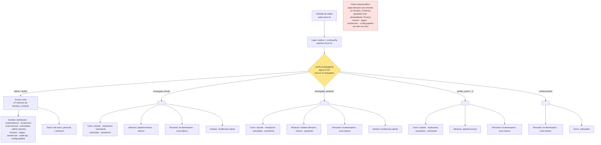
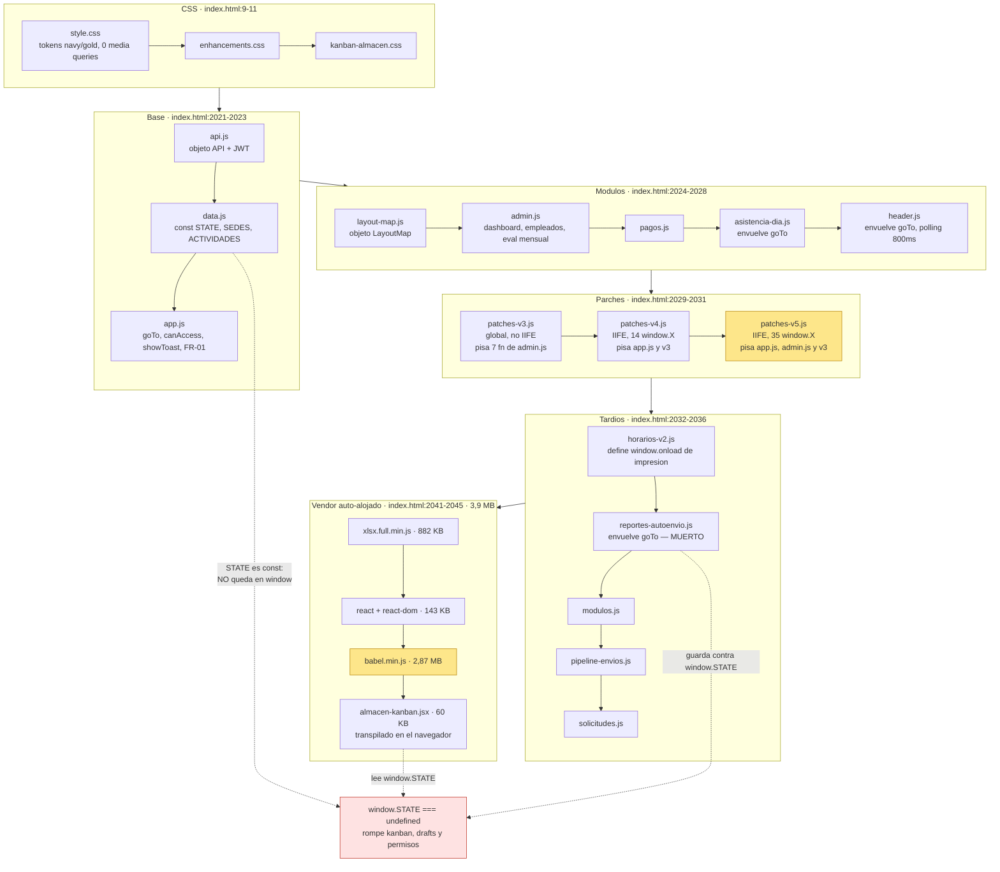

# Auditoría del frontend legacy — SCI-LB (LuceBien)

Fecha: 2026-08-13 · Alcance: `public/index.html`, `public/js/*.js`, `public/js/*.jsx`, `public/css/*.css`
Método: mapeo por búsqueda (Grep) y lectura dirigida de tramos. No se modificó ningún archivo.

Volumen auditado: 18 058 líneas de código de cliente (~1,1 MB de JS/JSX + 167 KB de CSS + 137 KB de HTML),
más 3,9 MB de vendor auto-alojado (`public/vendor/`).

| Archivo | Líneas | Rol |
|---|---:|---|
| `public/index.html` | 2 106 | Shell único: 23 vistas + 12 modales + todo el markup estático |
| `public/js/admin.js` | 3 251 | Dashboard, colaboradores, incidencias, eval. mensual, actividades, auditoría, asistencias |
| `public/js/app.js` | 2 175 | Bootstrap, sesión, navegación, permisos, FR-01, evaluación de reporte, valores 360° |
| `public/js/patches-v5.js` | 1 646 | Monkey-patching global (login, incidencias, layout, accesos, horarios Excel) |
| `public/js/horarios-v2.js` | 967 | Horarios: parser Excel, periodos, slots, grilla imprimible |
| `public/js/almacen-kanban.jsx` | 888 | Único módulo React (kanban de pipeline), transpilado en el navegador |
| `public/js/solicitudes.js` | 662 | Flujo de solicitudes (BPMN, undo, impresión, drafts) |
| `public/js/patches-v4.js` | 583 | Monkey-patching de reporte/evaluación/actividades/layout |
| `public/js/layout-map.js` | 390 | Motor de renderizado del plano de tienda (zonas de limpieza) |
| `public/js/header.js` | 404 | Header global: reloj, conexión, campana, usuario |
| `public/js/modulos.js` | 354 | Préstamos, bajas, garantías |
| `public/js/pagos.js` | 355 | Pagos a colaboradores, comprobante imprimible |
| `public/js/reportes-autoenvio.js` | 271 | Drafts FR-01 + auto-envío + alertas de deadline **(código muerto, ver H-02)** |
| `public/js/patches-v3.js` | 231 | Monkey-patching del editor de layout y gestión de actividades |
| `public/js/pipeline-envios.js` | 204 | Envíos recibidos en tienda + calificación |
| `public/js/asistencia-dia.js` | 135 | Asistencia diaria |
| `public/js/data.js` | 111 | Constantes de dominio y objeto `STATE` |
| `public/js/api.js` | 104 | Cliente HTTP con JWT |

---

## 1. Mapa de pantallas y vistas

Cada vista es un `
` dentro de `index.html`; sólo una lleva la clase
`active` a la vez. El "rol que la ve" corresponde a `DEFAULT_PERMS` (`app.js:1712-1721`), que puede
sobreescribirse desde `/config/permisos`.

| Vista (`goTo` id) | Contenedor | Lógica de render | Roles con acceso por defecto | Endpoints consumidos | Propósito de negocio |
|---|---|---|---|---|---|
| `reporte` | `index.html:335` | `app.js:486` (`buildActTable`), `app.js:1022` (`triggerEnviarFR01`) | todos salvo confeccionista | `GET /actividades?sede`, `GET /layout?sede`, `GET /reportes?sede&fecha`, `POST /reportes` | FR-01: reporte diario por turno con actividades, layout de limpieza, extras e incidencias |
| `evaluacion` | `index.html:481` | `app.js:1124` → sobrescrito por `patches-v4.js:63`; envío en `patches-v4.js:235` | todos salvo confeccionista | `GET /reportes`, `GET /reportes/:id/detalle`, `PUT /reportes/:id/evaluar` | Un compañero que no estuvo en el turno califica el FR-01 recién enviado |
| `mi-desempeno` | `index.html:550` | `admin.js:1008` (`renderMiDesempeno`) | todos | `GET /dashboard/empleado?…`, `GET /valores/mi-resumen/:mes` | Vista personal de puntos, asistencia y valores |
| `eval-valores` | `index.html:556` | `app.js:1520` (`initEvalValores`) | todos | `GET /valores/config`, `GET /valores/mis-pendientes/:mes`, `POST /valores` | Evaluación 360° de valores entre compañeros (escala Likert) |
| `lavanderia` | `index.html:585` | `app.js:1794` (`initLavResponsables`), `app.js:961` (`enviarListaLav`) | encargado_tienda, ventas_junior(_2) | `POST /lavanderia`, `GET /lavanderia?…` | Tienda arma la lista de prendas que salen a lavandería |
| `pipeline-envios` | `index.html:1814` | `pipeline-envios.js:9` | encargado_tienda, ventas_junior(_2) | `GET/PUT /pipeline/envios…`, `GET/PUT /pipeline/envios-accesorios…` | Tienda recibe, valida y califica lo que le manda almacén |
| `kanban-almacen` | `index.html:1809` | `almacen-kanban.jsx:24` (`KanbanApp`), montaje en `:888` | encargado_almacen (+admin/dueño) | `/pipeline/kanban`, `/avanzar`, `/rechazar`, `/enviar`, `/registrar-local`, `/ranking`, `/bitacora`, `/diario`, `/historial`, `/config-puntos`, `/stream` (SSE) | Tablero de los 9 pasos del pipeline de lavandería |
| `retorno` | `index.html:716` | `app.js:1362` (`initRetorno`) | encargado_tienda, encargado_almacen | `GET /lavanderia?…`, `PUT /lavanderia/:id/validar` | Validación del retorno de listas de lavandería |
| `prestamos` | `index.html:1691` | `modulos.js:17` (`renderPrestamos`), `modulos.js:237` (`renderBajas`) | encargado_tienda, encargado_almacen | `GET/POST /prestamos`, `PUT /prestamos/item/:id`, `/prestamos/bajas/…` | Préstamo de prendas entre sedes, por lote y con estado por prenda |
| `garantias` | `index.html:1763` | `modulos.js:278` (`renderGarantias`) | encargado_almacen | `GET/POST /garantias`, `GET /garantias/resumen?tienda` | Garantías Yape de clientes — **el ítem de nav está deshabilitado ("Pronto"), ver H-09** |
| `solicitudes` | `index.html:1961` | `solicitudes.js:134` (`renderSolicitudes`) | todos | `GET/POST/PUT /solicitudes…` | Pedidos de prenda entre sedes: aprobar, rechazar, entregar, confirmar |
| `dashboard` | `index.html:781` | `admin.js:28` (`renderDashboard`) | admin, dueño | `GET /dashboard/admin`, `GET /pipeline/ranking` | Panel ejecutivo: KPIs, alertas, salud del pipeline, ranking |
| `empleados` | `index.html:857` | `admin.js:733` (`renderEmpleados`) | admin, dueño | `GET/POST/PUT /empleados`, `GET /empleados/credentials/all`, `PUT /config/permisos` | Alta/baja/edición de colaboradores y matriz de accesos |
| `incidencias-admin` | `index.html:894` | `admin.js:661` (`renderIncidenciasAdmin`) | admin, dueño, ambos encargados | `GET/POST/DELETE /incidencias` | Registro y seguimiento de incidencias que descuentan puntos |
| `evaluacion-mensual` | `index.html:936` | `admin.js:1145` (`initEvalMensual`) | admin, dueño | `GET /evaluaciones/…`, `POST /evaluaciones/mensual`, `GET /config/eval-pesos`, `GET /ventas/bonus/…` | Hub con 6 pestañas (`app.js:2094`): Dashboard, Evaluar, Asistencias, Pagos, Valores 360°, Configuración |
| `gestion-actividades` | `index.html:1495` | `admin.js:1673` → sobrescrito por `patches-v3.js:19` | admin, dueño | `GET /actividades/admin?sede`, `POST/PUT/DELETE /actividades`, `GET/PUT /layout` | Catálogo de actividades por sede + editor visual del layout de tienda |
| `admin-reportes` | `index.html:1874` | `admin.js:2025` (`renderAdminReportes`) | admin, dueño | `GET /reportes?…` | Historial de FR-01, anulación y reenvío |
| `horarios-admin` | `index.html:2006` | `horarios-v2.js:595` | admin, dueño | `/horarios/periodos`, `/horarios/slots`, `/horarios/vigente` | Periodos y slots de horario; importación desde Excel |
| `asistencias` | `index.html:1371` | `asistencia-dia.js:23` (`renderAsistDia`) | admin, dueño | `GET /asistencias/del-dia`, `POST/DELETE /asistencias` | Asistencia diaria manual (previa al huellero) |
| `pagos` | `index.html:1282` | `pagos.js:7` (`renderPagos`) | admin, dueño | `GET/POST/PUT /pagos`, `GET /pagos/sugerir` | Pagos a colaboradores y comprobante imprimible |
| `audit-log` | `index.html:1918` | `admin.js:2063` (`renderAuditLog`) | admin, dueño | `GET /audit?…`, `GET /audit/stats` | Bitácora de acciones POST/PUT/DELETE |
| `config-pipeline` | `index.html:1901` | `admin.js:2127` (`renderCfgPipeline`) | admin, dueño | `GET/PUT /pipeline/config-puntos` | Pesos de puntos por etapa del pipeline |
| `almacen` | `index.html:746` | `app.js:1432` (`renderAlmacenListas`) | **ninguno** | `GET /lavanderia?…` | Vista huérfana: no está en `PAGES_CONFIG` ni tiene ítem de nav → inalcanzable (H-10) |

**Pantallas fuera del sistema de páginas:** selección de sede (`index.html:16`, `app.js:26`) y login
(`index.html:30`, cuyo markup es reescrito en caliente por `patches-v5.js:39`).

---

## 2. Arquitectura real

### 2.1 Carga

`index.html` es una única página que ya contiene el markup completo de las 23 vistas y los 12 modales
globales. No hay bundler, ni módulos ES, ni imports: 17 archivos `<script>` clásicos en secuencia
(`index.html:2021-2036`), seguidos del vendor y del único archivo JSX (`index.html:2041-2045`).
Cada `<script>` lleva un query string de versión manual (`?v=1780400000`) que hace de cache-busting;
esos números están desincronizados entre sí y deben editarse a mano en cada despliegue.

El orden es funcionalmente significativo, no arbitrario: `data.js` debe definir `STATE` y `SEDES`
antes que `app.js`; `admin.js` define funciones que `patches-v3/v4/v5` sobrescriben; y
`almacen-kanban.jsx` se carga al final porque necesita React, ReactDOM y Babel ya presentes.

### 2.2 Navegación

Todo pasa por `goTo(pageId, el)` (`app.js:1759`), invocada desde `onclick` en línea del sidebar
(`index.html:238-262`). La función:

1. verifica `canAccess(pageId)` (`app.js:1734`) y aborta con un toast si no hay permiso,
2. quita `.active` de todas las `.page` y de todos los `.nav-item`,
3. añade `.active` al `div#page-<id>`,
4. ejecuta un `if` por cada vista para disparar su función de carga (28 condicionales encadenados,
   `app.js:1770-1793`).

No hay router, ni URL, ni historial: recargar el navegador siempre devuelve al inicio, no se puede
compartir un enlace a una vista y el botón "atrás" cierra la aplicación.

`goTo` es envuelta después de su definición por **cuatro capas distintas**:

| Envoltorio | Archivo:línea | Qué añade |
|---|---|---|
| base | `app.js:1759` | permisos + activación de página + dispatch de render |
| asistencia | `asistencia-dia.js:105` (`hookOnce`) | re-render de asistencias; si `goTo` aún no existe, hace polling cada 200 ms hasta encontrarla |
| header | `header.js:329` (`hookGoTo`) | pinta el título de la página; se instala desde un `setInterval` de 800 ms |
| auto-envío | `reportes-autoenvio.js:256` | debía enganchar el ciclo de drafts del FR-01 — **nunca se activa** (H-02) |

El resultado es que el orden real de la cadena de decoradores depende de temporizadores, no del
orden de los `<script>`.

### 2.3 Estado

No hay store. El estado vive en tres lugares:

- **`STATE`** (`data.js:98`): objeto literal con sesión (`user`, `sede`), el borrador del FR-01
  (`fr01`), y varias cachés (`empleadosCache`, `listasCache`, `incidenciasCache`, `_permisos`,
  `_layoutZonas`, `_gaAllActs`, `_extras_*`). Se muta directamente desde cualquier archivo.
- **`localStorage`**: `lb_token`, `lb_user`, `lb_kanban_token`, `lb_device_sede`,
  `lb_sidebar_collapsed`.
- **El propio DOM**: es la fuente de verdad para casi todos los formularios. Hay **1 161 llamadas a
  `getElementById`** en `public/js/`; funciones críticas como `triggerEnviarFR01` (`app.js:1022`) o
  `guardarEvalMensual` (`admin.js:1595`) leen sus datos de negocio directamente de los inputs.

La compartición entre módulos es por **globales implícitas**: `var` y `function` de nivel superior
(que sí quedan en `window`), más asignaciones explícitas `window.X = …`. Hay 583 handlers `on*` en
línea (305 en `index.html`, 278 generados dentro de plantillas de `innerHTML`), lo que obliga a que
prácticamente cada función sea global.

**No existe reactividad.** `header.js:314` la simula con un `setInterval` de 800 ms que compara una
firma del usuario (`u.id+'|'+u.nombre+'|'+u.rol+…`) contra la anterior y repinta si cambió. En
paralelo corren: reloj cada 1 s (`header.js:346`), ping de conexión cada 20 s (`header.js:347`),
campana cada 30 s (`header.js:372`), refresco de `/auth/me` cada 30 s (`header.js:358`), alertas de
turno cada 15 s (`app.js:244`), polling de solicitudes cada 20 s (`solicitudes.js:132`), polling del
kanban cada 30 s (`almacen-kanban.jsx:96`) y un `setInterval` de 2 s que reescribe atributos
`autocomplete` en todo el DOM (`patches-v5.js:234`).

### 2.4 Renderizado

Dos paradigmas conviven. El 95 % del sistema construye HTML como cadenas y lo asigna con
`innerHTML` (**239 asignaciones** repartidas por 15 archivos). El módulo `kanban-almacen` es React 18
con hooks, pero transpilado por Babel **en el navegador en cada carga**.

---

## 3. El sistema de "patches" — deuda crítica

Los tres archivos `patches-v*.js` no son parches puntuales: contienen comportamiento de producción
que **no existe en ningún otro lugar**. Se cargan en orden estricto (v3 → v4 → v5,
`index.html:2029-2031`) después de `app.js` y `admin.js`, y cada uno pisa definiciones anteriores.

### 3.1 Mecánica de sobreescritura

- **`patches-v3.js` no está encapsulado**: sus `function foo(){}` de nivel superior son declaraciones
  globales que reemplazan a las homónimas de `admin.js` por el simple hecho de evaluarse después.
  También redefine variables: `var _ZONA_TIPOS` (`patches-v3.js:5`) machaca la de `admin.js:2795`.
- **`patches-v4.js` y `patches-v5.js` sí son IIFE** (`patches-v4.js:6`, `patches-v5.js:5`), por lo que
  deben usar `window.X = …` explícito para exportar. Varios capturan la versión previa antes de
  reemplazarla (`_origShowConfirm`, `_origCheckAlertas` en `patches-v5.js:73`, `_origSelectSede` en
  `patches-v5.js:212`, `_origAbrirIncRap` en `patches-v5.js:163`), formando cadenas de decoradores.

### 3.2 Qué sobrescribe cada uno

**`patches-v3.js` — editor de layout y gestión de actividades (7 reemplazos + ~15 funciones nuevas)**

| Función | Definición original | Reemplazo |
|---|---|---|
| `gaCargarActividades` | `admin.js:1673` | `patches-v3.js:19` |
| `gaRenderLayout` | `admin.js:2745` | `patches-v3.js:126` |
| `gaLoadLayout` | `admin.js:2736` | `patches-v3.js:127` |
| `gaLayoutSave` | `admin.js:2884` | `patches-v3.js:128` |
| `gaLayoutDeleteZona` | `admin.js:2876` | `patches-v3.js:129` |
| `_gaZonaModal` | `admin.js:2805` | `patches-v3.js:139` |
| `gaLayoutAddZona` / `gaLayoutEditZonaIdx` | `admin.js:2848` / `:2861` | `patches-v3.js:163` / `:164` |
| `LayoutMap._zoneStyle` / `._applyVisualStyles` | (no existían) | `patches-v3.js:170` / `:171` |

Sólo en v3 vive: el modal de layout a pantalla completa (`gaAbrirLayoutModal`, `:112` y de nuevo en
`:221`), la autogeneración de códigos de zona por prefijo (`_gzAutoCode`, `:9`), **toda la regla de
frecuencia de actividades** (`_actAplicaHoy`, `:10` — diaria / interdiaria / semanal por día /
quincenal / mensual) y el estilo visual de cada tipo de mobiliario en el plano (`:170`).

**`patches-v4.js` — reporte, evaluación, actividades (14 reemplazos)**

`marcarTodas` (`:10`), `updateReportSummary` (`:19`), `_evalSelCal` (`:49`), `prepararEval` (`:63`),
`calcEvalPreview` (`:131`), `evalLayoutMarkAll` (`:158`), `evalActMarkAll` (`:211`),
`triggerEnviarEval` (`:235`), `gaToggleActivo` (`:285`), `gaEditarActividad` (`:301`),
`gaGuardarActividad` (`:329`), `gaDuplicarActividades` (`:362`), `showConfirm` (`:380`),
`gaLayoutDeleteZona` (`:393`, sobre la de v3).

Sólo en v4 vive: la **interfaz de evaluación con tres botones emoji ✅👁❌** (la versión de `app.js`
usaba `<select>`), el manejo null-safe de calificaciones que llegan como `NULL` desde SQLite
(`:243-256`), el cálculo del puntaje de evaluación combinando actividades + zonas del layout
(`:252-262`), y la elevación de `z-index` de los modales de confirmación cuando hay un modal de layout
abierto (`:380-388`).

**`patches-v5.js` — cambios globales (35 asignaciones a `window`, 1 646 líneas)**

Es el archivo más peligroso porque no parchea: **reconstruye interfaces enteras**.

| Bloque | Línea | Comportamiento exclusivo |
|---|---|---|
| Login | `:10`, `:39` | Reescribe el DOM del formulario de login: sustituye `#loginNombre` por `#loginUser` y añade el botón de mostrar/ocultar contraseña. `doLogin` de `app.js:134` queda **muerto** porque lee un id que ya no existe. |
| Alertas | `:74` | Decora `checkAlertas` con avisos de luces exteriores a las 17:30 y 18:30, sólo en sedes tipo tienda |
| Incidencias | `:95`, `:142`, `:164` | Catálogo `TIPOS_INCIDENCIA_COMPLETOS`, prohibición de auto-reportarse, y carga dinámica de tipificaciones desde `/incidencias/tipos/list` con autoajuste de nivel y puntos |
| Sede por dispositivo | `:213`, `:219` | Recuerda la sede en `localStorage` y salta directo al login de esa sede |
| Anti-autofill | `:233` | `setInterval` perpetuo de 2 s que fuerza `autocomplete=off` |
| Terminología | `:258` | Redefine `EMP_ROLES_LABEL` |
| CSS de marca | `:341` | Inyecta un `<style id="lb-brand-override">` en runtime |
| Sidebar | `:342`, `:356` | Colapso persistente + tooltips por `data-label` |
| Herramientas de layout | `:378-776` | Recodificar, rotar, traer al frente/fondo, snap a grilla, clonar layout entre sedes, menú contextual ampliado, estadísticas, selección masiva, editor de color por zona, y el arreglo de referencias `sobre_cod` huérfanas al borrar una zona (`:726`) |
| **Configurar Accesos** | `:785-1204` | **Reemplaza por completo** `abrirConfigAccesos`/`guardarAccesos`/`resetAccesos` de `admin.js:926-1006`. Añade matriz por sector, puestos personalizados vía `/config/puestos` y grupos de rangos vía `/config/grupos-rangos`. Los 80 lineas originales de `admin.js` son código muerto. |
| Import/Export Excel de horarios | `:1214-1431` | Formato de columnas, validación de sedes y carga masiva a `/asistencias/horarios/bulk` |
| Editor de tipificaciones | `:1434-1541` | CRUD de tipos de incidencia con puntos y nivel por defecto |
| Tooltips de layout | `:1544-1646` | Carga y edición de `/config/layout-tooltips` |

**Qué se perdería al reescribir sin leer estos tres archivos:** el formulario de login real, las reglas
de frecuencia de actividades, el editor de layout completo (aproximadamente 900 líneas repartidas entre
v3 y v5), la interfaz de evaluación por emoji, la matriz de accesos con puestos personalizados, la
importación de horarios desde Excel, el catálogo de tipificaciones de incidencias y las alertas de
luces. Las versiones "originales" que quedan en `app.js` y `admin.js` son anteriores y en varios casos
ya no funcionan contra el DOM actual.

---

## 4. Diagramas

### 4.1 Árbol de navegación por rol

### 4.2 Orden de carga de scripts y dependencias

---

## 5. Hallazgos

Severidad: **Crítica** (pérdida de datos, dinero o control de acceso) · **Alta** (funcionalidad rota o
riesgo real) · **Media** (mantenimiento, rendimiento, UX) · **Baja** (higiene).

### Seguridad y lógica de negocio en el cliente

**H-01 · Crítica · El modelo de permisos completo vive sólo en el navegador.**
`PAGES_CONFIG` (`app.js:1675`), `DEFAULT_PERMS` (`app.js:1712`) y `canAccess` (`app.js:1734`) definen
22 módulos × 7 roles, pero el servidor sólo distingue dos niveles: token válido (`middleware/auth.js:4`)
y administrador (`middleware/auth.js:18`). Además, 11 de los 20 routers no aplican ninguna verificación:
`routes/empleados.js`, `config.js`, `actividades.js`, `layout.js`, `lavanderia.js`, `pipeline.js`,
`prestamos.js`, `garantias.js`, `reportes.js`, `solicitudes.js` y `ventas.js` no invocan `verifyToken`
en ninguna ruta, y `server.js:24` sólo monta un middleware de auditoría que explícitamente no bloquea.
Ocultar el ítem del sidebar (`applyPermissions`, `app.js:1742`) es la única barrera efectiva.

**H-02 · Crítica · `window.STATE` nunca existe: tres módulos son código muerto silencioso.**
`data.js:98` declara `const STATE = {…}`. En un script clásico, `const` de nivel superior crea un
binding léxico global que **no** se refleja como propiedad de `window`. Consecuencias verificadas:

- `almacen-kanban.jsx:54-55`: `esSupervisorSesion()` siempre devuelve `false`, así que el auto-login de
  admin/dueño/encargado_almacen en el kanban nunca ocurre. Peor: el intervalo de `almacen-kanban.jsx:97`
  (`if(esSupervisorSesion())return;`) tampoco corta, y **cada 60 segundos borra `lb_kanban_token` y
  desloguea al operario del tablero**.
- `reportes-autoenvio.js:33,39,70,127,153,189`: todas las funciones del módulo abren con
  `if (!window.STATE …) return;`. El autosave de borradores cada 45 s, la restauración de drafts, el
  pre-llenado del encargado desde el horario vigente y las alertas de deadline **nunca se ejecutan**.
  El módulo tiene además un segundo defecto independiente: engancha `goTo` comparando
  `pageId === 'fr01'` (`reportes-autoenvio.js:262`), cuando el id real de la vista es `'reporte'`.
- `patches-v5.js:834` y `patches-v5.js:1000`: tras guardar la matriz de accesos, `STATE._permisos` no
  se actualiza y `applyPermissions()` se ejecuta con permisos obsoletos; el cambio sólo se ve al recargar.

**H-03 · Crítica · El servidor confía en los puntajes calculados por el cliente.**
`triggerEnviarFR01` (`app.js:1084`) calcula `puntajeFinal` en el navegador y lo envía; `routes/reportes.js:145`
lo inserta tal cual (`b.puntaje||0`). Lo mismo con la evaluación: `patches-v4.js:262` calcula
`puntajeEval` y `routes/reportes.js:207` hace `UPDATE … SET puntaje_eval=?, puntaje=?`. El identificador
del reporte también se genera en el cliente (`genReporteId`, `app.js:1016`). Un usuario puede fijar su
propio puntaje desde la consola del navegador.

**H-04 · Crítica · Importes en soles calculados y enviados por el cliente.**
`getExtrasData` (`app.js:761`) construye `precio_unitario` y `monto_total` de las actividades
remuneradas a partir de la caché local, y `routes/reportes.js:152` los persiste sin revalidar contra el
catálogo de `actividades`. El pago por trabajo extra es manipulable desde el navegador.

**H-05 · Crítica · Los códigos operativos de 4 dígitos de todos los colaboradores se descargan a cada cliente.**
`cargarEmpleados` (`app.js:377`) llama a `/empleados/by-sede/:sede`, y `sanitizeEmp`
(`routes/empleados.js:33`) incluye `cod` en la lista de campos públicos para roles no-admin. Con eso
`validarCodigo` (`app.js:1329`) valida en local. Pero ese mismo `cod` es el único factor de
autenticación de `/api/auth/login-code` (`almacen-kanban.jsx:52`), y es lo que firma el FR-01
(`app.js:1050`), la evaluación (`patches-v4.js:236`) y las solicitudes (`solicitudes.js:206`). Cualquier
colaborador puede leer `STATE.empleadosCache` en devtools y actuar como otro.

**H-06 · Alta · El token JWT viaja en la query string del stream SSE.**
`almacen-kanban.jsx:67`: `'/api/pipeline/stream?token=' + encodeURIComponent(tk)`. Las query strings
quedan en logs de acceso, historial y cabeceras `Referer`.

**H-07 · Alta · Toda la fórmula de la evaluación mensual está en el cliente, y duplicada.**
`calcEvalMensualPreview` (`admin.js:1552`) y `guardarEvalMensual` (`admin.js:1595`) contienen **dos
copias literales** del mismo cálculo: escala `compTotal/32*20`, siete pesos ponderados, resta de
incidencias, suma de bonus y umbrales 17/14/11 para la recomendación. Sólo el resultado se envía al
servidor. Cualquier divergencia futura entre ambas copias produce una previsualización que no coincide
con lo guardado. Además `evaluador: STATE.user?.nombre||'Admin'` (`admin.js:1652`) permite falsificar
la identidad del evaluador.

**H-08 · Alta · Todas las restricciones horarias del FR-01 son validaciones sólo de cliente.**
`app.js:1027-1032`: apertura a las 8:00, corte de turno mañana/completo a las 15:00, apertura de turno
tarde a las 15:00 y cierre a las 23:00. También la comprobación de duplicado por turno
(`app.js:1039-1048`) se hace consultando `/reportes` desde el navegador. `POST /reportes`
(`routes/reportes.js:145`) no revalida nada de esto.

**H-09 · Alta · Riesgo de XSS almacenado en todo el sistema.**
No existe ninguna función de escapado de HTML en `public/js/` (`admin.js:2972` es escapado de CSV, no
de HTML). Hay 239 asignaciones a `innerHTML` que interpolan datos del servidor sin sanear. Ejemplo
concreto: `admin.js:691` inserta `${inc.descripcion}`, texto libre escrito por cualquier colaborador al
reportar una incidencia. Patrones equivalentes en `app.js:511` (nombres de actividad), `modulos.js`,
`solicitudes.js` y `pagos.js`.

### Funcionalidad rota o inalcanzable

**H-10 · Alta · Seis vistas sin forma de llegar a ellas.**
`page-almacen` (`index.html:746`) ni siquiera figura en `PAGES_CONFIG`, por lo que `canAccess` la
rechaza siempre. `retorno`, `garantias`, `pagos`, `asistencias` y `config-pipeline` están en
`PAGES_CONFIG` y `goTo` sabe renderizarlas (`app.js:1779-1793`), pero ningún ítem del sidebar las
invoca — el único de garantías está deshabilitado con `pointer-events:none` y la etiqueta "Pronto"
(`index.html:248`). `pagos` y `asistencias` sólo son accesibles como pestañas dentro de
Evaluación Mensual (`app.js:2094`).

**H-11 · Alta · El gotcha de `{0 && <X/>}` está presente en cuatro sitios del JSX.**
Con enteros de SQLite, React renderiza el literal `0`:
`almacen-kanban.jsx:365` (`{p.lista_lavanderia_id && …}`), `:716` (`{… && ev.enviado && …}`),
`:718` (`{(ev.tipo==='lista' && ev.ref_id) && …}`) y `:719` (`{(ev.tipo==='prenda' && ev.lista_id) && …}`).
Corrección: envolver en `Boolean(…)`.

**H-12 · Media · `optgroup` sin cerrar en el selector de incidencias.**
`patches-v5.js:148`: `if (t.startsWith('—')) return '<optgroup label="…">';` abre grupos que nunca se
cierran. El navegador los repara, pero el anidamiento resultante no es el pretendido.

### Manejo de errores y estados de interfaz

**H-13 · Alta · El cliente HTTP traga todos los errores y devuelve `null`.**
`API.request` (`api.js:21-35`) captura cualquier excepción, muestra un toast y retorna `null`. El patrón
en todo el código es `const r = await API.get(…); if (!r) return;` — indistinguible entre "no hay datos",
"error 500", "sin red" y "sin permiso". Un `401` provoca `location.reload()` directo (`api.js:27`),
descartando sin aviso el formulario que el usuario estuviera llenando. Además `showToast` se invoca desde
dentro de `api.js` (`api.js:32`) aunque esté definida en `app.js:2045`: acoplamiento inverso al orden de carga.

**H-14 · Media · Estados de carga casi inexistentes.**
Sólo 10 apariciones de texto "Cargando" en todo el frontend, frente a 23 vistas y más de 120 llamadas a
API. La mayoría de las vistas muestran la tabla anterior hasta que llega la respuesta, sin skeleton ni
spinner. `renderDashboard` (`admin.js:28`) encadena varias peticiones sin ningún indicador.

**H-15 · Media · Estados vacíos irregulares.**
Existe la convención `<td class="empty-cell">` pero sólo se usa 19 veces en total (`admin.js` 8,
`app.js` 6, `modulos.js` 4, `solicitudes.js` 1). Vistas como pagos, envíos recibidos o el historial del
kanban se quedan en blanco cuando no hay registros, sin distinguir "vacío" de "falló la carga".

**H-16 · Media · Bucles secuenciales de peticiones en el kanban.**
`almacen-kanban.jsx:107` (`mv`), `:110` (`fTanda`), `:111` (`approve`) y `:113` (`dRej`) recorren las
prendas seleccionadas con `for` + `await`, una petición por prenda. Avanzar 40 prendas son 40 viajes al
servidor en serie, con la interfaz bloqueada por `busy`.

### Duplicación de código

**H-17 · Alta · El editor de layout está implementado dos veces.**
`admin.js:2733-2906` (`_gaLayoutZonas`, `_ZONA_TIPOS`, `_gaZonaModal`, `gaLayoutAddZona`,
`gaLayoutEditZonaIdx`, `gaLayoutDeleteZona`, `gaLayoutSave`, `gaLoadLayout`, `gaRenderLayout`) queda
íntegramente muerto tras `patches-v3.js:5-170`, que redefine cada uno de esos símbolos. Son ~175 líneas
que un lector razonable creería activas.

**H-18 · Alta · La configuración de accesos está implementada dos veces.**
`admin.js:926-1006` (`abrirConfigAccesos`, `guardarAccesos`, `resetAccesos`) es reemplazada por
`patches-v5.js:830-1007`. Idem: ~80 líneas muertas.

**H-19 · Media · Cuatro sistemas de modales coexistiendo.**
`showConfirm`/`showPrompt` (`app.js:1640`/`:1647`) decorados por `patches-v4.js:380`; `lbConfirm`,
`lbPrompt` y `lbForm` en `horarios-v2.js`; los desplegables propios `sDD`/`sColorDD` de
`solicitudes.js:77`/`:97`; y modales construidos ad hoc con `document.createElement` en
`patches-v3.js:112`, `:139` y `patches-v5.js`. Estilos, comportamiento de cierre y z-index divergen.

**H-20 · Media · Constantes de dominio duplicadas con valores distintos.**
El color "Azul noche" es `#1e2a4a` en `almacen-kanban.jsx:18`, `#0a1628` en `solicitudes.js:18` y
`#0a1628` en `index.html:2062`. Las tallas están en `data.js:71` (`TALLAS_HTML`, sin uso), en
`solicitudes.js:12-15` y en `solicitudes.js:60-61`. Las etiquetas de rol existen tres veces:
`app.js:1664`, `admin.js:723` (`EMP_ROLES`) y `patches-v5.js:258`.

**H-21 · Media · Constantes muertas o contradictorias en `data.js`.**
`PESOS` (`data.js:89`) declara pesos de evaluación (0.15/0.25/0.25/0.15/0.10/0.10) que **no coinciden**
con los defaults reales usados en `admin.js:1566-1572` (25/25/10/10/10/15/5) y no se referencia en ningún
sitio. `TALLAS_HTML` (`data.js:71`) y `TIPOS_PRENDA` (`data.js:66`) tampoco tienen consumidores.
`TIPOS_INCIDENCIA` (`data.js:69`) sólo lo usa `app.js:1353`, función que `patches-v5.js:142` sobrescribe.

### Rendimiento

**H-22 · Alta · Transpilación de JSX en el navegador en cada carga.**
`index.html:2044` carga `babel.min.js` (**2,87 MB sin comprimir**) y `index.html:2045` le entrega
`almacen-kanban.jsx` (60 KB) con `type="text/babel"` para que lo compile en tiempo de ejecución, en cada
visita y en cada equipo de las cuatro sedes. Sumando `xlsx.full.min.js` (882 KB) el vendor pesa 3,9 MB.
Babel sólo sirve a un módulo de los 23.

**H-23 · Media · Ocho temporizadores globales corriendo en paralelo.**
Detallados en §2.3. Los más cuestionables: `header.js:314` (comparación de estado cada 800 ms),
`patches-v5.js:234` (recorre `.code-masked, input[type=password]` de todo el documento cada 2 s) y el
polling de solicitudes (`solicitudes.js:132`), que además re-renderiza la tabla completa cada 20 s
descartando el scroll y la selección del usuario.

**H-24 · Media · Ningún listado tiene paginación.**
`renderIncidenciasAdmin` (`admin.js:686`), `renderAdminReportes` (`admin.js:2025`), `renderAuditLog`
(`admin.js:2063`), `renderSolicitudes` (`solicitudes.js:134`) y el historial del kanban construyen la
tabla entera con `.map().join('')` sobre la respuesta completa. El caso extremo es
`admin.js` con `GET /pipeline/bitacora?limit=2000`: dos mil filas en un solo `innerHTML`. El filtrado
también es local, lo que obliga a traer todo el conjunto.

**H-25 · Media · Re-render total en cada interacción.**
Al no haber diffing fuera del kanban, cualquier cambio reemplaza el `innerHTML` del contenedor completo.
Esto destruye el foco, el scroll y el estado de los inputs, y es la causa de que existan mecanismos de
borrador manuales como `_soliSaveDraft` (`solicitudes.js:296`) y `_soliEntregaDraft` (`solicitudes.js:334`).

### Accesibilidad

**H-26 · Alta · La aplicación no es operable por teclado ni por lector de pantalla.**
En `index.html`: 115 elementos `<label>` y **0** atributos `for`; **0** atributos `role`; **0**
`tabindex`; sólo 7 atributos `aria-*` en 2 106 líneas. 62 elementos `div`/`span`/`td` llevan `onclick`
sin ser focalizables, más otros 53 generados desde JavaScript. La navegación entera del sidebar
(`index.html:238-262`) son `div.nav-item` con `onclick`. Los modales no atrapan el foco ni cierran con
`Escape`. `almacen-kanban.jsx` no contiene un solo atributo de accesibilidad.

**H-27 · Media · Contraste y semántica del color como único portador de información.**
El estado se comunica con emoji y color (`🔴 Alto` / `🟡 Medio` / `🟢 Bajo`, `patches-v5.js:157`;
botones ✅👁❌ en `patches-v4.js:49`). No hay alternativa textual ni patrón visual redundante.

**H-28 · Media · Sin diseño responsive en la hoja base ni respeto a preferencias del sistema.**
`public/css/style.css` (876 líneas) tiene **cero** `@media`; sólo `enhancements.css` añade 10 y
`kanban-almacen.css` 2. No hay `prefers-reduced-motion` ni `prefers-color-scheme` en ninguna de las tres
hojas, pese a que `style.css:27` define animaciones permanentes (`pulseGlow`) y `index.html:594` un
ticker con `animation: tickerScroll 10s linear infinite`.

### Valores de negocio codificados a mano

Contradicen el principio de "todo configurable" del proyecto.

| Valor | Ubicación | Observación |
|---|---|---|
| Horarios de corte del FR-01 (8:00 / 15:00 / 23:00) | `app.js:1027-1032` | Repetidos como texto en los toasts y de nuevo en `reportes-autoenvio.js:190-203` (14:00 / 20:00) |
| Alertas de luces exteriores 17:30 y 18:30 | `patches-v5.js:74-91` | Sólo para sedes tipo tienda |
| Umbrales de recomendación 17 / 14 / 11 sobre 20 | `admin.js:1578` y `admin.js:1621` | Duplicados |
| Escala de competencias `compTotal/32*20` | `admin.js:1555` y `admin.js:1600` | El 32 (8 competencias × 4) es implícito |
| Umbrales de bonus de ventas 120 % / 100 % / 80 % | `admin.js:1480-1482` | Los importes sí vienen de config, los umbrales no |
| Pesos por defecto 25/25/10/10/10/15/5 | `admin.js:1566-1572`, `admin.js:1635-1641` | Triplicados como fallback |
| Catálogo de actividades con pesos 1/3/5 | `data.js:27-57` | Fallback declarado "actualizado según PDF oficial marzo 2026" |
| Rúbricas de las 8 competencias, incluidos importes ("Faltó +S/300") | `data.js:75-84` | Reglas de negocio en constantes de frontend |
| Nombres de las 4 sedes y su tipo | `data.js:19-24`, `almacen-kanban.jsx:16`, `horarios-v2.js:12-20` | Tres listas independientes |
| Dimensiones por tipo de mobiliario del layout | `patches-v3.js:136` | 14 tipos con ancho/alto fijos |
| Etapas del pipeline y transiciones `NEXT` | `almacen-kanban.jsx:11-14` | Las 9 etapas y su orden están codificadas en el cliente |
| Puntos por envío (`ids.length*2`) | `almacen-kanban.jsx:112` | Constante mágica en medio de una llamada |
| Catálogos de colores, telas, modelos y tallas | `solicitudes.js:12-62` | 11 listas fijas |
| Tipos de incidencia | `data.js:69` y `patches-v5.js:95` | Dos catálogos; el segundo sí tiene versión en base de datos vía `/incidencias/tipos/list` |

### Higiene

**H-29 · Baja · Cache-busting manual y desincronizado.** Los `?v=` de `index.html:2021-2045` van desde
`1775870000` hasta `1780500000`; se editan a mano y es fácil olvidar uno tras un cambio.

**H-30 · Baja · Código sin efecto.** El handler `focusout` de `patches-v5.js:246-254` tiene el cuerpo
vacío salvo un comentario. El bucle sobre `.nav-section` en `applyPermissions` (`app.js:1752-1756`)
contiene sólo un comentario "Check if any visible nav-items follow" y no hace nada.
`toggleExtras` (`app.js:735`) está marcada como deprecada y vacía.

**H-31 · Baja · Markup suelto fuera del `<main>`.** El desplegable de colores `#lavColorDropdown`
(`index.html:2058`) y el modal `#modalAsist` (`index.html:2084`) quedan después del bloque de
`<script>`, fuera de cualquier contenedor de página.

**H-32 · Baja · Dependencia externa remanente.** Pese al comentario de `index.html:2037` sobre eliminar
las CDN, `index.html:7-8` sigue cargando Google Fonts desde `fonts.googleapis.com`. Si la PC de la
empresa pierde internet, la tipografía cae a los fallbacks del sistema.

---

## 6. Prioridades sugeridas

1. **Antes de tocar nada**: `patches-v3/v4/v5` son la especificación real de login, editor de layout,
   evaluación por emoji, matriz de accesos, importación de horarios y tipificaciones. Extraer esa
   lógica a documento o a tests antes de reescribir (§3).
2. **Corregir H-02** — es un arreglo de una línea (`window.STATE = STATE;` en `data.js`) que reactiva
   el autoguardado de borradores del FR-01, el auto-login del kanban y la aplicación inmediata de
   permisos, y detiene el deslogueo cada 60 s del tablero de almacén. Conviene validar antes qué
   comportamiento reaparece, porque lleva meses inactivo.
3. **Mover al servidor** el cálculo de puntajes, importes y las ventanas horarias (H-03, H-04, H-08), y
   aplicar autorización por rol en los 11 routers desprotegidos (H-01).
4. **Dejar de exponer `cod`** en `/empleados/by-sede` y sustituir la validación local por una
   verificación contra el servidor (H-05).
5. En la migración a Next.js: enrutado real con URL, escapado por defecto vía JSX (elimina H-09),
   compilación en build (elimina H-22), y trasladar a la tabla `config` todos los valores de §"Valores
   de negocio codificados a mano".
