# Auditoría de reglas de negocio y flujos operativos — SCI-LB (LuceBien)

**Fecha:** 13 de agosto de 2026
**Alcance:** sistema legacy en `D:\Sistemas\Lucebien\SCI-LB` (Node.js + Express + better-sqlite3,
frontend HTML/JS con React transpilado en navegador). Se excluyen deliberadamente `packages/`,
`apps/`, `node_modules/`, `.claude/worktrees/` y `_local_backup_*`.
**Propósito:** documentar las reglas **tal como están implementadas**, no como deberían ser, para
servir de base al rediseño del sistema nuevo.

> **Advertencia de lectura.** Este documento es descriptivo, no normativo. Donde el código es
> ambiguo, contradictorio o simplemente inventa un valor, se dice explícitamente y se marca
> `⚠️ PENDIENTE DE CONFIRMAR`. La lista consolidada de esos puntos está al final.

---

## 0. Panorama: dónde vive realmente la lógica de negocio

Antes de entrar por proceso conviene fijar tres hechos estructurales, porque condicionan todo lo
que sigue.

**Primero: buena parte de las reglas vive en el frontend, no en el backend.** El orden del
pipeline, las transiciones permitidas entre etapas, la fórmula de la nota mensual y el puntaje del
reporte diario están calculados en JavaScript de navegador (`public/js/almacen-kanban.jsx`,
`public/js/admin.js`, `public/js/app.js`). El backend, en la mayoría de los casos, se limita a
persistir el número que el cliente le manda. Esto significa que las reglas son **eludibles**: un
`curl` con un token válido puede escribir cualquier etapa o cualquier nota.

**Segundo: la autorización efectiva es casi inexistente a nivel de endpoint.** El middleware
`auth` de `routes/pipeline.js:6` solo verifica que el JWT sea válido; no mira el rol. Los permisos
que el usuario percibe son un filtro de **visibilidad de páginas** en el cliente
(`public/js/app.js:1734-1740`, `DEFAULT_PERMS` en `public/js/app.js:1712-1720`). Salvo excepciones
puntuales que se señalan en cada sección, cualquier empleado autenticado puede ejecutar cualquier
acción operativa.

**Tercero: conviven dos generaciones de reglas superpuestas.** Hay al menos tres definiciones
distintas de los pesos de evaluación (`public/js/data.js:89-96`, `routes/config.js:106-112`,
`routes/evaluaciones.js:62-70`), dos catálogos de actividades extra y varias claves de `config`
sembradas que nadie lee jamás. Esto se detalla en la sección 9.

---

## 1. Pipeline de lavandería

### 1.1 Los estados reales en base de datos

La tabla `prendas` (`database/db.js:94-115`) guarda el estado en la columna `etapa TEXT DEFAULT
'recepcion'`. **No hay CHECK constraint, ni enum, ni tabla de catálogo de etapas**: la columna
acepta cualquier cadena que el cliente envíe.

El conjunto de etapas efectivamente usado se define en el frontend, en
`public/js/almacen-kanban.jsx:11`:

```js
const ETAPAS=['recepcion','lavado','empatado','refaccion','compostura','planchado','control_calidad','listo'];
```

A esas ocho se suman dos estados terminales que nunca aparecen en el tablero:

| Estado | Origen | Significado |
|---|---|---|
| `recepcion` | `almacen-kanban.jsx:11` | prenda ingresada al almacén |
| `lavado` | `almacen-kanban.jsx:11` | en lavado (con subtipo `tipo_lavado`) |
| `empatado` | `almacen-kanban.jsx:11` | piezas del terno reunidas |
| `refaccion` | `almacen-kanban.jsx:11` | arreglo de costura / sastrería |
| `compostura` | `almacen-kanban.jsx:11` | compostura y codificación |
| `planchado` | `almacen-kanban.jsx:11` | planchado |
| `control_calidad` | `almacen-kanban.jsx:11` | revisión final |
| `listo` | `almacen-kanban.jsx:11` | listo para envío; fija `aprobada=1` (`routes/pipeline.js:261`) |
| `enviado` | `routes/pipeline.js:330` | despachada a tienda; sale del kanban |
| `dividido` | `routes/pipeline.js:418` | terno matriz partido en saco + pantalón |

> ⚠️ **PENDIENTE DE CONFIRMAR — la etapa "Vacío" no existe en el código.**
> `CLAUDE.md` y `docs/brief-fable-ui.md:29,86,96` describen un pipeline de **9 pasos** que incluye
> "Vacío" entre Empatado y Refacción. El código implementa **8**, y `vacio` no aparece en ningún
> archivo del repositorio. `CONTEXTO-PROYECTO.md:16` describe la cadena sin Vacío, coincidiendo con
> el código. Hay que decidir si Vacío es un paso real que nunca se implementó, o un paso que se
> eliminó y quedó en la documentación.

### 1.2 Transiciones permitidas

El backend **no valida transiciones**. `PUT /api/pipeline/:id/avanzar`
(`routes/pipeline.js:246-273`) acepta cualquier `etapa_destino` que venga en el cuerpo y la escribe
tal cual (`routes/pipeline.js:250,263`). Las únicas dos validaciones son que la prenda exista
(`:248`) y que no esté dividida (`:249`).

El grafo real de transiciones es, por tanto, el de los botones del cliente:

- `NEXT` para avance por tanda: `almacen-kanban.jsx:14`
  `recepcion→lavado`, `lavado→empatado`, `empatado→refaccion`, `refaccion→planchado`,
  `compostura→planchado`, `planchado→control_calidad`.
- Botones individuales de la barra de acciones: `almacen-kanban.jsx:297-319`.
  Desde `recepcion` se puede ir a `lavado` (eligiendo tipo de lavado) o saltar directo a
  `refaccion` (`:303-304`). Desde `refaccion` se bifurca a `compostura` o a `planchado`
  (`:308-311`). Desde `control_calidad` se aprueba a `listo` (`:317`, función `approve()` en
  `:111`), se rechaza (`:315`) o se divide el terno (`:316`).

Nótese que **`empatado` va a `refaccion` obligatoriamente** (`almacen-kanban.jsx:14` y `:307`): no
existe un camino que salte la refacción para una prenda que no necesita arreglo. En la práctica la
refacción funciona como estación de paso y triaje.

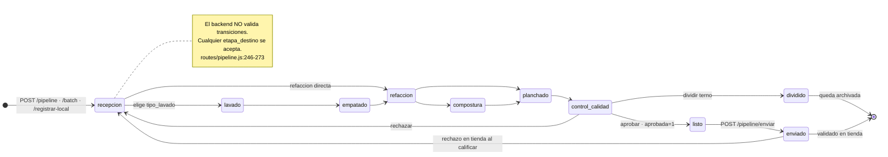

### 1.3 Quién puede ejecutar cada paso

**Ninguna etapa tiene un rol asociado.** Todas las escrituras del pipeline usan el mismo
middleware `auth` (`routes/pipeline.js:6`), que solo valida la firma del JWT.

La única distinción de rol que existe es la de "supervisor" (`routes/pipeline.js:154-158`:
`admin`, `dueno`, `dueño`, `encargado_almacen`) y sirve para dos cosas:

1. **Suplantación controlada.** El helper `actor()` (`routes/pipeline.js:62-85`) fuerza la
   identidad del JWT para los no supervisores; un supervisor sí puede registrar acciones a nombre
   de un operario enviando `cod_responsable`/`responsable` en el cuerpo (`:69-77`). El comentario
   lo llama "modo registro asistido".
2. **Acceso al historial unificado** (`routes/pipeline.js:473-474`) y **validación de envíos de
   otra sede** (`:347-349` y `:674-676`).

En el kanban, el operario se identifica escribiendo su código de 4 dígitos, que dispara un login
contra `/api/auth/login-code` con `sede:'AL'` fija (`almacen-kanban.jsx:50`). Ese token se guarda
en `localStorage` bajo `lb_kanban_token` y se purga cada 60 segundos si el usuario no es supervisor
(`almacen-kanban.jsx:97`). Los supervisores heredan la sesión principal automáticamente
(`almacen-kanban.jsx:54-55`).

> ⚠️ **PENDIENTE DE CONFIRMAR.** ¿Debe cada etapa tener un rol o un conjunto de personas
> habilitadas? Hoy un vendedor junior de tienda con token válido puede aprobar control de calidad.

### 1.4 Qué se registra en cada movimiento

Cada avance escribe tres cosas:

1. **`prendas`**: nueva `etapa`, `fecha_actualizado` (`routes/pipeline.js:253`), y de forma
   condicional `cod_lavador` si la etapa de origen era `recepcion` y `cod_planchador` si era
   `planchado` (`:255-256`). Ojo: la asignación usa `CASE WHEN etapa='recepcion'` evaluado **antes**
   del UPDATE, es decir, se registra al operario que *sacó* la prenda de esa etapa.
   Las observaciones se guardan en columnas distintas según destino: `obs_refaccion`,
   `obs_compostura`, `obs_calidad` (`:258-259`). Un destino distinto a esos tres **descarta la
   observación silenciosamente**.
2. **`prenda_historial`**: fila con `etapa_anterior`, `etapa_nueva`, `responsable` (texto),
   `cod_responsable` y `obs` (`:264`). Es la traza completa e inmutable del movimiento.
3. **`pipeline_puntos`**: ver sección 2.

Además se emite un evento SSE (`routes/pipeline.js:271`) a todos los clientes conectados
(`/api/pipeline/stream`, `:36-57`), lo que da el refresco en vivo del tablero.

### 1.5 Reversibilidad

Existen tres mecanismos distintos y con semánticas diferentes:

**Deshacer** (`PUT /:id/deshacer`, `routes/pipeline.js:276-286`). Devuelve la prenda a la etapa que
el cliente indique en `etapa_anterior`, escribe una fila de historial con `obs='DESHACER'` y borra
**la última fila de puntos de esa prenda para ese operario** (`:283`).

> ⚠️ **El límite de 5 segundos es puramente cosmético.** El temporizador vive en el cliente
> (`almacen-kanban.jsx:107`, `setTimeout(...,5000)`). El endpoint no comprueba tiempo, ni quién
> hizo el movimiento original, ni que `etapa_anterior` sea coherente con el historial. Cualquiera
> puede deshacer cualquier prenda en cualquier momento, y el borrado de puntos por `MAX(id)` puede
> eliminar una fila que no corresponde al movimiento deshecho.

**Rechazar** (`PUT /:id/rechazar`, `routes/pipeline.js:289-309`). Devuelve la prenda a una etapa
arbitraria (por defecto `recepcion`, `:293`), pone `aprobada=0` y —salvo que se envíe
`descontar_puntos:false`— **descuenta puntos al responsable del último movimiento hacia la etapa
destino** (`:298-304`), registrando una fila negativa con etapa `<destino>_rechazo`.

**Rechazo en recepción de tienda** (`PUT /envios/:id/calificar`, `routes/pipeline.js:342-370`). Al
validar un envío, cada prenda marcada como no aceptada vuelve al almacén: se limpia `envio_id`, se
pone `aprobada=0`, se guarda `obs_calidad` y se la manda a la etapa indicada o a `recepcion`
(`:361-363`). **Este rechazo no descuenta puntos a nadie.**

### 1.6 Envío a tienda

`POST /pipeline/enviar` (`routes/pipeline.js:312-339`) es el único punto del pipeline con
validación de estado real: separa las prendas en `listo` de las que no lo están y devuelve las
omitidas con su razón (`:317-326`). Crea una fila en `envios_prendas` y mueve las prendas a
`enviado` con `envio_id` (`:327-336`).

La validación en tienda exige que la sede del usuario coincida con `sede_destino`, salvo
supervisores (`:347-349`). Marca `validado_tienda=1` (`:367`).

> Un envío queda **para siempre** en `validado_tienda=0` si la tienda nunca lo abre. El dashboard
> lo levanta como alerta (`routes/dashboard.js:115-120`) pero no hay escalamiento ni cierre
> automático.

### 1.7 División de ternos

`POST /:id/dividir` (`routes/pipeline.js:403-426`) crea dos prendas nuevas con códigos
`<codigo>-S` (Saco) y `<codigo>-P` (Pantalón), heredando color, talla, sede, fecha de ingreso y la
**etapa actual** del terno, y permitiendo un tipo de lavado distinto para cada pieza (`:411-415`).
La prenda original **no se borra**: se marca `dividida=1`, `etapa='dividido'` y `dividida_en` con
los ids hijos (`:418-419`). Las prendas divididas quedan excluidas del kanban y de los conteos
(`:168`, `:180`).

### 1.8 Prendas atascadas

**No existe ningún mecanismo de detección de prendas atascadas.** No hay campo de SLA, ni fecha
límite, ni alerta por antigüedad, ni cron que revise el pipeline. Lo más cercano es:

- El KPI `prendas_observadas` del dashboard (`routes/dashboard.js:104-106`), que cuenta prendas con
  `obs_calidad` no vacía y etapa distinta de `enviado`.
- La notificación equivalente por sede (`routes/notificaciones.js:53-59`).

Una prenda puede quedarse en `refaccion` seis meses y el sistema no dirá nada. La única forma de
verlo es mirar `fecha_actualizado` a ojo en el tablero.

> ⚠️ **PENDIENTE DE CONFIRMAR.** ¿Cuál es el tiempo máximo aceptable por etapa? ¿Debe alertar,
> escalar al encargado, o generar incidencia automática?

---

## 2. Sistema de puntos y productividad

### 2.1 Fórmula implementada

Todo el cálculo vive en tres funciones cortas de `routes/pipeline.js`.

**Peso base** — `getPts()` (`routes/pipeline.js:87-92`):

```js
if(etapa==='lavado'){ k='pts_lavado_'+(tipoLav||'normal'); ... return r?parseFloat(r.valor):1; }
k2='pts_'+etapa; ... return r2?parseFloat(r2.valor):1;
```

Es decir: el peso se busca en la tabla `config` con la clave `pts_<etapa>`, y para lavado con
`pts_lavado_<tipo_lavado>`. **Si la clave no existe, el peso por defecto es 1** (`:89,:90`), lo que
significa que una etapa mal nombrada otorga silenciosamente 1 punto.

**Modificador de media prenda** — `routes/pipeline.js:267-269`:

```js
var tipo=(pr.tipo||'').toLowerCase();
var isHalf=tipo&&tipo!=='terno completo'&&tipo!=='terno'&&(tipo.indexOf('saco')>=0||tipo.indexOf('pantal')>=0||tipo.indexOf('falda')>=0||tipo.indexOf('chaleco')>=0||tipo.indexOf('blazer')>=0);
if(isHalf)pts=parseFloat((pts/2).toFixed(1));
```

Una prenda suelta (saco, pantalón, falda, chaleco, blazer) vale **la mitad** que un terno completo.
La detección es por búsqueda de subcadena en un campo de texto libre. Los tipos válidos están en
`public/js/data.js:66` (`TIPOS_PRENDA`), y ahí aparecen `Camisa` y `Corbata`, que **no** caen en la
regla de mitad y por tanto puntúan como terno completo.

> ⚠️ **PENDIENTE DE CONFIRMAR.** Una camisa procesada individualmente otorga los mismos puntos que
> un terno completo. ¿Es intencional? El documento `docs/entrevista-dueno.md:117` plantea
> exactamente esta pregunta al dueño y sigue sin respuesta.

**Punto crítico de atribución** — `routes/pipeline.js:266,270`:

```js
var pts=getPts(db,pr.etapa,pr.tipo_lavado);   // ← etapa de ORIGEN
...
recPts(db,act.cod,act.nombre,parseInt(q.params.id),pr.etapa,pts,...)
```

Los puntos se calculan sobre la **etapa de la que sale la prenda**, no sobre la que entra. Quien
mueve una prenda de `recepcion` a `lavado` cobra `pts_recepcion` (clave que **no está sembrada**,
por lo que cobra el default de 1). Quien la mueve de `lavado` a `empatado` cobra
`pts_lavado_<tipo>`. En consecuencia **`pts_listo` nunca se cobra**, porque de `listo` solo se sale
por `POST /enviar`, que no otorga puntos.

### 2.2 De dónde salen los pesos

De la tabla `config`, sembrada en `database/db.js:357-366`:

| Clave | Valor sembrado | Archivo:línea |
|---|---|---|
| `pts_lavado_normal` | 1 | `database/db.js:358` |
| `pts_lavado_seco` | 3 | `database/db.js:359` |
| `pts_lavado_especializado` | 5 | `database/db.js:360` |
| `pts_empatado` | 0.5 | `database/db.js:361` |
| `pts_refaccion` | 2 | `database/db.js:362` |
| `pts_compostura` | 5 | `database/db.js:363` |
| `pts_planchado` | 3 | `database/db.js:364` |
| `pts_control_calidad` | 2 | `database/db.js:365` |
| `pts_accesorio` | 0.5 | `database/db.js:366` |

Son editables desde el tab "Config" del kanban vía `PUT /pipeline/config-puntos`
(`routes/pipeline.js:210-215`), que acepta cualquier clave con prefijo `pts_` o `precio_`. La
lectura para la UI está en `routes/pipeline.js:203-208` y usa una lista **hardcodeada** de claves
que incluye `pts_envio`, clave que no se siembra ni se consume en ningún lado.

**Faltan sembradas** `pts_recepcion` y `pts_listo`. Ambas caen al default 1 de `getPts()`.

> ⚠️ **PENDIENTE DE CONFIRMAR.** `docs/entrevista-dueno.md:100-115` pide al dueño la tabla completa
> de puntos por paso. Los valores actuales son heredados del sistema anterior y nunca fueron
> validados.

### 2.3 Cuándo se asignan y a quién

Se registran en `pipeline_puntos` (`database/db.js:339-349`) mediante `recPts()`
(`routes/pipeline.js:93-96`), con `emp_cod`, `emp_nombre` (texto, pseudo-FK), `prenda_id`, `etapa`,
`puntos`, `detalle` y `fecha` (fecha local de Perú, `database/db.js:471-474`).

Hay cuatro eventos que generan filas:

| Evento | Puntos | Archivo:línea |
|---|---|---|
| Avance de etapa | `+pts` (mitad si prenda suelta) | `routes/pipeline.js:270` |
| Rechazo | `-pts` al responsable del movimiento anterior | `routes/pipeline.js:302` |
| Accesorio procesado | `+cantidad × pts_accesorio` | `routes/pipeline.js:391-392` |
| Camisas | **0 puntos**, se registra dinero | `routes/pipeline.js:387-389` |

El caso de las camisas es particular: en lugar de puntos se calcula
`cantidad × precio_camisa` y se guarda una fila con `puntos=0` y el monto en el campo `detalle`
como texto (`routes/pipeline.js:388-389`). **Ese dinero no alimenta ningún cálculo de pago**: queda
solo como cadena legible.

> ⚠️ **PENDIENTE DE CONFIRMAR.** El incentivo por camisa se registra pero no se liquida en ningún
> lado. ¿Se paga? ¿Cómo llega a la planilla?

### 2.4 Duplicación y reversión

**Se pueden duplicar.** No hay ninguna restricción de unicidad en `pipeline_puntos`, ni validación
de que la transición sea legal. Mover una prenda `recepcion → lavado → recepcion → lavado` genera
dos cobros de `pts_recepcion` y uno de `pts_lavado`. Como `/avanzar` acepta cualquier destino
(sección 1.2), el ciclo se puede repetir indefinidamente.

**La reversión es frágil.** `deshacer` borra la fila con
`id=(SELECT MAX(id) FROM pipeline_puntos WHERE prenda_id=? AND emp_cod=?)`
(`routes/pipeline.js:283`). Si el operario hizo dos movimientos sobre la misma prenda, borra el
más reciente, que puede no ser el que se está deshaciendo. Y como no hay ventana temporal real
(sección 1.5), se puede invocar mucho después.

El descuento por rechazo (`routes/pipeline.js:296-306`) sí es trazable: crea una fila negativa
nueva en vez de borrar, lo que preserva la auditoría.

### 2.5 Agregación por periodo

Hay tres agregaciones, todas con criterios distintos:

- **Ranking semanal** (`GET /pipeline/ranking`, `routes/pipeline.js:194-198`): desde el domingo de
  la semana en curso (`desde.setDate(desde.getDate()-desde.getDay())`, `:195`), agrupado por
  `emp_cod`, **filtrando `puntos>0`** — es decir, el ranking **ignora los descuentos por rechazo**.
  Tope de 15 filas.
- **Avance diario personal** (`GET /pipeline/mi-avance`, `routes/pipeline.js:459-468`): suma del
  día para un `cod`, también con `puntos>0` (`:462,464,466`). Mismo sesgo.
- **Tendencia del dashboard** (`routes/dashboard.js:245-246`): cuenta **filas**, no puntos, y **no
  filtra por sede** aunque el resto del dashboard sí lo haga.

> ⚠️ **PENDIENTE DE CONFIRMAR.** El filtro `puntos>0` hace que las penalizaciones por rechazo no
> se vean en ranking ni en el avance del operario. ¿El castigo debe ser visible o solo contable?

**No existe agregación mensual de puntos que alimente el pago.** Las claves
`pipeline_meta_mensual`, `pipeline_meta_semanal` y `pipeline_precio_punto`
(`database/seed-config.js:39`) están sembradas pero solo se leen en `routes/ventas.js` y en el
panel de administración; no participan del cálculo de la nota ni del pago.

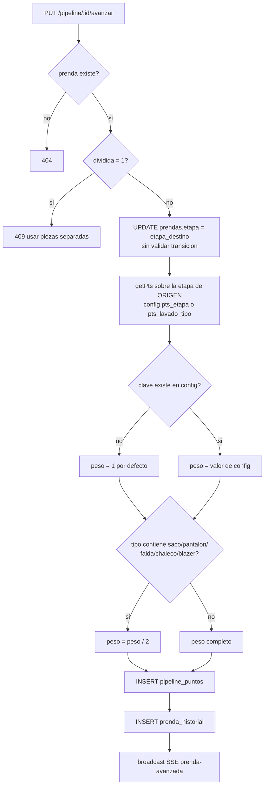

---

## 3. Reporte diario FR-01 por turno

### 3.1 Identidad y campos

El reporte se identifica con una cadena `DD-MM-YY_TURNO-SEDE`, por ejemplo `15-04-26_T-ST`. La
fecha **siempre se deriva del id**, nunca del cuerpo ni del reloj (`routes/reportes.js:12-20` y
`:144`), decisión deliberada para que una evaluación hecha al día siguiente no contamine la fecha
del turno. Hay incluso una migración que repara filas históricas cuya fecha no coincidía con el id
(`routes/reportes.js:25-41`).

Turnos válidos: `M` (mañana), `T` (tarde), `C` (completo) — `routes/reportes.js:330`.

Estructura de datos (`database/db.js:36-66`):

- `reportes`: `sede`, `turno`, `fecha`, `encargado`, `encargado_id`, `puntaje`, `puntaje_eval`,
  `act_total`, `act_done`, `evaluado`, `evaluador`, `bloqueado`, y por migración
  `auto_enviado`, `auto_enviado_razon`, `no_evaluable` (`routes/reportes.js:48-51`).
- `reporte_trabajadores`: nombres de quienes estuvieron en el turno (pseudo-FK por texto).
- `reporte_actividades`: `cod`, `nombre`, `cat`, `peso`, `realizada`, `obs`, más `calificacion` y
  `obs_eval` que llena el evaluador.
- `reporte_extras`: trabajos extra con `cantidad`, `precio_unitario`, `monto_total`,
  `registrado_por`.
- `incidencias`: se crean en cascada al enviar el reporte (`routes/reportes.js:153-165`).

### 3.2 Quién lo llena y con qué validaciones

El envío ocurre en el cliente (`public/js/app.js:1049-1104`). Las validaciones son:

- El código ingresado debe pertenecer a un empleado existente (`app.js:1053-1054`).
- **Ese empleado debe estar en la lista de encargados del turno** (`app.js:1055`).
- Debe haber al menos un colaborador, un encargado y una actividad marcada
  (`app.js:1056-1058`).
- No puede haber ya un reporte de ese turno hoy (`app.js:1040-1047`).

El backend, en cambio, **no valida nada de esto**: `POST /api/reportes`
(`routes/reportes.js:141-176`) solo comprueba que el id no exista (`:143`).

**Puntaje del reporte** (`public/js/app.js:1060-1062`, `:1083-1087`): es el porcentaje de peso
completado.

```js
const max=acts.reduce((s,a)=>s+a.peso,0);
const pts=done.reduce((s,a)=>s+a.peso,0);
const puntaje=max>0?Math.round(pts/max*100):0;
```

A eso se le suman las zonas de limpieza del layout, que entran como actividades sintéticas con
código `OL_<zona>` y categoría `IND` (`app.js:1077-1081`), recalculando sobre el total ampliado
(`app.js:1085-1087`).

### 3.3 Ventanas de tiempo

Hay **dos** juegos de horarios y no coinciden del todo.

**En el cliente** (`public/js/app.js:322-339`), solo para tiendas (el almacén está exento,
`:334-335`):

| Hora | M | T | C |
|---|---|---|---|
| < 08:00 | bloqueado | bloqueado | bloqueado |
| 08:00–15:00 | habilitado | bloqueado | habilitado |
| 15:00–23:00 | bloqueado | habilitado | bloqueado |
| ≥ 23:00 | bloqueado | bloqueado | bloqueado |

**En el servidor** (`routes/reportes.js:97-102`), para decidir el auto-envío:

```js
if (turno === 'M') return t.h >= 15;
if (turno === 'T' || turno === 'C') return t.h >= 23;
```

Coinciden en M=15:00 y T=23:00, pero el cliente bloquea `C` a las 15:00 mientras el servidor lo
cierra a las 23:00.

> ⚠️ **PENDIENTE DE CONFIRMAR.** `docs/entrevista-dueno.md:138-141` reconoce que 15:00/23:00 son
> valores heredados del sistema anterior que nadie validó. Además, **están hardcodeados en el
> código**, no en `config`, pese a que `seed-config.js:38` siembra `hora_inicio_m`, `hora_inicio_t`,
> `hora_fin_m` y `hora_fin_t` — claves que el backend de reportes **no lee** (solo las usa
> `public/js/header.js` para el reloj del encabezado).

### 3.4 Bloqueo por evaluación pendiente

Regla dura: **no se puede iniciar un reporte nuevo en una sede mientras el anterior de esa sede
siga sin evaluar**. Se implementa comparando contra el reporte más antiguo con `evaluado=0 AND
bloqueado=1` (`routes/reportes.js:123`), y el cliente bloquea el formulario con
`STATE.fr01.bloqueado = true` (`public/js/app.js:202`, `:296`) y el mensaje "Completa la Evaluación
primero" (`app.js:1023`, `:1108`).

No hay excepciones, ni turno de gracia, ni caducidad. `docs/pendientes-negocio.md:17-21` lo
confirma como regla implementada sin confirmar.

### 3.5 Auto-cierre por cron

El cron corre **cada 5 minutos** desde `server.js:156-168` e invoca
`autoEnviarPendientes()` (`routes/reportes.js:324-399`). Por cada combinación de las cuatro sedes
(`ST`, `LB`, `AL`, `TR` — hardcodeadas en `:328`) y los tres turnos:

1. Si el deadline no pasó, no hace nada (`:333`).
2. Si ya existe reporte para ese sede/fecha/turno, no hace nada (`:335-336`).
3. Busca el borrador vivo en `reporte_drafts` (tabla creada en `routes/reportes.js:54-62`,
   alimentada por el autosave `POST /reportes/drafts`, `:261-283`).
4. **Si el borrador tiene contenido** (trabajadores, actividades, extras o incidencias — `:345-350`)
   lo convierte en reporte real con `auto_enviado=1`, `auto_enviado_razon='auto-envio-deadline'`,
   `bloqueado=1` y `no_evaluable=0`. Solo se copian las actividades marcadas como realizadas
   (`:367`).
5. **Si no hay borrador o está vacío**, crea un reporte "fantasma" con `no_evaluable=1`,
   `auto_enviado_razon='sin-draft-no-evaluable'`, `bloqueado=0` y sin filas hijas (`:353-362`).
   Sirve de marca de trazabilidad: constancia de que ese turno no reportó.

En ambos casos el borrador se borra (`:382`).

**Consecuencia práctica de no llenar el reporte:** queda un registro `no_evaluable=1` que
`routes/dashboard.js:89-90` y `routes/notificaciones.js:104-105` excluyen del conteo de pendientes.
No genera incidencia, no descuenta nota, no notifica a nadie. La única salida es que un
admin/dueño lo borre con `POST /reportes/permitir-reenvio` (`routes/reportes.js:296-316`) para
habilitar el envío manual.

> ⚠️ **PENDIENTE DE CONFIRMAR.** `docs/entrevista-dueno.md:143-146` pregunta qué debe pasar si
> nadie envía el reporte. Hoy: nada. El turno simplemente desaparece del radar.

### 3.6 Auto-asistencia derivada del reporte

`generarAsistenciasDelReporte()` (`routes/reportes.js:76-95`) marca presentes al encargado y a
todos los trabajadores listados, con `fuente='reporte'` y `minutos_tardanza=0`. Es idempotente
(`INSERT OR IGNORE`). Los trabajadores se resuelven **por nombre exacto** contra `empleados`
(`:90`); si el nombre no coincide, la asistencia se pierde en silencio.

Se invoca desde el envío manual (`:169-172`) y desde el auto-envío, pero en este último **solo si
el borrador tenía contenido** (`:384-389`).

### 3.7 Evaluación del reporte

`PUT /api/reportes/:id/evaluar` (`routes/reportes.js:197-210`). Regla única: **el evaluador no
puede haber estado en el turno** (`:202`, y espejo en el cliente `public/js/app.js:1296`). No se
exige rol, ni sede, ni que sea el turno siguiente.

El puntaje de evaluación se calcula en el cliente (`public/js/app.js:1299-1311`) como promedio
ponderado de las calificaciones por actividad sobre el peso total, expresado en porcentaje. La
calificación por actividad por defecto es `1` (`app.js:1300`), lo que sugiere una escala 0–1
multiplicadora, aunque `database/db.js:52` declara `calificacion REAL DEFAULT 1` sin acotar rango.

Al evaluar se escriben `evaluado=1`, `evaluador`, `puntaje_eval`, `puntaje` (**se sobrescribe el
puntaje original de cumplimiento con el de la evaluación**, `:207`) y se libera el bloqueo con
`bloqueado=0`.

> ⚠️ **PENDIENTE DE CONFIRMAR.** La escala de `calificacion` no está documentada ni acotada.
> `routes/evaluaciones.js:234-235` la asume en escala 0–20 para el promedio mensual, mientras el
> FR-01 la usa como multiplicador ~0–1. Son dos lecturas incompatibles del mismo campo.

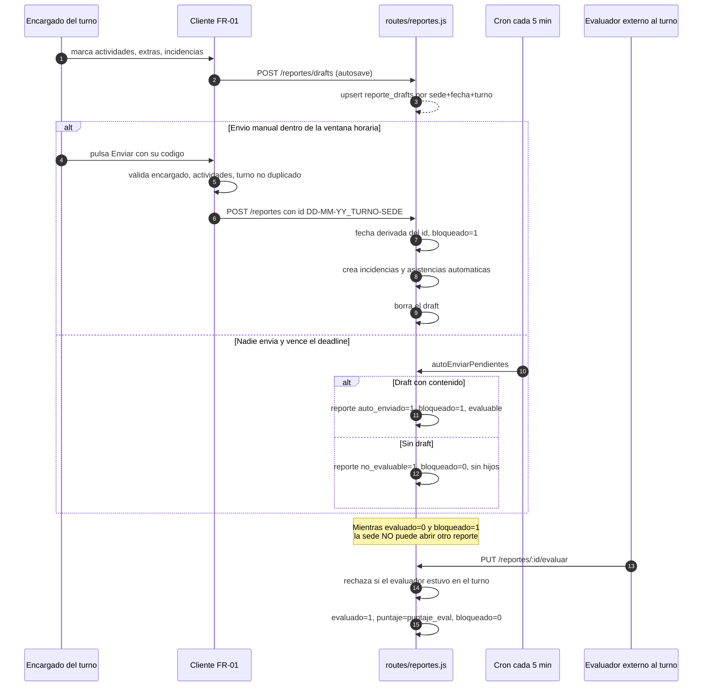

---

## 4. Evaluaciones mensuales

### 4.1 El ciclo personal

Cada colaborador tiene su propio "mes", anclado al aniversario de su `fecha_ingreso`
(`routes/evaluaciones.js:98-127`). Si entró un día 7, su ciclo va del 7 al 6 del mes siguiente
(`:123-125`). Si no tiene `fecha_ingreso` válida, se cae al mes calendario y se marca
`fuente:'mes_calendario'` (`:104-111`).

El dashboard anticipa los cierres de los próximos 7 días (`routes/dashboard.js:179-201`).

> ⚠️ **PENDIENTE DE CONFIRMAR — días 29, 30 y 31.** `new Date(y, m+1, 31)` en febrero desborda al
> 2 o 3 de marzo. El código no lo trata; `docs/entrevista-dueno.md:40-48` plantea la pregunta al
> dueño y sigue abierta.

### 4.2 Los siete componentes y sus pesos

La nota final es sobre 20 y se calcula **en el cliente**, en dos lugares duplicados:
`calcEvalMensualPreview()` (`public/js/admin.js:1552-1593`) y `guardarEvalMensual()`
(`public/js/admin.js:1595-1655`). La fórmula efectiva es `public/js/admin.js:1620-1621`:

```js
var notaBase=(nota_competencias*W.comp)+(nota_valores*W.val)+(nota_operaciones*W.op)
            +(nota_software*W.sw)+(nota_limpieza*W.limp)+(nota_examenes*W.exam)
            +(nota_tardanza*W.tard);
var nota_final=parseFloat(Math.max(0,notaBase-desc_incidencias+ventaBonus).toFixed(1));
```

Los pesos se leen de `config` con prefijo `peso_` (`routes/evaluaciones.js:85-96`), con estos
valores por defecto:

| Componente | Clave de config | Peso | Origen del dato |
|---|---|---|---|
| Competencias | `peso_competencias` | 25 % | manual del jefe |
| Valores 360° | `peso_valores360` | 25 % | peer review |
| Conocimientos / exámenes | `peso_conocimientos` | 15 % | manual |
| Operaciones | `peso_operaciones` | 10 % | actividades `AT*`/`BT*` |
| Software | `peso_software` | 10 % | actividades `AS*`/`BS*` |
| Limpieza | `peso_limpieza` | 10 % | actividades `cat='IND'` |
| Puntualidad | `peso_tardanzas` | 5 % | asistencias |

Sembrados en `database/seed-config.js:34-35` y reinicializados en `routes/evaluaciones.js:62-72`.
Suman 100. Se editan con `PUT /api/evaluaciones/pesos` (`routes/evaluaciones.js:198-211`), que
exige rol admin/dueño (`middleware/auth.js:18-23`).

**Competencias**: ocho criterios con rúbrica de 5 niveles (0–4), definidos en
`public/js/data.js:75-84` — Resolución de Problemas, Trabajo en Equipo, Buena Comunicación, Manejo
de Clientes, Cumplimiento de Metas, Relación con Clientes, Habilidades Técnicas, Habilidad de
Adaptación. Se normaliza con `(compTotal/32)*20` (`public/js/admin.js:1600`), donde 32 = 8 × 4.

**Snapshot de pesos.** Al guardar, se persiste en `pesos_usados` (JSON) los pesos exactos que se
usaron (`public/js/admin.js:1634-1642`, `routes/evaluaciones.js:168`), de modo que cambiar los
pesos después **no recalcula evaluaciones ya cerradas**. Es una regla explícita del usuario
(`CONTEXTO-PROYECTO.md:151`).

> ⚠️ **CONTRADICCIÓN GRAVE — hay tres tablas de pesos distintas conviviendo:**
> 1. `routes/evaluaciones.js:62-70` y `database/seed-config.js:34-35` — 25/25/15/10/10/10/5, **es
>    la que se usa**.
> 2. `routes/config.js:106-112` (`EVAL_PESOS_DEFAULT`) — competencias 25, valores 15,
>    operaciones 50, tardanzas 5, incidencias 5, guardada en la clave `eval_pesos`. Los endpoints
>    `GET/PUT /api/config/eval-pesos` (`:113-140`) **no son consumidos por ningún archivo del
>    frontend**: es código muerto que puede confundir a quien lo lea.
> 3. `public/js/data.js:89-96` (`PESOS`) — checklistOperaciones 0.15, competencias 0.25, valores
>    0.25, conocimientos 0.15, tardanzas 0.10, incidencias 0.10. También sin uso.

### 4.3 Autocálculo de componentes

`GET /api/evaluaciones/calcular` (`routes/evaluaciones.js:251-403`) prellena la UI a partir de
datos reales del periodo:

- **Operaciones / Software / Limpieza** (`:265-297`): promedio de `reporte_actividades.calificacion`
  de los reportes donde el empleado fue **encargado** (`encargado_id` o `encargado` por nombre,
  `:268`). El mapeo es: `cat='IND'` → limpieza; código que empieza en `AS`/`BS` → software;
  código que empieza en `AT`/`BT` → operaciones; `cat='EXT'` → no cuenta (`:286-296`).
- **Tardanza** (`:324-333`): `Math.max(0, 20 - Math.floor(totalMinTardanza / 15))`. Un punto menos
  por cada 15 minutos acumulados en el ciclo; a las 5 horas la nota es 0.
- **Descuento por incidencias** (`:335-343`): **cuenta la cantidad** de incidencias del periodo
  (`COUNT(*)`), no la suma de `puntos_penalidad`. La consulta filtra por `emp_id`, columna que
  **no existe en la tabla `incidencias`** (`database/db.js:173-179` usa `responsable TEXT`), por lo
  que el `try/catch` de `:337-343` la traga y el valor **siempre queda en 0**.
- **Bonus de ventas** (`:345-355`): si vendió al menos la meta,
  `min(2, ((vendido - meta) / meta) * 2)`. Consulta la tabla `ventas`, que **tampoco existe** — la
  real se llama `ventas_metas` (`database/seed-config.js:17`). Otro `try/catch` que devuelve 0
  siempre.
- **Valores** (`:357-371`): promedio de los seis criterios recibidos, escalado con
  `(promTotal / 5) * 20`.
- **Cumplimiento de reportes** (`:299-322`): enviados / esperados, donde los esperados se estiman
  multiplicando los slots semanales por el número de semanas del rango (`:312-320`). El comentario
  del propio código admite que es una aproximación.

> ⚠️ **DOS CÁLCULOS ROTOS EN SILENCIO.** El descuento por incidencias y el bonus de ventas
> devuelven siempre 0 por consultar columnas y tablas inexistentes. La documentación
> (`CONTEXTO-PROYECTO.md:243-244`) los describe como funcionando. `docs/entrevista-dueno.md:86-88`
> ya detectó que el bonus de ventas "aparece siempre en cero".

### 4.4 Quién evalúa a quién y cuándo

`POST /api/evaluaciones/mensual` exige `requireAdmin` (`routes/evaluaciones.js:155`), es decir
**solo admin o dueño** (`middleware/auth.js:18-23`). El helper `esSupervisor()` de
`routes/evaluaciones.js:79-83` incluye a los encargados, pero **no se usa en ningún endpoint** de
ese archivo: código muerto.

La lectura (`GET /mensual`, `:138`) solo requiere token válido: **cualquier empleado autenticado
puede listar las evaluaciones de todos**, sin filtro de sede ni de identidad.

**No hay ventana de evaluación.** No existe fecha de apertura ni de cierre, ni validación de que el
ciclo haya terminado. El id se compone como `EM-<emp_id>-<ciclo_desde>` (`:166`) y el guardado es
`INSERT OR REPLACE` (`:170`), de modo que **una evaluación se puede sobrescribir indefinidamente
sin dejar rastro** de la versión anterior.

> ⚠️ **PENDIENTE DE CONFIRMAR.** `docs/entrevista-dueno.md:180-186` pregunta quién debe poder ver
> sueldos y notas ajenas. Hoy: cualquiera con token.

### 4.5 Auto-evaluación cuando nadie evalúa a tiempo

**No está implementada en este sistema.** No hay cron, endpoint ni función de auto-evaluación en
`routes/`. La búsqueda de `auto.evalua` en el repositorio (excluyendo `packages/` y `apps/`) solo
devuelve menciones documentales.

Lo que existe es el **auto-envío** del reporte diario (sección 3.5), que es otra cosa: cierra el
reporte, no lo evalúa. Un reporte auto-enviado con contenido queda con `evaluado=0, bloqueado=1`,
o sea **bloqueando a su sede indefinidamente** hasta que alguien lo evalúe a mano.

La funcionalidad "auto-evaluación cuando nadie evalúa a tiempo" sí existe en el stack nuevo
(migración `0064_reportes_auto_evaluar.sql` en `packages/db/migrations/`), fuera del alcance de
esta auditoría.

> ⚠️ **PENDIENTE DE CONFIRMAR.** ¿Qué nota debe ponerse cuando nadie evalúa? ¿Se libera el bloqueo
> de la sede automáticamente?

### 4.6 Tramos de recomendación

Hardcodeados en `public/js/admin.js:1622`:

```js
var recomendacion=nota_final>=17?'Excelente':nota_final>=14?'Buen desempeño':nota_final>=11?'Requiere mejorar':'Bajo rendimiento';
```

Repetidos como clases CSS en `public/js/admin.js:1578`, `:1591`, `:1663-1664` y `:1132`. Cinco
copias del mismo umbral. `CONTEXTO-PROYECTO.md:251` añade "riesgo de despido si < 14", criterio que
**no está en el código**.

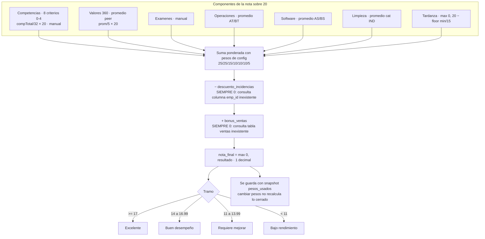

---

## 5. Incidencias

### 5.1 Modelo y ciclo de vida

Tabla `incidencias` (`database/db.js:173-179`) con columnas añadidas por migración silenciosa en
`routes/incidencias.js:12-15`: `reportado_por`, `reportado_por_cod`, `origen` (default `'manual'`)
y `puntos_penalidad` (REAL default 0).

**No existe columna `estado`, `resuelta` ni `fecha_resolucion`, y no hay ningún endpoint de
actualización.** El ciclo de vida completo es: se crea (`routes/incidencias.js:85`), se lista
(`:68`) y se borra (`:112`). Es un registro **append-only**. No hay descargo del responsable, ni
acuse de recibo, ni cierre, ni seguimiento.

> ⚠️ **PENDIENTE DE CONFIRMAR.** ¿Debe una incidencia poder resolverse, desestimarse o apelarse?
> Hoy la única salida es que un admin la borre, lo que elimina la evidencia.

### 5.2 Catálogo de tipos y severidades

Existe una tabla de catálogo `incidencia_tipos` (`routes/incidencias.js:17-25`) con `tipo` único,
`categoria`, `nivel_default`, `puntos_default` y `activo`. Se siembra con 21 tipos en 7 categorías
solo si está vacía (`routes/incidencias.js:27-54`). Extracto de los valores sembrados
(`routes/incidencias.js:30-50`):

| Categoría | Ejemplos | Nivel | Puntos |
|---|---|---|---|
| Uniforme | No contar con el uniforme completo | Bajo | 1 |
| Seguridad | No colocar candados al abrir · cerrar mal puertas | Medio | 2–3 |
| Equipos | Dejar prendida la plancha | **Alto** | 4 |
| Equipos | Dejar prendida la PC · las luces | Bajo | 1 |
| Orden | Dejar desordenada la tienda | Bajo | 1 |
| Documentación | No evaluó al turno anterior · no subir lista de actividades | Medio | 2 |
| Graves | Hurto o robo de prenda | Alto | **10** |
| Graves | Faltante de caja significativo | Alto | 6 |
| Graves | Accidente, conflicto con cliente, daño de infraestructura | Alto | 5 |

**Severidades:** tres valores, `Alto`, `Medio` y `Bajo`, normalizados por `normNivel()`
(`routes/incidencias.js:59-65`), que limpia emojis y hace coincidencia sin distinguir mayúsculas;
cualquier valor no reconocido cae a `'Medio'` (`:64`). Misma normalización, duplicada, en
`routes/reportes.js:158-159`.

El campo `tipo` de la tabla `incidencias` es **texto libre**: el POST inserta lo que llegue sin
validar contra el catálogo (`routes/incidencias.js:107`). El catálogo sirve únicamente de tabla de
consulta para los puntos.

### 5.3 Cómo se determinan los puntos de penalidad

Cascada de tres niveles (`routes/incidencias.js:93-103`):

1. Si el cliente envía `puntos_penalidad`, se respeta tal cual, **sin validar rango ni signo**
   (`:94-96`). El frontend expone ese campo al usuario (`public/js/app.js:2088`).
2. Si no, se busca `puntos_default` del catálogo por tipo exacto (`:99`); si además no vino nivel,
   se adopta el `nivel_default` (`:100`).
3. Fallback hardcodeado (`:103`): `Alto = 5`, `Bajo = 1`, `Medio = 2`. **Triplicado** en
   `routes/reportes.js:162` y `routes/reportes.js:376`.

> ⚠️ **DOBLE FUENTE DE VERDAD.** Existe un segundo sistema de penalidades por **categoría** en las
> claves `inc_uniforme`, `inc_orden_limpieza`, `inc_documentacion`, `inc_equipos_electricos`,
> `inc_seguridad_cerrar`, `inc_graves` e `inc_otros` (`database/seed-config.js:36-37`). **Ninguna
> ruta del backend las lee.** Su único consumidor es `public/js/admin.js:1395-1396`, y ahí está
> roto: el mapa se indexa por nombre de categoría (`'Uniforme'`, `'Graves'`…) pero se consulta con
> `inc.tipo`, que es la descripción del tipo (`'Dejar prendida la plancha'`). El lookup nunca
> acierta, de modo que **siempre aplica `inc_otros` = 2 puntos**. Las etiquetas tampoco coinciden
> con las categorías reales del catálogo (`'Orden'` vs `'Orden/Limpieza'`, `'Equipos'` vs
> `'Equipos eléctricos'`). Hay que elegir un sistema y eliminar el otro.

### 5.4 Origen y trazabilidad

`origen` admite tres valores en la práctica, aunque el comentario del código
(`routes/incidencias.js:14`) solo menciona dos:

- `'manual'` — alta directa desde el atajo del encabezado (`routes/incidencias.js:91`).
- `'reporte'` — creada en cascada al enviar un FR-01 (`routes/reportes.js:163`).
- `'auto'` — creada por el auto-envío al vencer el deadline (`routes/reportes.js:377`).

`responsable` es el nombre de texto del señalado, con default `'—'` (`routes/incidencias.js:107`);
`reportado_por` y `reportado_por_cod` identifican a quien reporta, tomando el JWT si no vienen en
el cuerpo (`:89-90`). Ambas son pseudo-FK por nombre, con cascada al renombrar empleados
(`routes/empleados.js:132-133`).

> **Defecto menor.** El INSERT de la ruta de auto-envío (`routes/reportes.js:373`) omite
> `reportado_por_cod` — usa 10 columnas donde el envío manual usa 11 (`routes/reportes.js:156`).
> Esas incidencias quedan sin código de reportante.

### 5.5 Autorización

| Acción | Endpoint | Quién puede |
|---|---|---|
| Listar (todas las sedes) | `GET /api/incidencias` (`:68`) | cualquier usuario autenticado |
| Crear | `POST /api/incidencias` (`:85`) | cualquier usuario autenticado |
| Editar | — | **no existe** |
| Borrar | `DELETE /api/incidencias/:id` (`:112`) | `admin` o `dueno` |
| Ver catálogo | `GET /tipos/list` (`:122`) | cualquier autenticado |
| Reemplazar catálogo | `PUT /tipos/list` (`:134`) | `admin` o `dueno` |

El listado **no filtra por sede** (`routes/incidencias.js:68-79`): cualquier empleado ve las 500
incidencias más recientes de las cuatro sedes. Y el POST permite fijar `sede`, `fecha`,
`responsable` y `puntos_penalidad` arbitrarios: **cualquier empleado puede imputar una falta a
cualquier compañero, con los puntos que quiera**.

La sustitución del catálogo (`:138-151`) hace borrado total y reinserción dentro de una
transacción, con los puntos acotados a 0–20 (`:147`). Como las incidencias referencian el tipo por
texto, no se rompen, pero tampoco quedan enlazadas: es una pseudo-FK más.

### 5.6 Efecto sobre evaluación y pagos

La cadena real es la siguiente, y está rota en el medio:

1. El navegador suma los `puntos_penalidad` de las incidencias del periodo y aplica un **tope
   hardcodeado de 20** (`public/js/admin.js:1388-1398`, `Math.min(20,totalDesc)`).
2. Ese número se guarda en `evaluaciones_mensuales.descuento_incidencias`
   (`routes/evaluaciones.js:174,181`).
3. La nota final le resta ese valor directamente (`public/js/admin.js:1621`).
4. El pago sugerido **también** le resta ese valor, pero **como si fueran soles**
   (`routes/pagos.js:131,136`).

> ⚠️ **AMBIGÜEDAD DE UNIDADES.** El mismo número se interpreta como puntos de nota en la
> evaluación y como soles en el pago. Un colaborador con tres incidencias pierde 3 puntos de nota
> **y** S/ 3.00.

> ⚠️ **CÁLCULO SERVIDOR ROTO.** El endpoint `GET /api/evaluaciones/calcular` intenta contar
> incidencias con `WHERE emp_id = ?` (`routes/evaluaciones.js:338-341`), columna que **no existe**
> en la tabla. La excepción la traga un `catch` vacío (`:343`) y el valor devuelto es siempre 0.
> El módulo de empleados sí lo hace bien, consultando por `responsable` (`routes/empleados.js:344-349`).

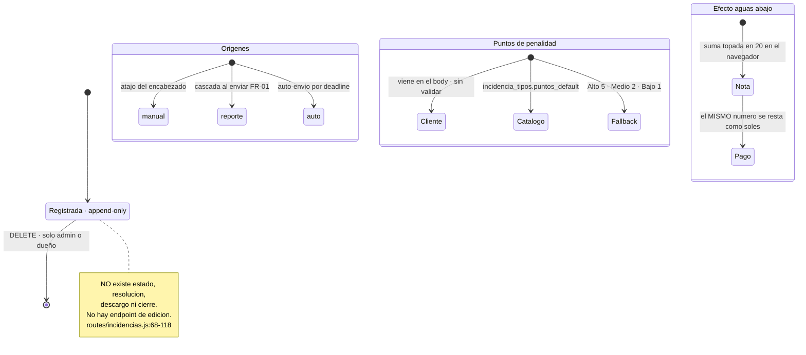

---

## 6. Pagos a empleados

### 6.1 Modelo de datos

Tabla `pagos`, creada por migración idempotente en `routes/pagos.js:22-49`, con índices en
`:50-52`. Columnas relevantes: `emp_id` (TEXT, pseudo-FK), `evaluacion_id`, `ciclo_desde`,
`ciclo_hasta`, `mes`, `monto`, `monto_base`, `bonus`, `descuentos`, `nota_final`, `metodo`
(default `'efectivo'`, `:38`), `comprobante_num`, `fecha_pago`, `estado` (default `'pendiente'`,
`:41`), `observaciones`, `registrado_por`, `registrado_por_cod`, `anulado` y `anulado_motivo`.

El módulo también añade a `empleados` las columnas `salario_base`, `tipo_contrato`,
`vencimiento_contrato`, `fecha_nacimiento`, `dni` y `telefono` (`routes/pagos.js:56-61`).

### 6.2 Qué suma y qué resta

El modelo económico tiene **solo tres componentes**, y uno de ellos es multiplicativo:

| Componente | Efecto | Origen | Archivo:línea |
|---|---|---|---|
| `salario_base` | base | `empleados.salario_base` | `routes/pagos.js:128` |
| `nota_final / 20` | **multiplica la base** | `evaluaciones_mensuales.nota_final` | `routes/pagos.js:129,136` |
| `bonus` | suma | `evaluaciones_mensuales.bonus_ventas` | `routes/pagos.js:130` |
| `descuentos` | resta | `evaluaciones_mensuales.descuento_incidencias` | `routes/pagos.js:131` |

La fórmula literal (`routes/pagos.js:136-137`) es:

```js
montoSugerido = salarioBase * (notaFinal / 20) + bonus - descuentos;
montoSugerido = Math.max(0, montoSugerido);
```

Si no hay evaluación para el periodo, el sugerido es el salario base completo, sin modular
(`routes/pagos.js:134`, condición en `:135`).

**No entran en el cálculo:** puntos del pipeline, horas trabajadas, incentivo por camisas,
adelantos, préstamos de dinero, ni descuento monetario por tardanza o por falta.

> El propio código admite que la regla es inventada. Comentario en `routes/pagos.js:105`:
> *"(fórmula simple a falta de regla más detallada del usuario)"*.

> ⚠️ **PENDIENTE DE CONFIRMAR — es la regla más delicada del sistema.** Modular todo el salario por
> la nota significa que un colaborador con 14/20 cobra el 70 % de su sueldo. `docs/entrevista-dueno.md:78-84`
> pregunta al dueño si la nota es informativa, define un bono, o define todo el pago. Sin esa
> respuesta, cualquier migración arrastra una regla potencialmente ilegal en términos laborales.

### 6.3 Automático frente a manual

La distinción es tajante: **el cálculo automático es solo una sugerencia que no se persiste**.

- `GET /api/pagos/sugerir` (`routes/pagos.js:107-153`) devuelve el desglose y la cadena de fórmula
  (`:150`), pero no escribe nada.
- `POST /api/pagos` (`routes/pagos.js:174-198`) **guarda exactamente el `monto` que envía el
  cliente** (`:178`), sin recalcularlo ni verificar que sea coherente con
  `monto_base + bonus − descuentos`. La única validación es rechazar montos negativos (`:179`).

> ⚠️ **CONTRADICCIÓN — backend y frontend calculan distinto.** El recálculo del cliente
> (`public/js/pagos.js:130-135`) hace `monto_base + bonus − descuentos`, **sin la modulación por
> nota**. Al pulsar "usar sugerido" (`public/js/pagos.js:163-166`) se rellena `monto_base` con el
> salario completo y `monto` con el valor modulado; en cuanto el usuario toca cualquier campo, el
> recálculo del cliente pisa el monto con la fórmula sin nota. El backend acepta ambos sin
> distinguirlos. **En producción conviven pagos calculados con dos reglas diferentes.**

> ⚠️ **ERROR DE UNIDADES.** `bonus_ventas` está topado en 2 y concebido como *puntos de nota*
> (`routes/evaluaciones.js:353`), y `descuento_incidencias` es un *conteo de incidencias*
> (`routes/evaluaciones.js:342`). Ambos se usan como **soles** en `routes/pagos.js:136`. Un
> colaborador con tres incidencias en el ciclo pierde S/ 3.00. Como además ambos cálculos
> devuelven siempre 0 por consultar objetos inexistentes (sección 4.3), en la práctica el pago
> sugerido hoy es simplemente `salario_base × nota/20`.

### 6.4 Periodicidad

**No hay periodicidad forzada.** El campo `mes` se deriva en cascada (`routes/pagos.js:182`):
`b.mes` → primeros 7 caracteres de `ciclo_desde` → primeros 7 de `fecha_pago` (que por defecto es
hoy, `:181`). `ciclo_desde` y `ciclo_hasta` son fechas libres sin validación de solapamiento, y
**no existe una restricción `UNIQUE(emp_id, mes)`**: se pueden registrar varios pagos del mismo
periodo al mismo colaborador sin que el sistema proteste.

La intención documentada es mensual por ciclo personal (`routes/pagos.js:3`,
`CONTEXTO-PROYECTO.md:257`), pero nada en el código lo impone.

### 6.5 Adelantos, préstamos y descuentos

**No existen.** No hay tabla, columna ni endpoint de adelanto de sueldo ni de préstamo de dinero a
empleados en ningún módulo del sistema legacy. La única forma de reflejar un adelanto es teclearlo
a mano en el campo `descuentos` o describirlo en `observaciones` (`routes/pagos.js:36,42`), sin
trazabilidad ni saldo pendiente.

Conviene evitar una confusión frecuente de nomenclatura: `routes/prestamos.js` gestiona
**préstamos de prendas entre sedes**, no de dinero (sección 8.3).

> ⚠️ **PENDIENTE DE CONFIRMAR.** ¿Se dan adelantos hoy? ¿Cómo se descuentan? Es un vacío completo
> del sistema actual y muy probablemente se lleva en cuaderno o WhatsApp
> (`docs/entrevista-dueno.md:31-33` pregunta exactamente eso).

### 6.6 Estados y autorización

`estado` es **texto libre**: el PUT lo copia sin validar contra ninguna lista
(`routes/pagos.js:211-214`). Los valores que el frontend usa son `'pendiente'` y `'pagado'`
(`public/js/pagos.js:170,196`). Al crear, el estado se infiere: si el cuerpo trae `fecha_pago`,
nace `'pagado'`; si no, `'pendiente'` (`routes/pagos.js:183`).

La anulación no es un estado sino un flag: `DELETE /api/pagos/:id` hace borrado lógico con
`anulado=1` y exige motivo no vacío (`routes/pagos.js:224-231`). Un pago anulado ya no admite
edición (`:208`, HTTP 409).

**Roles.** Crear, editar y anular exigen `requireAdmin` (`routes/pagos.js:174,203,224`), es decir
solo `admin` o `dueno` (`middleware/auth.js:18-23`).

> ⚠️ **FUGA DE DATOS SALARIALES.** Listar pagos (`routes/pagos.js:84`), ver el detalle (`:158`) y
> abrir el comprobante imprimible (`:236`) solo requieren un token válido, sin filtrar por el
> `emp_id` del solicitante. Cualquier empleado autenticado puede leer el sueldo y la nota de
> cualquier compañero. `docs/entrevista-dueno.md:180-186` pregunta al dueño quién debería poder
> ver esa información; la respuesta actual del sistema es "todos".

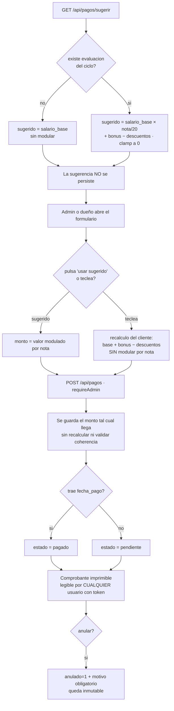

---

## 7. Asistencias y horarios

### 7.1 Turnos

Los turnos con semántica real en asistencias son `M` (mañana) y `T` (tarde)
(`routes/asistencias.js:13`), con `'M'` como valor por defecto en todas las escrituras
(`routes/asistencias.js:64,75,151,170`). El turno `C` (completo), que sí existe en reportes
(`routes/reportes.js:330`), **no está contemplado en asistencias**: cae en la rama de mañana.

### 7.2 Cómo se marca la asistencia

**No hay reloj checador ni marcaje por el propio empleado.** Existen tres vías:

1. **Digitación individual** — `POST /api/asistencias` con `INSERT OR REPLACE`
   (`routes/asistencias.js:153-154`), `fuente='manual'`.
2. **Digitación masiva** — `POST /api/asistencias/bulk`, grilla completa en transacción
   (`routes/asistencias.js:164-173`). Nótese que este endpoint **no persiste `obs`**, a diferencia
   del individual.
3. **Derivación automática desde el FR-01** — `routes/reportes.js:76-95`, con `fuente='reporte'`,
   `hora_entrada=null` y `minutos_tardanza=0`. El propio comentario lo reconoce como provisional
   "hasta tener huellero" (`routes/reportes.js:166-168`).

### 7.3 Cálculo de tardanza

`calcTardanza()` (`routes/asistencias.js:7-18`). Fórmula literal (`:16-17`):

```js
var diff = (parts2[0] * 60 + parts2[1]) - (parts1[0] * 60 + parts1[1]);
return diff > 0 ? diff : 0;
```

Las horas de referencia se leen de `config` (`hora_inicio_m`, `hora_inicio_t`,
`routes/asistencias.js:11-12`), con defaults `'08:00'` y `'14:00'` hardcodeados en
`routes/asistencias.js:10` y sembrados con los mismos valores en `database/seed-config.js:38`.
La selección es `ref = turno === 'T' ? HORA_INICIO_T : HORA_INICIO_M` (`:13`), de modo que
cualquier turno distinto de `T` usa la referencia de mañana.

> ⚠️ **La referencia es global, no por empleado ni por sede.** El sistema almacena horas de inicio
> por slot de horario (`routes/horarios.js:58`) y en la tabla legacy `horarios`
> (`routes/asistencias.js:188`), pero el cálculo de tardanza **las ignora por completo**. Un
> colaborador programado de 10:00 a 16:00 acumula 120 minutos de tardanza cada día.

**No existe tolerancia alguna.** `routes/asistencias.js:17` cuenta tardanza desde el primer minuto.
No hay clave de configuración de tolerancia; `database/seed-config.js:38` solo siembra las cuatro
horas. `docs/entrevista-dueno.md:175` pregunta al dueño cuántos minutos de tolerancia hay: hoy,
cero.

La conversión a nota está duplicada en dos archivos con los mismos literales:
`routes/asistencias.js:140` y `routes/evaluaciones.js:333`, ambos
`Math.max(0, 20 - Math.floor(totalMinTardanza / 15))`.

### 7.4 Faltas y justificaciones

**No existe el concepto de falta persistida.** La ausencia se infiere en tiempo de lectura en
`GET /del-dia`: `presentes` son las filas con registro y `ausentes = total − presentes`
(`routes/asistencias.js:97-98`). Nada se guarda.

**No existen justificaciones, permisos, vacaciones ni descansos médicos.** No hay columna
`justificado`, ni motivo, ni estado. El único texto libre es `obs` (`routes/asistencias.js:154`),
que además el endpoint masivo ni siquiera escribe. El comentario de cabecera del archivo promete
una pantalla para "marcar/justificar" (`routes/asistencias.js:26-27`) que el backend no soporta.

> ⚠️ **PENDIENTE DE CONFIRMAR.** `docs/entrevista-dueno.md:177-178` pregunta qué pasa con faltas
> justificadas, permisos, vacaciones y descansos médicos, y si afectan la nota. Hoy no existen.

### 7.5 Autorización

Toda lectura de asistencias requiere solo token válido (`routes/asistencias.js:29,110,124,185`):
cualquier usuario ve la asistencia de todos, sin filtro por sede ni por identidad propia. Toda
escritura exige `requireAdmin`, es decir `admin` o `dueno`
(`routes/asistencias.js:146,160,179,194,212`).

> ⚠️ **CONTRADICCIÓN.** El encargado de tienda **no puede** registrar asistencia por endpoint, pese
> a que el comentario del archivo describe la pantalla diaria como la que "el encargado usa para
> marcar/justificar" (`routes/asistencias.js:26-27`). Sin embargo, sí la genera indirectamente al
> enviar el FR-01 (`routes/reportes.js:76`), que no pasa por `requireAdmin`.

### 7.6 Horarios: dos sistemas coexistiendo

**Modelo v2 (vigente en el código nuevo)** — `routes/horarios.js:36-67`. Dos tablas:
`horario_periodos` (`id`, `nombre`, `fecha_desde`, `fecha_hasta` nullable, `activo`, `notas`) y
`horario_slots` (`periodo_id` con FK real, `emp_id` sin FK, `sede`, `sector`, `dia`, `turno`,
`rol`, `hora_inicio`, `hora_fin`, `minutos`, `notas`). Los días válidos son un array literal sin
tildes en `routes/horarios.js:72`.

**Modelo v1 legacy** — tabla plana `horarios` (`database/seed-config.js:16`, recreada
defensivamente en `routes/asistencias.js:188,215`) con `UNIQUE(emp_id, dia, turno)`. El comentario
de `routes/asistencias.js:53` la califica de "legacy pero la que usa el sistema".

Y efectivamente: **`GET /api/asistencias/del-dia` consulta la tabla plana v1, no los slots v2**
(`routes/asistencias.js:56-59`). El único consumidor real de v2 es el cálculo de cumplimiento de
reportes en `routes/evaluaciones.js:304-321`.

**Reglas de validación de horario — prácticamente inexistentes:**

- **Turnos:** texto libre, sin validación en ninguno de los dos modelos
  (`routes/horarios.js:262,367-368`; `routes/asistencias.js:202,226`).
- **Solapamientos de slots:** no se validan. `horario_slots` no tiene restricción de unicidad
  (`routes/horarios.js:48-64`); el mismo empleado puede quedar asignado dos veces el mismo día y
  turno en dos sedes distintas. El modelo lo permite deliberadamente para cubrir doble turno
  (`routes/horarios.js:12-14`), pero no distingue eso de un error de captura.
- **Límite de horas:** no existe. `getHorasMensuales()` (`routes/horarios.js:135-155`) es
  informativo y nunca se compara contra un máximo.
- **Descansos:** no existe el concepto de día libre ni de descanso mínimo entre turnos.
- **`hora_fin` anterior a `hora_inicio`:** no se rechaza; `minutosDiff` devuelve 0 en silencio
  (`routes/horarios.js:84`), de modo que un turno nocturno 22:00→06:00 se guarda con `minutos=0`.
- **Solapamiento de periodos:** es la única validación real, en
  `PUT /periodos/:id/activar` (`routes/horarios.js:187-205`). Pero `POST /periodos` permite crear
  directamente con `activo=1` (`:181`) saltándose esa lógica, con lo que pueden quedar dos periodos
  activos solapados.

Además, `PUT /horarios/:emp_id` y `POST /horarios/bulk` insertan **solo** `(emp_id, dia, turno,
sede)` (`routes/asistencias.js:201,221`), por lo que en la tabla v1 las columnas `hora_inicio` y
`hora_fin` quedan siempre nulas: son columnas muertas.

> ⚠️ **CONTRADICCIÓN CRÍTICA DE SCHEMA — la tabla `asistencias` está definida dos veces y las
> definiciones difieren.** `database/db.js:296-320` la crea **sin columna `turno`** y con
> `UNIQUE(emp_id, fecha)` y FK real a `empleados`. `database/seed-config.js:46` la crea **con
> `turno`** y `tipo_jornada`, con `UNIQUE(emp_id, fecha, turno)` y sin FK. En `server.js:150-151`
> corre primero `initDB()` y después el seed, cuyo `CREATE TABLE IF NOT EXISTS` es un no-op si la
> tabla ya existe. En una base creada desde cero por `db.js`, todas las escrituras de asistencia
> fallarían por columna inexistente, y la unicidad por `(emp_id, fecha)` haría que el turno tarde
> **sobrescriba** al de mañana. La divergencia está documentada en `docs/schema-actual.md:218-225`.

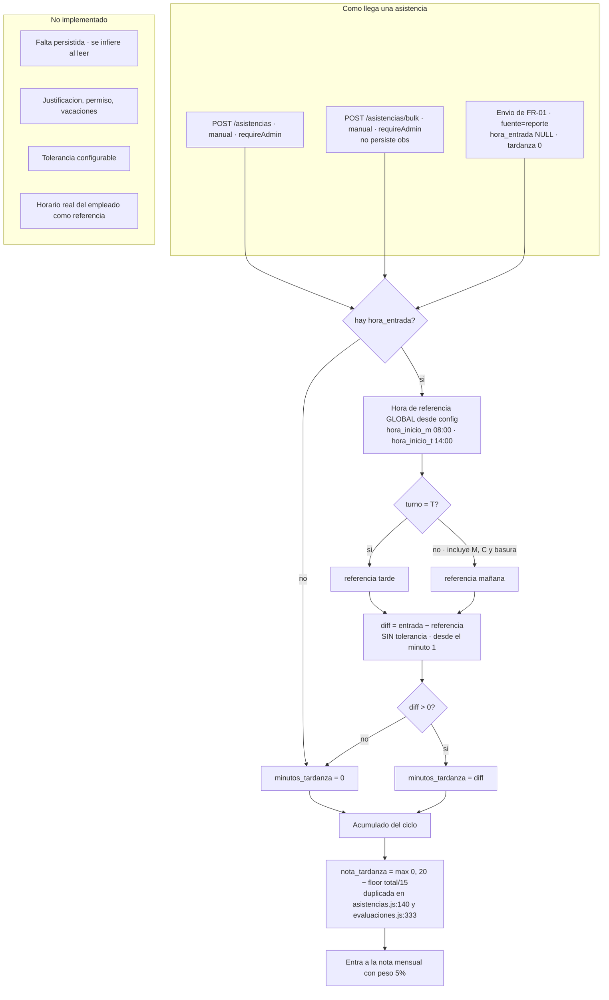

---

## 8. Solicitudes, garantías, préstamos, ventas, valores y envíos entre sedes

### 8.1 Solicitudes de tienda al almacén

Estados y quién ejecuta cada transición (`routes/solicitudes.js`):

| Estado | Endpoint | Quién |
|---|---|---|
| `pendiente` | default al crear (`:43`) | cualquier autenticado |
| `aprobada` | `PUT /:id/aprobar` (`:50-53`) | `admin`, `dueno`, `encargado_almacen` (`:6`) |
| `entregada` | `PUT /:id/entregar` (`:63-68`) | ídem |
| `confirmada` | `PUT /:id/confirmar` (`:73-76`) | **cualquier autenticado** |
| `rechazada` | `PUT /:id/rechazar` (`:85-91`) | ídem, con motivo obligatorio (`:86`) |

Existe además `PUT /:id/deshacer` (`:96-109`), abierto a cualquier autenticado, con destinos
`pendiente`, `aprobada` y `entregada`.

**No hay máquina de estados.** Ninguna transición comprueba el estado actual: se puede invocar
`/entregar` sobre una solicitud rechazada y funciona. Los valores `estado_anterior` que devuelve la
API son **literales hardcodeados** (`:59,69,81`), no leídos de la base, y el frontend los usa para
pintar el botón de deshacer (`public/js/solicitudes.js:124`), de modo que puede revertir a un
estado equivocado.

**Cantidades por ítem** (`routes/solicitudes.js:10-14`): `cantidad` es lo que pide la tienda
(`:45`), `cantidad_enviada` lo que el almacén aprueba (`:56-57`) y `cantidad_recibida` lo que la
tienda cuenta al recibir (`:78-79`). Si el cliente no envía este último, **se asume igual a
`cantidad_enviada`** (`:79`), lo que enmascara faltantes. El `estado_item` toma `'aprobado'` o
`'sin_stock'` según la cantidad aprobada (`:57`) y **nunca se actualiza al confirmar** (`:78`):
queda "aprobado" aunque la tienda reciba cero.

**Urgencias:** `alta`, `media`, `baja`, definidas únicamente en el frontend
(`public/js/solicitudes.js:47-48`). El backend acepta cualquier cadena (`routes/solicitudes.js:43`)
y solo la usa para ordenar (`:33`).

**Impresión:** cuatro columnas de control (`routes/solicitudes.js:16-19`) y un endpoint
`PUT /:id/marcar-impreso` (`:112-118`) que acepta `'pedido'` o `'confirmacion'`; cualquier otro
valor no hace nada y devuelve éxito.

> ⚠️ El listado sí filtra por sede para los no supervisores (`:29-31`), pero **el alta no valida
> `sede`** (`:43`): un empleado puede crear una solicitud a nombre de otra tienda. Y `/confirmar`,
> `/deshacer` y `/marcar-impreso` no comprueban ni rol ni sede.

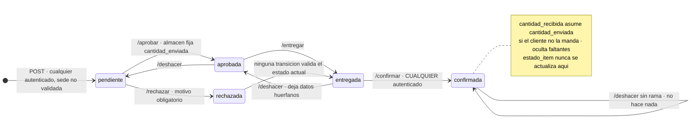

### 8.2 Garantías Yape

Devoluciones de garantía en efectivo o Yape a clientes de alquiler. Tabla
`devoluciones_garantia` (`database/db.js:249-257`) con `nombre_cliente`, `celular`, `num_boleta`,
`monto`, `tienda`, `responsable`, `estado`, `fecha_registro`, `fecha_devolucion` y `obs`.

**Solo dos estados:** `'pendiente'` (default, `database/db.js:254`) y `'devuelto'`. El flujo es
registrar (`routes/garantias.js:25-33`, valida cliente, celular y monto en `:27`) y devolver
(`:35-44`), momento en que se sella `fecha_devolucion` con la fecha local del servidor (`:38`). El
frontend lo confirma con el diálogo "¿Confirmar Yape enviado?" (`public/js/modulos.js:348-349`).

No hay anulación, ni devolución parcial, ni reversión limpia: mandar `estado:'pendiente'` a mano
dejaría `fecha_devolucion` poblada. El PUT tampoco valida el estado contra una lista (`:37`), así
que cualquier cadena lo hace desaparecer de ambos contadores del resumen (`:19-20`).

> ⚠️ **NADIE AUTORIZA.** Los tres endpoints usan solo `auth` (`routes/garantias.js:8,16,25,35`). No
> hay chequeo de rol, ni de sede, ni segunda firma. **Cualquier empleado autenticado puede
> registrar una garantía de cualquier tienda y marcarla como devuelta**, es decir, declarar que se
> entregó dinero. El único control es cosmético: el módulo aparece en el menú solo para
> `encargado_almacen` (`public/js/app.js:1716`).

> **Defecto:** el frontend envía `obs` (`public/js/modulos.js:337`) y la columna existe, pero el
> INSERT no la incluye (`routes/garantias.js:29`): la observación se descarta en silencio.

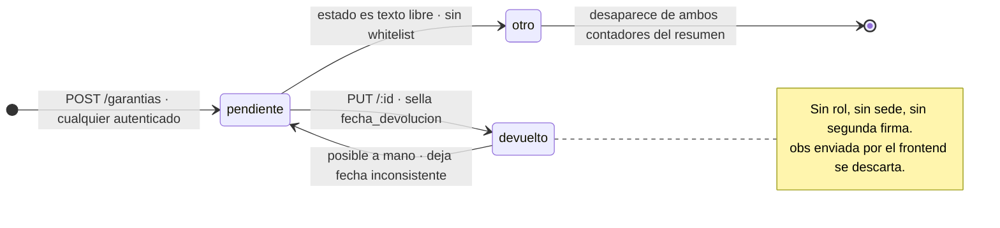

### 8.3 Préstamos de prendas entre sedes

**Son préstamos de prendas físicas, no de dinero.** No hay ningún campo monetario en el módulo
(`database/db.js:205-229`). El lote (`prestamos_lotes`) registra `sede_origen`, `sede_destino`,
`quien_lleva` y `responsable_registro`; cada `prestamo_items` lleva el código de prenda y su
estado.

**Estados del ítem** (lista blanca hardcodeada en `routes/prestamos.js:45`):
`prestada` (inicial, `:104`), `alquilada`, `devuelta`, `vendida`, `perdida`. **El lote no tiene
estado propio**: su situación se deriva al leer, contando ítems en `prestada` o `alquilada`
(`routes/prestamos.js:85`).

**No hay máquina de estados**: `PUT /item/:itemId/estado` (`:38-70`) solo verifica pertenencia a la
lista, aceptando cualquier transición, incluida `vendida → prestada`. Tampoco es idempotente:
repetir `vendida` inserta una fila nueva en `prendas_baja` cada vez (`:55`).

Al marcar `vendida` o `perdida` se crea automáticamente una baja de inventario en `prendas_baja`
(`routes/prestamos.js:53-56`), que después un `admin`, `dueno` o `encargado_almacen` procesa con
`PUT /bajas/:id/procesar` (`:31-32`).

> ⚠️ **INCONSISTENCIA DE PRIVILEGIOS.** Cambiar el estado de una prenda —incluido marcarla como
> vendida o perdida, lo que genera una baja de inventario— solo requiere token válido
> (`routes/prestamos.js:38`). En cambio, **cerrar** esa baja sí exige privilegio (`:28`). Generar
> la pérdida es libre; reconocerla es restringido.

> ⚠️ **RIESGO DE PÉRDIDA DE DATOS.** Si el INSERT en `prendas_baja` falla, el bloque de rescate
> ejecuta `db.exec('DROP TABLE IF EXISTS prendas_baja')` y recrea la tabla vacía
> (`routes/prestamos.js:57-65`), **destruyendo todo el historial de bajas sin respaldo**. El
> camino de lectura (`:17-21`) sí hace la migración correcta con renombrado y copia. Dos
> estrategias contradictorias para el mismo problema, y la destructiva vive en el camino de
> escritura.

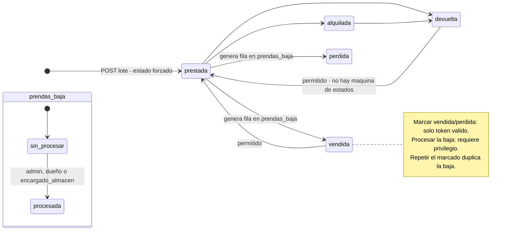

### 8.4 Ventas y metas

Tabla `ventas_metas` (`database/seed-config.js:17`): meta y venta mensual por empleado, con
`UNIQUE(emp_id, mes)` y el bonus ya calculado en `bonus_nota`.

El bonus se calcula por escalones (`routes/ventas.js:29-33`):

```js
var pct = meta > 0 ? (vendido / meta) * 100 : 0;
if      (pct >= 120) bonus = parseFloat(cfg.venta_bonus_max) || 2.0;
else if (pct >= 100) bonus = parseFloat(cfg.venta_bonus_120) || 1.5;
else if (pct >= 80)  bonus = parseFloat(cfg.venta_bonus_80)  || 0.5;
```

Es un valor absoluto que se suma a la nota sobre 20, no soles ni porcentaje. Registrar la meta
requiere `admin` o `dueno` (`routes/ventas.js:20`) y usa `INSERT OR REPLACE`, sobrescribiendo sin
historial (`:34`). La consulta, en cambio, solo pide token: cualquiera ve las metas y ventas de
cualquier compañero (`:8,40,50`).

> ⚠️ **TRES CÁLCULOS DISTINTOS DEL MISMO BONUS.**
> 1. `routes/ventas.js:31-33` — escalones configurables, se persiste en `bonus_nota`.
> 2. `public/js/admin.js:1475-1482` — duplicado literal en el navegador, que **recalcula el bonus
>    localmente en vez de usar el guardado**, y ese valor recalculado es el que se persiste en
>    `evaluaciones_mensuales.bonus_ventas` (`public/js/admin.js:1649`).
> 3. `routes/evaluaciones.js:347-355` — fórmula continua y distinta,
>    `min(2, ((vendido−meta)/meta) × 2)`, que además consulta una tabla `ventas` inexistente y
>    devuelve siempre 0.

> ⚠️ **BANDAS DESALINEADAS DE LAS CLAVES.** La rama de 100–119 % lee la clave `venta_bonus_120`
> (`routes/ventas.js:32`), mientras la interfaz de configuración etiqueta esa clave como
> "Bonus 101-120%" (`public/js/admin.js:2183`). Y `venta_bonus_100` es **una clave editable que
> nadie lee jamás**. Ninguna de las cuatro claves está sembrada, así que hasta que un admin las
> guarde rigen los defaults 2.0 / 1.5 / 0.5.

Existe además un bonus económico por productividad del pipeline,
`GET /ventas/pipeline-bonus/:emp_id/:mes` (`routes/ventas.js:50-103`), que cuenta movimientos de
`prenda_historial` por nombre, resta la meta mensual y multiplica el excedente por
`pipeline_precio_punto` (`:80,101`). Usa **pesos por etapa distintos** de los del pipeline real
(`routes/ventas.js:68-72`: planchado 5, lavado 3, empatado 2, compostura 3, refacción 2). Su
resultado **no se conecta con el módulo de pagos**.

> **Defecto de fecha.** El rango se cierra con `hasta = mes + '-31'` (`routes/ventas.js:59`),
> pero `prenda_historial.fecha` es un datetime completo (`database/db.js:124`). En comparación de
> cadenas, `'2026-08-31 14:02:11'` es mayor que `'2026-08-31'`: **en los meses de 31 días se
> pierde todo el día 31**.

### 8.5 Valores 360°

Seis criterios en `evaluaciones_valores` (`database/db.js:192-202`): `integridad`, `respeto`,
`honestidad`, `amabilidad`, `relacion` ("Buena relación con compañeros") y `actitud` ("Actitud para
el trabajo"), etiquetados en `public/js/data.js:85-86`. Escala Likert de 1 a 5
(`public/js/data.js:87`: Nunca, Raramente, A veces, Frecuentemente, Siempre), con valor inicial 3.
**El backend no valida el rango** (`routes/valores.js:103-113`).

**Quién evalúa a quién:** todos contra todos los empleados activos, sin filtro de sede, rol ni
jerarquía (`routes/valores.js:70,120`); la única restricción es no autoevaluarse (`:107`).

**Anonimato:** para el colaborador sí (`/mi-resumen`, `:201-219`, devuelve solo agregados). Para el
administrador **no**: `GET /resumen/:emp_id/:mes` devuelve el nombre de cada evaluador junto a su
nota (`:80-85,99`) y `/seguimiento` lista nominalmente quién le falta evaluar a quién (`:161-163`).

**Ventana temporal:** configurable en `eval_valores_modo` (`manual` o `auto`) y `eval_valores_dias`
(por defecto `25,26,27,28`), sembrados una sola vez en `routes/valores.js:6-19`. El módulo arranca
**apagado** (`eval_valores_habilitado='0'`, `:11`).

> ⚠️ **LA VENTANA ES COSMÉTICA.** `estaHabilitadoHoy()` (`routes/valores.js:25-35`) solo se
> consulta en `GET /config` y `PUT /config` (`:46,60`). **`POST /api/valores` nunca la invoca**
> (`:103-113`): la API acepta evaluaciones cualquier día del mes. El flag únicamente oculta la
> entrada del menú (`public/js/app.js:1495-1498`). Además, `routes/notificaciones.js:76-78` lee
> solo el flag e ignora modo y días, de modo que en modo automático el módulo aparece los días
> 25–28 pero el contador de pendientes marca cero.

Guardar usa `INSERT OR REPLACE` sobre la clave única (`:108`): una evaluación se puede reescribir
indefinidamente dentro del mes, sin cierre ni bloqueo.

> ⚠️ **TRES PROMEDIOS INCONSISTENTES.** `GET /resumen` convierte los campos nulos en 0 y divide
> siempre entre 6 (`routes/valores.js:91-95`); `/seguimiento` (`:165-170`) y `/mi-resumen`
> (`:210-215`) los excluyen y dividen entre los no nulos. **Para el mismo empleado y mes, las
> pantallas de resumen y de seguimiento pueden mostrar notas distintas.** La escala a 20 es
> `(total/5) × 20` en los tres sitios; el comentario de `routes/valores.js:96` describe una
> división entre 30 que el código no ejecuta.

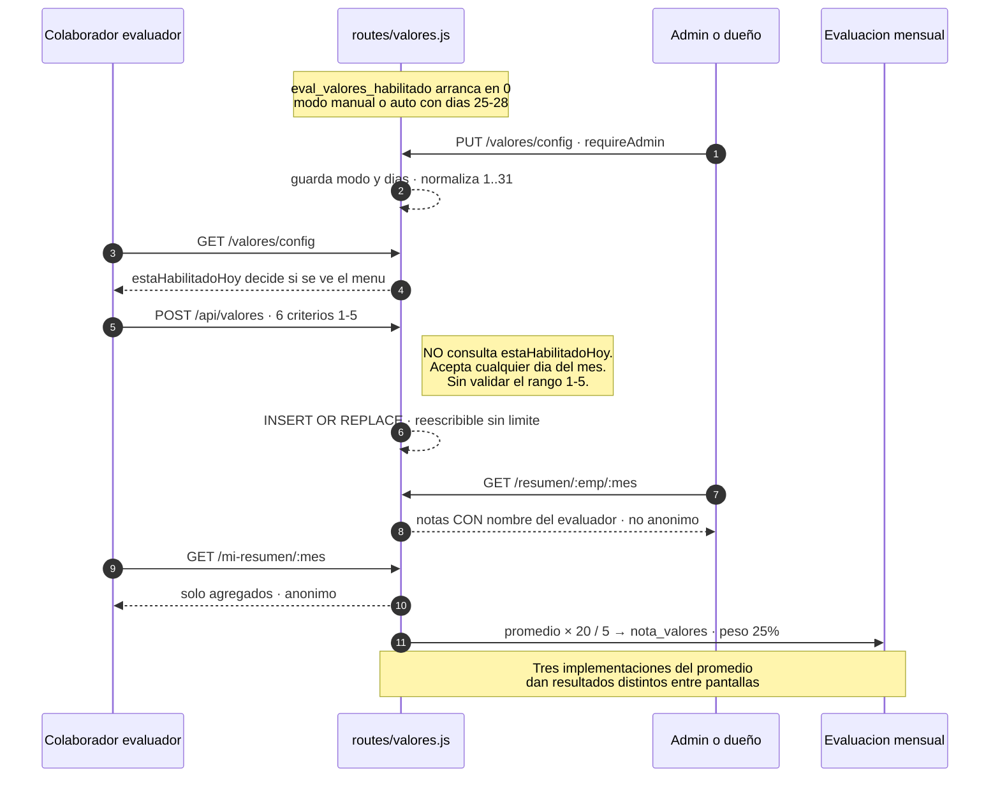

### 8.6 Envíos entre sedes

Hay **tres canales distintos** de movimiento entre sedes, con reglas incompatibles.

**Tienda → almacén: listas de lavandería.** `listas_lavanderia`
(`database/db.js:151-159`), con estados `En proceso` (default), `Procesado`, `Devuelto`,
`Validado` y `Devuelto-Observado`. La secuencia canónica vive **solo en el frontend**
(`public/js/app.js:1457`: `['En proceso','Procesado','Devuelto','Validado']`); el backend acepta
cualquier cadena (`routes/lavanderia.js:90-95`). La validación de retorno marca
`Devuelto-Observado` si algún ítem tiene estado distinto del literal `'bien'`
(`routes/lavanderia.js:106-107`).

El identificador se genera con contadores **por sede y tipo** (`lista_counters`,
`routes/lavanderia.js:19-24`), produciendo códigos como `LAV-LB007`. El contador se incrementa
**fuera** de la transacción que crea la lista (`:51` frente a `:56`), de modo que un fallo deja
huecos permanentes en la numeración.

Al crear la lista, **cada ítem con código se inyecta automáticamente al pipeline**
(`routes/lavanderia.js:73-81`), enlazado por `lista_lavanderia_id`. El mapeo de destino a etapa
(`:74-77`) admite un valor `'codificacion'` que **no es una etapa válida del pipeline**: aparece
solo en esa línea de todo el repositorio. Una prenda ingresada así queda invisible en el tablero y
sin transición de salida. El mapeo equivalente de `routes/pipeline.js:237` solo contempla
`compostura`, `refaccion` y `recepcion`: **dos entradas al mismo pipeline con reglas distintas**.

Los "generales" —camisas, corbatas, michis, corbatones, porta ternos y zapatos— son contadores
agregados sin código individual y **nunca entran al pipeline** (`routes/lavanderia.js:59-60`).

**Almacén → tienda: envíos de prendas.** Cubiertos en la sección 1.6. Requieren estado `listo`,
crean `envios_prendas` y se validan por sede.

**Almacén → tienda: envíos de accesorios.** Tablas `envios_accesorios` y
`envio_accesorios_items` (`routes/pipeline.js:118-141`). Al crear el envío se marcan como enviados
los registros de `accesorios_log` disponibles del mismo tipo, en orden de antigüedad, restando
cantidades hasta cubrir lo enviado (`routes/pipeline.js:635-646`). La validación en tienda exige
coincidencia de sede salvo supervisores (`:674-676`).

> ⚠️ **Sin control de acceso en lavandería.** Los cuatro endpoints usan solo `auth`
> (`routes/lavanderia.js:10-17`). Cualquier empleado puede listar las listas de todas las sedes,
> crear una a nombre de cualquier sede, cambiar su estado a cualquier cadena y validar su retorno.
> El listado además no tiene `LIMIT` (`:35`) y carga los ítems de cada lista en bucle.

> ⚠️ **Sin deduplicación de prendas.** `prendas.codigo` no es único (`database/db.js:96`).
> Reenviar la misma lista, o incluir un código que ya está en el pipeline, crea prendas duplicadas
> en silencio.

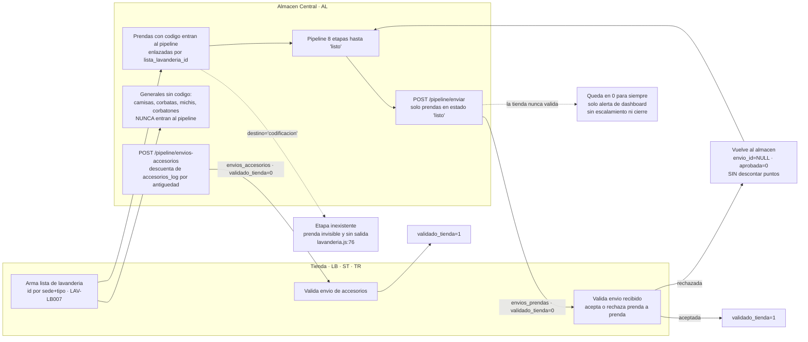

---

## 9. Configuración: qué es editable y qué está clavado en el código

Esta sección importa especialmente porque el cliente ha pedido de forma explícita que todos los
parámetros de negocio sean configurables desde la interfaz.

### 9.1 Lo que ya es editable

| Parámetro | Clave de `config` | Endpoint de edición | Rol |
|---|---|---|---|
| Puntos por etapa del pipeline | `pts_*` | `PUT /api/pipeline/config-puntos` (`routes/pipeline.js:210`) | cualquier autenticado |
| Precio unitario de camisa | `precio_camisa` | mismo endpoint | cualquier autenticado |
| Pesos de la evaluación mensual | `peso_*` | `PUT /api/evaluaciones/pesos` (`routes/evaluaciones.js:198`) | admin/dueño |
| Matriz de permisos por rol | `permisos` | `PUT /api/config/permisos` (`routes/config.js:12`) | admin/dueño |
| Puestos personalizados | `puestos_custom` | `PUT /api/config/puestos` (`routes/config.js:23`) | admin/dueño |
| Grupos de rangos | `grupos_rangos` | `PUT /api/config/grupos-rangos` (`routes/config.js:48`) | admin/dueño |
| Tooltips del layout | `layout_tooltips` | `PUT /api/config/layout-tooltips` (`routes/config.js:78`) | admin/dueño |
| Ventana de Valores 360° | `eval_valores_modo`, `eval_valores_dias`, `eval_valores_habilitado` | `PUT /api/valores/config` (`routes/valores.js:52`) | admin/dueño |
| Catálogo de tipos de incidencia | tabla `incidencia_tipos` | `PUT /api/incidencias/tipos/list` (`routes/incidencias.js:134`) | admin/dueño |
| Catálogo de actividades | tabla `actividades_config` | `POST/PUT /api/actividades` (`routes/actividades.js:6`) | admin/dueño |
| Cualquier clave suelta | libre | `PUT /api/config` (`routes/config.js:9`) | admin/dueño |

> ⚠️ **`PUT /api/pipeline/config-puntos` no verifica rol** (`routes/pipeline.js:210`): usa solo
> `auth`. Cualquier empleado con token puede reescribir los puntos de todas las etapas y, por esa
> vía, su propia productividad.

### 9.2 Configuración sembrada que nadie lee

Estas claves aparecen en la pantalla de configuración o en el seed, pero **no influyen en ningún
cálculo**:

| Clave | Sembrada en | Situación |
|---|---|---|
| `precio_lavado_mano` = 5.00 | `database/db.js:355` | jamás leída |
| `precio_michi` = 3.00 | `database/db.js:356` | jamás leída |
| `hora_fin_m` = 14:00, `hora_fin_t` = 20:00 | `database/seed-config.js:38` | solo el reloj del encabezado; no calculan salida ni horas |
| `inc_uniforme`, `inc_orden_limpieza`, `inc_documentacion`, `inc_equipos_electricos`, `inc_seguridad_cerrar`, `inc_graves`, `inc_otros` | `database/seed-config.js:36-37` | ningún backend las lee; el único consumidor está roto (sección 5.3) |
| `pipeline_meta_mensual`, `pipeline_meta_semanal`, `pipeline_precio_punto` | `database/seed-config.js:39` | solo el bonus de pipeline, que no llega a la planilla |
| `venta_bonus_100` | nunca sembrada | editable en el panel, jamás leída |
| `eval_pesos` | `routes/config.js:113-140` | endpoint completo sin ningún consumidor |
| `pts_envio` | nunca sembrada | listada en la UI de config (`routes/pipeline.js:205`), nunca consumida |

### 9.3 Reglas de negocio hardcodeadas en el código

Esta es la lista que hay que atacar si el objetivo es que todo sea configurable.

**Horarios y ventanas de tiempo**

| Regla | Valor | Archivo:línea |
|---|---|---|
| Cierre del turno mañana | 15:00 | `routes/reportes.js:99` |
| Cierre de turnos tarde y completo | 23:00 | `routes/reportes.js:100` |
| Apertura de reportes en tienda | 08:00 | `public/js/app.js:336` |
| Ventana de habilitación de turnos M/T/C | 8 / 15 / 23 | `public/js/app.js:322-339` |
| Alerta de reporte de mañana faltante | 11:00 | `routes/dashboard.js:153` |
| Alerta de turno tarde faltante | 20:00 | `public/js/app.js:357` |
| Frecuencia del cron de auto-envío | 5 minutos | `server.js:165` |
| Heartbeat del stream SSE | 25 segundos | `routes/pipeline.js:23` |

**Fórmulas de evaluación y pago**

| Regla | Valor | Archivo:línea |
|---|---|---|
| Escala de la nota | sobre 20 | `public/js/admin.js:1600,1621`; `routes/pagos.js:136` |
| Normalización de competencias | dividir entre 32 (8 criterios × 4) | `public/js/admin.js:1600` |
| Los 8 criterios de competencias y sus rúbricas | lista fija | `public/js/data.js:75-84` |
| Escala de valores a 20 | `(promedio/5) × 20` | `routes/valores.js:97,171,216` |
| Descuento por tardanza | 1 punto por cada 15 minutos | `routes/asistencias.js:140`; `routes/evaluaciones.js:333` |
| Tope del descuento por incidencias | 20 | `public/js/admin.js:1397` |
| Tramos de recomendación | 17 / 14 / 11 | `public/js/admin.js:1622` (y cuatro copias más) |
| Fórmula del pago sugerido | `base × nota/20 + bonus − descuentos` | `routes/pagos.js:136` |
| Bonus de ventas por defecto | 2.0 / 1.5 / 0.5 | `routes/ventas.js:31-33` |
| Bandas del bonus de ventas | 80 / 100 / 120 % | `routes/ventas.js:30-33` |
| Ciclo personal por aniversario de ingreso | regla fija | `routes/evaluaciones.js:98-127` |

**Pipeline**

| Regla | Valor | Archivo:línea |
|---|---|---|
| Lista de etapas y su orden | 8 etapas | `public/js/almacen-kanban.jsx:11` |
| Grafo de transiciones | mapa `NEXT` + botones | `public/js/almacen-kanban.jsx:14,297-319` |
| Media puntuación para prendas sueltas | dividir entre 2 | `routes/pipeline.js:269` |
| Lista de tipos que cuentan como media prenda | saco, pantalón, falda, chaleco, blazer | `routes/pipeline.js:268` |
| Peso por defecto si falta la clave de config | 1 | `routes/pipeline.js:89,90` |
| Ventana de deshacer | 5 segundos, solo en el cliente | `public/js/almacen-kanban.jsx:107` |
| Pesos por etapa del bonus de pipeline | 5/3/2/3/2 | `routes/ventas.js:68-72` |
| Tipos de accesorio | lista fija de 5 | `public/js/almacen-kanban.jsx:17` |

**Catálogos maestros (todos en el frontend, sin tabla)**

| Catálogo | Archivo:línea |
|---|---|
| Sedes | `public/js/data.js:19`; `routes/reportes.js:328`; `routes/dashboard.js:154,251`; `public/js/almacen-kanban.jsx:16` |
| Colores de prenda (17) | `public/js/data.js:65` |
| Tipos de prenda (8) | `public/js/data.js:66` |
| Observaciones de prenda (11) | `public/js/data.js:67` |
| Motivos de refacción (10) | `public/js/data.js:68` |
| Tipos de incidencia del formulario (10) | `public/js/data.js:69` |
| Tallas | `public/js/data.js:71-73` |
| Roles del sistema | `public/js/admin.js:723` |
| Permisos por rol por defecto | `public/js/app.js:1712-1720` |
| Días de la semana | `routes/horarios.js:72`; `routes/asistencias.js:35` |
| Categorías de actividad | `public/js/data.js:60-62`; `routes/dashboard.js:322` |
| Escala Likert de valores | `public/js/data.js:87` |

**Otros**

| Regla | Valor | Archivo:línea |
|---|---|---|
| Horas de referencia de tardanza por defecto | 08:00 / 14:00 | `routes/asistencias.js:10` |
| Ausencia de tolerancia de tardanza | desde el minuto 1 | `routes/asistencias.js:17` |
| Puntos de incidencia por nivel | Alto 5, Medio 2, Bajo 1 | `routes/incidencias.js:103`; `routes/reportes.js:162,376` |
| Catálogo semilla de 21 tipos de incidencia | valores fijos | `routes/incidencias.js:29-51` |
| Ventana de valores por defecto | días 25 a 28 | `routes/valores.js:16` |
| Estado de retorno sin problema | literal `'bien'` | `routes/lavanderia.js:106` |
| Estados de lista de lavandería | solo en el cliente | `public/js/app.js:1457` |
| Método de pago por defecto | `'efectivo'` | `routes/pagos.js:38,193` |
| Numeración de comprobante | 6 dígitos | `routes/pagos.js:291` |
| Moneda | `'S/ '` fijo | `routes/pagos.js:245` |
| Clave JWT de respaldo | literal en el código | `routes/pipeline.js:4` y otros seis archivos |
| Retención de respaldos | últimos 14 | `_backup-bd.js` |

---

## 10. Reglas ambiguas o contradictorias que requieren confirmación del dueño

Ordenadas por impacto sobre el dinero y sobre la operación.

1. **¿La nota mensual determina el sueldo?** El sistema multiplica el salario base por
   `nota_final/20` (`routes/pagos.js:136`), de modo que un 14/20 paga el 70 % del sueldo. El propio
   código admite que es una fórmula inventada (`routes/pagos.js:105`). Es la regla más delicada del
   sistema y no está confirmada.

2. **El frontend y el backend calculan el pago con fórmulas distintas.** El cliente usa
   `base + bonus − descuentos` sin modular por nota (`public/js/pagos.js:134`), el servidor sugiere
   la versión modulada (`routes/pagos.js:136`), y el POST guarda lo que llegue sin verificar
   (`routes/pagos.js:178`). En producción conviven pagos calculados con dos reglas.

3. **Confusión de unidades entre puntos y soles.** `descuento_incidencias` es un número de puntos
   de nota (`public/js/admin.js:1397`) y `bonus_ventas` es un valor topado en 2 pensado como puntos
   (`routes/ventas.js:31-33`), pero ambos se suman y restan **como soles** en
   `routes/pagos.js:136`. Hay que definir la unidad de cada concepto.

4. **La etapa "Vacío" no existe.** La documentación describe 9 pasos
   (`CLAUDE.md`, `docs/brief-fable-ui.md:29`) y el código implementa 8
   (`public/js/almacen-kanban.jsx:11`). Hay que decidir si es un paso real no implementado o un
   paso eliminado que quedó en los documentos.

5. **Cuánto vale cada paso del pipeline.** Los pesos actuales son heredados del sistema anterior y
   nunca fueron validados (`database/db.js:357-366`). Además faltan `pts_recepcion` y `pts_listo`,
   que caen a un default de 1 (`routes/pipeline.js:89-90`), y `pts_listo` nunca llega a cobrarse.

6. **¿Una camisa vale lo mismo que un terno completo?** La regla de media puntuación
   (`routes/pipeline.js:268`) solo cubre saco, pantalón, falda, chaleco y blazer. Camisas y
   corbatas puntúan como terno completo.

7. **¿Quién puede ejecutar cada paso del pipeline?** Hoy nadie está restringido: todos los
   endpoints de escritura usan un middleware que solo valida la firma del token
   (`routes/pipeline.js:6`). Un vendedor junior puede aprobar control de calidad.

8. **¿Existe un tiempo máximo por etapa?** No hay detección de prendas atascadas, ni SLA, ni
   alerta por antigüedad en ninguna parte del sistema.

9. **El descuento por incidencias y el bonus por ventas están rotos y devuelven siempre cero.**
   Consultan una columna `emp_id` que no existe (`routes/evaluaciones.js:338-341`) y una tabla
   `ventas` que tampoco (`routes/evaluaciones.js:349`). Hay que decidir cuál es el comportamiento
   correcto antes de arreglarlos.

10. **Tres tablas de pesos de evaluación conviven en el código.** La vigente
    (`routes/evaluaciones.js:62-70`), una alternativa con reparto completamente distinto y sin
    consumidores (`routes/config.js:106-112`), y una tercera muerta (`public/js/data.js:89-96`).
    Hay que confirmar los porcentajes reales y borrar las otras dos.

11. **Dos sistemas paralelos de penalidad por incidencia.** Por tipo, en la tabla
    `incidencia_tipos` (`routes/incidencias.js:29-51`), y por categoría, en las claves `inc_*`
    (`database/seed-config.js:36-37`), estas últimas sin lector funcional. Hay que elegir uno.

12. **Las incidencias no se resuelven.** Son append-only, sin estado, sin descargo del responsable
    y sin cierre (`routes/incidencias.js:68-118`). Falta definir si debe existir un ciclo de vida.

13. **Cualquier empleado puede imputar una falta a cualquier otro**, en cualquier sede y con los
    puntos que decida (`routes/incidencias.js:85`, campo expuesto en `public/js/app.js:2088`).

14. **La escala de calificación del FR-01 es ambigua.** El reporte diario la usa como multiplicador
    cercano a 1 (`public/js/app.js:1300`), mientras la evaluación mensual asume que va de 0 a 20
    (`routes/evaluaciones.js:234-235`). Son lecturas incompatibles del mismo campo.

15. **¿Qué pasa si nadie envía el reporte de un turno?** Hoy se crea un registro `no_evaluable=1`
    que se excluye de todos los conteos (`routes/reportes.js:353-362`): no baja la nota, no genera
    incidencia y no avisa a nadie.

16. **¿Qué pasa si nadie evalúa un reporte?** No hay auto-evaluación en este sistema. El reporte
    queda `evaluado=0, bloqueado=1` **bloqueando indefinidamente a su sede**
    (`routes/reportes.js:123`, `public/js/app.js:202`). No hay margen ni turno de gracia.

17. **Las horas de cierre de turno están hardcodeadas y difieren entre cliente y servidor.** El
    servidor cierra el turno completo a las 23:00 (`routes/reportes.js:100`) y el cliente a las
    15:00 (`public/js/app.js:338`). Además nadie confirmó nunca que 15:00 y 23:00 sean correctas
    (`docs/entrevista-dueno.md:138-141`).

18. **La tardanza se mide contra una hora global, no contra el horario real del empleado.**
    `routes/asistencias.js:10-13` usa `hora_inicio_m` y `hora_inicio_t` para todos, ignorando las
    horas por slot que el sistema sí almacena. Un colaborador de horario 10:00–16:00 acumula
    120 minutos de tardanza diarios.

19. **No existe tolerancia de tardanza.** Se cuenta desde el primer minuto
    (`routes/asistencias.js:17`) y no hay parámetro configurable.
    `docs/entrevista-dueno.md:175` pregunta cuántos minutos deberían ser.

20. **No existen faltas persistidas, justificaciones, permisos, vacaciones ni descansos médicos.**
    La ausencia se infiere al leer (`routes/asistencias.js:97-98`) y no se guarda nada.

21. **No existen adelantos ni préstamos de dinero a empleados.** No hay tabla, columna ni endpoint;
    la única vía es teclearlos a mano en el campo de descuentos (`routes/pagos.js:36,42`).

22. **No hay unicidad de pago por empleado y periodo.** Se pueden registrar varios pagos del mismo
    mes al mismo colaborador (`routes/pagos.js:182`, sin restricción única).

23. **Cualquier empleado autenticado puede leer los sueldos, las notas y las asistencias de todos.**
    `routes/pagos.js:84,158,236` y `routes/asistencias.js:110,124` no filtran por identidad ni por
    sede. `docs/entrevista-dueno.md:180-186` plantea quién debería poder verlo.

24. **Las garantías Yape no tienen ningún control de autorización.** Cualquier empleado puede
    registrar una devolución de dinero de cualquier tienda y marcarla como entregada
    (`routes/garantias.js:8,16,25,35`).

25. **Marcar una prenda prestada como vendida o perdida no requiere privilegio**, aunque genera una
    baja de inventario (`routes/prestamos.js:38,53`); en cambio procesar esa baja sí lo requiere
    (`:28`).

26. **Riesgo de pérdida de datos en préstamos.** El bloque de rescate ejecuta
    `DROP TABLE IF EXISTS prendas_baja` y recrea la tabla vacía (`routes/prestamos.js:57-65`),
    borrando todo el historial de bajas.

27. **La tabla `asistencias` está definida dos veces y las definiciones difieren.**
    `database/db.js:296-320` la crea sin `turno` y con unicidad por `(emp_id, fecha)`;
    `database/seed-config.js:46` la crea con `turno` y unicidad por `(emp_id, fecha, turno)`. En
    una base nueva, el turno tarde sobrescribiría al de mañana.

28. **La ventana de Valores 360° es cosmética.** `POST /api/valores` nunca consulta
    `estaHabilitadoHoy()` (`routes/valores.js:103-113`): se puede evaluar cualquier día. Hay que
    decidir si la ventana debe ser vinculante.

29. **La evaluación 360° no es anónima para el administrador.** `routes/valores.js:80-85,99` expone
    el nombre de cada evaluador junto a su nota. `docs/entrevista-dueno.md:169-171` pregunta si eso
    es lo deseado.

30. **El promedio de valores se calcula de tres formas distintas** según la pantalla
    (`routes/valores.js:91-95` frente a `:165-170` y `:210-215`), de modo que el mismo empleado
    puede aparecer con notas diferentes en el resumen y en el seguimiento.

31. **Tres cálculos distintos del bonus de ventas** (`routes/ventas.js:31-33`,
    `public/js/admin.js:1475-1482`, `routes/evaluaciones.js:353`) y bandas desalineadas de las
    claves de configuración (`routes/ventas.js:32` frente a `public/js/admin.js:2183`).

32. **El arrastre de actividades pendientes nunca se activa.** Los endpoints `POST
    /actividades/pendiente` y `/resolver` (`routes/actividades.js:116-117`) no se invocan desde
    ninguna parte, de modo que la tabla `actividades_pendientes` permanece vacía y el campo
    `acumula` no tiene efecto.

33. **El campo `descuento` de las actividades se guarda y se edita pero nunca se aplica** al
    puntaje del reporte (`routes/actividades.js:66,75` frente a `public/js/app.js:1060-1062`).

34. **El campo `aparece_dia` significa tres cosas distintas** según el valor de `frecuencia_dias`
    (`routes/actividades.js:25,29,30`): cada cuántas semanas, día base quincenal, o día del mes.
    Además `frecuencia_dias=2` no es "cada dos días" sino "días pares del mes"
    (`routes/actividades.js:19`), y el turno completo `'C'` no se filtra, con lo que aplican a la
    vez todas las actividades de mañana y de tarde (`routes/actividades.js:12-16`).

35. **Existen dos catálogos de actividades extra que no coinciden.** "Confección de michis" figura
    como trabajo remunerado a S/ 3 sin puntos en un lado y como 10 puntos sin pago en el otro
    (`docs/pendientes-negocio.md:36-47`, `docs/entrevista-dueno.md:154-157`).

36. **El incentivo por camisas se registra pero no se liquida.** Se guarda como texto en el campo
    de detalle (`routes/pipeline.js:388-389`) y no alimenta ningún cálculo de pago.

37. **La etapa `'codificacion'` no existe en el pipeline** pero la ingesta de listas de lavandería
    la puede asignar (`routes/lavanderia.js:76`), dejando prendas invisibles y sin salida. Además
    las dos entradas al pipeline usan mapeos distintos (`routes/lavanderia.js:74-77` frente a
    `routes/pipeline.js:237`).

38. **Los códigos de prenda no son únicos** (`database/db.js:96`), de modo que reenviar una lista
    duplica prendas en el pipeline sin aviso.

39. **El "deshacer" del pipeline no tiene límite real de tiempo ni de autoría**
    (`routes/pipeline.js:276-286`), y el borrado de puntos por identificador máximo puede eliminar
    una fila que no corresponde al movimiento deshecho (`:283`).

40. **Los descuentos de puntos por rechazo no aparecen en el ranking ni en el avance del operario**,
    porque ambas consultas filtran `puntos>0` (`routes/pipeline.js:196,462`).

41. **La numeración de listas de lavandería es por sede y tipo** (`routes/lavanderia.js:19-24`),
    mientras el principio declarado para prendas es numeración global. Hay que confirmar cuál
    aplica a cada objeto.

42. **El ciclo personal no está definido para quienes ingresaron los días 29, 30 o 31.** El cálculo
    desborda al mes siguiente (`routes/evaluaciones.js:123-125`);
    `docs/entrevista-dueno.md:40-48` plantea la pregunta y sigue sin respuesta.

43. **Una evaluación mensual se puede sobrescribir indefinidamente** con `INSERT OR REPLACE`
    (`routes/evaluaciones.js:170`), sin historial de versiones ni ventana de cierre.

44. **`PUT /api/pipeline/config-puntos` no verifica rol** (`routes/pipeline.js:210`): cualquier
    empleado puede reescribir los puntos de todas las etapas.
