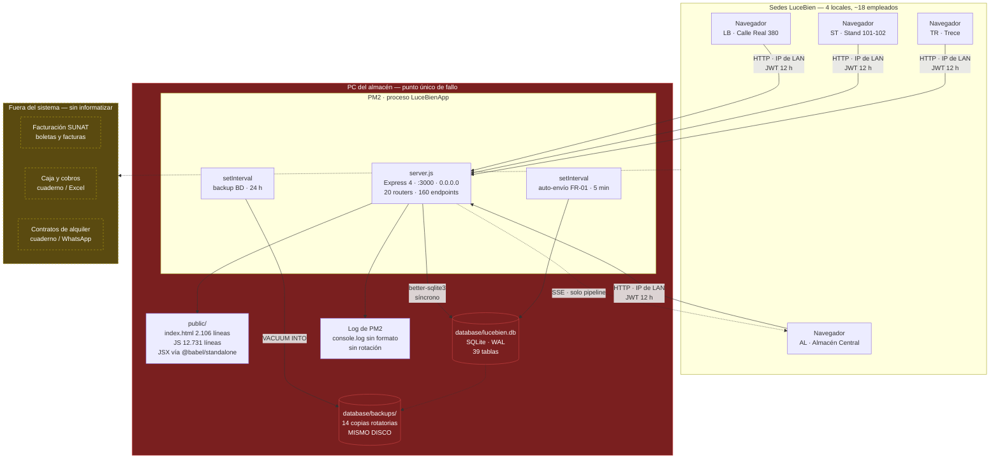
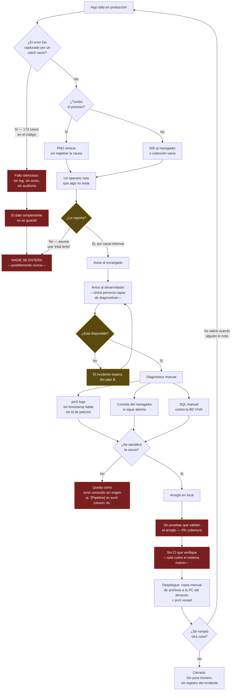

# Auditoría transversal de calidad, operación y brechas funcionales — SCI-LB (sistema viejo)

**Fecha:** 13 de agosto de 2026
**Alcance:** el ERP interno legacy de Confecciones Aliaga E.I.R.L. (LuceBien): Node.js + Express 4 +
better-sqlite3, con frontend servido desde `public/`. Quedan explícitamente fuera del alcance
`apps/`, `packages/`, `node_modules/`, `.claude/worktrees/` y las copias `_local_backup_*`; el
sistema nuevo (Next.js + Supabase) solo se menciona como referencia para juzgar si una brecha ya
está resuelta.
**Método:** lectura de código y documentación. No se modificó ningún archivo, no se ejecutaron
instalaciones ni se abrió la base de datos viva.

---

## Resumen ejecutivo

El sistema viejo es un ERP operativo de recursos humanos y de pipeline de lavandería. Cubre bien lo
que fue diseñado para cubrir —reportes diarios, evaluación mensual, puntos, incidencias, pagos al
personal— y lo hace desde una única máquina, sin pruebas automatizadas, sin CI que lo verifique y
sin ninguna capacidad comercial: no conoce clientes, no conoce pedidos, no conoce caja y no emite
comprobantes. Es, en términos del negocio, la mitad interna de la empresa; la mitad que factura no
está informatizada en él.

Tres hechos condicionan todo lo demás. Primero, el código legacy está congelado: el último commit
que tocó `routes/` o `public/js/` es del 10 de mayo de 2026, mientras que en los últimos sesenta
días hubo 236 commits, todos dirigidos al sistema nuevo. Segundo, ese código congelado sigue siendo
el sistema de registro real de la operación —los archivos de base de datos y los backups
automáticos muestran escrituras del día de hoy—. Tercero, el pipeline de CI existente
(`.github/workflows/ci.yml:41-45`) verifica exclusivamente el sistema nuevo; ningún cambio al
legacy pasa por verificación automática de ninguna clase.

De los hallazgos de esta auditoría, dos exigen atención inmediata con independencia de cuándo llegue
el reemplazo, porque son media jornada de trabajo cada uno y evitan una pérdida irreversible.
`routes/prestamos.js:60-61` ejecuta un `DROP TABLE IF EXISTS prendas_baja` dentro del `catch` de un
`PUT` HTTP, de modo que un fallo de inserción durante el uso normal borra el histórico completo de
prendas vendidas y perdidas. Y `routes/garantias.js:35` permite que cualquier usuario autenticado
—incluido un confeccionista— marque como devuelto el depósito de garantía de cualquier cliente en
cualquier tienda. Ambos se detallan en 4.3 y 5.5.

---

## 1. Cómo se despliega y opera hoy

### 1.1 Proceso de arranque

El punto de entrada es `server.js`, declarado en `package.json:5` y arrancable con
`npm start` (`package.json:7`). La secuencia de arranque es lineal y sin fases de verificación:

1. `server.js:3` carga `.env` mediante un lector propio (`_env-loader.js`), envuelto en `try/catch`
   para que la ausencia del archivo no impida el boot.
2. `server.js:18-20` monta `cors()` sin restricción de origen, `express.json()` y el servidor de
   estáticos de `public/` con `Cache-Control: no-store`.
3. `server.js:24-79` monta el interceptor de auditoría, que envuelve `res.json` para registrar todo
   `POST`/`PUT`/`DELETE` con respuesta 2xx.
4. `server.js:82-101` monta los 20 routers. Siete de ellos van envueltos en `try/catch`
   (`server.js:93-95`, `100-101`) precisamente para que un fallo de carga de un módulo no tumbe el
   proceso; los otros trece no, de modo que un error de sintaxis en, por ejemplo,
   `routes/pipeline.js` sí impide arrancar.
5. `server.js:150-151` ejecuta `initDB()` y luego las funciones de sembrado y migración idempotente
   de `database/seed-config.js`.
6. `server.js:156-176` arranca dos temporizadores en memoria: el auto-envío de reportes FR-01 cada
   cinco minutos y el planificador de backup.
7. `server.js:178` escucha en `0.0.0.0:${PORT||3000}`, es decir, expuesto a toda la red local.

El esquema de la base se crea y se migra **en tiempo de arranque y en tiempo de carga de cada
módulo**: hay 64 sentencias `CREATE TABLE IF NOT EXISTS` y 89 `ALTER TABLE` repartidas entre
`routes/`, `database/` y `server.js`. No existe un sistema formal de migraciones con versión y
registro; la estrategia documentada es la idempotencia por `try/catch` (`CLAUDE.md`, sección de
gotchas). El propio `server.js:11` crea la tabla `audit_log` en cada llamada a `registrarAudit`.

### 1.2 PM2

El archivo `ecosystem.config.js` declara dos procesos: `lucebien` (el legacy, `ecosystem.config.js:29-33`)
y `erp-dev` (el Next.js nuevo en modo desarrollo, `ecosystem.config.js:34-41`). Hay que subrayar
dos cosas sobre este archivo.

La primera es que **no está versionado**: `git status` lo lista como `?? ecosystem.config.js`, y
`git ls-files ecosystem.config.js` no devuelve nada. La definición del despliegue vive únicamente en
el disco de la máquina de desarrollo. Si esa máquina se pierde, se pierde también la configuración
de arranque.

La segunda es que este archivo describe el entorno de **desarrollo**, no el de producción. Su propio
encabezado lo dice (`ecosystem.config.js:1-5`) y apunta a `localhost:7000` y `localhost:3005`. La
producción real está documentada en otro lugar: `docs/arquitectura-unificada.md:32-33` la sitúa en
`C:\Program Files (x86)\Lucebien`, puerto `:3000`, bajo un proceso PM2 llamado **`LuceBienApp`** —un
nombre distinto al de este ecosystem—, y aclara que ese ERP viejo «sigue siendo system of record
para los 18 empleados». `CONTEXTO-PROYECTO.md:118` confirma que esa máquina «está físicamente en el
almacén — diferente máquina».

La entrada `lucebien` de `ecosystem.config.js:29-33` no declara `env`, `error_file`, `out_file`,
`max_memory_restart`, `autorestart` ni `max_restarts`. Todo queda en los valores por defecto de PM2:
los logs van a la carpeta de PM2 del usuario con rotación no configurada, y las variables de entorno
provienen exclusivamente del archivo `.env` que `_env-loader.js` lee del directorio del repositorio.

No hay documentación versionada de un procedimiento de despliegue a producción. Lo más cercano son
prompts operativos sueltos como `docs/prompt-asus-clonar-web.md:29-32` y
`docs/prompt-merge-dashboards.md:240-242`, que instruyen `pm2 start server.js --name lucebien` +
`pm2 save`, pero se refieren a máquinas de desarrollo y usan rutas distintas
(`C:\Users\ASUS\Downloads\Lucebien`). Coexisten por tanto al menos tres rutas de instalación del
mismo sistema: la de producción en el almacén, la de `Downloads` y este repositorio en
`D:\Sistemas\Lucebien\SCI-LB`.

### 1.3 Variables de entorno

`.env.example:1-36` documenta el contrato. Solo cuatro variables afectan al servidor legacy, y el
`.env` presente en la máquina define exactamente esas cuatro:

| Variable | Efecto | Comportamiento si falta |
|---|---|---|
| `JWT_SECRET` | Firma de los tokens | **Cae a un secreto hardcodeado** en el código |
| `PORT` | Puerto HTTP | 3000 (`server.js:16`) |
| `BACKUP_INTERVAL_HOURS` | Frecuencia del backup | 24 (`_backup-bd.js:92`) |
| `BACKUP_MAX_KEEP` | Backups conservados | 14 (`_backup-bd.js:72`) |

El resto de las variables de `.env.example` (`ANTHROPIC_API_KEY`, `SMTP_*`, `REPORT_REVIEWER`)
pertenecen al generador de reportes semanales y se consumen como secretos de GitHub Actions
(`.github/workflows/weekly-report.yml:31-37`), no por el servidor.

El punto crítico es `JWT_SECRET`. El literal de reserva `'lucebien-secret-2026-xK9mP3qR'` aparece en
**14 archivos**: `server.js:13`, `middleware/auth.js:2` y doce archivos de `routes/`
(`actividades.js`, `asistencias.js`, `config.js`, `empleados.js`, `garantias.js`, `lavanderia.js`,
`layout.js`, `pipeline.js`, `prestamos.js`, `reportes.js`, `solicitudes.js`, `ventas.js`). Ese
secreto está en el repositorio y, por tanto, es público para cualquiera con acceso al código: quien
lo tenga puede forjar un token de rol `admin` contra cualquier instalación que no haya definido la
variable. `docs/hoja-de-ruta-sistema.md:129` incluye «`JWT_SECRET` rotado en `.env` de producción»
como un ítem de checklist **sin marcar**. El `.env` de esta máquina sí define la variable, pero con
un valor de 29 caracteres, por debajo del mínimo de 32 que recomienda el propio
`.env.example:6-7`.

### 1.4 Backups

`_backup-bd.js` implementa un planificador propio, arrancado desde `server.js:171-176`. Su diseño
es correcto para lo que hace: usa `VACUUM INTO` (`_backup-bd.js:45`) para obtener un snapshot
consistente aunque la base esté en uso, con fallback a copia plana del archivo
(`_backup-bd.js:51`), y rota conservando los N más recientes con prefijo `lucebien_auto_`
(`_backup-bd.js:70-89`) para no borrar los backups manuales.

En la práctica funciona: `database/backups/` contiene 28 archivos, con una serie diaria continua de
`lucebien_auto_*` desde el 1 de agosto hasta hoy, 13 de agosto. El tamaño crece de forma sostenida
(847 KB → 868 KB en trece días), lo que confirma que la base recibe escrituras reales a diario.

Las limitaciones son igualmente claras. Los backups se escriben en `database/backups/`, es decir,
**en el mismo disco y la misma carpeta que la base de datos que protegen** (`_backup-bd.js:29-30`).
No hay copia fuera de la máquina, ni al almacenamiento en red, ni a la nube. Un fallo de disco, un
ransomware o un robo del equipo se llevan el original y las catorce copias a la vez. Tampoco hay
verificación de integridad del backup ni ningún procedimiento de restauración documentado y probado:
existe la copia, pero nadie ha comprobado nunca que sirva para volver a levantar el sistema.
`.gitignore:22-25` excluye tanto la base como la carpeta de backups del control de versiones, lo
cual es correcto por seguridad pero refuerza que no hay ninguna copia remota.

### 1.5 Dónde vive la base de datos de producción

`database/db.js:8` fija la ruta de forma absoluta respecto del código:
`DB_PATH = path.join(__dirname, 'lucebien.db')`. La base vive dentro del propio árbol de la
aplicación. En producción, según `docs/arquitectura-unificada.md:32`, eso significa
`C:\Program Files (x86)\Lucebien\database\lucebien.db`, en la PC del almacén.

`database/db.js:15-16` activa `journal_mode = WAL` y `foreign_keys = ON`. Un detalle observable en
esta copia local llama la atención: `lucebien.db` pesa 880 KB mientras que `lucebien.db-wal` pesa
4,1 MB y tiene fecha de hoy. Un WAL cuatro veces mayor que la base indica que el checkpoint
automático no está cerrando el journal, algo esperable con un proceso de larga vida y lectores
persistentes —el flujo SSE de `routes/pipeline.js` mantiene conexiones abiertas—. No es un fallo por
sí mismo, pero sí significa que una copia ingenua del archivo `.db` sin su `-wal` produciría un
backup con datos faltantes. El mismo patrón aparece ya materializado dentro de la carpeta de
backups, donde conviven `lucebien-pre-arranque-20260704.db` (823 KB) y su
`lucebien-pre-arranque-20260704.db-wal` (4,1 MB) como archivos separados.

### 1.6 Puntos únicos de fallo

El inventario de puntos únicos de fallo es corto porque el sistema entero es, esencialmente, un
único punto de fallo:

- **La PC del almacén.** Un solo equipo físico ejecuta el proceso, aloja la única base de datos y
  guarda las únicas copias de seguridad. No hay réplica, ni conmutación, ni segunda instancia.
- **El archivo SQLite único.** Sin replicación ni journal remoto. La corrupción del archivo o de su
  WAL es la pérdida del dato.
- **El proceso Node único.** `server.js:178` es un solo proceso, sin modo cluster. Cualquier
  excepción no capturada en el bucle de eventos mata la aplicación para las cuatro sedes a la vez;
  PM2 la reiniciará, pero sin registro de por qué.
- **La red local.** El servidor escucha en `0.0.0.0` y los operarios acceden por IP de LAN
  (`server.js:179-183` imprime esa IP al arrancar). No hay dominio ni DNS interno: si la IP de la
  máquina cambia, todos los clientes dejan de funcionar hasta que alguien reparta la nueva.
- **Los cron en memoria.** El auto-envío de reportes (`server.js:160-165`) y el backup
  (`_backup-bd.js:98-99`) son `setInterval` dentro del proceso. Si el proceso está caído a las 15:00
  o a las 23:00, los reportes de ese turno no se auto-cierran y nadie se entera; si está caído a la
  hora del backup, ese día simplemente no hay copia. Además, el intervalo se reinicia en cada
  arranque, de modo que reinicios frecuentes pueden desplazar indefinidamente el backup.
- **El secreto JWT compartido.** Un único secreto para todos los módulos y todos los roles, sin
  rotación ni revocación: los tokens duran 12 horas y no hay lista de revocados.
- **Un `DROP TABLE` alcanzable por HTTP.** `routes/prestamos.js:60-61` puede borrar la tabla
  `prendas_baja` completa como reacción a un error de inserción durante una petición normal (véase
  4.3). No es un punto de fallo de infraestructura, pero sí un camino directo a la pérdida
  irreversible de un dato de negocio.

---

## 2. Estado de pruebas

**No existe ninguna prueba automatizada del sistema viejo.** Esto no es una matización: es una
ausencia total.

- `package.json:6-10` declara tres scripts (`start`, `seed`, `repair`). **No hay script `test`.**
- No existe ningún directorio `test/`, `tests/`, `__tests__/` ni `spec/` fuera de `apps/` y
  `packages/`.
- No hay ninguna dependencia de testing: `package.json:11-17` lista cinco dependencias de
  producción y **cero devDependencies**.
- No hay configuración de linting ni de formato: no existen `.eslintrc*`, `.prettierrc*`,
  `jest.config`, `vitest.config` ni `.babelrc` en la raíz.
- La cobertura real del código legacy —160 endpoints en 20 routers, 4.891 líneas de `routes/`,
  12.731 líneas de `public/js/` y 2.106 de `public/index.html`— es del **0 %**.

El CI sí existe, pero no cubre este sistema. `.github/workflows/ci.yml:41-45` ejecuta dos pasos:
`tsc --noEmit` sobre `erp-web` y `pnpm --filter @scilb/core test`. Ambos apuntan al sistema nuevo.
El paso de instalación (`.github/workflows/ci.yml:36-39`) llega incluso a borrar `node_modules`
antes de instalar con pnpm, con un comentario que reconoce que «el repo antiguo tiene node_modules
versionado». Es decir: el CI conoce el legacy solo como un estorbo a limpiar. **Ningún push que
modifique `server.js`, `routes/` o `public/js/` dispara verificación alguna.**

El contraste con el sistema nuevo es elocuente y está documentado en
`docs/auditoria-2026-07-02.md:16-39`: 71 pruebas unitarias en once archivos más dos pruebas E2E de
Playwright. Toda la inversión en calidad automatizada fue al reemplazo, no al sistema que hoy
sostiene la operación.

### Riesgo estimado

**Alto, aunque parcialmente mitigado por el congelamiento del código.** El razonamiento es el
siguiente. El riesgo de una regresión no detectada es proporcional a la frecuencia de cambio, y
`routes/` y `public/js/` no cambian desde el 10 de mayo de 2026. Mientras nadie toque el legacy, la
falta de pruebas no produce daño nuevo.

El riesgo se materializa en tres escenarios concretos, todos plausibles:

1. **Un arreglo urgente en producción.** Si mañana aparece un bug que bloquea la operación de una
   sede, quien lo arregle lo hará sin red de seguridad, sobre 4.891 líneas de rutas que nadie
   ha ejercitado automáticamente jamás, y desplegará por copia manual de archivos.
2. **La migración de datos.** El ETL hacia Postgres (`docs/mapeo-migracion.md`) leerá de este
   esquema. No hay ninguna prueba que fije el comportamiento actual como referencia, de modo que
   cualquier diferencia de interpretación entre el sistema viejo y el nuevo solo se detectará
   cuando un empleado reclame su nota o su pago.
3. **La validación de reglas de negocio.** La auditoría de mayo (`docs/auditoria-2026-05-10.md:83-107`)
   encontró que `GET /api/pagos` devolvía 500 contra una columna inexistente mientras
   `POST /api/pagos` funcionaba: se podía crear un pago y no poder verlo nunca. Ese bug convivió con
   la operación hasta que una auditoría manual lo encontró. Una sola prueba de integración por
   endpoint lo habría detectado el día que se introdujo.

---

## 3. Observabilidad

### 3.1 Logging

No hay biblioteca de logging. Todo es `console.log` / `console.warn` / `console.error` directo,
sin niveles, sin marca de tiempo, sin identificador de petición y sin formato estructurado. El
arranque imprime un banner (`server.js:181-184`), el cron de auto-envío informa cuántos reportes
procesó (`server.js:163`) y el backup informa método y tamaño (`_backup-bd.js:59`).

La salida termina en el archivo de log por defecto de PM2, porque `ecosystem.config.js:29-33` no
declara `out_file` ni `error_file` ni rotación. Sin `pm2-logrotate` instalado, ese archivo crece de
forma indefinida.

No existe registro de acceso HTTP: no hay `morgan` ni ningún middleware equivalente. Una petición
que devuelve 500 no deja rastro en ningún log salvo el mensaje que el propio handler decida
imprimir. `docs/auditoria-2026-05-10.md:379-397` cuantificó 32 sentencias `console.X` en el frontend
y silenció las tres más ruidosas, dejando las demás.

Un ejemplo real de lo que esto produce está documentado en `docs/auditoria-pipeline-prendas.md:196`:
en los logs de PM2 aparece repetidamente `[Pipeline] no such column: AL`, un error SQL que el
wrapper `safe()` captura sin devolver 500. El hallazgo cierra con «investigar qué endpoint del
pipeline lo lanza» — es decir, hay un error conocido en producción cuyo origen nadie ha podido
localizar, porque el log no dice ni qué endpoint ni qué usuario ni qué petición lo provocó.

### 3.2 Trazas de auditoría

Esta es la única pieza de observabilidad que el sistema hace bien, y merece reconocerse. El
middleware de `server.js:24-79` intercepta `res.json` y registra en la tabla `audit_log` toda
escritura con respuesta 2xx: fecha, hora, código y nombre de usuario, sede, acción, módulo, IP y un
resumen del cuerpo. La extracción del resumen (`server.js:44-65`) es deliberada, no genérica:
selecciona los campos con significado de negocio (`sede_origen`, `etapa_destino`, `responsable`,
`quien_lleva`, número de prendas) en vez de volcar el JSON entero. Se consulta desde
`GET /api/audit` (`server.js:104-125`) y `GET /api/audit/stats` (`server.js:127-144`), ambos
restringidos a `admin`/`dueno`, con filtros por fecha, sede, usuario y módulo, y hay exportación a
CSV desde la interfaz (`CONTEXTO-PROYECTO.md:219`).

Tiene tres huecos importantes. Solo registra escrituras: los `GET` se descartan en
`server.js:26`, de modo que ninguna lectura de datos sensibles —salarios, notas, DNI— deja rastro.
Solo registra éxitos: la condición de `server.js:40` exige un código 2xx, así que **los intentos
fallidos y los rechazos por permisos no se auditan**, que es justo lo que uno querría ver al
investigar un incidente de seguridad. Y todo el mecanismo está envuelto en `catch(e){}`
(`server.js:11`, y de nuevo en `server.js:73`), de modo que si la auditoría falla, falla en
silencio y nadie se entera de que dejó de registrar.

### 3.3 Qué pasa cuando algo falla en producción, y cómo se diagnostica

No hay monitorización, ni alertas, ni healthcheck vigilado. Existe un endpoint `GET /api/test`
(`server.js:146`) que devuelve `{ok:true}`, pero nada lo consulta de forma automática: aparece solo
en instrucciones manuales como `docs/prompt-asus-clonar-web.md:23`. No hay Sentry ni equivalente, no
hay métricas, no hay panel de estado.

El ciclo real de un incidente es, por tanto, íntegramente humano y reactivo. Un operario en una de
las cuatro sedes nota que algo no funciona, lo comunica por el canal informal que exista, alguien en
el almacén mira la pantalla, y en algún momento el desarrollador se conecta —es la única persona que
sabe leer `pm2 logs`—. El diagnóstico se apoya en tres fuentes: la salida de PM2, sin marca temporal
fiable ni contexto de petición; la consola del navegador del usuario afectado, si todavía la tiene
abierta; y consultas SQL manuales contra la base viva.

El patrón de manejo de errores agrava el diagnóstico. Hay **173 bloques `catch` completamente
vacíos** repartidos así: 99 en `routes/`, 63 en `database/` y 11 en `server.js`. Sobre un total de
263 bloques `catch` en `routes/`, eso significa que **cerca de cuatro de cada diez descartan la
excepción sin dejar rastro**. Un fallo silenciado no aparece en ningún log, no
llega al usuario y no queda en la auditoría: simplemente el dato no se guarda. Ese patrón es
deliberado —`CONTEXTO-PROYECTO.md:97` establece «Estabilidad del servidor es prioridad absoluta.
Toda ruta nueva en `try/catch`. No romper el boot»— y consigue su objetivo: el servidor casi nunca
se cae. El precio es que un porcentaje desconocido de operaciones puede estar fallando en silencio
sin que nadie lo sepa jamás. Varios `GET` refuerzan el efecto devolviendo colecciones vacías en el
`catch` en vez de un error (`server.js:124` devuelve `[]`, `server.js:143` devuelve ceros): desde el
navegador, una tabla vacía por fallo es indistinguible de una tabla vacía por falta de datos.

Conviene señalar los casos concretos en que ese silencio oculta un fallo con consecuencias de
negocio, no un `ALTER TABLE` idempotente:

- `routes/ventas.js:79` y `:99` envuelven todo el cálculo de puntos del pipeline en un `catch`
  vacío. Si la consulta falla, el endpoint responde 200 con `puntos: 0`: **un empleado ve su
  bonificación en cero sin que nada indique que hubo un error.**
- `routes/ventas.js:26` y `:56` silencian la lectura de `config`, de modo que los bonos se calculan
  con los valores por defecto del código sin avisar de que la configuración real no se leyó.
- `routes/auth.js:45` silencia el `bcrypt.compareSync` — un fallo de comparación en la ruta de
  autenticación se convierte en «contraseña incorrecta».
- `server.js:100` monta `/api/asistencias` dentro de un `catch(e){}` sin log, mientras que la línea
  siguiente (`server.js:101`) sí hace `console.error` para horarios. Si el router de asistencias no
  carga, el módulo simplemente devuelve 404 y **nada en el arranque lo menciona**.

### 3.4 Del lado del navegador

El cliente tiene un manejo de errores mejor de lo esperable: `public/js/api.js:21-35` centraliza las
llamadas, fuerza el cierre de sesión ante un 401 (`api.js:27`) y muestra un aviso al usuario
(`api.js:32`); hay 266 llamadas a `showToast` repartidas por catorce archivos. Pero tiene tres
fugas.

La primera es que siete llamadas usan `fetch` directo saltándose el cliente central —`app.js:9`,
`app.js:113`, `header.js:103`, `header.js:165`, `header.js:216`, `pagos.js:218` y
`almacen-kanban.jsx:50`—, de modo que en esas rutas un token expirado no fuerza el re-login: falla
sin decir nada.

La segunda es que `api.js:33` devuelve `null` ante cualquier error y hay 27 llamadores que lo tratan
con la forma `if(!res) return;` (por ejemplo `patches-v3.js:25`). El aviso emergente desaparece a
los pocos segundos y **la pantalla se queda indefinidamente con datos viejos o con el texto
"Cargando…"**, mintiendo al usuario. No hay estados de carga, error o vacío modelados en ninguna
vista.

La tercera es el módulo Kanban, que degrada peor: `almacen-kanban.jsx:21` devuelve `null` sin log ni
aviso y sin distinguir un 401 de un 500 de una caída de red. Ese módulo mantiene además **una sesión
propia**, con el token en una clave distinta de `localStorage` (`lb_kanban_token` frente al `lb_token`
de `api.js:8`): son dos sistemas de sesión conviviendo en la misma aplicación.

En total, 32 de los 75 bloques `catch` del frontend están vacíos.

---

## 4. Deuda técnica cuantificada

### 4.1 Tamaño del código

| Área | Archivos | Líneas |
|---|---|---|
| `routes/` | 20 | 4.891 |
| `public/js/` | 17 | 12.731 |
| `public/index.html` | 1 | 2.106 |
| `database/` (`db.js`, seeds, repair) | 4 | ~1.400 |
| `server.js` | 1 | 186 |

Los mayores del backend son `routes/pipeline.js` (684), `routes/dashboard.js` (540),
`routes/horarios.js` (456), `routes/reportes.js` (409) y `routes/evaluaciones.js` (405). En el
frontend la concentración es mucho más severa: `public/js/admin.js` (3.251 líneas) y
`public/js/app.js` (2.175) suman por sí solos el 43 % de todo el JavaScript de cliente, y
`public/index.html` acumula 2.106 líneas de marcado con el DOM de todas las páginas y los doce
modales del sistema en un único archivo, con 246 atributos `onclick` y 471 atributos `style`
escritos en línea.

El conteo por líneas engaña en dos casos y conviene corregirlo: `public/js/patches-v3.js` declara
231 líneas pero pesa 55 KB, es decir 238 caracteres de media por línea, con 26 líneas de más de 500
caracteres y una de 3.442. Está escrito prácticamente minificado a mano; por volumen real equivale a
unas mil líneas normales y ningún `git diff` sobre él es legible. `public/js/solicitudes.js` tiene
una línea de 4.753 caracteres.

Las funciones más largas del backend son handlers únicos que concentran archivos enteros:

| Ubicación | Endpoint | Tamaño |
|---|---|---|
| `routes/dashboard.js:59` | `GET /admin` | ~237 líneas |
| `routes/dashboard.js:325` | `GET /empleado` | ~215 líneas |
| `routes/evaluaciones.js:251` | `GET /calcular` | ~152 líneas |
| `routes/pipeline.js:473` | `GET /historial` | ~131 líneas |
| `routes/notificaciones.js:31` | `GET /pendientes` | ~110 líneas |
| `routes/pagos.js:236` | `GET /:id/comprobante` | ~106 líneas (plantilla HTML y CSS completa dentro del handler) |

Los dos primeros suman ~452 líneas, el 84 % de `routes/dashboard.js`: el archivo *es*, en la
práctica, dos funciones.

### 4.2 Duplicación

La duplicación más costosa está en la capa de autenticación. Existe un middleware compartido,
`middleware/auth.js` (25 líneas), con `verifyToken` y `requireAdmin`. Ocho routers lo importan:
`auth.js`, `dashboard.js`, `evaluaciones.js`, `horarios.js`, `incidencias.js`, `notificaciones.js`,
`pagos.js` y `valores.js`. Los **doce restantes redefinen su propio `auth` y su propio `admin`
inline**, con el mismo cuerpo copiado casi carácter por carácter:

- `routes/actividades.js:5-6`
- `routes/config.js:5-6`
- `routes/empleados.js:7-8`
- `routes/garantias.js:6`
- `routes/lavanderia.js:10`
- `routes/layout.js:5`
- `routes/pipeline.js:6`
- `routes/prestamos.js:6-7`
- `routes/reportes.js:6`
- `routes/solicitudes.js:5`
- `routes/ventas.js:5-6`
- `routes/asistencias.js` (mismo patrón, con el secreto repetido)

Las copias no son idénticas, y ahí está el riesgo. `routes/config.js:6` define `admin` sin encadenar
`auth` primero —funciona solo porque cada ruta las compone explícitamente como `auth, admin`
(`routes/config.js:12`, `:23`, `:48`, `:78`, `:124`)—, mientras que `routes/empleados.js:8` y
`routes/ventas.js:6` sí encadenan internamente. Los mensajes de error tampoco coinciden: conviven
`'Solo admin'`, `'Solo admin/dueño'` (`routes/config.js:6`) y `'Solo administradores'`
(`middleware/auth.js:20`) para la misma condición.

La divergencia más peligrosa no es de estilo sino de política. La función `esSupervisor` está
reimplementada cuatro veces y **no dice lo mismo en todas**:

- `routes/dashboard.js:21`, `routes/notificaciones.js:15` y `routes/evaluaciones.js:79` incluyen
  `admin`, `dueno`, `dueño`, `encargado_almacen` y `encargado_tienda`.
- `routes/pipeline.js:154` incluye los mismos **menos `encargado_tienda`**.

Puede que esa diferencia sea deliberada —el pipeline es competencia del almacén—, pero no está
documentada en ninguna parte y es indistinguible de un descuido. `esAdmin` está triplicada
(`routes/dashboard.js:26`, `routes/notificaciones.js:20`, `routes/pagos.js:65`) y el envoltorio
`safe(fn)` duplicado con comportamientos distintos: `routes/pipeline.js:7` registra en consola y
`routes/pagos.js:69` no. Cambiar la política de autorización exige hoy editar veinte archivos y
razonar sobre doce variantes.

El mismo secreto JWT se declara en 14 archivos (véase 1.3). `docs/sistema-actual-mapa.md:69-71` ya
había señalado esta deuda: «la mitad de los módulos importa `middleware/auth.js`; la otra mitad
redefine `auth`/`admin` inline con el mismo secret hardcoded. No hay una única fuente de verdad de
roles».

Un efecto colateral de esa dispersión: `GET /api/config` (`routes/config.js:8`) **no tiene ningún
middleware de autenticación** y devuelve `SELECT * FROM config` completo — todos los parámetros de
negocio, incluida la clave `permisos` con la matriz entera de permisos por rol. Lo mismo ocurre con
`GET /config/layout-tooltips` (`routes/config.js:73`) y `GET /config/eval-pesos`
(`routes/config.js:113`). `routes/layout.js` expone su `GET` sin auth de forma explícitamente
documentada como decisión (`docs/sistema-actual-mapa.md:185`), pero los de `config.js` parecen
descuidos, no decisiones.

### 4.3 Migraciones en tiempo de ejecución

64 sentencias `CREATE TABLE IF NOT EXISTS` y 89 `ALTER TABLE` viven repartidas por el código de
aplicación en vez de en archivos de migración versionados. No existe un número de versión del
esquema, no hay forma de saber qué migraciones se aplicaron a una instalación concreta y no hay
posibilidad de revertir. El DDL aparece en tres modalidades, de menos a más grave.

**Al cargar el módulo.** Cada router ejecuta una función inmediata de migración en su `require()`:
`routes/pipeline.js:103` (seis `ALTER`, dos `CREATE TABLE`, siete índices),
`routes/horarios.js:33`, `routes/evaluaciones.js:46` (ocho `ALTER`), `routes/incidencias.js:8`,
`routes/reportes.js:45` y `routes/pagos.js:22`, que además de crear su propia tabla ejecuta **seis
`ALTER TABLE empleados`** (`routes/pagos.js:56-61`): el módulo de pagos muta el esquema del módulo
de personal.

**En cada petición.** Es un patrón caro y evitable. `routes/solicitudes.js:8` define `ensureCols(db)`
con **trece `ALTER TABLE`** (`:10-23`) e invoca esa función desde los ocho endpoints del archivo
(`:27, :40, :50, :63, :73, :85, :96, :112`): **cada consulta de solicitudes intenta trece
alteraciones de esquema que fallan y se descartan en silencio.** El mismo patrón, más contenido, en
`routes/empleados.js:15` (seis handlers) y `routes/layout.js:9` (tres). `server.js:11` ejecuta un
`CREATE TABLE IF NOT EXISTS audit_log` en **cada escritura del sistema**, y lo repite en
`server.js:113` y `:134`.

**DDL destructivo dentro de un handler HTTP.** Este es el hallazgo más grave de la auditoría.
`routes/prestamos.js:17-21`, dentro de `GET /bajas/list`, renombra la tabla `prendas_baja`, crea una
nueva, copia las filas y elimina la vieja, todo dentro de un `catch` silencioso. Y
`routes/prestamos.js:60-61`, dentro de `PUT /item/:itemId/estado`, ejecuta en la rama de
recuperación de un `catch`:

```
db.exec('DROP TABLE IF EXISTS prendas_baja')
```

seguido de un `CREATE TABLE`. Es decir: **un fallo de inserción en una petición HTTP normal borra
la tabla completa de prendas dadas de baja y su histórico**, sin copia previa, sin registro y sin
confirmación. La prenda perdida o vendida es precisamente el dato que el negocio necesita para saber
cuánto dinero se está yendo (`docs/entrevista-dueno.md:120-123` pregunta al dueño cuántas prendas se
pierden al mes y cuánto cuesta cada una). Es un camino de pérdida de datos alcanzable desde el uso
normal del sistema.

### 4.4 Modelo de datos

Siete relaciones se resuelven por nombre de persona en texto libre en lugar de por clave foránea:
`reportes.encargado`, `incidencias.responsable`, `incidencias.reportado_por`,
`pipeline_puntos.emp_nombre`, `prenda_historial.responsable`, `reporte_trabajadores.nombre` y
`reporte_extras.registrado_por` (`CLAUDE.md`, sección de gotchas; detalle en
`docs/mapeo-migracion.md:18-26`). Renombrar a un empleado obliga a una cascada manual sobre seis
tablas dentro de una transacción, implementada en `PUT /api/empleados/:id`
(`docs/sistema-actual-mapa.md:90-91`). El coste ya se cobró: la auditoría de mayo
(`docs/auditoria-2026-05-10.md:276`) encontró un nombre, «Marylin», en `reporte_trabajadores` que no
corresponde a ningún empleado existente, y la decisión sobre qué hacer con esas siete filas sigue
pendiente.

No hay validación de esquema en ninguna entrada: ni Zod ni Joi ni equivalente
(`docs/sistema-actual-mapa.md:252`). La validación es manual y ad hoc, con lista blanca únicamente
en `empleados`.

### 4.5 Dependencias

`package.json:11-17` declara cinco dependencias. Las versiones instaladas en `node_modules` son:

| Paquete | Rango declarado | Instalado | Situación |
|---|---|---|---|
| `express` | `^4.18.2` | 4.22.1 | Rama 4.x, en mantenimiento. Express 5 es la línea actual desde 2024 |
| `better-sqlite3` | `^9.4.3` | 9.6.0 | Rama 9.x; existen versiones mayores más recientes. Módulo nativo: recompila por versión de Node |
| `bcryptjs` | `^2.4.3` | 2.4.3 | Versión de 2016. Existe la línea 3.x. Implementación JS pura, más lenta que `bcrypt` nativo |
| `jsonwebtoken` | `^9.0.2` | 9.0.3 | Al día. La línea 9 corrigió los CVE críticos de 2022 |
| `cors` | `^2.8.5` | 2.8.6 | Estable, sin cambios de fondo desde hace años |

No hay vulnerabilidades conocidas evidentes en estas versiones concretas: la línea 9 de
`jsonwebtoken` ya incorpora las correcciones de CVE-2022-23529/23540/23541, y las ramas de
`express` 4.22 y `better-sqlite3` 9.6 están por encima de los umbrales de los avisos históricos.
El problema no es una vulnerabilidad concreta sino la ausencia de proceso: sin `npm audit` en CI,
sin Dependabot y sin bloqueo de versiones exactas —los cinco rangos usan `^`—, dos instalaciones
hechas en fechas distintas pueden traer árboles de dependencias distintos.

Hay además un problema de higiene de repositorio: **`node_modules/` está versionado en Git pese a
estar en `.gitignore:2`**. `git ls-files node_modules` devuelve 1.084 archivos rastreados. Fueron
añadidos antes de que existiera el `.gitignore` y nunca se retiraron del índice. El CI tiene que
borrarlos explícitamente antes de instalar (`.github/workflows/ci.yml:34-39`). Esto infla el
historial, y —más grave— significa que binarios nativos precompilados de `better-sqlite3` viajan en
el repositorio, con el riesgo de que una instalación use un binario compilado para otra versión de
Node.

### 4.6 Frontend: sin compilación, y con un coste de carga desproporcionado

No existe ningún paso de compilación. No hay `webpack.config`, `vite.config`, `rollup.config`,
`esbuild`, `.babelrc` ni `babel.config.js` en la raíz, y `package.json:6-10` no declara ningún
script `build`. El `turbo.json` de la raíz pertenece al monorepo del sistema nuevo; `public/` no
participa de él en absoluto. Por tanto: sin empaquetado, sin minificación del código propio, sin
eliminación de código muerto, sin división por rutas, sin verificación de tipos y sin linter sobre
casi 14.000 líneas de JavaScript.

La consecuencia más costosa está en cómo se carga la página, y merece detalle porque afecta a la
operación diaria de las cuatro sedes. `public/index.html:2041-2045` carga cuatro bibliotecas
alojadas localmente y un archivo JSX:

```
<script src="/vendor/xlsx.full.min.js?v=0.18.5"></script>
<script src="/vendor/react.production.min.js?v=18.3.1"></script>
<script src="/vendor/react-dom.production.min.js?v=18.3.1"></script>
<script src="/vendor/babel.min.js?v=7.24.7"></script>
<script type="text/babel" src="/js/almacen-kanban.jsx?v=1778900000"></script>
```

Alojar el vendor localmente fue una buena decisión, tomada deliberadamente para que el sistema no
dependa de la conexión a internet de la PC del almacén (el propio comentario de
`public/index.html:2037-2040` lo explica). El problema es lo que se aloja. `public/vendor/babel.min.js`
pesa **2,87 MB** — el 74 % de los 3,89 MB de vendor y más que todo el JavaScript de la aplicación
junto — y está ahí para transpilar **un solo archivo**, `almacen-kanban.jsx` (888 líneas, 60 KB),
en el hilo principal del navegador y en cada carga. A eso se suma `xlsx.full.min.js` (882 KB), que
se carga en todas las páginas aunque solo se use para importar horarios desde Excel. Los 22
elementos `<script>` de `index.html` son todos bloqueantes: ninguno lleva `defer`, `async` ni
`type="module"`.

El agravante decisivo es que ese peso **no se cachea nunca**. `server.js:20` sirve todo `public/`
con `etag: false`, `maxAge: 0`, `Cache-Control: no-store, no-cache, must-revalidate` y
`Pragma: no-cache`. El resultado es que cada recarga de página en cada terminal de cada sede vuelve
a transferir del orden de **5 MB** (3,89 de vendor, 830 KB de JavaScript propio, 167 KB de CSS y
137 KB de HTML) y vuelve a transpilar el JSX desde cero. En una red local es tolerable; explica, sin
embargo, buena parte de la percepción de lentitud, y hace inviable cualquier acceso desde datos
móviles.

Hay además una contradicción interna: el sistema mantiene veinte sufijos `?v=` escritos a mano para
invalidar la caché, con marcas temporales desincronizadas entre sí (`?v=1776400000` en siete
archivos, `?v=1780400000` en cinco, y otras siete distintas), pero al forzar `no-store` **ese
mecanismo no sirve para nada**. Se paga el riesgo de olvidar incrementar un número —que serviría
código obsoleto— sin obtener ninguno de los beneficios.

**Los parches acumulados.** `patches-v3.js` (231 líneas), `patches-v4.js` (583) y `patches-v5.js`
(1.646) suman 2.460 líneas y 187 KB, el 22 % del JavaScript de cliente. `CLAUDE.md` y
`docs/sistema-actual-mapa.md:237` los marcan como intocables, y la revisión confirma por qué: no son
parches puntuales sino reescritura en caliente de funciones ya definidas en `app.js`, `admin.js` y
`layout-map.js`, donde **el orden de carga es la única garantía de que el sistema funcione**
(`public/index.html:2029-2031`; los propios archivos lo documentan en `patches-v4.js:3` y
`patches-v5.js:3`).

Lo que produce ese patrón es código muerto indistinguible del vivo. `gaLayoutDeleteZona` está
definida **cuatro veces** —`admin.js:2876`, `patches-v3.js:129`, `patches-v4.js:393` y
`patches-v5.js:731`— y solo gana la última: quien corrija el error en `admin.js` no verá ningún
efecto, y nada en ese archivo lo advierte. El mismo fenómeno con `_gaZonaModal` (tres),
`gaLayoutEditZonaIdx` (tres), `gaLayoutAddZona` (tres) y una docena más con dos definiciones.
`patches-v5.js` por sí solo reasigna 38 globales en `window`.

El caso extremo es la función de navegación `goTo`, parcheada por **siete archivos**: `app.js:1759`
la define y `patches-v3.js:189`, `patches-v4.js:569`, `header.js:335`, `pagos.js:237`,
`asistencia-dia.js:113` y `reportes-autoenvio.js:260` la envuelven. Dos de ellos no la encuentran a
tiempo y recurren a **sondeo con `setInterval` cada 200 ms** esperando a que exista
(`pagos.js:232-234`, `asistencia-dia.js:109-121`). El orden final de la cadena es, por tanto, **no
determinista**: depende de si el sondeo gana o pierde contra el `DOMContentLoaded` de
`reportes-autoenvio.js:255`. Las banderas `_goToHooked`, `_goToPagosHooked` y `_goToAsistHooked` son
mitigaciones improvisadas de ese problema, no una solución. Y como los cuatro envoltorios usan
`catch(e){}`, si el render de una página falla, la navegación aparenta funcionar y el contenido
simplemente no aparece.

Dos detalles más ilustran la fragilidad: `patches-v3.js:223-230` localiza un botón con el selector
`#gaLayoutModal [style*="display:flex"][style*="gap:4px"]`, de modo que **cambiar un espacio en un
atributo `style` del HTML rompe la funcionalidad en silencio**; y `patches-v5.js:233-240` mantiene un
`setInterval` permanente cada dos segundos recorriendo el DOM para reponer un atributo
`autocomplete="off"` que podría ser estático.

**Duplicación de interfaz.** No hay componente de modal: hay doce en `index.html` más construcción
ad hoc por concatenación de cadenas repartida en ocho archivos. Hay **250 asignaciones a
`innerHTML`** en catorce archivos (89 en `admin.js`, 53 en `app.js`), cada tabla y cada tarjeta
reimplementada a mano, con tres funciones de escapado locales y parciales (`admin.js:2972`,
`horarios-v2.js:881`, `patches-v5.js:1579`) y ninguna compartida — lo que constituye además
superficie de inyección de HTML. La paleta de colores está duplicada y desincronizada entre
`index.html:2061-2078` y `almacen-kanban.jsx:18` («Azul Noche» frente a «Azul noche»).

**Responsive y móvil.** El viewport está bien declarado (`index.html:5`), pero hay solo doce reglas
`@media` en todo el proyecto y **`public/css/style.css` —la hoja principal, 876 líneas y la más
grande— no tiene ninguna**. Los puntos de corte existentes viven en `enhancements.css` y son
inconsistentes en valores y sintaxis (540, 640, 768, 850, 900 y 1100 px, algunos escritos de dos
formas distintas), señal de haberse añadido de forma reactiva. Los 471 estilos en línea de
`index.html` no pueden sobreescribirse por media queries sin `!important`, de modo que la
responsividad está bloqueada por especificidad. Y el editor de zonas depende de interacciones de
escritorio —menú contextual del clic derecho en `patches-v3.js:186` y `patches-v5.js:494`, arrastre
con ratón— sin equivalente táctil: es inoperable en móvil o tableta.

---

## 5. Brechas funcionales

Esta es la sección decisiva de la auditoría, porque no describe defectos del sistema sino territorio
que el sistema nunca ocupó. La forma más honesta de resumirlo: **el sistema viejo informatiza cómo
trabaja la gente de LuceBien, no cómo LuceBien gana dinero.**

La confirmación es directa. Una búsqueda de los términos del negocio comercial sobre todo el código
legacy (`routes/`, `public/`, `database/`, `server.js`) no devuelve **ninguna** aparición de
`alquiler`, `a_medida`, `confeccion` ni `SUNAT`. Las únicas apariciones de «cliente» son la palabra
en su acepción informática (el navegador, el consumidor SSE) o dentro del texto de un tipo de
incidencia («Conflicto grave con cliente»). Las de «boleta» son un campo de texto para anotar un
número de boleta emitida en otro sitio. `docs/mapeo-migracion.md:48` lo dice sin rodeos al mapear el
esquema viejo al nuevo: `clientes`, `inventario_activo`, `pedidos` y `pedido_items` son
«comercial NUEVO; arranca vacío» — no existe origen que migrar.

### 5.1 Alquiler de prendas — **no existe**

El negocio principal de LuceBien es alquilar ternos. El sistema viejo no tiene el concepto. No hay
contrato de alquiler, ni fecha de entrega, ni fecha de devolución pactada, ni control de prendas
vencidas, ni tarifa, ni histórico de a quién se alquiló cada prenda. La única noción cercana es
`routes/prestamos.js` (121 líneas), que gestiona **préstamos internos por lote entre sedes** y da de
baja prendas vendidas o perdidas (`docs/sistema-actual-mapa.md:137-141`); es logística interna, no
una relación comercial con un cliente.

Hay un rastro elocuente de la ausencia: `routes/prestamos.js:45` define como estados válidos de un
ítem `['prestada','alquilada','devuelta','vendida','perdida']`. El estado **`alquilada` existe como
etiqueta pero no tiene contraparte comercial**: la tabla `prestamos_lotes` guarda `sede_origen`,
`sede_destino` y `quien_lleva` (`routes/prestamos.js:99`), sin cliente, sin fechas de inicio y fin,
sin importe y sin garantía asociada. Alguien previó el concepto y nunca se construyó debajo.

Consecuencia operativa: hoy nadie puede responder desde el sistema «¿qué prendas tienen que volver
esta semana?» ni «¿este cliente ya devolvió?». `docs/hoja-de-ruta-sistema.md:139` reconoce la
ausencia listando «Trazabilidad cliente-prenda» entre lo que aún no está conectado.

### 5.2 Venta — **no existe** (solo metas de venta)

`routes/ventas.js` (105 líneas) es, pese al nombre, un módulo de **metas y bonos**, no de ventas.
Registra la meta mensual de cada empleado y calcula un bono por porcentaje de cumplimiento
(`docs/sistema-actual-mapa.md:193-196`); el dato de cuánto vendió realmente se introduce a mano.
No hay ninguna transacción de venta, ni línea de venta, ni precio, ni registro de qué se vendió a
quién.

La única escritura del módulo es un `INSERT OR REPLACE INTO ventas_metas` (`routes/ventas.js:34`)
en el que **`vendido_soles` se teclea a mano** (`routes/ventas.js:28`): no se deriva de ninguna venta
registrada, porque no hay ventas registradas. El bono es una escalera dura de tres tramos
(`routes/ventas.js:29-33`): 120 % o más → 2,0; 100 % o más → 1,5; 80 % o más → 0,5.

La revisión encontró además dos defectos concretos en este archivo que conviene anotar aunque el
módulo esté en desuso. El primero es un cruce de claves de configuración
(`routes/ventas.js:31-32`): **el tramo de 120 % lee `cfg.venta_bonus_max` mientras que el tramo de
100 % lee `cfg.venta_bonus_120`**, de modo que el parámetro etiquetado «120» se aplica al tramo del
100 %. Quien lo configure desde la interfaz obtendrá un resultado distinto del que espera. El
segundo está en `/pipeline-bonus/:emp_id/:mes` (`routes/ventas.js:50-103`): construye el rango de
fechas concatenando cadenas —`var desde = mes+'-01', hasta = mes+'-31'` (`routes/ventas.js:59`),
usando como cota superior una fecha que puede no existir— y vincula el trabajo con el empleado
mediante `WHERE ph.responsable = emp.nombre`, una de las siete relaciones por nombre descritas en
4.4: renombrar a un empleado le hace desaparecer sus puntos históricos, y de ahí la existencia de
`renombrarMencionesEmpleado` en `routes/empleados.js:127`. La tabla de pesos de puntos aparece
triplicada y desincronizada (`routes/ventas.js:68-72`, `:92-95` —donde falta `refaccion`— y
`routes/pipeline.js:87`).

Su estado actual es revelador: `docs/pendientes-negocio.md:120-126` documenta que el módulo
quedó explícitamente fuera del alcance de la migración, y que por eso `bonusVentas` sale siempre
en cero en el sistema nuevo. La tabla `ventas_metas` figura entre las tablas con cero filas en
`docs/auditoria-2026-05-10.md:73`. Es decir: en el sistema viejo la funcionalidad existe pero nadie
la usa, y en el nuevo directamente no se portó.

### 5.3 Confección a medida — **no existe**

Cero apariciones en el código legacy. El pipeline de nueve pasos
(Recepción → Lavado → Empatado → Vacío → Refacción → Compostura/Codificación → Planchado → Control
de Calidad → Listo para envío) está diseñado para el circuito de lavandería de prendas de alquiler,
no para fabricar una prenda a medida, que requiere etapas propias —toma de medidas, corte, primera
prueba, segunda prueba, acabado—. El propio cuestionario al dueño reconoce la laguna: la pregunta
**C7** (`docs/entrevista-dueno.md:131-133`) pregunta «¿Hay prendas que necesitan un proceso distinto
al de los 9 pasos? (por ejemplo, ropa de confección a medida...)» — es decir, ni siquiera se ha
confirmado cómo debería modelarse.

### 5.4 Inventario de prendas — **cubierto a medias, y para otra cosa**

Aquí conviene ser preciso, porque existe algo. La tabla `prendas` y su historial
(`routes/pipeline.js`, 684 líneas) sí llevan un registro por prenda con código, tipo, color, sede,
etapa del pipeline y trazabilidad completa de quién la movió y cuándo, con eventos en vivo por SSE.
Es un buen sistema de seguimiento **de proceso**.

Lo que falta es todo lo que hace de una prenda un activo comercial: no hay precio de alquiler ni de
venta, no hay estado comercial (disponible / alquilada / vendida / de baja como estados de negocio,
frente a las etapas de proceso), no hay talla ni atributos estructurados, no hay valor contable ni
depreciación por uso, no hay stock consultable por sede en términos de «qué puedo alquilar hoy».
El propio glosario del proyecto (`CLAUDE.md`) marca como pendiente de confirmar «la relación
inventario-comercial ↔ prenda-pipeline» y «baja de precio por uso acumulado». Y la calidad del dato
existente es cuestionable: `docs/auditoria-2026-05-10.md:278` documenta dieciséis prendas con código
`PRUEBA*` en la base, de las cuales catorce siguen ahí como histórico.

### 5.5 Clientes — **no existe**

No hay tabla de clientes ni concepto de cliente en el sistema viejo. El único lugar donde se captura
un dato de un cliente real es `routes/garantias.js:29-30`, que inserta en `devoluciones_garantia`
un `nombre_cliente`, un `celular`, un `num_boleta` y un monto. Son 46 líneas y cuatro endpoints
(`GET /`, `GET /resumen`, `POST /`, `PUT /:id`) cuyo propósito es llevar la cuenta de las garantías
en efectivo o Yape pendientes de devolver — un cuaderno digitalizado, no un CRM. Los datos se
escriben como texto libre en cada operación: no hay identidad de cliente, no hay deduplicación, no
hay historial, no se puede saber si el señor que viene hoy ya alquiló el año pasado.

Este módulo es el que toca dinero de clientes y es, a la vez, el más incompleto del sistema. Tres
carencias concretas:

- **`num_boleta` es texto libre y opcional** (`routes/garantias.js:30`, con `b.num_boleta||''`). No
  hay clave foránea, ni validación, ni unicidad, ni tabla de comprobantes detrás. Es el único
  vínculo entre el sistema y la facturación de la empresa, y es un campo de texto que puede quedar
  vacío.
- **La garantía no está ligada a ninguna prenda ni a ningún contrato.** Flota desconectada del
  inventario, de modo que no se puede saber por qué alquiler se dejó ese depósito.
- **`PUT /:id` (`routes/garantias.js:35`) solo exige `auth`, no `admin` ni pertenencia a la sede.**
  Cualquier usuario autenticado —incluido un confeccionista— puede marcar como devuelta cualquier
  garantía de cualquier tienda. No hay monto devuelto (se asume total), ni devolución parcial, ni
  retención por daño, ni motivo, ni reversión; la columna `obs` existe en el esquema
  (`database/db.js:256`) pero el código nunca la escribe ni la lee. Para un módulo cuyo objeto es
  dinero en custodia, es un control interno insuficiente.

### 5.6 Pedidos — **no existe**

Existe `routes/solicitudes.js` (120 líneas), pero son **solicitudes internas de tienda a almacén**
con un flujo pendiente → aprobada → entregada → confirmada
(`docs/sistema-actual-mapa.md:177-181`). No es un pedido de cliente: no tiene cliente, ni fechas
comprometidas, ni importe, ni garantía, ni líneas de venta y alquiler mezcladas.

### 5.7 Caja — **no existe**

Ni caja, ni arqueo, ni apertura y cierre de turno de caja, ni movimientos de efectivo, ni cuadre por
método de pago. Las únicas apariciones de la palabra son un tipo de incidencia
(`routes/incidencias.js:47`, «Faltante de caja significativo») y un campo `metodo` con valor por
defecto `'efectivo'` en la tabla de pagos al personal (`routes/pagos.js:38`), que es dinero que sale
hacia los empleados, no dinero que entra del cliente. `CONTEXTO-PROYECTO.md:302` lo tiene registrado
como pendiente desde el principio: «Caja chica / gastos operativos — control financiero operativo».

La consecuencia es de control interno, no solo de comodidad: el sistema tipifica «Faltante de caja
significativo» como una incidencia grave de 6 puntos de penalidad, pero no tiene ningún dato con el
que detectarla. Solo puede registrarse cuando un humano ya la descubrió por otros medios.

### 5.8 Facturación y comprobantes SUNAT — **no existe, ni en el sistema viejo ni en el nuevo**

Cero apariciones de `SUNAT`, `factura`, `IGV`, `RUC` o cualquier proveedor de facturación
electrónica en todo el repositorio, incluidos `apps/` y `packages/`. Lo único que el sistema emite
es un comprobante **interno** de pago al empleado: `GET /api/pagos/:id/comprobante` genera un HTML
imprimible en A4 con la estética navy/gold (`docs/sistema-actual-mapa.md:176`). Es un recibo de
sueldo, sin valor tributario.

Este es el hueco con mayor exposición legal del inventario, y merece subrayarse porque **el sistema
nuevo tampoco lo resuelve**: la emisión de comprobantes electrónicos ante SUNAT no aparece en
ninguna de las 66 migraciones ni en ninguna de las 33 rutas de `apps/erp-web/app`. Toda la
facturación de la empresa ocurre hoy fuera de cualquiera de los dos sistemas.

### 5.9 Reportes gerenciales — **cubierto a medias**

Existe `routes/dashboard.js` (540 líneas) con `GET /admin`, que entrega indicadores, alertas, estado
del pipeline, próximas evaluaciones, salud del sistema, tendencia de siete días y resumen por sede,
además de un dashboard personal por empleado con matriz de actividad por día y evolución a seis
meses (`docs/sistema-actual-mapa.md:165-170`). Para gestión de personas es sólido.

La brecha es que **todos los indicadores son operativos y de recursos humanos; ninguno es
financiero**. No hay ingresos, ni margen, ni ticket promedio, ni ocupación del inventario, ni
estacionalidad de la demanda, ni rentabilidad por sede — porque no existen los datos de origen. Un
dueño no puede responder desde este sistema «¿cuánto facturé este mes?» ni «¿qué sede es más
rentable?». La exportación es CSV a mano desde tres pantallas
(`CONTEXTO-PROYECTO.md:219`); no hay informes programados ni envío automático.

### 5.10 Aplicación móvil — **no existe**

No hay aplicación nativa, ni React Native, ni Expo, ni Capacitor, ni PWA, ni service worker, ni
`manifest.json`, ni iconos de instalación, ni en el sistema viejo ni en el nuevo. La búsqueda de
`serviceWorker`, `rel="manifest"`, `apple-mobile-*` y `theme-color` sobre `public/` no devuelve
ninguna coincidencia. El acceso es exclusivamente por navegador contra una IP de la red local, lo
que implica que **el sistema solo funciona dentro de los locales**: un encargado no puede consultar
nada desde la calle, y no hay captura de fotos de prendas ni lectura de códigos de barras desde el
teléfono. Es una limitación relevante para un negocio con cuatro sedes físicas y prendas que se
mueven entre ellas.

Hay aquí una ironía que conviene señalar: el sistema se auto-alojó las bibliotecas de terceros
precisamente para no depender de internet (`public/index.html:2037-2040`), pero al forzar `no-store`
en `server.js:20` depende del servidor para el 100 % de sus bytes en cada carga. Un service worker
—la pieza que daría resiliencia real ante una caída de red— es justamente lo que no existe. Sumado a
la ausencia de media queries en la hoja de estilos principal (4.6), el sistema no es utilizable en
un teléfono ni siquiera dentro del local.

### 5.11 Web pública — **fuera de este repositorio**

La web pública vive en un repositorio separado, `LuceBienWeb` (`CLAUDE.md`; ubicación local en
`D:\Sistemas\Lucebien\LB-Web`). El sistema viejo no expone absolutamente nada hacia el exterior: no
hay API pública, no hay catálogo, no hay reservas en línea, no hay integración de ningún tipo. El
e-commerce figura como Fase 2 del proyecto (`CONTEXTO-PROYECTO.md:300`).

### 5.12 Una brecha transversal: las reglas de negocio nunca confirmadas

Merece su propio apartado porque afecta a la validez de los datos que el sistema sí produce.
`docs/entrevista-dueno.md` es un cuestionario de 230 líneas dirigido al dueño, fechado hoy mismo,
cuyo encabezado (`docs/entrevista-dueno.md:4-6`) advierte: «El sistema tiene varias reglas que nadie
confirmó nunca. Se pusieron valores provisionales para que funcione, pero si están mal, hay gente
que puede estar cobrando de menos o prendas que se pierden sin que nadie se entere.»

Las preguntas marcadas como urgentes incluyen los siete pesos que componen la nota mensual sobre 20
(`docs/entrevista-dueno.md:52-64`), el castigo por tardanza de un punto por cada quince minutos
(`:67-69`), si la nota afecta al sueldo y de qué forma (`:78-84`), los puntos que vale cada uno de
los nueve pasos del pipeline (`:100-115`) y las horas de cierre de turno (`:138-141`). También
consta una contradicción concreta y sin resolver: «Confección de michis» figura como trabajo pagado
a S/ 3 sin puntos en un catálogo y como 10 puntos sin pago en el otro
(`docs/entrevista-dueno.md:155-157`), discrepancia que `docs/pendientes-negocio.md:36-47` rastrea
hasta dos catálogos distintos conviviendo.

El sistema viejo lleva más de un año calculando notas y pagos con parámetros que nadie ha validado.
Y hay un dato del cuestionario que cambia el marco de toda la sección 5:
`docs/entrevista-dueno.md:204` establece que «El inventario, la caja y las ventas los va a manejar
**otro programador** en un sistema aparte», reduciendo la pregunta al contrato de integración entre
ambos sistemas. Esto conviene confirmarlo antes de planificar cualquier trabajo sobre estas brechas,
porque contradice el alcance que el sistema nuevo ya construyó.

---

## 6. Riesgos de continuidad

### 6.1 Si se pierde el equipo donde corre el sistema

Es el escenario más grave y el más probable de los tres. La PC del almacén
(`docs/arquitectura-unificada.md:32`) contiene el proceso, la base de datos y **todas** las copias de
seguridad, ya que `_backup-bd.js:29-30` escribe los backups en una subcarpeta de la misma
instalación. Un robo, un incendio, una falla de disco o un ransomware producen la pérdida
simultánea del original y de las catorce copias.

Lo que se perdería, según el inventario de `docs/auditoria-2026-05-10.md:67`: el historial completo
de reportes diarios, más de 1.600 registros de actividades, la trazabilidad de las prendas, las
evaluaciones y los pagos del personal, y el registro de auditoría. Nada de eso existe en otro sitio.
Es también, muy probablemente, documentación laboral de dieciocho personas cuya reconstrucción sería
imposible.

Agravantes: la configuración de arranque (`ecosystem.config.js`) no está versionada; el `.env` de
producción, con el `JWT_SECRET` real, tampoco (correctamente excluido por `.gitignore:5`, pero sin
custodia documentada en ningún otro lado); y no existe procedimiento escrito de recuperación. Quien
tuviera que levantar el sistema en una máquina nueva tendría que reconstruir el entorno por
deducción a partir de prompts sueltos en `docs/`.

**Mitigación inmediata y barata:** copiar `database/backups/` a un destino externo —disco USB
rotatorio, carpeta sincronizada en la nube, otra máquina de la red— de forma diaria y automática, y
depositar el `JWT_SECRET` de producción en un gestor de contraseñas al que acceda el dueño. Ninguna
de las dos cosas requiere tocar código.

### 6.2 Si la base de datos se corrompe

SQLite en modo WAL es robusto frente a cortes de energía, pero no frente a corrupción de disco ni a
errores de aplicación. Existen backups diarios con `VACUUM INTO`, que es la técnica correcta, así
que la pérdida máxima teórica es de un día de trabajo. Los problemas son otros tres.

Nadie ha probado nunca una restauración. Existe `database/repair.js` (`package.json:9`), pero no hay
ningún procedimiento documentado, ni una prueba registrada de que un backup sea restaurable.

La corrupción silenciosa no se detectaría. No hay `PRAGMA integrity_check` periódico, y el proceso
de backup no verifica el archivo que produce (`_backup-bd.js:58` solo comprueba su tamaño). Si la
base se corrompe hoy, los backups de los catorce días siguientes irán arrastrando la corrupción y
rotando fuera las copias sanas: para cuando alguien lo note, ya no habrá a qué volver.

Y una restauración a un backup de ayer, en un negocio donde los reportes diarios alimentan la
evaluación mensual y el pago de dieciocho personas, no es un simple retroceso técnico: obliga a
recapturar a mano un día entero de trabajo de cuatro sedes.

### 6.3 Si el desarrollador se va

Este riesgo es estructural y actualmente máximo. El sistema tiene un único desarrollador, que es
además locador de servicios y no personal en planilla. La documentación es abundante y de calidad
inusual —`docs/` contiene veinticinco documentos y unas 6.900 líneas—, lo cual reduce mucho el
riesgo de conocimiento perdido, pero no lo elimina, y no compensa las tres carencias siguientes.

No hay pruebas automatizadas del legacy, de modo que un desarrollador nuevo no tiene ninguna forma
de verificar que un cambio suyo no rompió nada: tendría que ejercitar a mano 160 endpoints.
No hay CI que cubra el legacy (`.github/workflows/ci.yml:41-45` solo mira el sistema nuevo).
Y el conocimiento operativo —cómo se despliega a la PC del almacén, dónde está el `JWT_SECRET`, cómo
se restaura un backup, qué significa `[Pipeline] no such column: AL`— no está escrito en ninguna
parte.

Hay dos factores que empeoran el cuadro. El primero es la migración a medias: el sistema nuevo ya
tiene 66 migraciones escritas, pero `docs/pendientes-negocio.md:342-349` documenta que la base
`scilb` «sigue aplicada solo hasta aproximadamente la `0049`», con un hueco de nueve migraciones
—`0050` a `0058`— escritas y sin aplicar. Un relevo encontraría dos sistemas incompletos en vez de
uno completo. El segundo son las reglas de negocio sin confirmar de la sección 5.12: hoy viven en la
cabeza del desarrollador como «defaults heredados del sistema anterior», y para un sucesor serían
números sin origen ni justificación.

**Mitigación:** conseguir las respuestas de `docs/entrevista-dueno.md` mientras el desarrollador
sigue disponible es la acción de mayor retorno de toda esta auditoría, y no requiere escribir una
sola línea de código.

---

## 7. Diagramas

### 7.1 Arquitectura de despliegue actual (C4, nivel contenedor aproximado)



### 7.2 Ciclo de vida de un incidente en producción hoy



---

## 8. Tabla priorizada de brechas

Criterio de prioridad: primero lo que puede producir una pérdida irreversible, luego lo que expone
legalmente a la empresa, luego lo que limita su capacidad de operar y crecer. El esfuerzo se expresa
en jornadas de una persona.

| # | Brecha | Impacto en el negocio | Esfuerzo | ¿Lo resuelve el sistema nuevo? |
|---|---|---|---|---|
| 1 | **Backups sin copia externa** (`_backup-bd.js:29-30`) | Crítico. Un fallo de disco o un robo del equipo del almacén borra la operación completa: historial, evaluaciones y pagos de 18 personas | 0,5 día | **Sí, por construcción.** Supabase gestiona backups fuera de las instalaciones |
| 2 | **Reglas de negocio nunca confirmadas** (`docs/entrevista-dueno.md`) | Crítico. Pesos de la nota, castigo por tardanza y puntos del pipeline sin validar; hay gente cobrando según parámetros que nadie aprobó | 1 día de entrevista + 2 de ajuste | **No.** El sistema nuevo hereda los mismos defaults sin confirmar |
| 3 | **Facturación / comprobantes SUNAT** | Crítico legal. Toda la emisión ocurre fuera del sistema; sin conciliación entre lo vendido y lo declarado | 15-25 días (integración con proveedor autorizado) | **NO.** Cero cobertura en las 66 migraciones y las 33 rutas del ERP nuevo |
| 4 | **`DROP TABLE prendas_baja` alcanzable por HTTP** (`routes/prestamos.js:60-61`) | Crítico y silencioso. Un fallo de inserción durante un `PUT` normal borra el histórico completo de prendas vendidas y perdidas, sin copia ni registro | 0,5 día (retirar las dos líneas del `catch`) | **Sí.** El código no se porta; Postgres con migraciones versionadas no permite este patrón |
| 5 | **Cero pruebas y cero CI del legacy** (`package.json:6-10`, `.github/workflows/ci.yml:41-45`) | Alto. Cualquier arreglo urgente se despliega a ciegas sobre el sistema que sostiene la operación | 3-5 días (pruebas de humo de los 20 flujos críticos) | **Parcialmente.** El nuevo tiene 71 pruebas unitarias y 2 E2E; el legacy seguirá sin ninguna mientras siga vivo |
| 6 | **Caja y arqueo** | Alto. El sistema tipifica «faltante de caja» como falta grave pero no tiene datos para detectarla | 8-12 días | **Sí.** `apps/erp-web/app/caja` con arqueo y movimientos por método de pago |
| 7 | **Alquiler: contratos, devoluciones, vencimientos** | Alto. El negocio principal se lleva en cuaderno; no se puede saber qué prendas deben volver | 12-18 días | **Sí.** `pedidos` multi-línea con ciclo de devolución y garantías (migraciones 0059-0061) |
| 8 | **Clientes / CRM** (solo `routes/garantias.js:29-30`) | Alto. Sin identidad de cliente no hay historial, fidelización ni recompra | 5-8 días | **Sí.** `apps/erp-web/app/clientes` con segmentación y fidelización probadas en `@scilb/core` |
| 9 | **Inventario comercial** (existe el de proceso, no el de negocio) | Alto. Sin precio, estado comercial ni stock consultable no se puede vender ni alquilar con criterio | 8-12 días | **Sí.** `inventario_activo` con despiece, tipos y estados (migración 0055), pendiente de aplicar |
| 10 | **`JWT_SECRET` hardcodeado en 14 archivos** | Alto en seguridad. Cualquiera con acceso al código puede forjar un token de admin en instalaciones sin la variable definida | 0,5 día (rotar) / 2 días (unificar) | **Sí.** Supabase Auth con RLS por rol y sede |
| 11 | **Devolución de garantías sin control de rol ni sede** (`routes/garantias.js:35`) | Alto en control interno. Cualquier usuario autenticado marca como devuelto el depósito de cualquier cliente, en cualquier tienda, sin monto ni motivo | 1 día | **Sí.** `0060_pedido_garantias.sql` liga la garantía al pedido, con estados y RLS |
| 12 | **Sin monitorización ni alertas** | Medio-alto. Los fallos los descubre un operario, no el sistema; 173 catch vacíos silencian el resto | 2-3 días | **Parcialmente.** Vercel aporta logs y errores de ejecución, pero no hay alertas de negocio configuradas |
| 13 | **Reportes gerenciales financieros** | Medio-alto. El dueño no puede saber cuánto facturó ni qué sede es más rentable | 5-8 días (una vez existan caja y pedidos) | **Sí.** `apps/erp-web/app/finanzas` y `estadisticas` |
| 14 | **Migraciones 0050-0058 sin aplicar** (`docs/pendientes-negocio.md:342-349`) | Medio-alto. Seis fases completas del sistema nuevo corren hoy en modo degradado | 1 día (son idempotentes y secuenciales) | Es una tarea **del** sistema nuevo, no una brecha del viejo |
| 15 | **~5 MB retransferidos en cada carga** (`public/vendor/babel.min.js` 2,87 MB + `no-store` en `server.js:20`) | Medio-alto en experiencia diaria. Explica buena parte de la lentitud percibida e imposibilita el uso con datos móviles | 1 día (precompilar el único JSX y permitir caché con hash) | **Sí.** Next.js compila y versiona los recursos en el despliegue |
| 16 | **Despliegue manual y no documentado** (`ecosystem.config.js` sin versionar) | Medio. Copia de archivos a mano; la configuración de arranque vive solo en una máquina | 1-2 días | **Sí.** Despliegue automático en Vercel desde Git |
| 17 | **Confección a medida** | Medio. Línea de negocio íntegramente fuera del sistema; ni siquiera está definido su flujo (`docs/entrevista-dueno.md:131-133`) | 10-15 días (tras definir las etapas con el dueño) | **No.** El ERP nuevo tampoco modela etapas de confección |
| 18 | **Duplicación de auth en 12 routers, con `esSupervisor` divergente** (`routes/pipeline.js:154` frente a `routes/dashboard.js:21`) | Medio. Cambiar la política de permisos exige editar veinte archivos; hoy no hay una respuesta única a «quién es supervisor» | 2-3 días | **Sí.** RLS centralizada + `@scilb/core/permisos` con pruebas |
| 19 | **`GET /api/config` sin autenticación** (`routes/config.js:8`) | Medio. Expone la matriz completa de permisos y todos los parámetros de negocio a cualquiera en la red local | 0,5 día | **Sí.** Todas las tablas del ERP nuevo tienen políticas RLS |
| 20 | **Venta transaccional** (`routes/ventas.js` es solo metas, con las claves de bono cruzadas en `:31-32`) | Medio. Sin registro de qué se vendió a quién; el bono por metas figura siempre en cero | 8-12 días | **Parcialmente.** Los pedidos cubren la venta; las **metas y el bono** quedaron fuera de alcance (`docs/pendientes-negocio.md:330-333`) |
| 21 | **Sin acceso móvil ni PWA** (`public/css/style.css`, 876 líneas, sin una sola media query) | Medio. El sistema solo funciona dentro de los locales y en pantalla de escritorio | 5-10 días (PWA) | **No.** No hay manifest ni service worker en el ERP nuevo |
| 22 | **13 `ALTER TABLE` por petición** (`routes/solicitudes.js:8`, invocado en 8 endpoints) | Bajo-medio. Trabajo de esquema desperdiciado en cada consulta, con los fallos silenciados | 0,5 día | **Sí.** Migraciones versionadas fuera del código de aplicación |
| 23 | **`node_modules/` versionado** (1.084 archivos rastreados) | Bajo-medio. Infla el historial y arrastra binarios nativos que pueden no corresponder a la versión de Node instalada | 0,5 día | **Sí.** El monorepo usa pnpm con lockfile |
| 24 | **2.460 líneas de `patches-v3/v4/v5.js`** con `goTo` parcheado por 7 archivos y sondeo por `setInterval` | Bajo mientras el legacy esté congelado; bloqueante si hubiera que modificarlo | No procede — se retira con el legacy | **Sí, por eliminación.** No se portan |
| 25 | **Web pública y e-commerce** | Estratégico, no operativo. Sin captación en línea ni catálogo público | Fase 2 del proyecto | Repositorio separado `LuceBienWeb`, ya desplegado |

### Lectura de la tabla

Las brechas 1, 2, 4, 5, 10 y 11 son las únicas que conviene atacar **sobre el sistema viejo**,
porque protegen lo que hoy sostiene la operación y su valor no depende de cuándo llegue el cutover.
Cuestan en conjunto poco más de una semana de trabajo, y las números 4 y 11 —el `DROP TABLE`
alcanzable por HTTP y la devolución de garantías sin control— son media jornada cada una. Son, con
diferencia, la mejor relación entre riesgo evitado y esfuerzo de toda la tabla.

Las brechas 6 a 9, 13 y 20 —el bloque comercial completo— ya están construidas en el sistema nuevo
y esperando aplicación de migraciones y datos reales; duplicarlas en el legacy sería trabajo tirado.

Las brechas 3, 17 y 21 —SUNAT, confección a medida y movilidad— son las únicas que **ningún sistema
resuelve todavía**, y por tanto las que deberían entrar en la planificación de lo que viene. De las
tres, la facturación electrónica es la que tiene consecuencias legales y la que conviene decidir
primero.

Antes de comprometer esfuerzo en el bloque comercial conviene resolver la contradicción señalada en
5.12: `docs/entrevista-dueno.md:204` afirma que inventario, caja y ventas los llevará otro
programador en un sistema aparte, lo que convertiría buena parte de esa columna en un problema de
integración y no de desarrollo.
